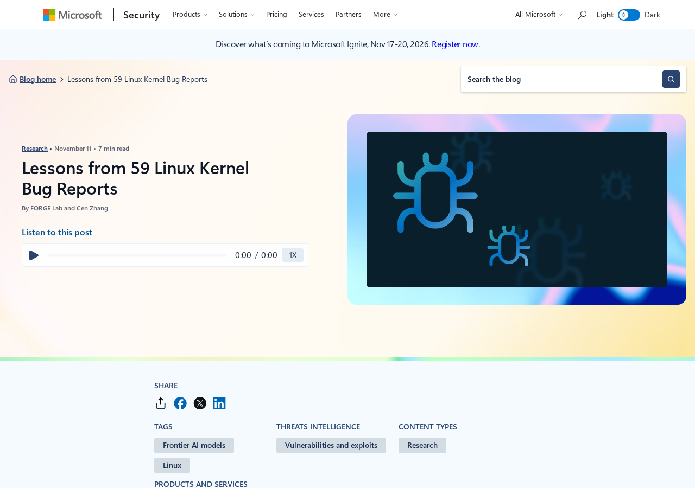

# Microsoft security digest: 9-15 November 2026 (IST), 2026-W46

Window: **2026-11-09 00:00 to 2026-11-15 23:59:59 IST (UTC+05:30)**. CVEs: the full November 2026 MSRC release (calendar month). Generated 2026-11-17T05:42:31+00:00.

## TL;DR

- **Securing AI agents moves to the front.** Most official output this week was about governing AI agents: Entra Agent ID, egress limits and traces in Foundry, Purview labels enforced on agents at runtime, Defender blocking malicious agent tool calls, MCP server governance, and a 19-part Zero Trust AI pillar video series, all ahead of Ignite (17-20 Nov).
- **Active campaigns: ScreenConnect/SCKit, GSocket, Storm-3350, outage-themed phishing.** Microsoft Threat Intelligence covered four live threats: SCKit spreading through ScreenConnect at MSPs, GSocket backdoors that keep access to Linux servers after patching, the Brazil-focused Storm-3350 cluster abusing password reset, and phishing that reused the 12 Nov M365 outage incident number.
- **AI model supply chain and AI-found vulnerabilities.** Microsoft research showed that models can be backdoored through a few neuron edits or poisoned fine-tuning, and that its own agentic tools (MDASH/Hyenas) found Rust standard-library and Linux kernel bugs, with 33 kernel CVEs assigned.
- **November Patch Tuesday: one exploited Outlook bug, 64 Critical.** The November release has 1,096 Microsoft-assigned CVEs. One is exploited (an Outlook spoofing flaw that leaks NTLM hashes), and the Critical RCEs in LDAP, Windows Search, Exchange and AD DS stand out. On Reddit, practitioners discussed the release and a separately published Windows zero-day, SignDrop.
- **Identity, data and endpoint hardening (Entra, Purview, Intune, Azure Backup).** Day-to-day controls also got attention: Entra Private Access and Internet Access in place of VPNs, tenant configuration snapshots, Connect Sync anchor migration, Purview classification and DSPM, Intune compliance with Autopatch, Edge extension control, and Azure Backup cyber recovery. Community threads covered passkey rollout and GSA tooling.

## Videos

| id | date (IST) | channel | title | views | summary | asset |
|---|---|---|---|---|---|---|
| v01 | 2026-11-09 21:35 | Microsoft Mechanics | [New Microsoft Copilot Harness \| More power, token efficiency & control for agents in Foundry](https://www.youtube.com/watch?v=4vCbQMUVV-I) | 28478 | Mechanics demo of the Copilot harness in Foundry, with per-agent Entra Agent ID, egress limits and traces. | [png](assets/yt-new-microsoft-copilot-harness-more-power-toke-4vcbqmuvv-i.png) |
| v02 | 2026-11-09 23:43 | Microsoft Security | [AI Pillar Deep Dive - Gain AI Visibility Swimlane Overview](https://www.youtube.com/watch?v=nflmD2D9T4k) | 364 | Zero Trust Workshop AI pillar walkthrough: how to gain visibility into AI usage. | [png](assets/yt-ai-pillar-deep-dive-gain-ai-visibility-swimla-nflmd2d9t4k.png) |
| v03 | 2026-11-09 23:45 | Microsoft Security | [AI Pillar Deep Dive - Registry Readiness Swimlane Overview](https://www.youtube.com/watch?v=B_Ecumz451U) | 797 | Zero Trust Workshop AI pillar walkthrough: preparing an agent registry. | [png](assets/yt-ai-pillar-deep-dive-registry-readiness-swimla-b_ecumz451u.png) |
| v04 | 2026-11-09 23:50 | Microsoft Security | [AI Pillar Deep Dive - Agent Registry Operations Swimlane Overview](https://www.youtube.com/watch?v=RkTaet71ZaU) | 402 | Zero Trust Workshop AI pillar walkthrough: running agent registry operations. | [png](assets/yt-ai-pillar-deep-dive-agent-registry-operations-rktaet71zau.png) |
| v05 | 2026-11-09 23:51 | Microsoft Security | [AI Pillar Deep Dive - Workload ID Migration to Agent ID Swimlane Overview](https://www.youtube.com/watch?v=P34pqLKWH88) | 415 | Zero Trust Workshop AI pillar walkthrough: moving workload identities to Entra Agent ID. | [png](assets/yt-ai-pillar-deep-dive-workload-id-migration-to-p34pqlkwh88.png) |
| v06 | 2026-11-09 23:52 | Microsoft Security | [AI Pillar Deep Dive - Access Swimlane Overview](https://www.youtube.com/watch?v=_Ja51-0LVy0) | 148 | Zero Trust Workshop AI pillar walkthrough: access controls for AI. | [png](assets/yt-ai-pillar-deep-dive-access-swimlane-overview-_ja51-0lvy0.png) |
| v07 | 2026-11-09 23:59 | Microsoft Security | [AI Pillar Deep Dive - Identity Governance Swimlane Overview](https://www.youtube.com/watch?v=oUBW4DYVnvA) | 248 | Zero Trust Workshop AI pillar walkthrough: identity governance for agents. | [png](assets/yt-ai-pillar-deep-dive-identity-governance-swiml-oubw4dyvnva.png) |
| v08 | 2026-11-10 00:01 | Microsoft Security | [AI Pillar Deep Dive - Network Security Readiness Swimlane Overview](https://www.youtube.com/watch?v=TrskCxNNgiE) | 460 | Zero Trust Workshop AI pillar walkthrough: network security readiness. | [png](assets/yt-ai-pillar-deep-dive-network-security-readines-trskcxnngie.png) |
| v09 | 2026-11-10 00:04 | Microsoft Security | [AI Pillar Deep Dive - Web & Destination Control Swimlane Overview](https://www.youtube.com/watch?v=TAO6uk2ksMU) | 388 | Zero Trust Workshop AI pillar walkthrough: controlling web destinations reached by AI. | [png](assets/yt-ai-pillar-deep-dive-web-destination-control-s-tao6uk2ksmu.png) |
| v10 | 2026-11-10 00:09 | Microsoft Security | [AI Pillar Deep Dive - Prompt & Content Protection Swimlane Overview](https://www.youtube.com/watch?v=9ZhoV8dzZBc) | 444 | Zero Trust Workshop AI pillar walkthrough: prompt and content protection. | [png](assets/yt-ai-pillar-deep-dive-prompt-content-protection-9zhov8dzzbc.png) |
| v11 | 2026-11-10 00:09 | Microsoft Security | [AI Pillar Deep Dive - Data Access Readiness Swimlane Overview](https://www.youtube.com/watch?v=tCgBYrQqI-8) | 200 | Zero Trust Workshop AI pillar walkthrough: readiness of data access for AI. | [png](assets/yt-ai-pillar-deep-dive-data-access-readiness-swi-tcgbyrqqi-8.png) |
| v12 | 2026-11-10 00:10 | Microsoft Security | [AI Pillar Deep Dive - AI Data Usage Monitoring Swimlane Overview](https://www.youtube.com/watch?v=6fKLT6O4NLE) | 209 | Zero Trust Workshop AI pillar walkthrough: monitoring how AI uses data. | [png](assets/yt-ai-pillar-deep-dive-ai-data-usage-monitoring-6fklt6o4nle.png) |
| v13 | 2026-11-10 00:14 | Microsoft Security | [AI Pillar Deep Dive - Data Loss Prevention Swimlane Overview](https://www.youtube.com/watch?v=CghlABVbgRY) | 153 | Zero Trust Workshop AI pillar walkthrough: data loss prevention for AI. | [png](assets/yt-ai-pillar-deep-dive-data-loss-prevention-swim-cghlabvbgry.png) |
| v14 | 2026-11-10 00:17 | Microsoft Security | [AI Pillar Deep Dive - Insider Risk Management Swimlane Overview](https://www.youtube.com/watch?v=g0aKWuu_ktY) | 628 | Zero Trust Workshop AI pillar walkthrough: insider risk management. | [png](assets/yt-ai-pillar-deep-dive-insider-risk-management-s-g0akwuu_kty.png) |
| v15 | 2026-11-10 00:24 | Microsoft Security | [AI Pillar Deep Dive - Agent Development Readiness Swimlane Overview](https://www.youtube.com/watch?v=8i4C3zs_a6Y) | 254 | Zero Trust Workshop AI pillar walkthrough: readiness for building agents. | [png](assets/yt-ai-pillar-deep-dive-agent-development-readine-8i4c3zs_a6y.png) |
| v16 | 2026-11-10 00:27 | Microsoft Security | [AI Pillar Deep Dive - MCP Server Governance Swimlane Overview](https://www.youtube.com/watch?v=JbYr5ijo9Hc) | 294 | Zero Trust Workshop AI pillar walkthrough: governing MCP servers. | [png](assets/yt-ai-pillar-deep-dive-mcp-server-governance-swi-jbyr5ijo9hc.png) |
| v17 | 2026-11-10 00:34 | Microsoft Security | [AI Pillar Deep Dive - Assess AI Risk Swimlane Overview](https://www.youtube.com/watch?v=wTVTWFVBV48) | 363 | Zero Trust Workshop AI pillar walkthrough: assessing AI risk. | [png](assets/yt-ai-pillar-deep-dive-assess-ai-risk-swimlane-o-wtvtwfvbv48.png) |
| v18 | 2026-11-10 00:35 | Microsoft Security | [AI Pillar Deep Dive - AI Threat Detection & Response Swimlane Overview](https://www.youtube.com/watch?v=E149ztL7OwY) | 580 | Zero Trust Workshop AI pillar walkthrough: detecting and responding to AI threats. | [png](assets/yt-ai-pillar-deep-dive-ai-threat-detection-respo-e149ztl7owy.png) |
| v19 | 2026-11-10 00:40 | Microsoft Security | [AI Pillar Deep Dive - Security Validation Swimlane Overview](https://www.youtube.com/watch?v=pZzzoluFlt0) | 901 | Zero Trust Workshop AI pillar walkthrough: validating security controls. | [png](assets/yt-ai-pillar-deep-dive-security-validation-swiml-pzzzoluflt0.png) |
| v20 | 2026-11-10 00:58 | Microsoft Security | [AI Pillar Deep Dive - Agent Platform Controls Swimlane Overview](https://www.youtube.com/watch?v=dJ_2CdPKxiA) | 465 | Zero Trust Workshop AI pillar walkthrough: controls on agent platforms. | [png](assets/yt-ai-pillar-deep-dive-agent-platform-controls-s-dj_2cdpkxia.png) |
| v21 | 2026-11-10 03:14 | Microsoft Security Community | [AI is changing how we think about access, and Ignite 2026 is where it all …](https://www.youtube.com/watch?v=dbPNIxHXYLU) | 281 | Short: Microsoft Security marketing VP previews Entra news planned for Ignite 2026. | [png](assets/yt-ai-is-changing-how-we-think-about-access-and-dbpnixhxylu.png) |
| v22 | 2026-11-11 03:50 | Microsoft Security Community | [⏱️ 3 sessions. 15 seconds each. Go!](https://www.youtube.com/watch?v=awUDlAhm7tM) | 378 | Short: Entra team previews three Ignite sessions on access for people and AI agents. | [png](assets/yt-3-sessions-15-seconds-each-go-awudlahm7tm.png) |
| v23 | 2026-11-11 22:00 | Microsoft Security | [English Security Update Release Summary November 2026](https://www.youtube.com/watch?v=mYwsmmb4MAI) | 1933 | MSRC monthly briefing on the November release, covering four CVEs including the exploited Outlook spoofing bug. | [png](assets/yt-english-security-update-release-summary-novem-mywsmmb4mai.png) |
| v24 | 2026-11-12 03:06 | Microsoft Security Community | [⏱️ Can you pitch an Ignite session in 15 seconds? We asked 3 experts.](https://www.youtube.com/watch?v=YQ2J5K5kljI) | 164 | Short: Entra team pitches more Ignite sessions, including finding and securing local agents. | [png](assets/yt-can-you-pitch-an-ignite-session-in-15-seconds-yq2j5k5klji.png) |
| v25 | 2026-11-12 23:30 | Microsoft Azure | [Bulk Restore using Azure Backup](https://www.youtube.com/watch?v=caW13LqRrQw) | 1084 | Demo of Azure Backup bulk restore, recovering many VMs in one job after an attack or disaster. | [png](assets/yt-bulk-restore-using-azure-backup-caw13lqrrqw.png) |
| v26 | 2026-11-13 01:30 | Microsoft Azure | [From backups to cyber recovery readiness with Azure Backup](https://www.youtube.com/watch?v=cKqeTw5mBfM) | 1861 | Demo of cyber recovery readiness with Azure Backup: air-gapped vaults, immutability and cross-tenant restore. | [png](assets/yt-from-backups-to-cyber-recovery-readiness-with-ckqetw5mbfm.png) |
| v27 | 2026-11-13 08:50 | Microsoft Security | [Security at Scale: How ABT Readied Its Clients for AI](https://www.youtube.com/watch?v=4Z1yruxmXVE) | 349 | Customer story: an Australian MSP put guardrails in place before its SMB clients adopted AI. | [png](assets/yt-security-at-scale-how-abt-readied-its-clients-4z1yruxmxve.png) |
| v28 | 2026-11-13 08:50 | Microsoft Security | [Securing Data Before Scaling AI: RWW Group](https://www.youtube.com/watch?v=vkEXYb2gdq4) | 388 | Customer story: a uniform supplier classified and protected its data ahead of an AI rollout. | [png](assets/yt-securing-data-before-scaling-ai-rww-group-vkexyb2gdq4.png) |
| v29 | 2026-11-13 08:50 | Microsoft Security | [Secure First, Then AI: RWW Group’s Growth Story with Alliance Business Technologies](https://www.youtube.com/watch?v=xvzmzbE58F4) | 463 | Customer story: RWW Group and its partner hardened identity, data and threat protection before using AI. | [png](assets/yt-secure-first-then-ai-rww-groups-growth-story-xvzmzbe58f4.png) |

Top 5 videos by views:

**v01: New Microsoft Copilot Harness \| More power, token efficiency & control for agents in Foundry**

**v23: English Security Update Release Summary November 2026**

**v26: From backups to cyber recovery readiness with Azure Backup**

**v25: Bulk Restore using Azure Backup**

**v19: AI Pillar Deep Dive - Security Validation Swimlane Overview**

## X

Official handles checked: @msftsecurity, @MsftSecIntel, @msftsecresponse, @Microsoft, @MSFTMechanics (all verified business accounts). @MicrosoftEntra does not exist on X (see Gaps). Only security-related posts are listed. Threat-intelligence posts from @MsftSecIntel appear under Threat intelligence instead. Reply notes are paraphrased, and repliers are not named.

### x01: @MSFTMechanics, 2026-11-09 00:49 IST

- Link: https://x.com/MSFTMechanics/status/2119510111542538498
- Summary: Treat the MCP catalog like a supply chain: deny unapproved tools and scope servers per agent via API Management.
- Engagement: 52 likes, 13 replies, 11 reposts, 1 quotes, 5477 views
- What replies say: Replies suggest an audit-mode week before deny-by-default, pinning MCP server versions and named owners per agent.
- Asset: null (x.com blocks headless capture of the direct post URL; see Gaps)

### x02: @MSFTMechanics, 2026-11-09 20:48 IST

- Link: https://x.com/MSFTMechanics/status/2119811910598087016
- Summary: Entra Internet Access Secure Web and AI Gateway stops sensitive file uploads to AI apps.
- Engagement: 3 likes, 0 replies, 2 reposts, 0 quotes, 1183 views
- What replies say: No replies.
- Asset: null (x.com blocks headless capture of the direct post URL; see Gaps)

### x03: @MSFTMechanics, 2026-11-09 21:51 IST

- Link: https://x.com/MSFTMechanics/status/2119827846906437909
- Summary: Foundry agents now run on the Copilot harness, with Entra Agent ID, egress rules and traces as guardrails.
- Engagement: 5 likes, 0 replies, 2 reposts, 0 quotes, 2146 views
- What replies say: No replies.
- Asset: null (x.com blocks headless capture of the direct post URL; see Gaps)

### x04: @MSFTMechanics, 2026-11-10 00:44 IST

- Link: https://x.com/MSFTMechanics/status/2119871294875296067
- Summary: Entra policies can automatically block uploads of risky file types to ChatGPT and similar tools.
- Engagement: 10 likes, 0 replies, 0 reposts, 0 quotes, 2145 views
- What replies say: No replies.
- Asset: null (x.com blocks headless capture of the direct post URL; see Gaps)

### x05: @MsftSecIntel, 2026-11-10 02:01 IST

- Link: https://x.com/MsftSecIntel/status/2119890522466578648
- Summary: FORGE Lab found memory-safety bugs in Rust core and std, including undefined behaviour reachable from safe code.
- Engagement: 125 likes, 5 replies, 25 reposts, 3 quotes, 13416 views
- What replies say: Replies discuss a bug fixed on one code path but missed on another and suggest checking pinned toolchains once fixes ship.
- Asset: null (x.com blocks headless capture of the direct post URL; see Gaps)

### x06: @MSFTMechanics, 2026-11-10 02:02 IST

- Link: https://x.com/MSFTMechanics/status/2119890883390656765
- Summary: Agent 365 CLI and SDK can give an unmanaged agent an Entra Agent ID with lifecycle controls.
- Engagement: 7 likes, 2 replies, 1 reposts, 1 quotes, 1438 views
- What replies say: One reply says an identity without an owner still leaves an orphaned agent.
- Asset: null (x.com blocks headless capture of the direct post URL; see Gaps)

### x07: @MSFTMechanics, 2026-11-10 19:14 IST

- Link: https://x.com/MSFTMechanics/status/2120150561169326576
- Summary: Extends Conditional Access and MFA to on-premises resources through Entra.
- Engagement: 3 likes, 0 replies, 2 reposts, 0 quotes, 1059 views
- What replies say: No replies.
- Asset: null (x.com blocks headless capture of the direct post URL; see Gaps)

### x08: @MSFTMechanics, 2026-11-10 20:47 IST

- Link: https://x.com/MSFTMechanics/status/2120174021295620514
- Summary: Foundry agents each get an Entra Agent ID, egress rules and action traces, enforced at infrastructure level.
- Engagement: 9 likes, 2 replies, 0 reposts, 0 quotes, 1301 views
- What replies say: Replies suggest assigning a human sponsor to each agent identity and warn that sub-agents may present a shared service account.
- Asset: null (x.com blocks headless capture of the direct post URL; see Gaps)

### x09: @MSFTMechanics, 2026-11-10 20:48 IST

- Link: https://x.com/MSFTMechanics/status/2120174308794192101
- Summary: Recommends unified data classification in Purview for consistent sensitive-data definitions.
- Engagement: 3 likes, 0 replies, 2 reposts, 0 quotes, 1045 views
- What replies say: No replies.
- Asset: null (x.com blocks headless capture of the direct post URL; see Gaps)

### x10: @msftsecresponse, 2026-11-10 23:51 IST

- Link: https://x.com/msftsecresponse/status/2120220395018318285
- Summary: MSRC announces the November 2026 Patch Tuesday release and links the Security Update Guide.
- Engagement: 185 likes, 3 replies, 40 reposts, 8 quotes, 26731 views
- What replies say: Three replies with no substantive content.
- Asset: null (x.com blocks headless capture of the direct post URL; see Gaps)

### x11: @MsftSecIntel, 2026-11-11 00:33 IST

- Link: https://x.com/MsftSecIntel/status/2120230988621992403
- Summary: Notes that the November 2026 security updates are out, with a link to the release.
- Engagement: 80 likes, 2 replies, 16 reposts, 0 quotes, 9623 views
- What replies say: Only two replies: one reminder to restart machines, one spam.
- Asset: null (x.com blocks headless capture of the direct post URL; see Gaps)

### x12: @MSFTMechanics, 2026-11-11 00:44 IST

- Link: https://x.com/MSFTMechanics/status/2120233636473471144
- Summary: Encourages labelling critical files so protection follows them into workflows and AI use.
- Engagement: 5 likes, 2 replies, 3 reposts, 0 quotes, 1571 views
- What replies say: One reply notes agent pipelines could still open labelled files they could not inspect.
- Asset: null (x.com blocks headless capture of the direct post URL; see Gaps)

### x13: @MSFTMechanics, 2026-11-11 02:02 IST

- Link: https://x.com/MSFTMechanics/status/2120253272686522585
- Summary: Purview DSPM shows which agents are active, what data they touch and where policy gaps are.
- Engagement: 5 likes, 0 replies, 1 reposts, 0 quotes, 1389 views
- What replies say: No replies.
- Asset: null (x.com blocks headless capture of the direct post URL; see Gaps)

### x14: @MsftSecIntel, 2026-11-11 05:06 IST

- Link: https://x.com/MsftSecIntel/status/2120299667443396688
- Summary: Microsoft Research showed that editing under ten neurons can make an agent model a hidden sleeper that passes evaluations.
- Engagement: 72 likes, 7 replies, 22 reposts, 5 quotes, 11346 views
- What replies say: Repliers recommend hashing model weights, restricting write access to checkpoints and treating third-party weights as untrusted.
- Asset: null (x.com blocks headless capture of the direct post URL; see Gaps)

### x15: @MSFTMechanics, 2026-11-11 19:14 IST

- Link: https://x.com/MSFTMechanics/status/2120513022783344816
- Summary: Shows how to set up Entra Private Access as identity-aware remote access without a VPN.
- Engagement: 8 likes, 0 replies, 4 reposts, 0 quotes, 1910 views
- What replies say: No replies.
- Asset: null (x.com blocks headless capture of the direct post URL; see Gaps)

### x16: @MSFTMechanics, 2026-11-11 20:48 IST

- Link: https://x.com/MSFTMechanics/status/2120536711096615334
- Summary: Introduces Purview Information Protection for finding and labelling sensitive data.
- Engagement: 2 likes, 0 replies, 1 reposts, 0 quotes, 999 views
- What replies say: No replies.
- Asset: null (x.com blocks headless capture of the direct post URL; see Gaps)

### x17: @MsftSecIntel, 2026-11-11 22:30 IST

- Link: https://x.com/MsftSecIntel/status/2120562349236965430
- Summary: FORGE Lab's MDASH scanning of Linux kernel code produced 59 upstream reports and 33 CVEs, with root exploits for eight.
- Engagement: 57 likes, 5 replies, 17 reposts, 5 quotes, 13753 views
- What replies say: Replies highlight the old average age of the bugs and suggest mapping the CVEs to running kernel versions and rebooting after fixes.
- Asset: null (x.com blocks headless capture of the direct post URL; see Gaps)

### x18: @MSFTMechanics, 2026-11-12 00:44 IST

- Link: https://x.com/MSFTMechanics/status/2120596035261075725
- Summary: Suggests layering Purview classification and labelling on top of existing DLP.
- Engagement: 3 likes, 0 replies, 2 reposts, 0 quotes, 1157 views
- What replies say: No replies.
- Asset: null (x.com blocks headless capture of the direct post URL; see Gaps)

### x19: @MSFTMechanics, 2026-11-12 02:02 IST

- Link: https://x.com/MSFTMechanics/status/2120615625135394986
- Summary: Purview sensitivity labels stop an agent at runtime when it reaches a labelled file.
- Engagement: 4 likes, 3 replies, 2 reposts, 0 quotes, 1362 views
- What replies say: Replies ask whether protection follows content the agent creates; one cites docs saying new output does not inherit the label.
- Asset: null (x.com blocks headless capture of the direct post URL; see Gaps)

### x20: @MSFTMechanics, 2026-11-12 19:14 IST

- Link: https://x.com/MSFTMechanics/status/2120875396430278759
- Summary: Pitches Entra identity-based access as a VPN replacement.
- Engagement: 2 likes, 0 replies, 1 reposts, 0 quotes, 957 views
- What replies say: No replies.
- Asset: null (x.com blocks headless capture of the direct post URL; see Gaps)

### x21: @MSFTMechanics, 2026-11-12 20:48 IST

- Link: https://x.com/MSFTMechanics/status/2120899056721416380
- Summary: Edge for Business lets admins block extensions by permission type and handle exceptions in the M365 admin center.
- Engagement: 6 likes, 2 replies, 3 reposts, 0 quotes, 1092 views
- What replies say: Replies call browser extensions an overlooked attack surface and favour allow-listing.
- Asset: null (x.com blocks headless capture of the direct post URL; see Gaps)

### x22: @MSFTMechanics, 2026-11-12 20:52 IST

- Link: https://x.com/MSFTMechanics/status/2120899960073859189
- Summary: Project Perception agents are pitched as finding, proving and fixing vulnerabilities with a human in control.
- Engagement: 1 likes, 0 replies, 1 reposts, 0 quotes, 1326 views
- What replies say: No replies.
- Asset: null (x.com blocks headless capture of the direct post URL; see Gaps)

### x23: @msftsecurity, 2026-11-12 22:30 IST

- Link: https://x.com/msftsecurity/status/2120924712427499805
- Summary: Promotes a CISO interview on how E.ON approaches securing agents with Microsoft Security.
- Engagement: 10 likes, 4 replies, 2 reposts, 1 quotes, 5733 views
- What replies say: Few replies; one says Microsoft should fix its own outage first, others are unrelated.
- Asset: null (x.com blocks headless capture of the direct post URL; see Gaps)

### x24: @MsftSecIntel, 2026-11-12 22:41 IST

- Link: https://x.com/MsftSecIntel/status/2120927480588484989
- Summary: Explains that a backdoored model can stay dormant until triggered and then drive an agent's tools, generalising past exact triggers.
- Engagement: 80 likes, 7 replies, 25 reposts, 4 quotes, 16817 views
- What replies say: Repliers argue controls must sit outside the model: log and gate every tool call, track model and dataset provenance and hashes.
- Asset: null (x.com blocks headless capture of the direct post URL; see Gaps)

### x25: @MSFTMechanics, 2026-11-13 02:02 IST

- Link: https://x.com/MSFTMechanics/status/2120978124678570166
- Summary: Defender watches Copilot Studio agents in real time, blocks malicious tool calls and alerts on jailbreak attempts.
- Engagement: 10 likes, 2 replies, 3 reposts, 1 quotes, 1847 views
- What replies say: Replies agree the tool call is the right enforcement point and ask who receives the alert.
- Asset: null (x.com blocks headless capture of the direct post URL; see Gaps)

### x26: @MSFTMechanics, 2026-11-13 07:48 IST

- Link: https://x.com/MSFTMechanics/status/2121065110898610541
- Summary: Foundry ties each agent to an Entra Agent ID, egress rules and logged traces that stop unapproved web calls.
- Engagement: 33 likes, 4 replies, 4 reposts, 0 quotes, 2227 views
- What replies say: Replies mostly approve; one asks whether agents fail closed if Entra is unreachable.
- Asset: null (x.com blocks headless capture of the direct post URL; see Gaps)

### x27: @MSFTMechanics, 2026-11-13 19:14 IST

- Link: https://x.com/MSFTMechanics/status/2121237741862101481
- Summary: Windows 365 output protection blocks screenshots and screen scraping on policy-protected Cloud PCs.
- Engagement: 35 likes, 1 replies, 3 reposts, 0 quotes, 2196 views
- What replies say: One reply asks what an automated agent sees when it hits a protected window.
- Asset: null (x.com blocks headless capture of the direct post URL; see Gaps)

### x28: @MSFTMechanics, 2026-11-13 20:47 IST

- Link: https://x.com/MSFTMechanics/status/2121261204937089459
- Summary: Hosted agents in Foundry can run any harness under the same Entra Agent ID, telemetry and guardrails.
- Engagement: 28 likes, 1 replies, 2 reposts, 0 quotes, 1855 views
- What replies say: One reply says built-in identity and guardrails would have saved time spent managing agent permissions.
- Asset: null (x.com blocks headless capture of the direct post URL; see Gaps)

### x29: @MSFTMechanics, 2026-11-13 20:48 IST

- Link: https://x.com/MSFTMechanics/status/2121261399552712889
- Summary: Windows Autopatch report in Intune shows which devices are current, missing updates or at risk.
- Engagement: 7 likes, 0 replies, 3 reposts, 0 quotes, 1916 views
- What replies say: No replies.
- Asset: null (x.com blocks headless capture of the direct post URL; see Gaps)

### x30: @MSFTMechanics, 2026-11-14 00:44 IST

- Link: https://x.com/MSFTMechanics/status/2121320766264295729
- Summary: Intune Conditional Access limits internal access to compliant devices, paired with Windows Autopatch.
- Engagement: 0 likes, 0 replies, 0 reposts, 0 quotes, 1074 views
- What replies say: No replies.
- Asset: null (x.com blocks headless capture of the direct post URL; see Gaps)

### x31: @MSFTMechanics, 2026-11-14 02:02 IST

- Link: https://x.com/MSFTMechanics/status/2121340430075793874
- Summary: Admins can block a risky agent from the Agent Registry in the M365 admin center until it is resubmitted.
- Engagement: 9 likes, 3 replies, 0 reposts, 0 quotes, 1439 views
- What replies say: Replies back an admin-held kill switch and ask whether makers are told why and how the incident trail shows prior actions.
- Asset: null (x.com blocks headless capture of the direct post URL; see Gaps)

### x32: @MSFTMechanics, 2026-11-14 19:14 IST

- Link: https://x.com/MSFTMechanics/status/2121600175986585964
- Summary: Configuration Snapshots in Entra Tenant Governance baseline settings across 200+ resource types to catch drift.
- Engagement: 9 likes, 0 replies, 2 reposts, 0 quotes, 1666 views
- What replies say: No replies.
- Asset: null (x.com blocks headless capture of the direct post URL; see Gaps)

### x33: @MSFTMechanics, 2026-11-15 00:49 IST

- Link: https://x.com/MSFTMechanics/status/2121684426455134224
- Summary: Purview Communication Compliance can flag agent behaviour; Agent 365 can block agent access to labelled files.
- Engagement: 7 likes, 2 replies, 2 reposts, 0 quotes, 1768 views
- What replies say: Two replies say runtime blocking matters more than flagging after the fact.
- Asset: null (x.com blocks headless capture of the direct post URL; see Gaps)

### x34: @MSFTMechanics, 2026-11-15 09:32 IST

- Link: https://x.com/MSFTMechanics/status/2121816060680626292
- Summary: Defender for Cloud can open a GitHub issue for a container CVE fix and sync the resolution back.
- Engagement: 8 likes, 0 replies, 2 reposts, 0 quotes, 2318 views
- What replies say: No replies.
- Asset: null (x.com blocks headless capture of the direct post URL; see Gaps)

### x35: @MSFTMechanics, 2026-11-15 19:14 IST

- Link: https://x.com/MSFTMechanics/status/2121962580998602892
- Summary: Defender for Cloud groups 19 container alerts from one multi-stage attack into a single incident timeline.
- Engagement: 6 likes, 0 replies, 2 reposts, 0 quotes, 1280 views
- What replies say: No replies.
- Asset: null (x.com blocks headless capture of the direct post URL; see Gaps)

## CVEs this month

Source: MSRC CVRF `2026-Nov` (https://api.msrc.microsoft.com/cvrf/v3.0/cvrf/2026-Nov), released 2026-11-10. Listed: 1096 CVEs assigned by Microsoft as CNA (64 Critical, 1 exploited, 0 publicly disclosed). The same document also carries 548 third-party CVEs (Chromium/Edge 291, Azure Linux/Mariner and other open-source CNAs 257), which are not listed here (see Gaps). Sorted by CVSS, highest first. A CVSS of null means MSRC published no score.

| CVE | title | product | CVSS | severity | exploited | disclosed | link |
|---|---|---|---|---|---|---|---|
| CVE-2026-109469 | Entra Device Registration Elevation of Privilege Vulnerability | Entra Device Registration | 10.0 | Critical | no | no | [MSRC](https://msrc.microsoft.com/update-guide/vulnerability/CVE-2026-109469) |
| CVE-2026-109467 | Azure DevOps Server Remote Code Execution Vulnerability | Azure DevOps | 9.9 | Important | no | no | [MSRC](https://msrc.microsoft.com/update-guide/vulnerability/CVE-2026-109467) |
| CVE-2026-120002 | Microsoft SharePoint Server Elevation of Privilege Vulnerability | Microsoft Office SharePoint | 9.9 | Important | no | no | [MSRC](https://msrc.microsoft.com/update-guide/vulnerability/CVE-2026-120002) |
| CVE-2026-112967 | Windows Xbox Live Networking Service Remote Code Execution Vulnerability | Windows Xbox Live Networking Service | 9.8 | Critical | no | no | [MSRC](https://msrc.microsoft.com/update-guide/vulnerability/CVE-2026-112967) |
| CVE-2026-116928 | Windows Search Remote Code Execution Vulnerability | Microsoft Windows Search Component | 9.8 | Critical | no | no | [MSRC](https://msrc.microsoft.com/update-guide/vulnerability/CVE-2026-116928) |
| CVE-2026-116945 | Microsoft SQL Server Remote Code Execution Vulnerability | SQL Server | 9.8 | Important | no | no | [MSRC](https://msrc.microsoft.com/update-guide/vulnerability/CVE-2026-116945) |
| CVE-2026-119958 | Windows LDAP - Lightweight Directory Access Protocol Remote Code Execution Vulnerability | Windows LDAP - Lightweight Directory Access Protocol | 9.8 | Critical | no | no | [MSRC](https://msrc.microsoft.com/update-guide/vulnerability/CVE-2026-119958) |
| CVE-2026-119990 | Azure OpenAI Elevation of Privilege Vulnerability | Azure OpenAI | 9.8 | Critical | no | no | [MSRC](https://msrc.microsoft.com/update-guide/vulnerability/CVE-2026-119990) |
| CVE-2026-85844 | Windows Kerberos Elevation of Privilege Vulnerability | Windows Kerberos | 9.8 | Important | no | no | [MSRC](https://msrc.microsoft.com/update-guide/vulnerability/CVE-2026-85844) |
| CVE-2026-88218 | Windows DNS Remote Code Execution Vulnerability | Windows DNS | 9.8 | Important | no | no | [MSRC](https://msrc.microsoft.com/update-guide/vulnerability/CVE-2026-88218) |
| CVE-2026-88234 | Windows iSCSI Remote Code Execution Vulnerability | Windows iSCSI | 9.8 | Important | no | no | [MSRC](https://msrc.microsoft.com/update-guide/vulnerability/CVE-2026-88234) |
| CVE-2026-88243 | Windows DHCP Server Remote Code Execution Vulnerability | Windows DHCP Server | 9.8 | Important | no | no | [MSRC](https://msrc.microsoft.com/update-guide/vulnerability/CVE-2026-88243) |
| CVE-2026-95882 | Microsoft DirectMusic Remote Code Execution Vulnerability | Windows Microsoft DirectMusic | 9.8 | Important | no | no | [MSRC](https://msrc.microsoft.com/update-guide/vulnerability/CVE-2026-95882) |
| CVE-2026-95901 | Microsoft DirectMusic Remote Code Execution Vulnerability | Windows Microsoft DirectMusic | 9.8 | Important | no | no | [MSRC](https://msrc.microsoft.com/update-guide/vulnerability/CVE-2026-95901) |
| CVE-2026-96067 | Microsoft Color Management Remote Code Execution Vulnerability | Microsoft Color Management | 9.8 | Important | no | no | [MSRC](https://msrc.microsoft.com/update-guide/vulnerability/CVE-2026-96067) |
| CVE-2026-96078 | Microsoft Color Management Remote Code Execution Vulnerability | Microsoft Color Management | 9.8 | Important | no | no | [MSRC](https://msrc.microsoft.com/update-guide/vulnerability/CVE-2026-96078) |
| CVE-2026-96157 | Microsoft Windows Media Foundation Remote Code Execution Vulnerability | Microsoft Windows Media Foundation | 9.8 | Important | no | no | [MSRC](https://msrc.microsoft.com/update-guide/vulnerability/CVE-2026-96157) |
| CVE-2026-120779 | Visual Studio Code Remote Code Execution Vulnerability | Visual Studio Code | 9.6 | Important | no | no | [MSRC](https://msrc.microsoft.com/update-guide/vulnerability/CVE-2026-120779) |
| CVE-2026-114162 | Microsoft Graph Elevation of Privilege Vulnerability | Microsoft Graph | 9.1 | Important | no | no | [MSRC](https://msrc.microsoft.com/update-guide/vulnerability/CVE-2026-114162) |
| CVE-2026-118740 | Aspire Security Feature Bypass Vulnerability | Aspire | 9.1 | Important | no | no | [MSRC](https://msrc.microsoft.com/update-guide/vulnerability/CVE-2026-118740) |
| CVE-2026-109454 | Microsoft Office SharePoint Spoofing Vulnerability | Microsoft Office SharePoint | 9.0 | Important | no | no | [MSRC](https://msrc.microsoft.com/update-guide/vulnerability/CVE-2026-109454) |
| CVE-2026-114146 | ASP.NET Core Elevation of Privilege Vulnerability | ASP.NET Core | 9.0 | Important | no | no | [MSRC](https://msrc.microsoft.com/update-guide/vulnerability/CVE-2026-114146) |
| CVE-2026-80095 | Microsoft Office SharePoint Elevation of Privilege Vulnerability | Microsoft Office SharePoint | 9.0 | Important | no | no | [MSRC](https://msrc.microsoft.com/update-guide/vulnerability/CVE-2026-80095) |
| CVE-2026-95962 | Windows Virtual Filtering Platform (VFP) Remote Code Execution Vulnerability | Windows Virtual Filtering Platform (VFP) | 9.0 | Important | no | no | [MSRC](https://msrc.microsoft.com/update-guide/vulnerability/CVE-2026-95962) |
| CVE-2026-105020 | Windows Advanced Rasterization Platform Elevation of Privilege Vulnerability | Windows Advanced Rasterization Platform | 8.8 | Important | no | no | [MSRC](https://msrc.microsoft.com/update-guide/vulnerability/CVE-2026-105020) |
| CVE-2026-105021 | Windows Advanced Rasterization Platform Elevation of Privilege Vulnerability | Windows Advanced Rasterization Platform | 8.8 | Important | no | no | [MSRC](https://msrc.microsoft.com/update-guide/vulnerability/CVE-2026-105021) |
| CVE-2026-105023 | Windows Advanced Rasterization Platform Elevation of Privilege Vulnerability | Windows Advanced Rasterization Platform | 8.8 | Important | no | no | [MSRC](https://msrc.microsoft.com/update-guide/vulnerability/CVE-2026-105023) |
| CVE-2026-105026 | Windows Advanced Rasterization Platform Elevation of Privilege Vulnerability | Windows Advanced Rasterization Platform | 8.8 | Important | no | no | [MSRC](https://msrc.microsoft.com/update-guide/vulnerability/CVE-2026-105026) |
| CVE-2026-105490 | Windows Advanced Rasterization Platform Elevation of Privilege Vulnerability | Windows Advanced Rasterization Platform | 8.8 | Important | no | no | [MSRC](https://msrc.microsoft.com/update-guide/vulnerability/CVE-2026-105490) |
| CVE-2026-105491 | Windows Advanced Rasterization Platform Elevation of Privilege Vulnerability | Windows Advanced Rasterization Platform | 8.8 | Important | no | no | [MSRC](https://msrc.microsoft.com/update-guide/vulnerability/CVE-2026-105491) |
| CVE-2026-105493 | Windows Advanced Rasterization Platform Elevation of Privilege Vulnerability | Windows Advanced Rasterization Platform | 8.8 | Important | no | no | [MSRC](https://msrc.microsoft.com/update-guide/vulnerability/CVE-2026-105493) |
| CVE-2026-105495 | Windows Advanced Rasterization Platform Elevation of Privilege Vulnerability | Windows Advanced Rasterization Platform | 8.8 | Important | no | no | [MSRC](https://msrc.microsoft.com/update-guide/vulnerability/CVE-2026-105495) |
| CVE-2026-105496 | Windows Advanced Rasterization Platform Elevation of Privilege Vulnerability | Windows Advanced Rasterization Platform | 8.8 | Important | no | no | [MSRC](https://msrc.microsoft.com/update-guide/vulnerability/CVE-2026-105496) |
| CVE-2026-105497 | Windows Advanced Rasterization Platform Elevation of Privilege Vulnerability | Windows Advanced Rasterization Platform | 8.8 | Important | no | no | [MSRC](https://msrc.microsoft.com/update-guide/vulnerability/CVE-2026-105497) |
| CVE-2026-105498 | Windows Advanced Rasterization Platform Elevation of Privilege Vulnerability | Windows Advanced Rasterization Platform | 8.8 | Important | no | no | [MSRC](https://msrc.microsoft.com/update-guide/vulnerability/CVE-2026-105498) |
| CVE-2026-105499 | Windows Advanced Rasterization Platform Elevation of Privilege Vulnerability | Windows Advanced Rasterization Platform | 8.8 | Important | no | no | [MSRC](https://msrc.microsoft.com/update-guide/vulnerability/CVE-2026-105499) |
| CVE-2026-105518 | Windows iSCSI Remote Code Execution Vulnerability | Windows iSCSI | 8.8 | Important | no | no | [MSRC](https://msrc.microsoft.com/update-guide/vulnerability/CVE-2026-105518) |
| CVE-2026-105534 | Windows Storage Remote Code Execution Vulnerability | Windows Storage | 8.8 | Important | no | no | [MSRC](https://msrc.microsoft.com/update-guide/vulnerability/CVE-2026-105534) |
| CVE-2026-105542 | Windows NTFS Remote Code Execution Vulnerability | Windows NTFS | 8.8 | Important | no | no | [MSRC](https://msrc.microsoft.com/update-guide/vulnerability/CVE-2026-105542) |
| CVE-2026-105581 | Desktop Window Manager Elevation of Privilege Vulnerability | Desktop Window Manager | 8.8 | Important | no | no | [MSRC](https://msrc.microsoft.com/update-guide/vulnerability/CVE-2026-105581) |
| CVE-2026-108401 | Remote Desktop Services Remote Code Execution Vulnerability | Windows Remote Desktop Services | 8.8 | Important | no | no | [MSRC](https://msrc.microsoft.com/update-guide/vulnerability/CVE-2026-108401) |
| CVE-2026-108411 | Microsoft ODBC Driver Remote Code Execution Vulnerability | Windows ODBC Driver | 8.8 | Important | no | no | [MSRC](https://msrc.microsoft.com/update-guide/vulnerability/CVE-2026-108411) |
| CVE-2026-109463 | Windows DNS Remote Code Execution Vulnerability | Windows DNS | 8.8 | Important | no | no | [MSRC](https://msrc.microsoft.com/update-guide/vulnerability/CVE-2026-109463) |
| CVE-2026-109464 | Microsoft Office SharePoint Remote Code Execution Vulnerability | Microsoft Office SharePoint | 8.8 | Important | no | no | [MSRC](https://msrc.microsoft.com/update-guide/vulnerability/CVE-2026-109464) |
| CVE-2026-109472 | Microsoft Office SharePoint Remote Code Execution Vulnerability | Microsoft Office SharePoint | 8.8 | Important | no | no | [MSRC](https://msrc.microsoft.com/update-guide/vulnerability/CVE-2026-109472) |
| CVE-2026-109493 | Microsoft Office Access Remote Code Execution Vulnerability | Microsoft Office Access | 8.8 | Important | no | no | [MSRC](https://msrc.microsoft.com/update-guide/vulnerability/CVE-2026-109493) |
| CVE-2026-109494 | Microsoft Office Visio Remote Code Execution Vulnerability | Microsoft Office Visio | 8.8 | Important | no | no | [MSRC](https://msrc.microsoft.com/update-guide/vulnerability/CVE-2026-109494) |
| CVE-2026-109496 | Microsoft Office Visio Remote Code Execution Vulnerability | Microsoft Office Visio | 8.8 | Important | no | no | [MSRC](https://msrc.microsoft.com/update-guide/vulnerability/CVE-2026-109496) |
| CVE-2026-109499 | Microsoft Office SharePoint Remote Code Execution Vulnerability | Microsoft Office SharePoint | 8.8 | Important | no | no | [MSRC](https://msrc.microsoft.com/update-guide/vulnerability/CVE-2026-109499) |
| CVE-2026-109501 | Microsoft Office Word Remote Code Execution Vulnerability | Microsoft Office Word | 8.8 | Important | no | no | [MSRC](https://msrc.microsoft.com/update-guide/vulnerability/CVE-2026-109501) |
| CVE-2026-109502 | Microsoft Office SharePoint Elevation of Privilege Vulnerability | Microsoft Office SharePoint | 8.8 | Important | no | no | [MSRC](https://msrc.microsoft.com/update-guide/vulnerability/CVE-2026-109502) |
| CVE-2026-109503 | Microsoft Office Word Remote Code Execution Vulnerability | Microsoft Office Word | 8.8 | Important | no | no | [MSRC](https://msrc.microsoft.com/update-guide/vulnerability/CVE-2026-109503) |
| CVE-2026-109505 | Microsoft Office Word Remote Code Execution Vulnerability | Microsoft Office Word | 8.8 | Important | no | no | [MSRC](https://msrc.microsoft.com/update-guide/vulnerability/CVE-2026-109505) |
| CVE-2026-110043 | Microsoft Office Outlook Remote Code Execution Vulnerability | Microsoft Office Outlook | 8.8 | Critical | no | no | [MSRC](https://msrc.microsoft.com/update-guide/vulnerability/CVE-2026-110043) |
| CVE-2026-110044 | Microsoft Office SharePoint Remote Code Execution Vulnerability | Microsoft Office SharePoint | 8.8 | Important | no | no | [MSRC](https://msrc.microsoft.com/update-guide/vulnerability/CVE-2026-110044) |
| CVE-2026-110047 | Microsoft Office Word Remote Code Execution Vulnerability | Microsoft Office Word | 8.8 | Critical | no | no | [MSRC](https://msrc.microsoft.com/update-guide/vulnerability/CVE-2026-110047) |
| CVE-2026-110048 | Microsoft Word Remote Code Execution Vulnerability | Microsoft Office Word | 8.8 | Important | no | no | [MSRC](https://msrc.microsoft.com/update-guide/vulnerability/CVE-2026-110048) |
| CVE-2026-110050 | Microsoft Office Word Remote Code Execution Vulnerability | Microsoft Office Word | 8.8 | Important | no | no | [MSRC](https://msrc.microsoft.com/update-guide/vulnerability/CVE-2026-110050) |
| CVE-2026-110054 | Microsoft Office Word Remote Code Execution Vulnerability | Microsoft Office Word | 8.8 | Important | no | no | [MSRC](https://msrc.microsoft.com/update-guide/vulnerability/CVE-2026-110054) |
| CVE-2026-110055 | Microsoft Word Remote Code Execution Vulnerability | Microsoft Office Word | 8.8 | Important | no | no | [MSRC](https://msrc.microsoft.com/update-guide/vulnerability/CVE-2026-110055) |
| CVE-2026-110058 | Microsoft Office Access Remote Code Execution Vulnerability | Microsoft Office Access | 8.8 | Important | no | no | [MSRC](https://msrc.microsoft.com/update-guide/vulnerability/CVE-2026-110058) |
| CVE-2026-110059 | Microsoft Office Access Remote Code Execution Vulnerability | Microsoft Office Access | 8.8 | Important | no | no | [MSRC](https://msrc.microsoft.com/update-guide/vulnerability/CVE-2026-110059) |
| CVE-2026-110060 | Microsoft Office Access Remote Code Execution Vulnerability | Microsoft Office Access | 8.8 | Important | no | no | [MSRC](https://msrc.microsoft.com/update-guide/vulnerability/CVE-2026-110060) |
| CVE-2026-110061 | Microsoft Office Word Remote Code Execution Vulnerability | Microsoft Office Word | 8.8 | Important | no | no | [MSRC](https://msrc.microsoft.com/update-guide/vulnerability/CVE-2026-110061) |
| CVE-2026-110062 | Microsoft Office Word Remote Code Execution Vulnerability | Microsoft Office Word | 8.8 | Important | no | no | [MSRC](https://msrc.microsoft.com/update-guide/vulnerability/CVE-2026-110062) |
| CVE-2026-110064 | Microsoft Office Word Remote Code Execution Vulnerability | Microsoft Office Word | 8.8 | Important | no | no | [MSRC](https://msrc.microsoft.com/update-guide/vulnerability/CVE-2026-110064) |
| CVE-2026-110067 | Microsoft Office Word Remote Code Execution Vulnerability | Microsoft Office Word | 8.8 | Critical | no | no | [MSRC](https://msrc.microsoft.com/update-guide/vulnerability/CVE-2026-110067) |
| CVE-2026-110068 | Microsoft Office Outlook Remote Code Execution Vulnerability | Microsoft Office Outlook | 8.8 | Critical | no | no | [MSRC](https://msrc.microsoft.com/update-guide/vulnerability/CVE-2026-110068) |
| CVE-2026-111285 | Microsoft Office Word Remote Code Execution Vulnerability | Microsoft Office Word | 8.8 | Critical | no | no | [MSRC](https://msrc.microsoft.com/update-guide/vulnerability/CVE-2026-111285) |
| CVE-2026-111289 | Microsoft Office Remote Code Execution Vulnerability | Microsoft Office | 8.8 | Critical | no | no | [MSRC](https://msrc.microsoft.com/update-guide/vulnerability/CVE-2026-111289) |
| CVE-2026-111290 | Microsoft Office Word Remote Code Execution Vulnerability | Microsoft Office Word | 8.8 | Important | no | no | [MSRC](https://msrc.microsoft.com/update-guide/vulnerability/CVE-2026-111290) |
| CVE-2026-111294 | Microsoft Office Word Remote Code Execution Vulnerability | Microsoft Office Word | 8.8 | Important | no | no | [MSRC](https://msrc.microsoft.com/update-guide/vulnerability/CVE-2026-111294) |
| CVE-2026-111295 | Microsoft Office Word Remote Code Execution Vulnerability | Microsoft Office Word | 8.8 | Important | no | no | [MSRC](https://msrc.microsoft.com/update-guide/vulnerability/CVE-2026-111295) |
| CVE-2026-111298 | Microsoft Office Word Remote Code Execution Vulnerability | Microsoft Office Word | 8.8 | Important | no | no | [MSRC](https://msrc.microsoft.com/update-guide/vulnerability/CVE-2026-111298) |
| CVE-2026-111299 | Microsoft Office Word Remote Code Execution Vulnerability | Microsoft Office Word | 8.8 | Important | no | no | [MSRC](https://msrc.microsoft.com/update-guide/vulnerability/CVE-2026-111299) |
| CVE-2026-111301 | Microsoft Office Access Remote Code Execution Vulnerability | Microsoft Office Access | 8.8 | Important | no | no | [MSRC](https://msrc.microsoft.com/update-guide/vulnerability/CVE-2026-111301) |
| CVE-2026-111304 | Microsoft Office Word Remote Code Execution Vulnerability | Microsoft Office Word | 8.8 | Important | no | no | [MSRC](https://msrc.microsoft.com/update-guide/vulnerability/CVE-2026-111304) |
| CVE-2026-111305 | Microsoft Office Access Remote Code Execution Vulnerability | Microsoft Office Access | 8.8 | Important | no | no | [MSRC](https://msrc.microsoft.com/update-guide/vulnerability/CVE-2026-111305) |
| CVE-2026-111306 | Microsoft Office Word Remote Code Execution Vulnerability | Microsoft Office Word | 8.8 | Important | no | no | [MSRC](https://msrc.microsoft.com/update-guide/vulnerability/CVE-2026-111306) |
| CVE-2026-111307 | Microsoft Office Word Remote Code Execution Vulnerability | Microsoft Office Word | 8.8 | Important | no | no | [MSRC](https://msrc.microsoft.com/update-guide/vulnerability/CVE-2026-111307) |
| CVE-2026-111308 | Microsoft Office Word Remote Code Execution Vulnerability | Microsoft Office Word | 8.8 | Important | no | no | [MSRC](https://msrc.microsoft.com/update-guide/vulnerability/CVE-2026-111308) |
| CVE-2026-111309 | Microsoft Office Outlook Remote Code Execution Vulnerability | Microsoft Office Outlook | 8.8 | Critical | no | no | [MSRC](https://msrc.microsoft.com/update-guide/vulnerability/CVE-2026-111309) |
| CVE-2026-111310 | Microsoft Office Word Remote Code Execution Vulnerability | Microsoft Office Word | 8.8 | Important | no | no | [MSRC](https://msrc.microsoft.com/update-guide/vulnerability/CVE-2026-111310) |
| CVE-2026-112714 | Microsoft Office Word Remote Code Execution Vulnerability | Microsoft Office Word | 8.8 | Important | no | no | [MSRC](https://msrc.microsoft.com/update-guide/vulnerability/CVE-2026-112714) |
| CVE-2026-112715 | Microsoft Office Word Remote Code Execution Vulnerability | Microsoft Office Word | 8.8 | Important | no | no | [MSRC](https://msrc.microsoft.com/update-guide/vulnerability/CVE-2026-112715) |
| CVE-2026-112716 | Microsoft Office Word Remote Code Execution Vulnerability | Microsoft Office Word | 8.8 | Important | no | no | [MSRC](https://msrc.microsoft.com/update-guide/vulnerability/CVE-2026-112716) |
| CVE-2026-112717 | Microsoft Office Word Remote Code Execution Vulnerability | Microsoft Office Word | 8.8 | Important | no | no | [MSRC](https://msrc.microsoft.com/update-guide/vulnerability/CVE-2026-112717) |
| CVE-2026-112718 | Microsoft Office Word Remote Code Execution Vulnerability | Microsoft Office Word | 8.8 | Important | no | no | [MSRC](https://msrc.microsoft.com/update-guide/vulnerability/CVE-2026-112718) |
| CVE-2026-112719 | Microsoft Office Word Remote Code Execution Vulnerability | Microsoft Office Word | 8.8 | Important | no | no | [MSRC](https://msrc.microsoft.com/update-guide/vulnerability/CVE-2026-112719) |
| CVE-2026-112721 | Microsoft Office Word Remote Code Execution Vulnerability | Microsoft Office Word | 8.8 | Important | no | no | [MSRC](https://msrc.microsoft.com/update-guide/vulnerability/CVE-2026-112721) |
| CVE-2026-112722 | Microsoft Office Word Remote Code Execution Vulnerability | Microsoft Office Word | 8.8 | Important | no | no | [MSRC](https://msrc.microsoft.com/update-guide/vulnerability/CVE-2026-112722) |
| CVE-2026-112723 | Microsoft Office Word Remote Code Execution Vulnerability | Microsoft Office Word | 8.8 | Important | no | no | [MSRC](https://msrc.microsoft.com/update-guide/vulnerability/CVE-2026-112723) |
| CVE-2026-112724 | Microsoft Office Word Remote Code Execution Vulnerability | Microsoft Office Word | 8.8 | Important | no | no | [MSRC](https://msrc.microsoft.com/update-guide/vulnerability/CVE-2026-112724) |
| CVE-2026-112726 | Microsoft Office Word Remote Code Execution Vulnerability | Microsoft Office Word | 8.8 | Important | no | no | [MSRC](https://msrc.microsoft.com/update-guide/vulnerability/CVE-2026-112726) |
| CVE-2026-112727 | Windows  Domain Name Service Remote Code Execution Vulnerability | Role: DNS Server | 8.8 | Important | no | no | [MSRC](https://msrc.microsoft.com/update-guide/vulnerability/CVE-2026-112727) |
| CVE-2026-112728 | Microsoft Office Word Remote Code Execution Vulnerability | Microsoft Office Word | 8.8 | Important | no | no | [MSRC](https://msrc.microsoft.com/update-guide/vulnerability/CVE-2026-112728) |
| CVE-2026-112729 | Microsoft Office Word Remote Code Execution Vulnerability | Microsoft Office Word | 8.8 | Important | no | no | [MSRC](https://msrc.microsoft.com/update-guide/vulnerability/CVE-2026-112729) |
| CVE-2026-112730 | Microsoft Office Word Remote Code Execution Vulnerability | Microsoft Office Word | 8.8 | Important | no | no | [MSRC](https://msrc.microsoft.com/update-guide/vulnerability/CVE-2026-112730) |
| CVE-2026-112733 | Microsoft Office Word Remote Code Execution Vulnerability | Microsoft Office Word | 8.8 | Important | no | no | [MSRC](https://msrc.microsoft.com/update-guide/vulnerability/CVE-2026-112733) |
| CVE-2026-112734 | Microsoft Office PowerPoint Remote Code Execution Vulnerability | Microsoft Office PowerPoint | 8.8 | Important | no | no | [MSRC](https://msrc.microsoft.com/update-guide/vulnerability/CVE-2026-112734) |
| CVE-2026-112735 | Microsoft Office Word Remote Code Execution Vulnerability | Microsoft Office Word | 8.8 | Important | no | no | [MSRC](https://msrc.microsoft.com/update-guide/vulnerability/CVE-2026-112735) |
| CVE-2026-112737 | Microsoft Office PowerPoint Remote Code Execution Vulnerability | Microsoft Office PowerPoint | 8.8 | Important | no | no | [MSRC](https://msrc.microsoft.com/update-guide/vulnerability/CVE-2026-112737) |
| CVE-2026-112739 | Microsoft Office Word Remote Code Execution Vulnerability | Microsoft Office Word | 8.8 | Important | no | no | [MSRC](https://msrc.microsoft.com/update-guide/vulnerability/CVE-2026-112739) |
| CVE-2026-112741 | Microsoft Office Word Remote Code Execution Vulnerability | Microsoft Office Word | 8.8 | Important | no | no | [MSRC](https://msrc.microsoft.com/update-guide/vulnerability/CVE-2026-112741) |
| CVE-2026-112762 | Windows Print Spooler Components Elevation of Privilege Vulnerability | Windows Print Spooler Components | 8.8 | Important | no | no | [MSRC](https://msrc.microsoft.com/update-guide/vulnerability/CVE-2026-112762) |
| CVE-2026-112805 | Windows Kernel Elevation of Privilege Vulnerability | Windows Kernel | 8.8 | Important | no | no | [MSRC](https://msrc.microsoft.com/update-guide/vulnerability/CVE-2026-112805) |
| CVE-2026-113760 | Windows XWizard Framework Elevation of Privilege Vulnerability | Windows XWizard Framework | 8.8 | Important | no | no | [MSRC](https://msrc.microsoft.com/update-guide/vulnerability/CVE-2026-113760) |
| CVE-2026-113814 | Windows Storage Spaces Controller Remote Code Execution Vulnerability | Windows Storage Spaces Controller | 8.8 | Important | no | no | [MSRC](https://msrc.microsoft.com/update-guide/vulnerability/CVE-2026-113814) |
| CVE-2026-113863 | Windows DHCP Client Elevation of Privilege Vulnerability | Windows DHCP Client | 8.8 | Important | no | no | [MSRC](https://msrc.microsoft.com/update-guide/vulnerability/CVE-2026-113863) |
| CVE-2026-114151 | Visual Studio Remote Code Execution Vulnerability | Visual Studio | 8.8 | Important | no | no | [MSRC](https://msrc.microsoft.com/update-guide/vulnerability/CVE-2026-114151) |
| CVE-2026-114152 | Visual Studio Remote Code Execution Vulnerability | Visual Studio | 8.8 | Important | no | no | [MSRC](https://msrc.microsoft.com/update-guide/vulnerability/CVE-2026-114152) |
| CVE-2026-114158 | Visual Studio Remote Code Execution Vulnerability | Visual Studio | 8.8 | Important | no | no | [MSRC](https://msrc.microsoft.com/update-guide/vulnerability/CVE-2026-114158) |
| CVE-2026-114159 | Visual Studio Remote Code Execution Vulnerability | Visual Studio | 8.8 | Important | no | no | [MSRC](https://msrc.microsoft.com/update-guide/vulnerability/CVE-2026-114159) |
| CVE-2026-114164 | HEVC Video Extensions Remote Code Execution Vulnerability | Microsoft Windows Codecs Library | 8.8 | Important | no | no | [MSRC](https://msrc.microsoft.com/update-guide/vulnerability/CVE-2026-114164) |
| CVE-2026-114169 | Windows Raw Image Extension Remote Code Execution Vulnerability | Windows Raw Image Extension | 8.8 | Critical | no | no | [MSRC](https://msrc.microsoft.com/update-guide/vulnerability/CVE-2026-114169) |
| CVE-2026-114171 | Visual Studio Code Security Feature Bypass Vulnerability | Visual Studio Code | 8.8 | Important | no | no | [MSRC](https://msrc.microsoft.com/update-guide/vulnerability/CVE-2026-114171) |
| CVE-2026-116717 | Microsoft Office Remote Code Execution Vulnerability | Microsoft Office | 8.8 | Important | no | no | [MSRC](https://msrc.microsoft.com/update-guide/vulnerability/CVE-2026-116717) |
| CVE-2026-116719 | Microsoft Office Word Remote Code Execution Vulnerability | Microsoft Office Word | 8.8 | Important | no | no | [MSRC](https://msrc.microsoft.com/update-guide/vulnerability/CVE-2026-116719) |
| CVE-2026-116720 | Microsoft Office Word Remote Code Execution Vulnerability | Microsoft Office Word | 8.8 | Important | no | no | [MSRC](https://msrc.microsoft.com/update-guide/vulnerability/CVE-2026-116720) |
| CVE-2026-116722 | Microsoft Office Word Remote Code Execution Vulnerability | Microsoft Office Word | 8.8 | Important | no | no | [MSRC](https://msrc.microsoft.com/update-guide/vulnerability/CVE-2026-116722) |
| CVE-2026-116923 | Microsoft Office Word Remote Code Execution Vulnerability | Microsoft Office Word | 8.8 | Important | no | no | [MSRC](https://msrc.microsoft.com/update-guide/vulnerability/CVE-2026-116923) |
| CVE-2026-116925 | Microsoft Office Word Remote Code Execution Vulnerability | Microsoft Office Word | 8.8 | Important | no | no | [MSRC](https://msrc.microsoft.com/update-guide/vulnerability/CVE-2026-116925) |
| CVE-2026-116927 | Microsoft Office Excel Remote Code Execution Vulnerability | Microsoft Office Excel | 8.8 | Important | no | no | [MSRC](https://msrc.microsoft.com/update-guide/vulnerability/CVE-2026-116927) |
| CVE-2026-116930 | Microsoft SQL Server Remote Code Execution Vulnerability | SQL Server | 8.8 | Important | no | no | [MSRC](https://msrc.microsoft.com/update-guide/vulnerability/CVE-2026-116930) |
| CVE-2026-116934 | Microsoft SQL Server Elevation of Privilege Vulnerability | SQL Server | 8.8 | Important | no | no | [MSRC](https://msrc.microsoft.com/update-guide/vulnerability/CVE-2026-116934) |
| CVE-2026-116941 | Microsoft SQL Server Remote Code Execution Vulnerability | SQL Server | 8.8 | Important | no | no | [MSRC](https://msrc.microsoft.com/update-guide/vulnerability/CVE-2026-116941) |
| CVE-2026-116942 | Microsoft SQL Server Remote Code Execution Vulnerability | SQL Server | 8.8 | Important | no | no | [MSRC](https://msrc.microsoft.com/update-guide/vulnerability/CVE-2026-116942) |
| CVE-2026-116946 | Microsoft SQL Server Remote Code Execution Vulnerability | SQL Server | 8.8 | Important | no | no | [MSRC](https://msrc.microsoft.com/update-guide/vulnerability/CVE-2026-116946) |
| CVE-2026-118105 | Microsoft SQL Server Elevation of Privilege Vulnerability | SQL Server | 8.8 | Important | no | no | [MSRC](https://msrc.microsoft.com/update-guide/vulnerability/CVE-2026-118105) |
| CVE-2026-118109 | Microsoft SQL Server Elevation of Privilege Vulnerability | SQL Server | 8.8 | Important | no | no | [MSRC](https://msrc.microsoft.com/update-guide/vulnerability/CVE-2026-118109) |
| CVE-2026-118110 | Microsoft SQL Server Elevation of Privilege Vulnerability | SQL Server | 8.8 | Important | no | no | [MSRC](https://msrc.microsoft.com/update-guide/vulnerability/CVE-2026-118110) |
| CVE-2026-118120 | Microsoft SQL Server Elevation of Privilege Vulnerability | SQL Server | 8.8 | Important | no | no | [MSRC](https://msrc.microsoft.com/update-guide/vulnerability/CVE-2026-118120) |
| CVE-2026-118141 | Windows Client for NFS Remote Code Execution Vulnerability | Windows Client for NFS | 8.8 | Important | no | no | [MSRC](https://msrc.microsoft.com/update-guide/vulnerability/CVE-2026-118141) |
| CVE-2026-118146 | Windows Active Directory Domain Services Remote Code Execution Vulnerability | Active Directory Domain Services | 8.8 | Critical | no | no | [MSRC](https://msrc.microsoft.com/update-guide/vulnerability/CVE-2026-118146) |
| CVE-2026-118149 | Microsoft Exchange Server Remote Code Execution Vulnerability | Microsoft Exchange Server | 8.8 | Important | no | no | [MSRC](https://msrc.microsoft.com/update-guide/vulnerability/CVE-2026-118149) |
| CVE-2026-118150 | Microsoft Exchange Server Elevation of Privilege Vulnerability | Microsoft Exchange Server | 8.8 | Important | no | no | [MSRC](https://msrc.microsoft.com/update-guide/vulnerability/CVE-2026-118150) |
| CVE-2026-118154 | Microsoft Exchange Server Elevation of Privilege Vulnerability | Microsoft Exchange Server | 8.8 | Important | no | no | [MSRC](https://msrc.microsoft.com/update-guide/vulnerability/CVE-2026-118154) |
| CVE-2026-118207 | Microsoft Exchange Server Remote Code Execution Vulnerability | Microsoft Exchange Server | 8.8 | Critical | no | no | [MSRC](https://msrc.microsoft.com/update-guide/vulnerability/CVE-2026-118207) |
| CVE-2026-118216 | Windows Advanced Rasterization Platform Elevation of Privilege Vulnerability | Windows Advanced Rasterization Platform | 8.8 | Important | no | no | [MSRC](https://msrc.microsoft.com/update-guide/vulnerability/CVE-2026-118216) |
| CVE-2026-118217 | Windows Advanced Rasterization Platform Elevation of Privilege Vulnerability | Windows Advanced Rasterization Platform | 8.8 | Important | no | no | [MSRC](https://msrc.microsoft.com/update-guide/vulnerability/CVE-2026-118217) |
| CVE-2026-118218 | Windows Advanced Rasterization Platform Elevation of Privilege Vulnerability | Windows Advanced Rasterization Platform | 8.8 | Important | no | no | [MSRC](https://msrc.microsoft.com/update-guide/vulnerability/CVE-2026-118218) |
| CVE-2026-118219 | Windows Advanced Rasterization Platform Elevation of Privilege Vulnerability | Windows Advanced Rasterization Platform | 8.8 | Important | no | no | [MSRC](https://msrc.microsoft.com/update-guide/vulnerability/CVE-2026-118219) |
| CVE-2026-118221 | Windows Advanced Rasterization Platform Elevation of Privilege Vulnerability | Windows Advanced Rasterization Platform | 8.8 | Important | no | no | [MSRC](https://msrc.microsoft.com/update-guide/vulnerability/CVE-2026-118221) |
| CVE-2026-118225 | Windows Advanced Rasterization Platform Elevation of Privilege Vulnerability | Windows Advanced Rasterization Platform | 8.8 | Important | no | no | [MSRC](https://msrc.microsoft.com/update-guide/vulnerability/CVE-2026-118225) |
| CVE-2026-118226 | Windows Advanced Rasterization Platform Elevation of Privilege Vulnerability | Windows Advanced Rasterization Platform | 8.8 | Important | no | no | [MSRC](https://msrc.microsoft.com/update-guide/vulnerability/CVE-2026-118226) |
| CVE-2026-118227 | Windows Advanced Rasterization Platform Elevation of Privilege Vulnerability | Windows Advanced Rasterization Platform | 8.8 | Important | no | no | [MSRC](https://msrc.microsoft.com/update-guide/vulnerability/CVE-2026-118227) |
| CVE-2026-118228 | Windows Advanced Rasterization Platform Elevation of Privilege Vulnerability | Windows Advanced Rasterization Platform | 8.8 | Important | no | no | [MSRC](https://msrc.microsoft.com/update-guide/vulnerability/CVE-2026-118228) |
| CVE-2026-118229 | Windows Advanced Rasterization Platform Elevation of Privilege Vulnerability | Windows Advanced Rasterization Platform | 8.8 | Important | no | no | [MSRC](https://msrc.microsoft.com/update-guide/vulnerability/CVE-2026-118229) |
| CVE-2026-118232 | Windows Advanced Rasterization Platform Elevation of Privilege Vulnerability | Windows Advanced Rasterization Platform | 8.8 | Important | no | no | [MSRC](https://msrc.microsoft.com/update-guide/vulnerability/CVE-2026-118232) |
| CVE-2026-118277 | Windows Advanced Rasterization Platform Elevation of Privilege Vulnerability | Windows Advanced Rasterization Platform | 8.8 | Important | no | no | [MSRC](https://msrc.microsoft.com/update-guide/vulnerability/CVE-2026-118277) |
| CVE-2026-118278 | Windows Advanced Rasterization Platform Elevation of Privilege Vulnerability | Windows Advanced Rasterization Platform | 8.8 | Important | no | no | [MSRC](https://msrc.microsoft.com/update-guide/vulnerability/CVE-2026-118278) |
| CVE-2026-118279 | Windows Advanced Rasterization Platform Elevation of Privilege Vulnerability | Windows Advanced Rasterization Platform | 8.8 | Important | no | no | [MSRC](https://msrc.microsoft.com/update-guide/vulnerability/CVE-2026-118279) |
| CVE-2026-118283 | Windows Advanced Rasterization Platform Elevation of Privilege Vulnerability | Windows Advanced Rasterization Platform | 8.8 | Important | no | no | [MSRC](https://msrc.microsoft.com/update-guide/vulnerability/CVE-2026-118283) |
| CVE-2026-118292 | Microsoft Office Excel Remote Code Execution Vulnerability | Microsoft Office Excel | 8.8 | Critical | no | no | [MSRC](https://msrc.microsoft.com/update-guide/vulnerability/CVE-2026-118292) |
| CVE-2026-118293 | Microsoft Office Excel Remote Code Execution Vulnerability | Microsoft Office Excel | 8.8 | Important | no | no | [MSRC](https://msrc.microsoft.com/update-guide/vulnerability/CVE-2026-118293) |
| CVE-2026-118294 | Microsoft Office Excel Remote Code Execution Vulnerability | Microsoft Office Excel | 8.8 | Important | no | no | [MSRC](https://msrc.microsoft.com/update-guide/vulnerability/CVE-2026-118294) |
| CVE-2026-118295 | Microsoft Office Excel Remote Code Execution Vulnerability | Microsoft Office Excel | 8.8 | Important | no | no | [MSRC](https://msrc.microsoft.com/update-guide/vulnerability/CVE-2026-118295) |
| CVE-2026-118296 | Microsoft Office Excel Remote Code Execution Vulnerability | Microsoft Office Excel | 8.8 | Critical | no | no | [MSRC](https://msrc.microsoft.com/update-guide/vulnerability/CVE-2026-118296) |
| CVE-2026-118297 | Microsoft Office Excel Remote Code Execution Vulnerability | Microsoft Office Excel | 8.8 | Critical | no | no | [MSRC](https://msrc.microsoft.com/update-guide/vulnerability/CVE-2026-118297) |
| CVE-2026-118298 | Microsoft Office Excel Remote Code Execution Vulnerability | Microsoft Office Excel | 8.8 | Important | no | no | [MSRC](https://msrc.microsoft.com/update-guide/vulnerability/CVE-2026-118298) |
| CVE-2026-118299 | Microsoft Office Excel Remote Code Execution Vulnerability | Microsoft Office Excel | 8.8 | Important | no | no | [MSRC](https://msrc.microsoft.com/update-guide/vulnerability/CVE-2026-118299) |
| CVE-2026-118302 | Microsoft Office Excel Remote Code Execution Vulnerability | Microsoft Office Excel | 8.8 | Important | no | no | [MSRC](https://msrc.microsoft.com/update-guide/vulnerability/CVE-2026-118302) |
| CVE-2026-118700 | Microsoft Office Excel Remote Code Execution Vulnerability | Microsoft Office Excel | 8.8 | Important | no | no | [MSRC](https://msrc.microsoft.com/update-guide/vulnerability/CVE-2026-118700) |
| CVE-2026-118701 | Microsoft Office Excel Remote Code Execution Vulnerability | Microsoft Office Excel | 8.8 | Critical | no | no | [MSRC](https://msrc.microsoft.com/update-guide/vulnerability/CVE-2026-118701) |
| CVE-2026-118702 | Microsoft Office Excel Remote Code Execution Vulnerability | Microsoft Office Excel | 8.8 | Critical | no | no | [MSRC](https://msrc.microsoft.com/update-guide/vulnerability/CVE-2026-118702) |
| CVE-2026-118703 | Microsoft Office Excel Remote Code Execution Vulnerability | Microsoft Office Excel | 8.8 | Important | no | no | [MSRC](https://msrc.microsoft.com/update-guide/vulnerability/CVE-2026-118703) |
| CVE-2026-118704 | Microsoft Office Excel Remote Code Execution Vulnerability | Microsoft Office Excel | 8.8 | Important | no | no | [MSRC](https://msrc.microsoft.com/update-guide/vulnerability/CVE-2026-118704) |
| CVE-2026-118705 | Microsoft Office Excel Remote Code Execution Vulnerability | Microsoft Office Excel | 8.8 | Important | no | no | [MSRC](https://msrc.microsoft.com/update-guide/vulnerability/CVE-2026-118705) |
| CVE-2026-118706 | Microsoft Office Excel Remote Code Execution Vulnerability | Microsoft Office Excel | 8.8 | Important | no | no | [MSRC](https://msrc.microsoft.com/update-guide/vulnerability/CVE-2026-118706) |
| CVE-2026-118707 | Microsoft Office Excel Remote Code Execution Vulnerability | Microsoft Office Excel | 8.8 | Important | no | no | [MSRC](https://msrc.microsoft.com/update-guide/vulnerability/CVE-2026-118707) |
| CVE-2026-118708 | Microsoft Office Excel Remote Code Execution Vulnerability | Microsoft Office Excel | 8.8 | Important | no | no | [MSRC](https://msrc.microsoft.com/update-guide/vulnerability/CVE-2026-118708) |
| CVE-2026-118709 | Microsoft Office Excel Remote Code Execution Vulnerability | Microsoft Office Excel | 8.8 | Important | no | no | [MSRC](https://msrc.microsoft.com/update-guide/vulnerability/CVE-2026-118709) |
| CVE-2026-118710 | Microsoft Office Excel Remote Code Execution Vulnerability | Microsoft Office Excel | 8.8 | Important | no | no | [MSRC](https://msrc.microsoft.com/update-guide/vulnerability/CVE-2026-118710) |
| CVE-2026-118711 | Microsoft Office Excel Remote Code Execution Vulnerability | Microsoft Office Excel | 8.8 | Critical | no | no | [MSRC](https://msrc.microsoft.com/update-guide/vulnerability/CVE-2026-118711) |
| CVE-2026-118712 | Microsoft Office Excel Remote Code Execution Vulnerability | Microsoft Office Excel | 8.8 | Important | no | no | [MSRC](https://msrc.microsoft.com/update-guide/vulnerability/CVE-2026-118712) |
| CVE-2026-118713 | Microsoft Office Excel Remote Code Execution Vulnerability | Microsoft Office Excel | 8.8 | Critical | no | no | [MSRC](https://msrc.microsoft.com/update-guide/vulnerability/CVE-2026-118713) |
| CVE-2026-118714 | Microsoft Office Excel Remote Code Execution Vulnerability | Microsoft Office Excel | 8.8 | Important | no | no | [MSRC](https://msrc.microsoft.com/update-guide/vulnerability/CVE-2026-118714) |
| CVE-2026-118715 | Microsoft Office Excel Elevation of Privilege Vulnerability | Microsoft Office Excel | 8.8 | Important | no | no | [MSRC](https://msrc.microsoft.com/update-guide/vulnerability/CVE-2026-118715) |
| CVE-2026-118716 | Microsoft Office Excel Remote Code Execution Vulnerability | Microsoft Office Excel | 8.8 | Important | no | no | [MSRC](https://msrc.microsoft.com/update-guide/vulnerability/CVE-2026-118716) |
| CVE-2026-118717 | Microsoft Office Excel Remote Code Execution Vulnerability | Microsoft Office Excel | 8.8 | Important | no | no | [MSRC](https://msrc.microsoft.com/update-guide/vulnerability/CVE-2026-118717) |
| CVE-2026-118718 | Microsoft Office Excel Remote Code Execution Vulnerability | Microsoft Office Excel | 8.8 | Important | no | no | [MSRC](https://msrc.microsoft.com/update-guide/vulnerability/CVE-2026-118718) |
| CVE-2026-118719 | Microsoft Office Excel Remote Code Execution Vulnerability | Microsoft Office Excel | 8.8 | Important | no | no | [MSRC](https://msrc.microsoft.com/update-guide/vulnerability/CVE-2026-118719) |
| CVE-2026-118720 | Microsoft Office Excel Remote Code Execution Vulnerability | Microsoft Office Excel | 8.8 | Important | no | no | [MSRC](https://msrc.microsoft.com/update-guide/vulnerability/CVE-2026-118720) |
| CVE-2026-118721 | Microsoft Office Excel Remote Code Execution Vulnerability | Microsoft Office Excel | 8.8 | Important | no | no | [MSRC](https://msrc.microsoft.com/update-guide/vulnerability/CVE-2026-118721) |
| CVE-2026-118722 | Microsoft Office Excel Remote Code Execution Vulnerability | Microsoft Office Excel | 8.8 | Important | no | no | [MSRC](https://msrc.microsoft.com/update-guide/vulnerability/CVE-2026-118722) |
| CVE-2026-118724 | Microsoft Office Excel Remote Code Execution Vulnerability | Microsoft Office Excel | 8.8 | Important | no | no | [MSRC](https://msrc.microsoft.com/update-guide/vulnerability/CVE-2026-118724) |
| CVE-2026-118725 | Microsoft Office Excel Elevation of Privilege Vulnerability | Microsoft Office Excel | 8.8 | Important | no | no | [MSRC](https://msrc.microsoft.com/update-guide/vulnerability/CVE-2026-118725) |
| CVE-2026-118726 | Microsoft Office Excel Remote Code Execution Vulnerability | Microsoft Office Excel | 8.8 | Important | no | no | [MSRC](https://msrc.microsoft.com/update-guide/vulnerability/CVE-2026-118726) |
| CVE-2026-118729 | Microsoft Office Excel Remote Code Execution Vulnerability | Microsoft Office Excel | 8.8 | Important | no | no | [MSRC](https://msrc.microsoft.com/update-guide/vulnerability/CVE-2026-118729) |
| CVE-2026-118730 | Microsoft Office Excel Remote Code Execution Vulnerability | Microsoft Office Excel | 8.8 | Critical | no | no | [MSRC](https://msrc.microsoft.com/update-guide/vulnerability/CVE-2026-118730) |
| CVE-2026-118731 | Microsoft Office Excel Remote Code Execution Vulnerability | Microsoft Office Excel | 8.8 | Important | no | no | [MSRC](https://msrc.microsoft.com/update-guide/vulnerability/CVE-2026-118731) |
| CVE-2026-118732 | Microsoft Office Excel Remote Code Execution Vulnerability | Microsoft Office Excel | 8.8 | Important | no | no | [MSRC](https://msrc.microsoft.com/update-guide/vulnerability/CVE-2026-118732) |
| CVE-2026-118745 | Visual Studio Remote Code Execution Vulnerability | Visual Studio | 8.8 | Important | no | no | [MSRC](https://msrc.microsoft.com/update-guide/vulnerability/CVE-2026-118745) |
| CVE-2026-119392 | Windows Storage Spaces Controller Elevation of Privilege Vulnerability | Windows Storage Spaces Controller | 8.8 | Important | no | no | [MSRC](https://msrc.microsoft.com/update-guide/vulnerability/CVE-2026-119392) |
| CVE-2026-119824 | Remote Desktop Client Tampering Vulnerability | Remote Desktop Client | 8.8 | Important | no | no | [MSRC](https://msrc.microsoft.com/update-guide/vulnerability/CVE-2026-119824) |
| CVE-2026-119839 | Windows Remote Desktop Client Elevation of Privilege Vulnerability | Remote Desktop Client | 8.8 | Important | no | no | [MSRC](https://msrc.microsoft.com/update-guide/vulnerability/CVE-2026-119839) |
| CVE-2026-119862 | Windows Input System Elevation of Privilege Vulnerability | Windows Input System | 8.8 | Important | no | no | [MSRC](https://msrc.microsoft.com/update-guide/vulnerability/CVE-2026-119862) |
| CVE-2026-119881 | Microsoft XPS Document Converter Elevation of Privilege Vulnerability | Microsoft XPS Document Converter | 8.8 | Important | no | no | [MSRC](https://msrc.microsoft.com/update-guide/vulnerability/CVE-2026-119881) |
| CVE-2026-119908 | Windows Storage Spaces Controller Remote Code Execution Vulnerability | Windows Storage Spaces Controller | 8.8 | Important | no | no | [MSRC](https://msrc.microsoft.com/update-guide/vulnerability/CVE-2026-119908) |
| CVE-2026-119916 | Windows Input System Elevation of Privilege Vulnerability | Windows Input System | 8.8 | Important | no | no | [MSRC](https://msrc.microsoft.com/update-guide/vulnerability/CVE-2026-119916) |
| CVE-2026-119925 | Windows Text Services Framework Elevation of Privilege Vulnerability | Windows Text Services Framework | 8.8 | Important | no | no | [MSRC](https://msrc.microsoft.com/update-guide/vulnerability/CVE-2026-119925) |
| CVE-2026-119934 | Remote Desktop Client Remote Code Execution Vulnerability | Remote Desktop Client | 8.8 | Important | no | no | [MSRC](https://msrc.microsoft.com/update-guide/vulnerability/CVE-2026-119934) |
| CVE-2026-119950 | Windows Print Spooler Components Elevation of Privilege Vulnerability | Windows Print Spooler Components | 8.8 | Important | no | no | [MSRC](https://msrc.microsoft.com/update-guide/vulnerability/CVE-2026-119950) |
| CVE-2026-119969 | Graphic Fonts Remote Code Execution Vulnerability | Graphic Fonts | 8.8 | Critical | no | no | [MSRC](https://msrc.microsoft.com/update-guide/vulnerability/CVE-2026-119969) |
| CVE-2026-119975 | Visual Studio Code Remote Code Execution Vulnerability | Visual Studio Code | 8.8 | Important | no | no | [MSRC](https://msrc.microsoft.com/update-guide/vulnerability/CVE-2026-119975) |
| CVE-2026-119983 | Visual Studio Code Security Feature Bypass Vulnerability | Visual Studio Code | 8.8 | Important | no | no | [MSRC](https://msrc.microsoft.com/update-guide/vulnerability/CVE-2026-119983) |
| CVE-2026-119986 | Microsoft Office Excel Remote Code Execution Vulnerability | Microsoft Office Excel | 8.8 | Important | no | no | [MSRC](https://msrc.microsoft.com/update-guide/vulnerability/CVE-2026-119986) |
| CVE-2026-120001 | Microsoft Office PowerPoint Remote Code Execution Vulnerability | Microsoft Office PowerPoint | 8.8 | Important | no | no | [MSRC](https://msrc.microsoft.com/update-guide/vulnerability/CVE-2026-120001) |
| CVE-2026-120003 | Microsoft Office Remote Code Execution Vulnerability | Microsoft Office | 8.8 | Critical | no | no | [MSRC](https://msrc.microsoft.com/update-guide/vulnerability/CVE-2026-120003) |
| CVE-2026-120005 | Microsoft PowerPoint Remote Code Execution Vulnerability | Microsoft Office PowerPoint | 8.8 | Critical | no | no | [MSRC](https://msrc.microsoft.com/update-guide/vulnerability/CVE-2026-120005) |
| CVE-2026-120785 | Microsoft Office Excel Remote Code Execution Vulnerability | Microsoft Office Excel | 8.8 | Important | no | no | [MSRC](https://msrc.microsoft.com/update-guide/vulnerability/CVE-2026-120785) |
| CVE-2026-120786 | Microsoft Office Excel Remote Code Execution Vulnerability | Microsoft Office Excel | 8.8 | Critical | no | no | [MSRC](https://msrc.microsoft.com/update-guide/vulnerability/CVE-2026-120786) |
| CVE-2026-120788 | Microsoft Office Excel Remote Code Execution Vulnerability | Microsoft Office Excel | 8.8 | Critical | no | no | [MSRC](https://msrc.microsoft.com/update-guide/vulnerability/CVE-2026-120788) |
| CVE-2026-120789 | Microsoft Office Excel Remote Code Execution Vulnerability | Microsoft Office Excel | 8.8 | Critical | no | no | [MSRC](https://msrc.microsoft.com/update-guide/vulnerability/CVE-2026-120789) |
| CVE-2026-120790 | Microsoft Office Excel Remote Code Execution Vulnerability | Microsoft Office Excel | 8.8 | Important | no | no | [MSRC](https://msrc.microsoft.com/update-guide/vulnerability/CVE-2026-120790) |
| CVE-2026-120791 | Microsoft Office Excel Remote Code Execution Vulnerability | Microsoft Office Excel | 8.8 | Important | no | no | [MSRC](https://msrc.microsoft.com/update-guide/vulnerability/CVE-2026-120791) |
| CVE-2026-121663 | Visual Studio Code Security Feature Bypass Vulnerability | Visual Studio Code | 8.8 | Important | no | no | [MSRC](https://msrc.microsoft.com/update-guide/vulnerability/CVE-2026-121663) |
| CVE-2026-121665 | Visual Studio Code Security Feature Bypass Vulnerability | Visual Studio Code | 8.8 | Important | no | no | [MSRC](https://msrc.microsoft.com/update-guide/vulnerability/CVE-2026-121665) |
| CVE-2026-122171 | Microsoft XPS Document Converter Remote Code Execution Vulnerability | Microsoft XPS Document Converter | 8.8 | Important | no | no | [MSRC](https://msrc.microsoft.com/update-guide/vulnerability/CVE-2026-122171) |
| CVE-2026-122176 | Windows SMB Remote Code Execution Vulnerability | Windows SMB | 8.8 | Important | no | no | [MSRC](https://msrc.microsoft.com/update-guide/vulnerability/CVE-2026-122176) |
| CVE-2026-122194 | Microsoft Defender Remote Code Execution Vulnerability | Microsoft Defender | 8.8 | Critical | no | no | [MSRC](https://msrc.microsoft.com/update-guide/vulnerability/CVE-2026-122194) |
| CVE-2026-122198 | Microsoft Office Remote Code Execution Vulnerability | Microsoft Office | 8.8 | Important | no | no | [MSRC](https://msrc.microsoft.com/update-guide/vulnerability/CVE-2026-122198) |
| CVE-2026-122475 | Windows Storage Spaces Controller Remote Code Execution Vulnerability | Windows Storage Spaces Controller | 8.8 | Important | no | no | [MSRC](https://msrc.microsoft.com/update-guide/vulnerability/CVE-2026-122475) |
| CVE-2026-123375 | Microsoft Office Outlook Remote Code Execution Vulnerability | Microsoft Office Outlook | 8.8 | Important | no | no | [MSRC](https://msrc.microsoft.com/update-guide/vulnerability/CVE-2026-123375) |
| CVE-2026-123376 | Microsoft Office Outlook Remote Code Execution Vulnerability | Microsoft Office Outlook | 8.8 | Important | no | no | [MSRC](https://msrc.microsoft.com/update-guide/vulnerability/CVE-2026-123376) |
| CVE-2026-123377 | Microsoft Office Outlook Remote Code Execution Vulnerability | Microsoft Office Outlook | 8.8 | Important | no | no | [MSRC](https://msrc.microsoft.com/update-guide/vulnerability/CVE-2026-123377) |
| CVE-2026-123380 | Microsoft Office Outlook Remote Code Execution Vulnerability | Microsoft Office Outlook | 8.8 | Important | no | no | [MSRC](https://msrc.microsoft.com/update-guide/vulnerability/CVE-2026-123380) |
| CVE-2026-123381 | Microsoft Office Outlook Remote Code Execution Vulnerability | Microsoft Office Outlook | 8.8 | Important | no | no | [MSRC](https://msrc.microsoft.com/update-guide/vulnerability/CVE-2026-123381) |
| CVE-2026-123382 | Microsoft Office Outlook Remote Code Execution Vulnerability | Microsoft Office Outlook | 8.8 | Important | no | no | [MSRC](https://msrc.microsoft.com/update-guide/vulnerability/CVE-2026-123382) |
| CVE-2026-123383 | Microsoft Office Outlook Remote Code Execution Vulnerability | Microsoft Office Outlook | 8.8 | Important | no | no | [MSRC](https://msrc.microsoft.com/update-guide/vulnerability/CVE-2026-123383) |
| CVE-2026-123384 | Microsoft Office Outlook Remote Code Execution Vulnerability | Microsoft Office Outlook | 8.8 | Important | no | no | [MSRC](https://msrc.microsoft.com/update-guide/vulnerability/CVE-2026-123384) |
| CVE-2026-123385 | Microsoft Office Excel Remote Code Execution Vulnerability | Microsoft Office Excel | 8.8 | Important | no | no | [MSRC](https://msrc.microsoft.com/update-guide/vulnerability/CVE-2026-123385) |
| CVE-2026-123390 | Microsoft Office SharePoint Remote Code Execution Vulnerability | Microsoft Office SharePoint | 8.8 | Important | no | no | [MSRC](https://msrc.microsoft.com/update-guide/vulnerability/CVE-2026-123390) |
| CVE-2026-123391 | Microsoft Office SharePoint Elevation of Privilege Vulnerability | Microsoft Office SharePoint | 8.8 | Important | no | no | [MSRC](https://msrc.microsoft.com/update-guide/vulnerability/CVE-2026-123391) |
| CVE-2026-123394 | Microsoft Office Word Remote Code Execution Vulnerability | Microsoft Office Word | 8.8 | Important | no | no | [MSRC](https://msrc.microsoft.com/update-guide/vulnerability/CVE-2026-123394) |
| CVE-2026-124174 | Microsoft Office Excel Remote Code Execution Vulnerability | Microsoft Office Excel | 8.8 | Important | no | no | [MSRC](https://msrc.microsoft.com/update-guide/vulnerability/CVE-2026-124174) |
| CVE-2026-124176 | Microsoft Office Excel Remote Code Execution Vulnerability | Microsoft Office Excel | 8.8 | Important | no | no | [MSRC](https://msrc.microsoft.com/update-guide/vulnerability/CVE-2026-124176) |
| CVE-2026-124187 | Microsoft Office Excel Remote Code Execution Vulnerability | Microsoft Office Excel | 8.8 | Important | no | no | [MSRC](https://msrc.microsoft.com/update-guide/vulnerability/CVE-2026-124187) |
| CVE-2026-124226 | Microsoft PowerShell Security Feature Bypass Vulnerability | Windows PowerShell | 8.8 | Important | no | no | [MSRC](https://msrc.microsoft.com/update-guide/vulnerability/CVE-2026-124226) |
| CVE-2026-124228 | Microsoft Office Outlook Remote Code Execution Vulnerability | Microsoft Office Outlook | 8.8 | Important | no | no | [MSRC](https://msrc.microsoft.com/update-guide/vulnerability/CVE-2026-124228) |
| CVE-2026-125136 | Windows Network Connected Devices Auto-Setup Service Remote Code Execution Vulnerability | Windows Network Connected Devices Auto-Setup Service | 8.8 | Critical | no | no | [MSRC](https://msrc.microsoft.com/update-guide/vulnerability/CVE-2026-125136) |
| CVE-2026-126526 | Microsoft Office OneNote Remote Code Execution Vulnerability | Microsoft Office OneNote | 8.8 | Important | no | no | [MSRC](https://msrc.microsoft.com/update-guide/vulnerability/CVE-2026-126526) |
| CVE-2026-67372 | Microsoft SQL Server Remote Code Execution Vulnerability | SQL Server | 8.8 | Important | no | no | [MSRC](https://msrc.microsoft.com/update-guide/vulnerability/CVE-2026-67372) |
| CVE-2026-67374 | Microsoft SQL Server Remote Code Execution Vulnerability | SQL Server | 8.8 | Important | no | no | [MSRC](https://msrc.microsoft.com/update-guide/vulnerability/CVE-2026-67374) |
| CVE-2026-67375 | Microsoft SQL Server Elevation of Privilege Vulnerability | SQL Server | 8.8 | Important | no | no | [MSRC](https://msrc.microsoft.com/update-guide/vulnerability/CVE-2026-67375) |
| CVE-2026-67387 | Microsoft SQL Server Elevation of Privilege Vulnerability | SQL Server | 8.8 | Important | no | no | [MSRC](https://msrc.microsoft.com/update-guide/vulnerability/CVE-2026-67387) |
| CVE-2026-67391 | Microsoft SQL Server Remote Code Execution Vulnerability | SQL Server | 8.8 | Important | no | no | [MSRC](https://msrc.microsoft.com/update-guide/vulnerability/CVE-2026-67391) |
| CVE-2026-67632 | Microsoft SQL Server Remote Code Execution Vulnerability | SQL Server | 8.8 | Important | no | no | [MSRC](https://msrc.microsoft.com/update-guide/vulnerability/CVE-2026-67632) |
| CVE-2026-67637 | Microsoft SQL Server Remote Code Execution Vulnerability | SQL Server | 8.8 | Important | no | no | [MSRC](https://msrc.microsoft.com/update-guide/vulnerability/CVE-2026-67637) |
| CVE-2026-67646 | Microsoft SQL Server Remote Code Execution Vulnerability | SQL Server | 8.8 | Important | no | no | [MSRC](https://msrc.microsoft.com/update-guide/vulnerability/CVE-2026-67646) |
| CVE-2026-70094 | Visual Studio Code Remote Code Execution Vulnerability | Visual Studio Code | 8.8 | Important | no | no | [MSRC](https://msrc.microsoft.com/update-guide/vulnerability/CVE-2026-70094) |
| CVE-2026-85838 | Microsoft WDAC OLE DB provider for SQL Remote Code Execution Vulnerability | Microsoft WDAC OLE DB provider for SQL | 8.8 | Important | no | no | [MSRC](https://msrc.microsoft.com/update-guide/vulnerability/CVE-2026-85838) |
| CVE-2026-85839 | Microsoft WDAC OLE DB provider for SQL Remote Code Execution Vulnerability | Microsoft WDAC OLE DB provider for SQL | 8.8 | Important | no | no | [MSRC](https://msrc.microsoft.com/update-guide/vulnerability/CVE-2026-85839) |
| CVE-2026-85923 | Azure DevOps Server Elevation of Privilege Vulnerability | Azure DevOps Server | 8.8 | Important | no | no | [MSRC](https://msrc.microsoft.com/update-guide/vulnerability/CVE-2026-85923) |
| CVE-2026-88176 | Microsoft Office SharePoint Elevation of Privilege Vulnerability | Microsoft Office SharePoint | 8.8 | Important | no | no | [MSRC](https://msrc.microsoft.com/update-guide/vulnerability/CVE-2026-88176) |
| CVE-2026-88222 | Microsoft WDAC OLE DB provider for SQL Remote Code Execution Vulnerability | Microsoft WDAC OLE DB provider for SQL | 8.8 | Important | no | no | [MSRC](https://msrc.microsoft.com/update-guide/vulnerability/CVE-2026-88222) |
| CVE-2026-88229 | Windows Media Player Remote Code Execution Vulnerability | Windows Media Player | 8.8 | Important | no | no | [MSRC](https://msrc.microsoft.com/update-guide/vulnerability/CVE-2026-88229) |
| CVE-2026-88249 | Windows Client for NFS Remote Code Execution Vulnerability | Windows Client for NFS | 8.8 | Important | no | no | [MSRC](https://msrc.microsoft.com/update-guide/vulnerability/CVE-2026-88249) |
| CVE-2026-94511 | SQL Server Remote Code Execution Vulnerability | SQL Server | 8.8 | Important | no | no | [MSRC](https://msrc.microsoft.com/update-guide/vulnerability/CVE-2026-94511) |
| CVE-2026-95960 | Windows Advanced Rasterization Platform Elevation of Privilege Vulnerability | Windows Advanced Rasterization Platform | 8.8 | Important | no | no | [MSRC](https://msrc.microsoft.com/update-guide/vulnerability/CVE-2026-95960) |
| CVE-2026-95975 | Windows Performance Counters Remote Code Execution Vulnerability | Windows Performance Counters | 8.8 | Important | no | no | [MSRC](https://msrc.microsoft.com/update-guide/vulnerability/CVE-2026-95975) |
| CVE-2026-95996 | Windows Bluetooth Port Driver Elevation of Privilege Vulnerability | Windows Bluetooth Port Driver | 8.8 | Important | no | no | [MSRC](https://msrc.microsoft.com/update-guide/vulnerability/CVE-2026-95996) |
| CVE-2026-96002 | Windows  Domain Name Service Remote Code Execution Vulnerability | Role: DNS Server | 8.8 | Important | no | no | [MSRC](https://msrc.microsoft.com/update-guide/vulnerability/CVE-2026-96002) |
| CVE-2026-96010 | HID Parser Library Elevation of Privilege Vulnerability | HID Parser Library | 8.8 | Important | no | no | [MSRC](https://msrc.microsoft.com/update-guide/vulnerability/CVE-2026-96010) |
| CVE-2026-96020 | Windows  Domain Name Service Remote Code Execution Vulnerability | Role: DNS Server | 8.8 | Important | no | no | [MSRC](https://msrc.microsoft.com/update-guide/vulnerability/CVE-2026-96020) |
| CVE-2026-96064 | Windows  Domain Name Service Remote Code Execution Vulnerability | Role: DNS Server | 8.8 | Important | no | no | [MSRC](https://msrc.microsoft.com/update-guide/vulnerability/CVE-2026-96064) |
| CVE-2026-96164 | Windows Imaging Component Remote Code Execution Vulnerability | Windows Imaging Component | 8.8 | Important | no | no | [MSRC](https://msrc.microsoft.com/update-guide/vulnerability/CVE-2026-96164) |
| CVE-2026-70003 | JDBC Driver for SQL Server Security Feature Bypass Vulnerability | JDBC Driver for SQL Server | 8.7 | Important | no | no | [MSRC](https://msrc.microsoft.com/update-guide/vulnerability/CVE-2026-70003) |
| CVE-2026-102236 | Visual Studio Code Security Feature Bypass Vulnerability | Visual Studio Code | 8.6 | Important | no | no | [MSRC](https://msrc.microsoft.com/update-guide/vulnerability/CVE-2026-102236) |
| CVE-2026-118742 | Azure Front Door Elevation of Privilege Vulnerability | Azure Front Door (AFD) | 8.6 | Important | no | no | [MSRC](https://msrc.microsoft.com/update-guide/vulnerability/CVE-2026-118742) |
| CVE-2026-121662 | Visual Studio Code Remote Code Execution Vulnerability | Visual Studio Code | 8.6 | Important | no | no | [MSRC](https://msrc.microsoft.com/update-guide/vulnerability/CVE-2026-121662) |
| CVE-2026-102224 | Azure CycleCloud Elevation of Privilege Vulnerability | Azure CycleCloud | 8.4 | Important | no | no | [MSRC](https://msrc.microsoft.com/update-guide/vulnerability/CVE-2026-102224) |
| CVE-2026-119985 | Visual Studio Code Remote Code Execution Vulnerability | Visual Studio Code | 8.3 | Important | no | no | [MSRC](https://msrc.microsoft.com/update-guide/vulnerability/CVE-2026-119985) |
| CVE-2026-120780 | Visual Studio Code Remote Code Execution Vulnerability | Visual Studio Code | 8.3 | Important | no | no | [MSRC](https://msrc.microsoft.com/update-guide/vulnerability/CVE-2026-120780) |
| CVE-2026-121664 | Visual Studio Code Remote Code Execution Vulnerability | Visual Studio Code | 8.3 | Important | no | no | [MSRC](https://msrc.microsoft.com/update-guide/vulnerability/CVE-2026-121664) |
| CVE-2026-113753 | Windows Hyper-V Elevation of Privilege Vulnerability | Windows Hyper-V | 8.2 | Critical | no | no | [MSRC](https://msrc.microsoft.com/update-guide/vulnerability/CVE-2026-113753) |
| CVE-2026-119989 | Azure Pipelines Remote Code Execution Vulnerability | Azure Pipelines | 8.2 | Important | no | no | [MSRC](https://msrc.microsoft.com/update-guide/vulnerability/CVE-2026-119989) |
| CVE-2026-102219 | Windows Modern Device Management (MDM) Remote Code Execution Vulnerability | Windows Modern Device Management (MDM) | 8.1 | Important | no | no | [MSRC](https://msrc.microsoft.com/update-guide/vulnerability/CVE-2026-102219) |
| CVE-2026-109459 | Windows Message Queuing Queue Manager Remote Code Execution Vulnerability | Windows Message Queuing Queue Manager | 8.1 | Critical | no | no | [MSRC](https://msrc.microsoft.com/update-guide/vulnerability/CVE-2026-109459) |
| CVE-2026-113862 | Windows Network Address Translation (NAT) Remote Code Execution Vulnerability | Windows Network Address Translation (NAT) | 8.1 | Critical | no | no | [MSRC](https://msrc.microsoft.com/update-guide/vulnerability/CVE-2026-113862) |
| CVE-2026-116710 | Windows Message Queuing Remote Code Execution Vulnerability | Windows Message Queuing | 8.1 | Critical | no | no | [MSRC](https://msrc.microsoft.com/update-guide/vulnerability/CVE-2026-116710) |
| CVE-2026-118106 | Microsoft SQL Server Remote Code Execution Vulnerability | SQL Server | 8.1 | Important | no | no | [MSRC](https://msrc.microsoft.com/update-guide/vulnerability/CVE-2026-118106) |
| CVE-2026-118737 | Remote Procedure Call Runtime Remote Code Execution Vulnerability | Windows Remote Procedure Call Runtime | 8.1 | Critical | no | no | [MSRC](https://msrc.microsoft.com/update-guide/vulnerability/CVE-2026-118737) |
| CVE-2026-118741 | ASP.NET Core Elevation of Privilege Vulnerability | ASP.NET Core | 8.1 | Important | no | no | [MSRC](https://msrc.microsoft.com/update-guide/vulnerability/CVE-2026-118741) |
| CVE-2026-119945 | Windows Modern Device Management (MDM) Remote Code Execution Vulnerability | Windows Modern Device Management (MDM) | 8.1 | Important | no | no | [MSRC](https://msrc.microsoft.com/update-guide/vulnerability/CVE-2026-119945) |
| CVE-2026-119951 | Windows Deployment Services Remote Code Execution Vulnerability | Windows Deployment Services | 8.1 | Critical | no | no | [MSRC](https://msrc.microsoft.com/update-guide/vulnerability/CVE-2026-119951) |
| CVE-2026-119952 | Windows Schannel Remote Code Execution Vulnerability | Windows Schannel | 8.1 | Critical | no | no | [MSRC](https://msrc.microsoft.com/update-guide/vulnerability/CVE-2026-119952) |
| CVE-2026-119961 | Windows Internet Information Services Remote Code Execution Vulnerability | Windows Internet Information Services | 8.1 | Critical | no | no | [MSRC](https://msrc.microsoft.com/update-guide/vulnerability/CVE-2026-119961) |
| CVE-2026-119962 | Windows CredSSP Remote Code Execution Vulnerability | Windows Cred SSProvider Protocol | 8.1 | Critical | no | no | [MSRC](https://msrc.microsoft.com/update-guide/vulnerability/CVE-2026-119962) |
| CVE-2026-119963 | Windows Message Queuing Remote Code Execution Vulnerability | Windows Message Queuing | 8.1 | Critical | no | no | [MSRC](https://msrc.microsoft.com/update-guide/vulnerability/CVE-2026-119963) |
| CVE-2026-119964 | Windows Message Queuing Remote Code Execution Vulnerability | Windows Message Queuing | 8.1 | Critical | no | no | [MSRC](https://msrc.microsoft.com/update-guide/vulnerability/CVE-2026-119964) |
| CVE-2026-119967 | Windows Message Queuing Queue Manager Remote Code Execution Vulnerability | Windows Message Queuing Queue Manager | 8.1 | Critical | no | no | [MSRC](https://msrc.microsoft.com/update-guide/vulnerability/CVE-2026-119967) |
| CVE-2026-122979 | Microsoft Teams for Android Spoofing Vulnerability | Microsoft Teams for Android | 8.1 | Important | no | no | [MSRC](https://msrc.microsoft.com/update-guide/vulnerability/CVE-2026-122979) |
| CVE-2026-66813 | Microsoft SQL Server Elevation of Privilege Vulnerability | SQL Server | 8.1 | Important | no | no | [MSRC](https://msrc.microsoft.com/update-guide/vulnerability/CVE-2026-66813) |
| CVE-2026-72998 | Windows DHCP Server Remote Code Execution Vulnerability | Windows DHCP Server | 8.1 | Important | no | no | [MSRC](https://msrc.microsoft.com/update-guide/vulnerability/CVE-2026-72998) |
| CVE-2026-81384 | Windows DNS Server Remote Code Execution Vulnerability | Role: DNS Server | 8.1 | Important | no | no | [MSRC](https://msrc.microsoft.com/update-guide/vulnerability/CVE-2026-81384) |
| CVE-2026-95885 | Windows Client for NFS Elevation of Privilege Vulnerability | Windows Client for NFS | 8.1 | Important | no | no | [MSRC](https://msrc.microsoft.com/update-guide/vulnerability/CVE-2026-95885) |
| CVE-2026-95956 | Windows eSCL Scanner Remote Code Execution Vulnerability | Windows eSCL Scanner | 8.1 | Important | no | no | [MSRC](https://msrc.microsoft.com/update-guide/vulnerability/CVE-2026-95956) |
| CVE-2026-96092 | Windows  Domain Name Service Remote Code Execution Vulnerability | Role: DNS Server | 8.1 | Important | no | no | [MSRC](https://msrc.microsoft.com/update-guide/vulnerability/CVE-2026-96092) |
| CVE-2026-96177 | Windows  Domain Name Service Remote Code Execution Vulnerability | Role: DNS Server | 8.1 | Important | no | no | [MSRC](https://msrc.microsoft.com/update-guide/vulnerability/CVE-2026-96177) |
| CVE-2026-109457 | Azure CLI Remote Code Execution Vulnerability | Azure CLI | 8.0 | Important | no | no | [MSRC](https://msrc.microsoft.com/update-guide/vulnerability/CVE-2026-109457) |
| CVE-2026-109466 | Microsoft Office SharePoint Elevation of Privilege Vulnerability | Microsoft Office SharePoint | 8.0 | Important | no | no | [MSRC](https://msrc.microsoft.com/update-guide/vulnerability/CVE-2026-109466) |
| CVE-2026-111296 | Microsoft Office SharePoint Elevation of Privilege Vulnerability | Microsoft Office SharePoint | 8.0 | Important | no | no | [MSRC](https://msrc.microsoft.com/update-guide/vulnerability/CVE-2026-111296) |
| CVE-2026-111297 | Microsoft Office SharePoint Spoofing Vulnerability | Microsoft Office SharePoint | 8.0 | Important | no | no | [MSRC](https://msrc.microsoft.com/update-guide/vulnerability/CVE-2026-111297) |
| CVE-2026-118111 | Microsoft SQL Server Elevation of Privilege Vulnerability | SQL Server | 8.0 | Important | no | no | [MSRC](https://msrc.microsoft.com/update-guide/vulnerability/CVE-2026-118111) |
| CVE-2026-118112 | Microsoft SQL Server Elevation of Privilege Vulnerability | SQL Server | 8.0 | Important | no | no | [MSRC](https://msrc.microsoft.com/update-guide/vulnerability/CVE-2026-118112) |
| CVE-2026-118113 | Microsoft SQL Server Elevation of Privilege Vulnerability | SQL Server | 8.0 | Important | no | no | [MSRC](https://msrc.microsoft.com/update-guide/vulnerability/CVE-2026-118113) |
| CVE-2026-118117 | Microsoft SQL Server Elevation of Privilege Vulnerability | SQL Server | 8.0 | Important | no | no | [MSRC](https://msrc.microsoft.com/update-guide/vulnerability/CVE-2026-118117) |
| CVE-2026-118118 | Microsoft SQL Server Elevation of Privilege Vulnerability | SQL Server | 8.0 | Important | no | no | [MSRC](https://msrc.microsoft.com/update-guide/vulnerability/CVE-2026-118118) |
| CVE-2026-118119 | Microsoft SQL Server Elevation of Privilege Vulnerability | SQL Server | 8.0 | Important | no | no | [MSRC](https://msrc.microsoft.com/update-guide/vulnerability/CVE-2026-118119) |
| CVE-2026-122164 | Windows Kerberos Elevation of Privilege Vulnerability | Windows Kerberos | 8.0 | Important | no | no | [MSRC](https://msrc.microsoft.com/update-guide/vulnerability/CVE-2026-122164) |
| CVE-2026-122988 | Windows Admin Center Elevation of Privilege Vulnerability | Windows Admin Center | 8.0 | Important | no | no | [MSRC](https://msrc.microsoft.com/update-guide/vulnerability/CVE-2026-122988) |
| CVE-2026-123387 | Active Directory Domain Services Elevation of Privilege Vulnerability | Windows Active Directory | 8.0 | Important | no | no | [MSRC](https://msrc.microsoft.com/update-guide/vulnerability/CVE-2026-123387) |
| CVE-2026-88187 | Windows Bluetooth A2DP driver Elevation of Privilege Vulnerability | Windows Bluetooth A2DP driver | 8.0 | Important | no | no | [MSRC](https://msrc.microsoft.com/update-guide/vulnerability/CVE-2026-88187) |
| CVE-2026-88240 | Windows DHCP Client Elevation of Privilege Vulnerability | Windows DHCP Client | 8.0 | Important | no | no | [MSRC](https://msrc.microsoft.com/update-guide/vulnerability/CVE-2026-88240) |
| CVE-2026-94513 | Microsoft SQL Server Elevation of Privilege Vulnerability | SQL Server | 8.0 | Important | no | no | [MSRC](https://msrc.microsoft.com/update-guide/vulnerability/CVE-2026-94513) |
| CVE-2026-96115 | Windows DHCP Client Elevation of Privilege Vulnerability | Windows DHCP Client | 8.0 | Important | no | no | [MSRC](https://msrc.microsoft.com/update-guide/vulnerability/CVE-2026-96115) |
| CVE-2026-100223 | Windows NTFS Elevation of Privilege Vulnerability | Windows NTFS | 7.8 | Important | no | no | [MSRC](https://msrc.microsoft.com/update-guide/vulnerability/CVE-2026-100223) |
| CVE-2026-105022 | Windows Advanced Rasterization Platform Elevation of Privilege Vulnerability | Windows Advanced Rasterization Platform | 7.8 | Important | no | no | [MSRC](https://msrc.microsoft.com/update-guide/vulnerability/CVE-2026-105022) |
| CVE-2026-105025 | Windows Advanced Rasterization Platform Elevation of Privilege Vulnerability | Windows Advanced Rasterization Platform | 7.8 | Important | no | no | [MSRC](https://msrc.microsoft.com/update-guide/vulnerability/CVE-2026-105025) |
| CVE-2026-105028 | Windows Win32k Elevation of Privilege Vulnerability | Windows Win32K | 7.8 | Important | no | no | [MSRC](https://msrc.microsoft.com/update-guide/vulnerability/CVE-2026-105028) |
| CVE-2026-105501 | Windows Installer Elevation of Privilege Vulnerability | Windows Installer | 7.8 | Important | no | no | [MSRC](https://msrc.microsoft.com/update-guide/vulnerability/CVE-2026-105501) |
| CVE-2026-105503 | Windows Management Instrumentation Elevation of Privilege Vulnerability | Windows Management Instrumentation | 7.8 | Important | no | no | [MSRC](https://msrc.microsoft.com/update-guide/vulnerability/CVE-2026-105503) |
| CVE-2026-105505 | Microsoft Input Method Editor (IME) Elevation of Privilege Vulnerability | Microsoft Input Method Editor (IME) | 7.8 | Important | no | no | [MSRC](https://msrc.microsoft.com/update-guide/vulnerability/CVE-2026-105505) |
| CVE-2026-105507 | Windows Installer Elevation of Privilege Vulnerability | Windows Installer | 7.8 | Important | no | no | [MSRC](https://msrc.microsoft.com/update-guide/vulnerability/CVE-2026-105507) |
| CVE-2026-105524 | Windows Management Instrumentation Elevation of Privilege Vulnerability | Windows Management Instrumentation | 7.8 | Important | no | no | [MSRC](https://msrc.microsoft.com/update-guide/vulnerability/CVE-2026-105524) |
| CVE-2026-105528 | Desktop Window Manager Elevation of Privilege Vulnerability | Desktop Window Manager | 7.8 | Important | no | no | [MSRC](https://msrc.microsoft.com/update-guide/vulnerability/CVE-2026-105528) |
| CVE-2026-105532 | Windows Installer Elevation of Privilege Vulnerability | Windows Installer | 7.8 | Important | no | no | [MSRC](https://msrc.microsoft.com/update-guide/vulnerability/CVE-2026-105532) |
| CVE-2026-105541 | Windows Audio Service Elevation of Privilege Vulnerability | Windows Audio Service | 7.8 | Important | no | no | [MSRC](https://msrc.microsoft.com/update-guide/vulnerability/CVE-2026-105541) |
| CVE-2026-105543 | Windows Installer Elevation of Privilege Vulnerability | Windows Installer | 7.8 | Important | no | no | [MSRC](https://msrc.microsoft.com/update-guide/vulnerability/CVE-2026-105543) |
| CVE-2026-105569 | Windows Cloud Files Mini Filter Driver Elevation of Privilege Vulnerability | Windows Cloud Files Mini Filter Driver | 7.8 | Important | no | no | [MSRC](https://msrc.microsoft.com/update-guide/vulnerability/CVE-2026-105569) |
| CVE-2026-105575 | Windows DWM Core Library Elevation of Privilege Vulnerability | Windows DWM Core Library | 7.8 | Important | no | no | [MSRC](https://msrc.microsoft.com/update-guide/vulnerability/CVE-2026-105575) |
| CVE-2026-105580 | Windows Management Instrumentation Remote Code Execution Vulnerability | Windows Management Instrumentation | 7.8 | Important | no | no | [MSRC](https://msrc.microsoft.com/update-guide/vulnerability/CVE-2026-105580) |
| CVE-2026-108403 | Windows Kernel Elevation of Privilege Vulnerability | Windows Kernel | 7.8 | Important | no | no | [MSRC](https://msrc.microsoft.com/update-guide/vulnerability/CVE-2026-108403) |
| CVE-2026-108405 | Windows CD-ROM Driver Elevation of Privilege Vulnerability | Windows CD-ROM Driver | 7.8 | Important | no | no | [MSRC](https://msrc.microsoft.com/update-guide/vulnerability/CVE-2026-108405) |
| CVE-2026-108407 | Windows GDI Elevation of Privilege Vulnerability | Windows GDI | 7.8 | Important | no | no | [MSRC](https://msrc.microsoft.com/update-guide/vulnerability/CVE-2026-108407) |
| CVE-2026-108412 | Windows Redirected Drive Buffering System Elevation of Privilege Vulnerability | Windows Redirected Drive Buffering | 7.8 | Important | no | no | [MSRC](https://msrc.microsoft.com/update-guide/vulnerability/CVE-2026-108412) |
| CVE-2026-109473 | Windows Kernel Elevation of Privilege Vulnerability | Windows Kernel | 7.8 | Important | no | no | [MSRC](https://msrc.microsoft.com/update-guide/vulnerability/CVE-2026-109473) |
| CVE-2026-110049 | Microsoft Word Remote Code Execution Vulnerability | Microsoft Office Word | 7.8 | Important | no | no | [MSRC](https://msrc.microsoft.com/update-guide/vulnerability/CVE-2026-110049) |
| CVE-2026-110056 | Microsoft Office Word Remote Code Execution Vulnerability | Microsoft Office Word | 7.8 | Important | no | no | [MSRC](https://msrc.microsoft.com/update-guide/vulnerability/CVE-2026-110056) |
| CVE-2026-111302 | Microsoft Office Word Remote Code Execution Vulnerability | Microsoft Office Word | 7.8 | Important | no | no | [MSRC](https://msrc.microsoft.com/update-guide/vulnerability/CVE-2026-111302) |
| CVE-2026-112743 | Windows Device Association Service Elevation of Privilege Vulnerability | Windows Device Association Service | 7.8 | Important | no | no | [MSRC](https://msrc.microsoft.com/update-guide/vulnerability/CVE-2026-112743) |
| CVE-2026-112751 | Windows Remote Assistance Elevation of Privilege Vulnerability | Windows Remote Assistance | 7.8 | Important | no | no | [MSRC](https://msrc.microsoft.com/update-guide/vulnerability/CVE-2026-112751) |
| CVE-2026-112752 | Windows Print Spooler Components Elevation of Privilege Vulnerability | Windows Print Spooler Components | 7.8 | Important | no | no | [MSRC](https://msrc.microsoft.com/update-guide/vulnerability/CVE-2026-112752) |
| CVE-2026-112758 | Windows Defender Firewall Service Elevation of Privilege Vulnerability | Windows Defender Firewall Service | 7.8 | Important | no | no | [MSRC](https://msrc.microsoft.com/update-guide/vulnerability/CVE-2026-112758) |
| CVE-2026-112760 | Windows Overlay Filter Elevation of Privilege Vulnerability | Windows Overlay Filter | 7.8 | Important | no | no | [MSRC](https://msrc.microsoft.com/update-guide/vulnerability/CVE-2026-112760) |
| CVE-2026-112794 | Windows Smart Card Elevation of Privilege Vulnerability | Windows Smart Card | 7.8 | Important | no | no | [MSRC](https://msrc.microsoft.com/update-guide/vulnerability/CVE-2026-112794) |
| CVE-2026-112799 | Windows Projected File System Elevation of Privilege Vulnerability | Windows Projected File System | 7.8 | Important | no | no | [MSRC](https://msrc.microsoft.com/update-guide/vulnerability/CVE-2026-112799) |
| CVE-2026-112801 | Windows eSCL Scanner Elevation of Privilege Vulnerability | Windows eSCL Scanner | 7.8 | Important | no | no | [MSRC](https://msrc.microsoft.com/update-guide/vulnerability/CVE-2026-112801) |
| CVE-2026-112802 | Windows Kernel Elevation of Privilege Vulnerability | Windows Kernel | 7.8 | Important | no | no | [MSRC](https://msrc.microsoft.com/update-guide/vulnerability/CVE-2026-112802) |
| CVE-2026-112811 | Windows Print Spooler Components Elevation of Privilege Vulnerability | Windows Print Spooler Components | 7.8 | Important | no | no | [MSRC](https://msrc.microsoft.com/update-guide/vulnerability/CVE-2026-112811) |
| CVE-2026-112978 | Windows Print Spooler Components Elevation of Privilege Vulnerability | Windows Print Spooler Components | 7.8 | Important | no | no | [MSRC](https://msrc.microsoft.com/update-guide/vulnerability/CVE-2026-112978) |
| CVE-2026-112981 | Windows Print Spooler Components Elevation of Privilege Vulnerability | Windows Print Spooler Components | 7.8 | Important | no | no | [MSRC](https://msrc.microsoft.com/update-guide/vulnerability/CVE-2026-112981) |
| CVE-2026-113748 | Software Protection Platform (SPP) Elevation of Privilege Vulnerability | Software Protection Platform (SPP) | 7.8 | Important | no | no | [MSRC](https://msrc.microsoft.com/update-guide/vulnerability/CVE-2026-113748) |
| CVE-2026-113758 | Windows Desktop Window Manager Elevation of Privilege Vulnerability | Desktop Window Manager | 7.8 | Important | no | no | [MSRC](https://msrc.microsoft.com/update-guide/vulnerability/CVE-2026-113758) |
| CVE-2026-113759 | Microsoft Word Remote Code Execution Vulnerability | Microsoft Office Word | 7.8 | Important | no | no | [MSRC](https://msrc.microsoft.com/update-guide/vulnerability/CVE-2026-113759) |
| CVE-2026-113765 | Windows File Server Resource Management Service Elevation of Privilege Vulnerability | Windows File Server Resource Management Service | 7.8 | Important | no | no | [MSRC](https://msrc.microsoft.com/update-guide/vulnerability/CVE-2026-113765) |
| CVE-2026-113767 | Windows COM+ Event System Service Elevation of Privilege Vulnerability | Windows COM+ Event System Service | 7.8 | Important | no | no | [MSRC](https://msrc.microsoft.com/update-guide/vulnerability/CVE-2026-113767) |
| CVE-2026-113843 | Windows Remote Access Connection Manager Elevation of Privilege Vulnerability | Windows Remote Access Connection Manager | 7.8 | Important | no | no | [MSRC](https://msrc.microsoft.com/update-guide/vulnerability/CVE-2026-113843) |
| CVE-2026-113847 | Windows Installer Elevation of Privilege Vulnerability | Windows Installer | 7.8 | Important | no | no | [MSRC](https://msrc.microsoft.com/update-guide/vulnerability/CVE-2026-113847) |
| CVE-2026-113848 | Windows NTFS Remote Code Execution Vulnerability | Windows NTFS | 7.8 | Important | no | no | [MSRC](https://msrc.microsoft.com/update-guide/vulnerability/CVE-2026-113848) |
| CVE-2026-113856 | Windows Hyper-V Elevation of Privilege Vulnerability | Windows Hyper-V | 7.8 | Critical | no | no | [MSRC](https://msrc.microsoft.com/update-guide/vulnerability/CVE-2026-113856) |
| CVE-2026-113865 | Windows Hyper-V Elevation of Privilege Vulnerability | Windows Hyper-V | 7.8 | Critical | no | no | [MSRC](https://msrc.microsoft.com/update-guide/vulnerability/CVE-2026-113865) |
| CVE-2026-114161 | Azure CycleCloud Elevation of Privilege Vulnerability | Azure CycleCloud | 7.8 | Important | no | no | [MSRC](https://msrc.microsoft.com/update-guide/vulnerability/CVE-2026-114161) |
| CVE-2026-114165 | HEVC Video Extensions Remote Code Execution Vulnerability | Microsoft Windows Codecs Library | 7.8 | Important | no | no | [MSRC](https://msrc.microsoft.com/update-guide/vulnerability/CVE-2026-114165) |
| CVE-2026-114167 | HEVC Video Extensions Remote Code Execution Vulnerability | Microsoft Windows Codecs Library | 7.8 | Important | no | no | [MSRC](https://msrc.microsoft.com/update-guide/vulnerability/CVE-2026-114167) |
| CVE-2026-114170 | Windows Kernel Elevation of Privilege Vulnerability | Windows Kernel | 7.8 | Important | no | no | [MSRC](https://msrc.microsoft.com/update-guide/vulnerability/CVE-2026-114170) |
| CVE-2026-116714 | Windows AppX Deployment Service Elevation of Privilege Vulnerability | Windows AppX Deployment Service | 7.8 | Important | no | no | [MSRC](https://msrc.microsoft.com/update-guide/vulnerability/CVE-2026-116714) |
| CVE-2026-118126 | Windows Message Queuing Elevation of Privilege Vulnerability | Windows Message Queuing | 7.8 | Important | no | no | [MSRC](https://msrc.microsoft.com/update-guide/vulnerability/CVE-2026-118126) |
| CVE-2026-118137 | Windows FTP Service Elevation of Privilege Vulnerability | Windows FTP Service | 7.8 | Important | no | no | [MSRC](https://msrc.microsoft.com/update-guide/vulnerability/CVE-2026-118137) |
| CVE-2026-118138 | Windows Client for NFS Elevation of Privilege Vulnerability | Windows Client for NFS | 7.8 | Important | no | no | [MSRC](https://msrc.microsoft.com/update-guide/vulnerability/CVE-2026-118138) |
| CVE-2026-118142 | Windows Distributed File System (DFS) Elevation of Privilege Vulnerability | Windows Distributed File System (DFS) | 7.8 | Important | no | no | [MSRC](https://msrc.microsoft.com/update-guide/vulnerability/CVE-2026-118142) |
| CVE-2026-118215 | Windows Advanced Rasterization Platform Elevation of Privilege Vulnerability | Windows Advanced Rasterization Platform | 7.8 | Important | no | no | [MSRC](https://msrc.microsoft.com/update-guide/vulnerability/CVE-2026-118215) |
| CVE-2026-118220 | Windows Multiple Provider Router Elevation of Privilege Vulnerability | Windows Multiple Provider Router | 7.8 | Important | no | no | [MSRC](https://msrc.microsoft.com/update-guide/vulnerability/CVE-2026-118220) |
| CVE-2026-118222 | Windows Advanced Rasterization Platform Elevation of Privilege Vulnerability | Windows Advanced Rasterization Platform | 7.8 | Important | no | no | [MSRC](https://msrc.microsoft.com/update-guide/vulnerability/CVE-2026-118222) |
| CVE-2026-118223 | Windows Advanced Rasterization Platform Elevation of Privilege Vulnerability | Windows Advanced Rasterization Platform | 7.8 | Important | no | no | [MSRC](https://msrc.microsoft.com/update-guide/vulnerability/CVE-2026-118223) |
| CVE-2026-118224 | Windows Advanced Rasterization Platform Elevation of Privilege Vulnerability | Windows Advanced Rasterization Platform | 7.8 | Important | no | no | [MSRC](https://msrc.microsoft.com/update-guide/vulnerability/CVE-2026-118224) |
| CVE-2026-118280 | Windows Advanced Rasterization Platform Elevation of Privilege Vulnerability | Windows Advanced Rasterization Platform | 7.8 | Important | no | no | [MSRC](https://msrc.microsoft.com/update-guide/vulnerability/CVE-2026-118280) |
| CVE-2026-118723 | Microsoft Office Excel Remote Code Execution Vulnerability | Microsoft Office Excel | 7.8 | Important | no | no | [MSRC](https://msrc.microsoft.com/update-guide/vulnerability/CVE-2026-118723) |
| CVE-2026-119382 | Windows TPM Elevation of Privilege Vulnerability | Windows TPM | 7.8 | Critical | no | no | [MSRC](https://msrc.microsoft.com/update-guide/vulnerability/CVE-2026-119382) |
| CVE-2026-119390 | Remote Desktop Client Remote Code Execution Vulnerability | Remote Desktop Client | 7.8 | Important | no | no | [MSRC](https://msrc.microsoft.com/update-guide/vulnerability/CVE-2026-119390) |
| CVE-2026-119391 | Windows Hyper-V Elevation of Privilege Vulnerability | Windows Hyper-V | 7.8 | Important | no | no | [MSRC](https://msrc.microsoft.com/update-guide/vulnerability/CVE-2026-119391) |
| CVE-2026-119393 | Windows Credential Manager Elevation of Privilege Vulnerability | Windows Credential Manager | 7.8 | Important | no | no | [MSRC](https://msrc.microsoft.com/update-guide/vulnerability/CVE-2026-119393) |
| CVE-2026-119398 | Windows Installer Elevation of Privilege Vulnerability | Windows Installer | 7.8 | Important | no | no | [MSRC](https://msrc.microsoft.com/update-guide/vulnerability/CVE-2026-119398) |
| CVE-2026-119816 | Windows Microsoft Account Sign-in Assistant Elevation of Privilege Vulnerability | Windows Microsoft Account Sign-in Assistant | 7.8 | Important | no | no | [MSRC](https://msrc.microsoft.com/update-guide/vulnerability/CVE-2026-119816) |
| CVE-2026-119817 | Windows Shell Elevation of Privilege Vulnerability | Windows Shell | 7.8 | Important | no | no | [MSRC](https://msrc.microsoft.com/update-guide/vulnerability/CVE-2026-119817) |
| CVE-2026-119818 | Windows Text Services Framework Elevation of Privilege Vulnerability | Windows Text Services Framework | 7.8 | Important | no | no | [MSRC](https://msrc.microsoft.com/update-guide/vulnerability/CVE-2026-119818) |
| CVE-2026-119821 | Windows Network Connection Broker Elevation of Privilege Vulnerability | Windows Network Connection Broker | 7.8 | Important | no | no | [MSRC](https://msrc.microsoft.com/update-guide/vulnerability/CVE-2026-119821) |
| CVE-2026-119826 | Windows Hyper-V Elevation of Privilege Vulnerability | Windows Hyper-V | 7.8 | Important | no | no | [MSRC](https://msrc.microsoft.com/update-guide/vulnerability/CVE-2026-119826) |
| CVE-2026-119834 | Windows Subsystem for Linux Elevation of Privilege Vulnerability | Windows Subsystem for Linux | 7.8 | Important | no | no | [MSRC](https://msrc.microsoft.com/update-guide/vulnerability/CVE-2026-119834) |
| CVE-2026-119846 | Windows Subsystem for Linux Elevation of Privilege Vulnerability | Windows Subsystem for Linux | 7.8 | Important | no | no | [MSRC](https://msrc.microsoft.com/update-guide/vulnerability/CVE-2026-119846) |
| CVE-2026-119847 | Windows Kerberos Elevation of Privilege Vulnerability | Windows Kerberos | 7.8 | Important | no | no | [MSRC](https://msrc.microsoft.com/update-guide/vulnerability/CVE-2026-119847) |
| CVE-2026-119853 | Remote Access API Elevation of Privilege Vulnerability | Windows Remote Access API | 7.8 | Important | no | no | [MSRC](https://msrc.microsoft.com/update-guide/vulnerability/CVE-2026-119853) |
| CVE-2026-119886 | Windows Telephony Service Elevation of Privilege Vulnerability | Windows Telephony Service | 7.8 | Important | no | no | [MSRC](https://msrc.microsoft.com/update-guide/vulnerability/CVE-2026-119886) |
| CVE-2026-119892 | Windows Installer Elevation of Privilege Vulnerability | Windows Installer | 7.8 | Important | no | no | [MSRC](https://msrc.microsoft.com/update-guide/vulnerability/CVE-2026-119892) |
| CVE-2026-119899 | Windows Win32k Elevation of Privilege Vulnerability | Windows Win32K | 7.8 | Important | no | no | [MSRC](https://msrc.microsoft.com/update-guide/vulnerability/CVE-2026-119899) |
| CVE-2026-119903 | Windows Installer Elevation of Privilege Vulnerability | Windows Installer | 7.8 | Important | no | no | [MSRC](https://msrc.microsoft.com/update-guide/vulnerability/CVE-2026-119903) |
| CVE-2026-119904 | Microsoft Windows Speech Elevation of Privilege Vulnerability | Microsoft Windows Speech | 7.8 | Important | no | no | [MSRC](https://msrc.microsoft.com/update-guide/vulnerability/CVE-2026-119904) |
| CVE-2026-119907 | Windows Function Discovery Resource Publication Elevation of Privilege Vulnerability | Windows Function Discovery Resource Publication | 7.8 | Important | no | no | [MSRC](https://msrc.microsoft.com/update-guide/vulnerability/CVE-2026-119907) |
| CVE-2026-119917 | Windows Distributed Transaction Coordinator Elevation of Privilege Vulnerability | Windows Distributed Transaction Coordinator | 7.8 | Important | no | no | [MSRC](https://msrc.microsoft.com/update-guide/vulnerability/CVE-2026-119917) |
| CVE-2026-119929 | Windows Installer Elevation of Privilege Vulnerability | Windows Installer | 7.8 | Important | no | no | [MSRC](https://msrc.microsoft.com/update-guide/vulnerability/CVE-2026-119929) |
| CVE-2026-119933 | Windows NTFS Elevation of Privilege Vulnerability | Windows NTFS | 7.8 | Important | no | no | [MSRC](https://msrc.microsoft.com/update-guide/vulnerability/CVE-2026-119933) |
| CVE-2026-119939 | Windows Print Spooler Components Elevation of Privilege Vulnerability | Windows Print Spooler Components | 7.8 | Important | no | no | [MSRC](https://msrc.microsoft.com/update-guide/vulnerability/CVE-2026-119939) |
| CVE-2026-119941 | Volume Shadow Copy Elevation of Privilege Vulnerability | Windows Volume Shadow Copy | 7.8 | Important | no | no | [MSRC](https://msrc.microsoft.com/update-guide/vulnerability/CVE-2026-119941) |
| CVE-2026-119943 | Microsoft Windows Search Component Elevation of Privilege Vulnerability | Microsoft Windows Search Component | 7.8 | Important | no | no | [MSRC](https://msrc.microsoft.com/update-guide/vulnerability/CVE-2026-119943) |
| CVE-2026-119953 | Windows DNS Elevation of Privilege Vulnerability | Windows DNS | 7.8 | Important | no | no | [MSRC](https://msrc.microsoft.com/update-guide/vulnerability/CVE-2026-119953) |
| CVE-2026-119954 | Microsoft Windows Search Component Elevation of Privilege Vulnerability | Microsoft Windows Search Component | 7.8 | Important | no | no | [MSRC](https://msrc.microsoft.com/update-guide/vulnerability/CVE-2026-119954) |
| CVE-2026-119957 | Windows Remote Desktop Services Elevation of Privilege Vulnerability | Windows Remote Desktop Services | 7.8 | Critical | no | no | [MSRC](https://msrc.microsoft.com/update-guide/vulnerability/CVE-2026-119957) |
| CVE-2026-119987 | Microsoft Windows App Store Elevation of Privilege Vulnerability | Microsoft Windows App Store | 7.8 | Important | no | no | [MSRC](https://msrc.microsoft.com/update-guide/vulnerability/CVE-2026-119987) |
| CVE-2026-119997 | Microsoft Office Outlook Remote Code Execution Vulnerability | Microsoft Office Outlook | 7.8 | Important | no | no | [MSRC](https://msrc.microsoft.com/update-guide/vulnerability/CVE-2026-119997) |
| CVE-2026-120782 | Visual Studio Code Security Feature Bypass Vulnerability | Visual Studio Code | 7.8 | Important | no | no | [MSRC](https://msrc.microsoft.com/update-guide/vulnerability/CVE-2026-120782) |
| CVE-2026-121661 | Visual Studio Code Security Feature Bypass Vulnerability | Visual Studio Code | 7.8 | Important | no | no | [MSRC](https://msrc.microsoft.com/update-guide/vulnerability/CVE-2026-121661) |
| CVE-2026-121673 | Windows Filter Manager Elevation of Privilege Vulnerability | Windows Filter Manager | 7.8 | Important | no | no | [MSRC](https://msrc.microsoft.com/update-guide/vulnerability/CVE-2026-121673) |
| CVE-2026-121681 | Microsoft Trace Data Helper Elevation of Privilege Vulnerability | Microsoft Trace Data Helper | 7.8 | Important | no | no | [MSRC](https://msrc.microsoft.com/update-guide/vulnerability/CVE-2026-121681) |
| CVE-2026-122165 | Windows Client for NFS Elevation of Privilege Vulnerability | Windows Client for NFS | 7.8 | Important | no | no | [MSRC](https://msrc.microsoft.com/update-guide/vulnerability/CVE-2026-122165) |
| CVE-2026-122166 | Windows Remote Desktop Services Elevation of Privilege Vulnerability | Windows Remote Desktop Services | 7.8 | Important | no | no | [MSRC](https://msrc.microsoft.com/update-guide/vulnerability/CVE-2026-122166) |
| CVE-2026-122168 | Microsoft Windows Media Foundation Elevation of Privilege Vulnerability | Microsoft Windows Media Foundation | 7.8 | Important | no | no | [MSRC](https://msrc.microsoft.com/update-guide/vulnerability/CVE-2026-122168) |
| CVE-2026-122172 | Microsoft Trace Data Helper Elevation of Privilege Vulnerability | Microsoft Trace Data Helper | 7.8 | Important | no | no | [MSRC](https://msrc.microsoft.com/update-guide/vulnerability/CVE-2026-122172) |
| CVE-2026-122183 | Windows Kernel Elevation of Privilege Vulnerability | Windows Kernel | 7.8 | Important | no | no | [MSRC](https://msrc.microsoft.com/update-guide/vulnerability/CVE-2026-122183) |
| CVE-2026-122984 | Windows Universal Disk Format File System Driver (UDFS) Elevation of Privilege Vulnerability | Windows Universal Disk Format File System Driver (UDFS) | 7.8 | Important | no | no | [MSRC](https://msrc.microsoft.com/update-guide/vulnerability/CVE-2026-122984) |
| CVE-2026-122986 | Microsoft Azure Kubernetes Service Elevation of Privilege Vulnerability | Microsoft Azure Kubernetes Service | 7.8 | Important | no | no | [MSRC](https://msrc.microsoft.com/update-guide/vulnerability/CVE-2026-122986) |
| CVE-2026-123388 | Windows Program Compatibility Assistant Service Elevation of Privilege Vulnerability | Windows Program Compatibility Assistant Service | 7.8 | Important | no | no | [MSRC](https://msrc.microsoft.com/update-guide/vulnerability/CVE-2026-123388) |
| CVE-2026-124225 | Windows PowerShell Remote Code Execution Vulnerability | Windows PowerShell | 7.8 | Important | no | no | [MSRC](https://msrc.microsoft.com/update-guide/vulnerability/CVE-2026-124225) |
| CVE-2026-125137 | Windows Graphics Kernel Elevation of Privilege Vulnerability | Windows Graphics Kernel | 7.8 | Critical | no | no | [MSRC](https://msrc.microsoft.com/update-guide/vulnerability/CVE-2026-125137) |
| CVE-2026-70182 | Windows Bind Filter Driver Elevation of Privilege Vulnerability | Windows Bind Filter Driver | 7.8 | Important | no | no | [MSRC](https://msrc.microsoft.com/update-guide/vulnerability/CVE-2026-70182) |
| CVE-2026-83563 | Winlogon Elevation of Privilege Vulnerability | Winlogon | 7.8 | Important | no | no | [MSRC](https://msrc.microsoft.com/update-guide/vulnerability/CVE-2026-83563) |
| CVE-2026-85801 | Windows Local Security Authority Subsystem Service (LSASS) Elevation of Privilege Vulnerability | Windows Local Security Authority Subsystem Service (LSASS) | 7.8 | Important | no | no | [MSRC](https://msrc.microsoft.com/update-guide/vulnerability/CVE-2026-85801) |
| CVE-2026-85929 | Microsoft Brokering File System Elevation of Privilege Vulnerability | Windows Brokering File System | 7.8 | Important | no | no | [MSRC](https://msrc.microsoft.com/update-guide/vulnerability/CVE-2026-85929) |
| CVE-2026-85942 | Windows Camera Frame Server Monitor Elevation of Privilege Vulnerability | Windows Camera Frame Server Monitor | 7.8 | Important | no | no | [MSRC](https://msrc.microsoft.com/update-guide/vulnerability/CVE-2026-85942) |
| CVE-2026-88213 | Windows Bluetooth Service Elevation of Privilege Vulnerability | Windows Bluetooth Service | 7.8 | Important | no | no | [MSRC](https://msrc.microsoft.com/update-guide/vulnerability/CVE-2026-88213) |
| CVE-2026-88227 | Windows Local Security Authority Subsystem Service (LSASS) Elevation of Privilege Vulnerability | Windows Local Security Authority Subsystem Service (LSASS) | 7.8 | Important | no | no | [MSRC](https://msrc.microsoft.com/update-guide/vulnerability/CVE-2026-88227) |
| CVE-2026-88230 | Windows LUA File Virtualization Filter Driver Elevation of Privilege Vulnerability | Windows LUAFV | 7.8 | Important | no | no | [MSRC](https://msrc.microsoft.com/update-guide/vulnerability/CVE-2026-88230) |
| CVE-2026-88232 | Windows Camera Frame Server Monitor Elevation of Privilege Vulnerability | Windows Camera Frame Server Monitor | 7.8 | Important | no | no | [MSRC](https://msrc.microsoft.com/update-guide/vulnerability/CVE-2026-88232) |
| CVE-2026-88233 | Windows Task Scheduler Elevation of Privilege Vulnerability | Windows Task Scheduler | 7.8 | Important | no | no | [MSRC](https://msrc.microsoft.com/update-guide/vulnerability/CVE-2026-88233) |
| CVE-2026-88235 | Servicing Stack Updates Elevation of Privilege Vulnerability | Servicing Stack Updates | 7.8 | Important | no | no | [MSRC](https://msrc.microsoft.com/update-guide/vulnerability/CVE-2026-88235) |
| CVE-2026-88238 | Windows Camera Frame Server Monitor Elevation of Privilege Vulnerability | Windows Camera Frame Server Monitor | 7.8 | Important | no | no | [MSRC](https://msrc.microsoft.com/update-guide/vulnerability/CVE-2026-88238) |
| CVE-2026-88239 | Windows Biometric Service Elevation of Privilege Vulnerability | Windows Biometric Service | 7.8 | Important | no | no | [MSRC](https://msrc.microsoft.com/update-guide/vulnerability/CVE-2026-88239) |
| CVE-2026-88241 | Windows Sensor Data Service Elevation of Privilege Vulnerability | Windows Sensor Data Service | 7.8 | Important | no | no | [MSRC](https://msrc.microsoft.com/update-guide/vulnerability/CVE-2026-88241) |
| CVE-2026-88245 | Windows Brokering File System Elevation of Privilege Vulnerability | Windows Brokering File System | 7.8 | Important | no | no | [MSRC](https://msrc.microsoft.com/update-guide/vulnerability/CVE-2026-88245) |
| CVE-2026-94507 | DirectX Elevation of Privilege Vulnerability | Windows DirectX | 7.8 | Important | no | no | [MSRC](https://msrc.microsoft.com/update-guide/vulnerability/CVE-2026-94507) |
| CVE-2026-94515 | Windows Advanced Rasterization Platform Elevation of Privilege Vulnerability | Windows Advanced Rasterization Platform | 7.8 | Important | no | no | [MSRC](https://msrc.microsoft.com/update-guide/vulnerability/CVE-2026-94515) |
| CVE-2026-94527 | Windows GDI Elevation of Privilege Vulnerability | Windows GDI | 7.8 | Important | no | no | [MSRC](https://msrc.microsoft.com/update-guide/vulnerability/CVE-2026-94527) |
| CVE-2026-94531 | Windows COM Elevation of Privilege Vulnerability | Windows COM | 7.8 | Important | no | no | [MSRC](https://msrc.microsoft.com/update-guide/vulnerability/CVE-2026-94531) |
| CVE-2026-95872 | Windows USB Driver Elevation of Privilege Vulnerability | Windows USB Driver | 7.8 | Important | no | no | [MSRC](https://msrc.microsoft.com/update-guide/vulnerability/CVE-2026-95872) |
| CVE-2026-95874 | Xbox Gaming Services Elevation of Privilege Vulnerability | Xbox | 7.8 | Important | no | no | [MSRC](https://msrc.microsoft.com/update-guide/vulnerability/CVE-2026-95874) |
| CVE-2026-95877 | Windows Biometric Service Elevation of Privilege Vulnerability | Windows Biometric Service | 7.8 | Important | no | no | [MSRC](https://msrc.microsoft.com/update-guide/vulnerability/CVE-2026-95877) |
| CVE-2026-95879 | Windows Graphics Kernel Elevation of Privilege Vulnerability | Windows Graphics Kernel | 7.8 | Important | no | no | [MSRC](https://msrc.microsoft.com/update-guide/vulnerability/CVE-2026-95879) |
| CVE-2026-95881 | Windows Push Notifications Elevation of Privilege Vulnerability | Windows Push Notifications | 7.8 | Important | no | no | [MSRC](https://msrc.microsoft.com/update-guide/vulnerability/CVE-2026-95881) |
| CVE-2026-95891 | Microsoft DirectMusic Remote Code Execution Vulnerability | Windows Microsoft DirectMusic | 7.8 | Important | no | no | [MSRC](https://msrc.microsoft.com/update-guide/vulnerability/CVE-2026-95891) |
| CVE-2026-95894 | Windows Task Scheduler Elevation of Privilege Vulnerability | Windows Task Scheduler | 7.8 | Important | no | no | [MSRC](https://msrc.microsoft.com/update-guide/vulnerability/CVE-2026-95894) |
| CVE-2026-95895 | Windows Graphics Kernel Elevation of Privilege Vulnerability | Windows Graphics Kernel | 7.8 | Important | no | no | [MSRC](https://msrc.microsoft.com/update-guide/vulnerability/CVE-2026-95895) |
| CVE-2026-95896 | Microsoft DirectMusic Remote Code Execution Vulnerability | Windows Microsoft DirectMusic | 7.8 | Important | no | no | [MSRC](https://msrc.microsoft.com/update-guide/vulnerability/CVE-2026-95896) |
| CVE-2026-95898 | Windows iSCSI Elevation of Privilege Vulnerability | Windows iSCSI | 7.8 | Important | no | no | [MSRC](https://msrc.microsoft.com/update-guide/vulnerability/CVE-2026-95898) |
| CVE-2026-95902 | Windows USB Hub Driver Elevation of Privilege Vulnerability | Windows USB Hub Driver | 7.8 | Important | no | no | [MSRC](https://msrc.microsoft.com/update-guide/vulnerability/CVE-2026-95902) |
| CVE-2026-95909 | Windows Graphics Kernel Elevation of Privilege Vulnerability | Windows Graphics Kernel | 7.8 | Important | no | no | [MSRC](https://msrc.microsoft.com/update-guide/vulnerability/CVE-2026-95909) |
| CVE-2026-95920 | Windows Management Instrumentation Elevation of Privilege Vulnerability | Windows Management Instrumentation | 7.8 | Important | no | no | [MSRC](https://msrc.microsoft.com/update-guide/vulnerability/CVE-2026-95920) |
| CVE-2026-95932 | Windows Graphics Kernel Elevation of Privilege Vulnerability | Windows Graphics Kernel | 7.8 | Important | no | no | [MSRC](https://msrc.microsoft.com/update-guide/vulnerability/CVE-2026-95932) |
| CVE-2026-95933 | Windows OLE Elevation of Privilege Vulnerability | Windows OLE | 7.8 | Important | no | no | [MSRC](https://msrc.microsoft.com/update-guide/vulnerability/CVE-2026-95933) |
| CVE-2026-95934 | Windows Diagnostic Policy Service Elevation of Privilege Vulnerability | Windows Diagnostic Policy Service | 7.8 | Important | no | no | [MSRC](https://msrc.microsoft.com/update-guide/vulnerability/CVE-2026-95934) |
| CVE-2026-95935 | Windows Graphics Kernel Elevation of Privilege Vulnerability | Windows Graphics Kernel | 7.8 | Important | no | no | [MSRC](https://msrc.microsoft.com/update-guide/vulnerability/CVE-2026-95935) |
| CVE-2026-95942 | Windows Graphics Kernel Elevation of Privilege Vulnerability | Windows Graphics Kernel | 7.8 | Important | no | no | [MSRC](https://msrc.microsoft.com/update-guide/vulnerability/CVE-2026-95942) |
| CVE-2026-95947 | Windows Error Reporting Elevation of Privilege Vulnerability | Windows Error Reporting | 7.8 | Important | no | no | [MSRC](https://msrc.microsoft.com/update-guide/vulnerability/CVE-2026-95947) |
| CVE-2026-95948 | Windows Graphics Kernel Elevation of Privilege Vulnerability | Windows Graphics Kernel | 7.8 | Important | no | no | [MSRC](https://msrc.microsoft.com/update-guide/vulnerability/CVE-2026-95948) |
| CVE-2026-95951 | Windows Installer Elevation of Privilege Vulnerability | Windows Installer | 7.8 | Important | no | no | [MSRC](https://msrc.microsoft.com/update-guide/vulnerability/CVE-2026-95951) |
| CVE-2026-95953 | Windows Graphics Kernel Elevation of Privilege Vulnerability | Windows Graphics Kernel | 7.8 | Important | no | no | [MSRC](https://msrc.microsoft.com/update-guide/vulnerability/CVE-2026-95953) |
| CVE-2026-95963 | Data Sharing Service Client Elevation of Privilege Vulnerability | Data Sharing Service Client | 7.8 | Important | no | no | [MSRC](https://msrc.microsoft.com/update-guide/vulnerability/CVE-2026-95963) |
| CVE-2026-95965 | Windows USB Video Driver Elevation of Privilege Vulnerability | Windows USB Video Driver | 7.8 | Important | no | no | [MSRC](https://msrc.microsoft.com/update-guide/vulnerability/CVE-2026-95965) |
| CVE-2026-95983 | Windows Graphics Kernel Elevation of Privilege Vulnerability | Windows Graphics Kernel | 7.8 | Important | no | no | [MSRC](https://msrc.microsoft.com/update-guide/vulnerability/CVE-2026-95983) |
| CVE-2026-95988 | Windows Kernel Elevation of Privilege Vulnerability | Windows Kernel | 7.8 | Important | no | no | [MSRC](https://msrc.microsoft.com/update-guide/vulnerability/CVE-2026-95988) |
| CVE-2026-95991 | Windows Graphics Kernel Elevation of Privilege Vulnerability | Windows Graphics Kernel | 7.8 | Important | no | no | [MSRC](https://msrc.microsoft.com/update-guide/vulnerability/CVE-2026-95991) |
| CVE-2026-95997 | Windows Event Logging Service Elevation of Privilege Vulnerability | Windows Event Logging Service | 7.8 | Important | no | no | [MSRC](https://msrc.microsoft.com/update-guide/vulnerability/CVE-2026-95997) |
| CVE-2026-95999 | Windows USB Hub Driver Elevation of Privilege Vulnerability | Windows USB Hub Driver | 7.8 | Important | no | no | [MSRC](https://msrc.microsoft.com/update-guide/vulnerability/CVE-2026-95999) |
| CVE-2026-96005 | Windows USB Driver Elevation of Privilege Vulnerability | Windows USB Driver | 7.8 | Important | no | no | [MSRC](https://msrc.microsoft.com/update-guide/vulnerability/CVE-2026-96005) |
| CVE-2026-96016 | Windows Local Security Authority Subsystem Service (LSASS) Elevation of Privilege Vulnerability | Windows Local Security Authority Subsystem Service (LSASS) | 7.8 | Important | no | no | [MSRC](https://msrc.microsoft.com/update-guide/vulnerability/CVE-2026-96016) |
| CVE-2026-96023 | Windows Push Notification Core Elevation of Privilege Vulnerability | Windows Push Notification Core | 7.8 | Important | no | no | [MSRC](https://msrc.microsoft.com/update-guide/vulnerability/CVE-2026-96023) |
| CVE-2026-96028 | Windows Installer Elevation of Privilege Vulnerability | Windows Installer | 7.8 | Important | no | no | [MSRC](https://msrc.microsoft.com/update-guide/vulnerability/CVE-2026-96028) |
| CVE-2026-96029 | Windows Installer Elevation of Privilege Vulnerability | Windows Installer | 7.8 | Important | no | no | [MSRC](https://msrc.microsoft.com/update-guide/vulnerability/CVE-2026-96029) |
| CVE-2026-96031 | Windows Kernel Elevation of Privilege Vulnerability | Windows Kernel | 7.8 | Important | no | no | [MSRC](https://msrc.microsoft.com/update-guide/vulnerability/CVE-2026-96031) |
| CVE-2026-96036 | Windows Installer Elevation of Privilege Vulnerability | Windows Installer | 7.8 | Important | no | no | [MSRC](https://msrc.microsoft.com/update-guide/vulnerability/CVE-2026-96036) |
| CVE-2026-96037 | Windows User Manager Service Elevation of Privilege Vulnerability | Windows User Manager Service | 7.8 | Important | no | no | [MSRC](https://msrc.microsoft.com/update-guide/vulnerability/CVE-2026-96037) |
| CVE-2026-96038 | Windows Audio Service Elevation of Privilege Vulnerability | Windows Audio Service | 7.8 | Important | no | no | [MSRC](https://msrc.microsoft.com/update-guide/vulnerability/CVE-2026-96038) |
| CVE-2026-96052 | Windows Kernel Elevation of Privilege Vulnerability | Windows Kernel | 7.8 | Important | no | no | [MSRC](https://msrc.microsoft.com/update-guide/vulnerability/CVE-2026-96052) |
| CVE-2026-96053 | Windows Task Scheduler Elevation of Privilege Vulnerability | Windows Task Scheduler | 7.8 | Important | no | no | [MSRC](https://msrc.microsoft.com/update-guide/vulnerability/CVE-2026-96053) |
| CVE-2026-96055 | Windows USB Driver Elevation of Privilege Vulnerability | Windows USB Driver | 7.8 | Important | no | no | [MSRC](https://msrc.microsoft.com/update-guide/vulnerability/CVE-2026-96055) |
| CVE-2026-96056 | Windows USB Driver Elevation of Privilege Vulnerability | Windows USB Driver | 7.8 | Important | no | no | [MSRC](https://msrc.microsoft.com/update-guide/vulnerability/CVE-2026-96056) |
| CVE-2026-96057 | Windows USB Driver Elevation of Privilege Vulnerability | Windows USB Driver | 7.8 | Important | no | no | [MSRC](https://msrc.microsoft.com/update-guide/vulnerability/CVE-2026-96057) |
| CVE-2026-96060 | Windows Installer Elevation of Privilege Vulnerability | Windows Installer | 7.8 | Important | no | no | [MSRC](https://msrc.microsoft.com/update-guide/vulnerability/CVE-2026-96060) |
| CVE-2026-96062 | Windows Installer Elevation of Privilege Vulnerability | Windows Installer | 7.8 | Important | no | no | [MSRC](https://msrc.microsoft.com/update-guide/vulnerability/CVE-2026-96062) |
| CVE-2026-96066 | Windows Local Security Authority Subsystem Service (LSASS) Elevation of Privilege Vulnerability | Windows Local Security Authority Subsystem Service (LSASS) | 7.8 | Important | no | no | [MSRC](https://msrc.microsoft.com/update-guide/vulnerability/CVE-2026-96066) |
| CVE-2026-96074 | Windows AppX Package Manager Elevation of Privilege Vulnerability | Windows AppX Package Manager | 7.8 | Important | no | no | [MSRC](https://msrc.microsoft.com/update-guide/vulnerability/CVE-2026-96074) |
| CVE-2026-96076 | Windows DIAL Client Elevation of Privilege Vulnerability | Windows DIAL Client | 7.8 | Important | no | no | [MSRC](https://msrc.microsoft.com/update-guide/vulnerability/CVE-2026-96076) |
| CVE-2026-96084 | Graphic Fonts Elevation of Privilege Vulnerability | Graphic Fonts | 7.8 | Important | no | no | [MSRC](https://msrc.microsoft.com/update-guide/vulnerability/CVE-2026-96084) |
| CVE-2026-96085 | Windows Installer Elevation of Privilege Vulnerability | Windows Installer | 7.8 | Important | no | no | [MSRC](https://msrc.microsoft.com/update-guide/vulnerability/CVE-2026-96085) |
| CVE-2026-96102 | Windows TCP/IP Elevation of Privilege Vulnerability | Windows TCP/IP | 7.8 | Important | no | no | [MSRC](https://msrc.microsoft.com/update-guide/vulnerability/CVE-2026-96102) |
| CVE-2026-96103 | Desktop Window Manager Elevation of Privilege Vulnerability | Desktop Window Manager | 7.8 | Important | no | no | [MSRC](https://msrc.microsoft.com/update-guide/vulnerability/CVE-2026-96103) |
| CVE-2026-96117 | Windows LUA File Virtualization Filter Driver Elevation of Privilege Vulnerability | Windows LUAFV | 7.8 | Important | no | no | [MSRC](https://msrc.microsoft.com/update-guide/vulnerability/CVE-2026-96117) |
| CVE-2026-96122 | Windows Graphics Kernel Elevation of Privilege Vulnerability | Windows Graphics Kernel | 7.8 | Important | no | no | [MSRC](https://msrc.microsoft.com/update-guide/vulnerability/CVE-2026-96122) |
| CVE-2026-96126 | Windows Graphics Kernel Elevation of Privilege Vulnerability | Windows Graphics Kernel | 7.8 | Important | no | no | [MSRC](https://msrc.microsoft.com/update-guide/vulnerability/CVE-2026-96126) |
| CVE-2026-96127 | Windows Biometric Service Elevation of Privilege Vulnerability | Windows Biometric Service | 7.8 | Important | no | no | [MSRC](https://msrc.microsoft.com/update-guide/vulnerability/CVE-2026-96127) |
| CVE-2026-96129 | Windows Kernel Elevation of Privilege Vulnerability | Windows Kernel | 7.8 | Important | no | no | [MSRC](https://msrc.microsoft.com/update-guide/vulnerability/CVE-2026-96129) |
| CVE-2026-96152 | Windows Installer Elevation of Privilege Vulnerability | Windows Installer | 7.8 | Important | no | no | [MSRC](https://msrc.microsoft.com/update-guide/vulnerability/CVE-2026-96152) |
| CVE-2026-96160 | Windows Graphics Kernel Elevation of Privilege Vulnerability | Windows Graphics Kernel | 7.8 | Important | no | no | [MSRC](https://msrc.microsoft.com/update-guide/vulnerability/CVE-2026-96160) |
| CVE-2026-96162 | Windows Clipboard Virtual Channel Extension Elevation of Privilege Vulnerability | Windows Clipboard Virtual Channel Extension | 7.8 | Important | no | no | [MSRC](https://msrc.microsoft.com/update-guide/vulnerability/CVE-2026-96162) |
| CVE-2026-96172 | Desktop Window Manager Elevation of Privilege Vulnerability | Desktop Window Manager | 7.8 | Important | no | no | [MSRC](https://msrc.microsoft.com/update-guide/vulnerability/CVE-2026-96172) |
| CVE-2026-96174 | Desktop Window Manager Elevation of Privilege Vulnerability | Desktop Window Manager | 7.8 | Important | no | no | [MSRC](https://msrc.microsoft.com/update-guide/vulnerability/CVE-2026-96174) |
| CVE-2026-96175 | Desktop Window Manager Elevation of Privilege Vulnerability | Desktop Window Manager | 7.8 | Important | no | no | [MSRC](https://msrc.microsoft.com/update-guide/vulnerability/CVE-2026-96175) |
| CVE-2026-96184 | Windows Modern Device Management (MDM) Elevation of Privilege Vulnerability | Windows Modern Device Management (MDM) | 7.8 | Important | no | no | [MSRC](https://msrc.microsoft.com/update-guide/vulnerability/CVE-2026-96184) |
| CVE-2026-96845 | Windows Task Scheduler Elevation of Privilege Vulnerability | Windows Task Scheduler | 7.8 | Important | no | no | [MSRC](https://msrc.microsoft.com/update-guide/vulnerability/CVE-2026-96845) |
| CVE-2026-97013 | Windows Shell Elevation of Privilege Vulnerability | Windows Shell | 7.8 | Important | no | no | [MSRC](https://msrc.microsoft.com/update-guide/vulnerability/CVE-2026-97013) |
| CVE-2026-105512 | Microsoft QUIC Denial of Service Vulnerability | Microsoft QUIC | 7.5 | Important | no | no | [MSRC](https://msrc.microsoft.com/update-guide/vulnerability/CVE-2026-105512) |
| CVE-2026-105515 | Windows Message Queuing Denial of Service Vulnerability | Windows Message Queuing | 7.5 | Important | no | no | [MSRC](https://msrc.microsoft.com/update-guide/vulnerability/CVE-2026-105515) |
| CVE-2026-105544 | .NET Elevation of Privilege Vulnerability | .NET | 7.5 | Important | no | no | [MSRC](https://msrc.microsoft.com/update-guide/vulnerability/CVE-2026-105544) |
| CVE-2026-105551 | Windows NetBIOS Elevation of Privilege Vulnerability | Windows NetBIOS | 7.5 | Important | no | no | [MSRC](https://msrc.microsoft.com/update-guide/vulnerability/CVE-2026-105551) |
| CVE-2026-105558 | Windows Deployment Services Remote Code Execution Vulnerability | Windows Deployment Services | 7.5 | Important | no | no | [MSRC](https://msrc.microsoft.com/update-guide/vulnerability/CVE-2026-105558) |
| CVE-2026-105561 | Windows Secure Socket Tunneling Protocol (SSTP) Denial of Service Vulnerability | Windows Secure Socket Tunneling Protocol (SSTP) | 7.5 | Important | no | no | [MSRC](https://msrc.microsoft.com/update-guide/vulnerability/CVE-2026-105561) |
| CVE-2026-105578 | Microsoft JScript Remote Code Execution Vulnerability | Microsoft JScript | 7.5 | Important | no | no | [MSRC](https://msrc.microsoft.com/update-guide/vulnerability/CVE-2026-105578) |
| CVE-2026-105579 | Windows DNS Information Disclosure Vulnerability | Windows DNS | 7.5 | Important | no | no | [MSRC](https://msrc.microsoft.com/update-guide/vulnerability/CVE-2026-105579) |
| CVE-2026-108421 | Windows File Server Resource Management Service Elevation of Privilege Vulnerability | Windows File Server Resource Management Service | 7.5 | Important | no | no | [MSRC](https://msrc.microsoft.com/update-guide/vulnerability/CVE-2026-108421) |
| CVE-2026-109475 | .NET Denial of Service Vulnerability | .NET | 7.5 | Important | no | no | [MSRC](https://msrc.microsoft.com/update-guide/vulnerability/CVE-2026-109475) |
| CVE-2026-109478 | ASP.NET Core Denial of Service Vulnerability | ASP.NET Core | 7.5 | Important | no | no | [MSRC](https://msrc.microsoft.com/update-guide/vulnerability/CVE-2026-109478) |
| CVE-2026-109481 | ASP.NET Core Elevation of Privilege Vulnerability | ASP.NET Core | 7.5 | Important | no | no | [MSRC](https://msrc.microsoft.com/update-guide/vulnerability/CVE-2026-109481) |
| CVE-2026-109487 | Microsoft PowerPoint Remote Code Execution Vulnerability | Microsoft Office PowerPoint | 7.5 | Important | no | no | [MSRC](https://msrc.microsoft.com/update-guide/vulnerability/CVE-2026-109487) |
| CVE-2026-109491 | Microsoft Office Word Remote Code Execution Vulnerability | Microsoft Office Word | 7.5 | Important | no | no | [MSRC](https://msrc.microsoft.com/update-guide/vulnerability/CVE-2026-109491) |
| CVE-2026-109498 | Microsoft Office Access Remote Code Execution Vulnerability | Microsoft Office Access | 7.5 | Important | no | no | [MSRC](https://msrc.microsoft.com/update-guide/vulnerability/CVE-2026-109498) |
| CVE-2026-109500 | Microsoft Office Word Remote Code Execution Vulnerability | Microsoft Office Word | 7.5 | Important | no | no | [MSRC](https://msrc.microsoft.com/update-guide/vulnerability/CVE-2026-109500) |
| CVE-2026-110052 | Microsoft Office Word Remote Code Execution Vulnerability | Microsoft Office Word | 7.5 | Important | no | no | [MSRC](https://msrc.microsoft.com/update-guide/vulnerability/CVE-2026-110052) |
| CVE-2026-110053 | Microsoft Office Word Remote Code Execution Vulnerability | Microsoft Office Word | 7.5 | Important | no | no | [MSRC](https://msrc.microsoft.com/update-guide/vulnerability/CVE-2026-110053) |
| CVE-2026-111286 | Microsoft Office Remote Code Execution Vulnerability | Microsoft Office | 7.5 | Important | no | no | [MSRC](https://msrc.microsoft.com/update-guide/vulnerability/CVE-2026-111286) |
| CVE-2026-111287 | Microsoft Office Word Remote Code Execution Vulnerability | Microsoft Office Word | 7.5 | Important | no | no | [MSRC](https://msrc.microsoft.com/update-guide/vulnerability/CVE-2026-111287) |
| CVE-2026-112793 | Windows Event Collector Service Elevation of Privilege Vulnerability | Windows Event Collector Service | 7.5 | Important | no | no | [MSRC](https://msrc.microsoft.com/update-guide/vulnerability/CVE-2026-112793) |
| CVE-2026-112966 | Windows Security Account Manager Denial of Service Vulnerability | Windows Security Account Manager | 7.5 | Important | no | no | [MSRC](https://msrc.microsoft.com/update-guide/vulnerability/CVE-2026-112966) |
| CVE-2026-112972 | Windows SMBv3 Server Remote Code Execution Vulnerability | Windows SMB Server | 7.5 | Important | no | no | [MSRC](https://msrc.microsoft.com/update-guide/vulnerability/CVE-2026-112972) |
| CVE-2026-112985 | Windows JScript Remote Code Execution Vulnerability | Microsoft JScript | 7.5 | Important | no | no | [MSRC](https://msrc.microsoft.com/update-guide/vulnerability/CVE-2026-112985) |
| CVE-2026-113749 | Microsoft Windows Codecs Library Remote Code Execution Vulnerability | Microsoft Windows Codecs Library | 7.5 | Critical | no | no | [MSRC](https://msrc.microsoft.com/update-guide/vulnerability/CVE-2026-113749) |
| CVE-2026-113752 | Windows Print Spooler Components Remote Code Execution Vulnerability | Windows Print Spooler Components | 7.5 | Critical | no | no | [MSRC](https://msrc.microsoft.com/update-guide/vulnerability/CVE-2026-113752) |
| CVE-2026-113768 | Windows Performance Counters Remote Code Execution Vulnerability | Windows Performance Counters | 7.5 | Important | no | no | [MSRC](https://msrc.microsoft.com/update-guide/vulnerability/CVE-2026-113768) |
| CVE-2026-113823 | Azure CycleCloud Information Disclosure Vulnerability | Azure CycleCloud | 7.5 | Important | no | no | [MSRC](https://msrc.microsoft.com/update-guide/vulnerability/CVE-2026-113823) |
| CVE-2026-113825 | Windows SMB Server Network Transport Driver (srvnet.sys) Remote Code Execution Vulnerability | Windows SMB Server Network Transport Driver (srvnet.sys) | 7.5 | Critical | no | no | [MSRC](https://msrc.microsoft.com/update-guide/vulnerability/CVE-2026-113825) |
| CVE-2026-113855 | Windows DNS Remote Code Execution Vulnerability | Windows DNS | 7.5 | Important | no | no | [MSRC](https://msrc.microsoft.com/update-guide/vulnerability/CVE-2026-113855) |
| CVE-2026-113859 | Windows TCP/IP Remote Code Execution Vulnerability | Windows TCP/IP | 7.5 | Critical | no | no | [MSRC](https://msrc.microsoft.com/update-guide/vulnerability/CVE-2026-113859) |
| CVE-2026-113861 | Windows Hyper-V Elevation of Privilege Vulnerability | Windows Hyper-V | 7.5 | Critical | no | no | [MSRC](https://msrc.microsoft.com/update-guide/vulnerability/CVE-2026-113861) |
| CVE-2026-114147 | ASP.NET Core Denial of Service Vulnerability | ASP.NET Core | 7.5 | Important | no | no | [MSRC](https://msrc.microsoft.com/update-guide/vulnerability/CVE-2026-114147) |
| CVE-2026-114149 | ASP.NET Core Denial of Service Vulnerability | ASP.NET Core | 7.5 | Important | no | no | [MSRC](https://msrc.microsoft.com/update-guide/vulnerability/CVE-2026-114149) |
| CVE-2026-114154 | ASP.NET Core Denial of Service Vulnerability | ASP.NET Core | 7.5 | Important | no | no | [MSRC](https://msrc.microsoft.com/update-guide/vulnerability/CVE-2026-114154) |
| CVE-2026-114155 | .NET Elevation of Privilege Vulnerability | .NET | 7.5 | Important | no | no | [MSRC](https://msrc.microsoft.com/update-guide/vulnerability/CVE-2026-114155) |
| CVE-2026-114157 | ASP.NET Core Security Feature Bypass Vulnerability | ASP.NET Core | 7.5 | Important | no | no | [MSRC](https://msrc.microsoft.com/update-guide/vulnerability/CVE-2026-114157) |
| CVE-2026-116698 | Microsoft WDAC OLE DB provider for SQL Remote Code Execution Vulnerability | Microsoft WDAC OLE DB provider for SQL | 7.5 | Important | no | no | [MSRC](https://msrc.microsoft.com/update-guide/vulnerability/CVE-2026-116698) |
| CVE-2026-116706 | Windows Link Layer Topology Discovery Protocol Remote Code Execution Vulnerability | Windows Link Layer Topology Discovery Protocol | 7.5 | Important | no | no | [MSRC](https://msrc.microsoft.com/update-guide/vulnerability/CVE-2026-116706) |
| CVE-2026-116718 | Microsoft Office Word Remote Code Execution Vulnerability | Microsoft Office Word | 7.5 | Important | no | no | [MSRC](https://msrc.microsoft.com/update-guide/vulnerability/CVE-2026-116718) |
| CVE-2026-116926 | Microsoft Teams Spoofing Vulnerability | Microsoft Teams | 7.5 | Important | no | no | [MSRC](https://msrc.microsoft.com/update-guide/vulnerability/CVE-2026-116926) |
| CVE-2026-116929 | Microsoft SQL Server Elevation of Privilege Vulnerability | SQL Server | 7.5 | Important | no | no | [MSRC](https://msrc.microsoft.com/update-guide/vulnerability/CVE-2026-116929) |
| CVE-2026-116931 | Microsoft SQL Server Remote Code Execution Vulnerability | SQL Server | 7.5 | Important | no | no | [MSRC](https://msrc.microsoft.com/update-guide/vulnerability/CVE-2026-116931) |
| CVE-2026-116937 | Microsoft SQL Server Remote Code Execution Vulnerability | SQL Server | 7.5 | Important | no | no | [MSRC](https://msrc.microsoft.com/update-guide/vulnerability/CVE-2026-116937) |
| CVE-2026-116938 | Microsoft SQL Server Remote Code Execution Vulnerability | SQL Server | 7.5 | Important | no | no | [MSRC](https://msrc.microsoft.com/update-guide/vulnerability/CVE-2026-116938) |
| CVE-2026-116943 | Microsoft SQL Server Information Disclosure Vulnerability | SQL Server | 7.5 | Important | no | no | [MSRC](https://msrc.microsoft.com/update-guide/vulnerability/CVE-2026-116943) |
| CVE-2026-116947 | Microsoft SQL Server Remote Code Execution Vulnerability | SQL Server | 7.5 | Important | no | no | [MSRC](https://msrc.microsoft.com/update-guide/vulnerability/CVE-2026-116947) |
| CVE-2026-118108 | Microsoft SQL Server Elevation of Privilege Vulnerability | SQL Server | 7.5 | Important | no | no | [MSRC](https://msrc.microsoft.com/update-guide/vulnerability/CVE-2026-118108) |
| CVE-2026-118114 | Microsoft SQL Server Elevation of Privilege Vulnerability | SQL Server | 7.5 | Important | no | no | [MSRC](https://msrc.microsoft.com/update-guide/vulnerability/CVE-2026-118114) |
| CVE-2026-118115 | Microsoft SQL Server Elevation of Privilege Vulnerability | SQL Server | 7.5 | Important | no | no | [MSRC](https://msrc.microsoft.com/update-guide/vulnerability/CVE-2026-118115) |
| CVE-2026-118145 | Windows Function Discovery SSDP Provider Remote Code Execution Vulnerability | Windows Function Discovery SSDP Provider | 7.5 | Critical | no | no | [MSRC](https://msrc.microsoft.com/update-guide/vulnerability/CVE-2026-118145) |
| CVE-2026-118148 | Active Directory Domain Services Elevation of Privilege Vulnerability | Active Directory Domain Services | 7.5 | Critical | no | no | [MSRC](https://msrc.microsoft.com/update-guide/vulnerability/CVE-2026-118148) |
| CVE-2026-118153 | Microsoft Exchange Server Denial of Service Vulnerability | Microsoft Exchange Server | 7.5 | Important | no | no | [MSRC](https://msrc.microsoft.com/update-guide/vulnerability/CVE-2026-118153) |
| CVE-2026-118301 | Microsoft Office Excel Remote Code Execution Vulnerability | Microsoft Office Excel | 7.5 | Important | no | no | [MSRC](https://msrc.microsoft.com/update-guide/vulnerability/CVE-2026-118301) |
| CVE-2026-118735 | Active Directory Domain Services Elevation of Privilege Vulnerability | Active Directory Domain Services | 7.5 | Important | no | no | [MSRC](https://msrc.microsoft.com/update-guide/vulnerability/CVE-2026-118735) |
| CVE-2026-118747 | .NET Denial of Service Vulnerability | .NET | 7.5 | Important | no | no | [MSRC](https://msrc.microsoft.com/update-guide/vulnerability/CVE-2026-118747) |
| CVE-2026-118748 | ASP.NET Core Denial of Service Vulnerability | ASP.NET Core | 7.5 | Important | no | no | [MSRC](https://msrc.microsoft.com/update-guide/vulnerability/CVE-2026-118748) |
| CVE-2026-118749 | ASP.NET Core Denial of Service Vulnerability | ASP.NET Core | 7.5 | Important | no | no | [MSRC](https://msrc.microsoft.com/update-guide/vulnerability/CVE-2026-118749) |
| CVE-2026-118750 | ASP.NET Core Denial of Service Vulnerability | ASP.NET Core | 7.5 | Important | no | no | [MSRC](https://msrc.microsoft.com/update-guide/vulnerability/CVE-2026-118750) |
| CVE-2026-119837 | Windows Universal Disk Format File System Driver (UDFS) Elevation of Privilege Vulnerability | Windows Universal Disk Format File System Driver (UDFS) | 7.5 | Important | no | no | [MSRC](https://msrc.microsoft.com/update-guide/vulnerability/CVE-2026-119837) |
| CVE-2026-119858 | Remote Desktop Client Remote Code Execution Vulnerability | Remote Desktop Client | 7.5 | Important | no | no | [MSRC](https://msrc.microsoft.com/update-guide/vulnerability/CVE-2026-119858) |
| CVE-2026-119880 | Microsoft XPS Document Converter Remote Code Execution Vulnerability | Microsoft XPS Document Converter | 7.5 | Important | no | no | [MSRC](https://msrc.microsoft.com/update-guide/vulnerability/CVE-2026-119880) |
| CVE-2026-119932 | Windows Remote Desktop Denial of Service Vulnerability | Windows Remote Desktop | 7.5 | Important | no | no | [MSRC](https://msrc.microsoft.com/update-guide/vulnerability/CVE-2026-119932) |
| CVE-2026-119938 | Windows Shell Remote Code Execution Vulnerability | Windows Shell | 7.5 | Important | no | no | [MSRC](https://msrc.microsoft.com/update-guide/vulnerability/CVE-2026-119938) |
| CVE-2026-119944 | Windows Mobile Device Management Elevation of Privilege Vulnerability | Windows Mobile Device Management | 7.5 | Important | no | no | [MSRC](https://msrc.microsoft.com/update-guide/vulnerability/CVE-2026-119944) |
| CVE-2026-119947 | Windows Hyper-V Elevation of Privilege Vulnerability | Windows Hyper-V | 7.5 | Critical | no | no | [MSRC](https://msrc.microsoft.com/update-guide/vulnerability/CVE-2026-119947) |
| CVE-2026-119948 | Windows Active Directory Remote Code Execution Vulnerability | Windows Active Directory | 7.5 | Important | no | no | [MSRC](https://msrc.microsoft.com/update-guide/vulnerability/CVE-2026-119948) |
| CVE-2026-119960 | Windows Hyper-V Elevation of Privilege Vulnerability | Windows Hyper-V | 7.5 | Critical | no | no | [MSRC](https://msrc.microsoft.com/update-guide/vulnerability/CVE-2026-119960) |
| CVE-2026-119966 | Windows Graphics Kernel Elevation of Privilege Vulnerability | Windows Graphics Kernel | 7.5 | Critical | no | no | [MSRC](https://msrc.microsoft.com/update-guide/vulnerability/CVE-2026-119966) |
| CVE-2026-119995 | Microsoft Office Outlook Remote Code Execution Vulnerability | Microsoft Office Outlook | 7.5 | Important | no | no | [MSRC](https://msrc.microsoft.com/update-guide/vulnerability/CVE-2026-119995) |
| CVE-2026-119996 | Microsoft Office Outlook Remote Code Execution Vulnerability | Microsoft Office Outlook | 7.5 | Important | no | no | [MSRC](https://msrc.microsoft.com/update-guide/vulnerability/CVE-2026-119996) |
| CVE-2026-120000 | Microsoft Office SharePoint Remote Code Execution Vulnerability | Microsoft Office SharePoint | 7.5 | Important | no | no | [MSRC](https://msrc.microsoft.com/update-guide/vulnerability/CVE-2026-120000) |
| CVE-2026-121660 | Visual Studio Code Security Feature Bypass Vulnerability | Visual Studio Code | 7.5 | Important | no | no | [MSRC](https://msrc.microsoft.com/update-guide/vulnerability/CVE-2026-121660) |
| CVE-2026-121680 | Windows NTLM Spoofing Vulnerability | Windows NTLM | 7.5 | Important | no | no | [MSRC](https://msrc.microsoft.com/update-guide/vulnerability/CVE-2026-121680) |
| CVE-2026-122163 | Windows Image Acquisition Remote Code Execution Vulnerability | Windows Image Acquisition | 7.5 | Important | no | no | [MSRC](https://msrc.microsoft.com/update-guide/vulnerability/CVE-2026-122163) |
| CVE-2026-122169 | Windows IKE Extension Spoofing Vulnerability | Windows IKE Extension | 7.5 | Important | no | no | [MSRC](https://msrc.microsoft.com/update-guide/vulnerability/CVE-2026-122169) |
| CVE-2026-122177 | Windows iSCSI Elevation of Privilege Vulnerability | Windows iSCSI | 7.5 | Important | no | no | [MSRC](https://msrc.microsoft.com/update-guide/vulnerability/CVE-2026-122177) |
| CVE-2026-123378 | Microsoft Office Outlook Remote Code Execution Vulnerability | Microsoft Office Outlook | 7.5 | Important | no | no | [MSRC](https://msrc.microsoft.com/update-guide/vulnerability/CVE-2026-123378) |
| CVE-2026-123379 | Microsoft Office Outlook Remote Code Execution Vulnerability | Microsoft Office Outlook | 7.5 | Important | no | no | [MSRC](https://msrc.microsoft.com/update-guide/vulnerability/CVE-2026-123379) |
| CVE-2026-124170 | Microsoft Office Excel Remote Code Execution Vulnerability | Microsoft Office Excel | 7.5 | Critical | no | no | [MSRC](https://msrc.microsoft.com/update-guide/vulnerability/CVE-2026-124170) |
| CVE-2026-124185 | Microsoft Office Word Remote Code Execution Vulnerability | Microsoft Office Word | 7.5 | Critical | no | no | [MSRC](https://msrc.microsoft.com/update-guide/vulnerability/CVE-2026-124185) |
| CVE-2026-124227 | Microsoft Office Outlook Remote Code Execution Vulnerability | Microsoft Office Outlook | 7.5 | Important | no | no | [MSRC](https://msrc.microsoft.com/update-guide/vulnerability/CVE-2026-124227) |
| CVE-2026-125134 | Windows Function Discovery Resource Publication Remote Code Execution Vulnerability | Windows Function Discovery Resource Publication | 7.5 | Critical | no | no | [MSRC](https://msrc.microsoft.com/update-guide/vulnerability/CVE-2026-125134) |
| CVE-2026-69901 | Microsoft Teams for Android Spoofing Vulnerability | Microsoft Teams for Android | 7.5 | Important | no | no | [MSRC](https://msrc.microsoft.com/update-guide/vulnerability/CVE-2026-69901) |
| CVE-2026-70240 | Windows Kerberos Denial of Service Vulnerability | Windows Kerberos | 7.5 | Important | no | no | [MSRC](https://msrc.microsoft.com/update-guide/vulnerability/CVE-2026-70240) |
| CVE-2026-80094 | Remote Desktop Gateway Service Elevation of Privilege Vulnerability | Remote Desktop Gateway Service | 7.5 | Important | no | no | [MSRC](https://msrc.microsoft.com/update-guide/vulnerability/CVE-2026-80094) |
| CVE-2026-83684 | Windows iSCSI Target Service Information Disclosure Vulnerability | Windows iSCSI Target Service | 7.5 | Important | no | no | [MSRC](https://msrc.microsoft.com/update-guide/vulnerability/CVE-2026-83684) |
| CVE-2026-84010 | Microsoft SQL Server Elevation of Privilege Vulnerability | SQL Server | 7.5 | Important | no | no | [MSRC](https://msrc.microsoft.com/update-guide/vulnerability/CVE-2026-84010) |
| CVE-2026-88111 | SQL Server Remote Code Execution Vulnerability | SQL Server | 7.5 | Important | no | no | [MSRC](https://msrc.microsoft.com/update-guide/vulnerability/CVE-2026-88111) |
| CVE-2026-88212 | Windows Network Address Translation (NAT) Remote Code Execution Vulnerability | Windows Network Address Translation (NAT) | 7.5 | Important | no | no | [MSRC](https://msrc.microsoft.com/update-guide/vulnerability/CVE-2026-88212) |
| CVE-2026-88216 | Windows DHCP Server Remote Code Execution Vulnerability | Windows DHCP Server | 7.5 | Important | no | no | [MSRC](https://msrc.microsoft.com/update-guide/vulnerability/CVE-2026-88216) |
| CVE-2026-88236 | Microsoft QUIC Denial of Service Vulnerability | Microsoft QUIC | 7.5 | Important | no | no | [MSRC](https://msrc.microsoft.com/update-guide/vulnerability/CVE-2026-88236) |
| CVE-2026-88244 | Windows Link Layer Topology Discovery Protocol Remote Code Execution Vulnerability | Windows Link Layer Topology Discovery Protocol | 7.5 | Important | no | no | [MSRC](https://msrc.microsoft.com/update-guide/vulnerability/CVE-2026-88244) |
| CVE-2026-95964 | Remote Desktop Client Remote Code Execution Vulnerability | Remote Desktop Client | 7.5 | Important | no | no | [MSRC](https://msrc.microsoft.com/update-guide/vulnerability/CVE-2026-95964) |
| CVE-2026-96077 | Windows TCP/IP Denial of Service Vulnerability | Windows TCP/IP | 7.5 | Important | no | no | [MSRC](https://msrc.microsoft.com/update-guide/vulnerability/CVE-2026-96077) |
| CVE-2026-96081 | Windows Rich Text Edit Control Remote Code Execution Vulnerability | Windows Rich Text Edit Control | 7.5 | Important | no | no | [MSRC](https://msrc.microsoft.com/update-guide/vulnerability/CVE-2026-96081) |
| CVE-2026-96134 | Windows DHCP Server Denial of Service Vulnerability | Windows DHCP Server | 7.5 | Important | no | no | [MSRC](https://msrc.microsoft.com/update-guide/vulnerability/CVE-2026-96134) |
| CVE-2026-96176 | Windows DNS Denial of Service Vulnerability | Windows DNS | 7.5 | Important | no | no | [MSRC](https://msrc.microsoft.com/update-guide/vulnerability/CVE-2026-96176) |
| CVE-2026-96972 | Windows DNS Server Information Disclosure Vulnerability | Windows DNS | 7.5 | Important | no | no | [MSRC](https://msrc.microsoft.com/update-guide/vulnerability/CVE-2026-96972) |
| CVE-2026-96993 | Windows Performance Monitor Remote Code Execution Vulnerability | Windows Performance Monitor | 7.5 | Important | no | no | [MSRC](https://msrc.microsoft.com/update-guide/vulnerability/CVE-2026-96993) |
| CVE-2026-97002 | Microsoft Windows VMSwitch Elevation of Privilege Vulnerability | Windows VMSwitch | 7.5 | Important | no | no | [MSRC](https://msrc.microsoft.com/update-guide/vulnerability/CVE-2026-97002) |
| CVE-2026-102230 | Visual Studio Code Information Disclosure Vulnerability | Visual Studio Code | 7.4 | Important | no | no | [MSRC](https://msrc.microsoft.com/update-guide/vulnerability/CVE-2026-102230) |
| CVE-2026-69327 | Windows Remote Desktop Services Remote Code Execution Vulnerability | Remote Desktop Gateway Service | 7.4 | Important | no | no | [MSRC](https://msrc.microsoft.com/update-guide/vulnerability/CVE-2026-69327) |
| CVE-2026-109497 | Microsoft Office SharePoint Spoofing Vulnerability | Microsoft Office SharePoint | 7.3 | Important | no | no | [MSRC](https://msrc.microsoft.com/update-guide/vulnerability/CVE-2026-109497) |
| CVE-2026-109504 | Microsoft Office SharePoint Spoofing Vulnerability | Microsoft Office SharePoint | 7.3 | Important | no | no | [MSRC](https://msrc.microsoft.com/update-guide/vulnerability/CVE-2026-109504) |
| CVE-2026-110045 | Microsoft Office SharePoint Spoofing Vulnerability | Microsoft Office SharePoint | 7.3 | Important | no | no | [MSRC](https://msrc.microsoft.com/update-guide/vulnerability/CVE-2026-110045) |
| CVE-2026-110065 | Microsoft Office SharePoint Spoofing Vulnerability | Microsoft Office SharePoint | 7.3 | Important | no | no | [MSRC](https://msrc.microsoft.com/update-guide/vulnerability/CVE-2026-110065) |
| CVE-2026-111300 | Microsoft Office SharePoint Spoofing Vulnerability | Microsoft Office SharePoint | 7.3 | Important | no | no | [MSRC](https://msrc.microsoft.com/update-guide/vulnerability/CVE-2026-111300) |
| CVE-2026-111303 | Microsoft Office SharePoint Spoofing Vulnerability | Microsoft Office SharePoint | 7.3 | Important | no | no | [MSRC](https://msrc.microsoft.com/update-guide/vulnerability/CVE-2026-111303) |
| CVE-2026-119900 | Windows NTFS Elevation of Privilege Vulnerability | Windows NTFS | 7.3 | Important | no | no | [MSRC](https://msrc.microsoft.com/update-guide/vulnerability/CVE-2026-119900) |
| CVE-2026-120778 | Aspire Elevation of Privilege Vulnerability | Aspire | 7.3 | Important | no | no | [MSRC](https://msrc.microsoft.com/update-guide/vulnerability/CVE-2026-120778) |
| CVE-2026-120792 | Aspire Information Disclosure Vulnerability | Aspire | 7.3 | Important | no | no | [MSRC](https://msrc.microsoft.com/update-guide/vulnerability/CVE-2026-120792) |
| CVE-2026-105520 | Windows DNS Elevation of Privilege Vulnerability | Windows DNS | 7.2 | Important | no | no | [MSRC](https://msrc.microsoft.com/update-guide/vulnerability/CVE-2026-105520) |
| CVE-2026-105560 | Windows DHCP Server Remote Code Execution Vulnerability | Windows DHCP Server | 7.2 | Important | no | no | [MSRC](https://msrc.microsoft.com/update-guide/vulnerability/CVE-2026-105560) |
| CVE-2026-116933 | Microsoft SQL Server Remote Code Execution Vulnerability | SQL Server | 7.2 | Important | no | no | [MSRC](https://msrc.microsoft.com/update-guide/vulnerability/CVE-2026-116933) |
| CVE-2026-116936 | Microsoft SQL Server Remote Code Execution Vulnerability | SQL Server | 7.2 | Important | no | no | [MSRC](https://msrc.microsoft.com/update-guide/vulnerability/CVE-2026-116936) |
| CVE-2026-116944 | Microsoft SQL Server Elevation of Privilege Vulnerability | SQL Server | 7.2 | Important | no | no | [MSRC](https://msrc.microsoft.com/update-guide/vulnerability/CVE-2026-116944) |
| CVE-2026-118151 | Microsoft Exchange Server Elevation of Privilege Vulnerability | Microsoft Exchange Server | 7.2 | Important | no | no | [MSRC](https://msrc.microsoft.com/update-guide/vulnerability/CVE-2026-118151) |
| CVE-2026-118157 | Microsoft Exchange Server Elevation of Privilege Vulnerability | Microsoft Exchange Server | 7.2 | Important | no | no | [MSRC](https://msrc.microsoft.com/update-guide/vulnerability/CVE-2026-118157) |
| CVE-2026-112973 | Windows Kernel Security Feature Bypass Vulnerability | Windows Kernel | 7.1 | Important | no | no | [MSRC](https://msrc.microsoft.com/update-guide/vulnerability/CVE-2026-112973) |
| CVE-2026-118208 | Microsoft Exchange Server Spoofing Vulnerability | Microsoft Exchange Server | 7.1 | Important | no | no | [MSRC](https://msrc.microsoft.com/update-guide/vulnerability/CVE-2026-118208) |
| CVE-2026-119988 | Windows SMB Remote Code Execution Vulnerability | Windows SMB | 7.1 | Important | no | no | [MSRC](https://msrc.microsoft.com/update-guide/vulnerability/CVE-2026-119988) |
| CVE-2026-100204 | HEIF Image Extensions Remote Code Execution Vulnerability | HEIF Image Extensions | 7.0 | Important | no | no | [MSRC](https://msrc.microsoft.com/update-guide/vulnerability/CVE-2026-100204) |
| CVE-2026-103571 | Windows CNG Key Isolation Service Elevation of Privilege Vulnerability | Windows CNG Key Isolation Service | 7.0 | Important | no | no | [MSRC](https://msrc.microsoft.com/update-guide/vulnerability/CVE-2026-103571) |
| CVE-2026-105017 | Volume Shadow Copy Elevation of Privilege Vulnerability | Windows Volume Shadow Copy | 7.0 | Important | no | no | [MSRC](https://msrc.microsoft.com/update-guide/vulnerability/CVE-2026-105017) |
| CVE-2026-105024 | Windows Storage Spaces Controller Elevation of Privilege Vulnerability | Windows Storage Spaces Controller | 7.0 | Important | no | no | [MSRC](https://msrc.microsoft.com/update-guide/vulnerability/CVE-2026-105024) |
| CVE-2026-105504 | Windows Kernel Elevation of Privilege Vulnerability | Windows Kernel | 7.0 | Important | no | no | [MSRC](https://msrc.microsoft.com/update-guide/vulnerability/CVE-2026-105504) |
| CVE-2026-105509 | Windows Resilient File System (ReFS) Elevation of Privilege Vulnerability | Windows Resilient File System (ReFS) | 7.0 | Important | no | no | [MSRC](https://msrc.microsoft.com/update-guide/vulnerability/CVE-2026-105509) |
| CVE-2026-105510 | Windows Secure Socket Tunneling Protocol (SSTP) Elevation of Privilege Vulnerability | Windows Secure Socket Tunneling Protocol (SSTP) | 7.0 | Important | no | no | [MSRC](https://msrc.microsoft.com/update-guide/vulnerability/CVE-2026-105510) |
| CVE-2026-105511 | Windows Point-to-Point Protocol over Ethernet (PPPoE) Elevation of Privilege Vulnerability | Windows Point-to-Point Protocol over Ethernet (PPPoE) | 7.0 | Important | no | no | [MSRC](https://msrc.microsoft.com/update-guide/vulnerability/CVE-2026-105511) |
| CVE-2026-105513 | Windows Kernel Elevation of Privilege Vulnerability | Windows Kernel | 7.0 | Important | no | no | [MSRC](https://msrc.microsoft.com/update-guide/vulnerability/CVE-2026-105513) |
| CVE-2026-105522 | Winlogon Elevation of Privilege Vulnerability | Winlogon | 7.0 | Important | no | no | [MSRC](https://msrc.microsoft.com/update-guide/vulnerability/CVE-2026-105522) |
| CVE-2026-105525 | Windows Network Connection Broker Elevation of Privilege Vulnerability | Windows Network Connection Broker | 7.0 | Important | no | no | [MSRC](https://msrc.microsoft.com/update-guide/vulnerability/CVE-2026-105525) |
| CVE-2026-105526 | Winsock Elevation of Privilege Vulnerability | Winsock | 7.0 | Important | no | no | [MSRC](https://msrc.microsoft.com/update-guide/vulnerability/CVE-2026-105526) |
| CVE-2026-105529 | Windows Storage Elevation of Privilege Vulnerability | Windows Storage | 7.0 | Important | no | no | [MSRC](https://msrc.microsoft.com/update-guide/vulnerability/CVE-2026-105529) |
| CVE-2026-105533 | Windows COM Elevation of Privilege Vulnerability | Windows COM | 7.0 | Important | no | no | [MSRC](https://msrc.microsoft.com/update-guide/vulnerability/CVE-2026-105533) |
| CVE-2026-105540 | Windows Error Reporting Elevation of Privilege Vulnerability | Windows Error Reporting | 7.0 | Important | no | no | [MSRC](https://msrc.microsoft.com/update-guide/vulnerability/CVE-2026-105540) |
| CVE-2026-105545 | Windows Installer Elevation of Privilege Vulnerability | Windows Installer | 7.0 | Important | no | no | [MSRC](https://msrc.microsoft.com/update-guide/vulnerability/CVE-2026-105545) |
| CVE-2026-105546 | Windows Management Instrumentation Elevation of Privilege Vulnerability | Windows Management Instrumentation | 7.0 | Important | no | no | [MSRC](https://msrc.microsoft.com/update-guide/vulnerability/CVE-2026-105546) |
| CVE-2026-105547 | Windows Setup and Deployment Elevation of Privilege Vulnerability | Windows Setup and Deployment | 7.0 | Important | no | no | [MSRC](https://msrc.microsoft.com/update-guide/vulnerability/CVE-2026-105547) |
| CVE-2026-105553 | Windows Filtering Platform (WFP) Elevation of Privilege Vulnerability | Windows Filtering Platform (WFP) | 7.0 | Important | no | no | [MSRC](https://msrc.microsoft.com/update-guide/vulnerability/CVE-2026-105553) |
| CVE-2026-105554 | Windows Background Intelligent Transfer Service (BITS) Elevation of Privilege Vulnerability | Windows Background Intelligent Transfer Service (BITS) | 7.0 | Important | no | no | [MSRC](https://msrc.microsoft.com/update-guide/vulnerability/CVE-2026-105554) |
| CVE-2026-105565 | Windows MIDI Service Module Elevation of Privileges Vulnerability | Windows MIDI Service Module | 7.0 | Important | no | no | [MSRC](https://msrc.microsoft.com/update-guide/vulnerability/CVE-2026-105565) |
| CVE-2026-105566 | Windows Kernel Elevation of Privilege Vulnerability | Windows Kernel | 7.0 | Important | no | no | [MSRC](https://msrc.microsoft.com/update-guide/vulnerability/CVE-2026-105566) |
| CVE-2026-105567 | Windows Print Spooler Components Elevation of Privilege Vulnerability | Windows Print Spooler Components | 7.0 | Important | no | no | [MSRC](https://msrc.microsoft.com/update-guide/vulnerability/CVE-2026-105567) |
| CVE-2026-105574 | Windows MIDI Service Module Elevation of Privileges Vulnerability | Windows MIDI Service Module | 7.0 | Important | no | no | [MSRC](https://msrc.microsoft.com/update-guide/vulnerability/CVE-2026-105574) |
| CVE-2026-105582 | Windows DWM Core Library Elevation of Privilege Vulnerability | Windows DWM Core Library | 7.0 | Important | no | no | [MSRC](https://msrc.microsoft.com/update-guide/vulnerability/CVE-2026-105582) |
| CVE-2026-105583 | Windows DWM Core Library Elevation of Privilege Vulnerability | Windows DWM Core Library | 7.0 | Important | no | no | [MSRC](https://msrc.microsoft.com/update-guide/vulnerability/CVE-2026-105583) |
| CVE-2026-105586 | Microsoft Windows SCSI Class System File Elevation of Privilege Vulnerability | Microsoft Windows SCSI Class System File | 7.0 | Important | no | no | [MSRC](https://msrc.microsoft.com/update-guide/vulnerability/CVE-2026-105586) |
| CVE-2026-105587 | Windows OLE DB Elevation of Privilege Vulnerability | Windows OLE DB | 7.0 | Important | no | no | [MSRC](https://msrc.microsoft.com/update-guide/vulnerability/CVE-2026-105587) |
| CVE-2026-105589 | Windows Wireless Networking Elevation of Privilege Vulnerability | Windows Wireless Networking | 7.0 | Important | no | no | [MSRC](https://msrc.microsoft.com/update-guide/vulnerability/CVE-2026-105589) |
| CVE-2026-105734 | Azure Local Elevation of Privilege Vulnerability | Azure Local | 7.0 | Important | no | no | [MSRC](https://msrc.microsoft.com/update-guide/vulnerability/CVE-2026-105734) |
| CVE-2026-108406 | Windows Network Connection Broker Elevation of Privilege Vulnerability | Windows Network Connection Broker | 7.0 | Important | no | no | [MSRC](https://msrc.microsoft.com/update-guide/vulnerability/CVE-2026-108406) |
| CVE-2026-108413 | Windows Telephony Service Elevation of Privilege Vulnerability | Windows Telephony Service | 7.0 | Important | no | no | [MSRC](https://msrc.microsoft.com/update-guide/vulnerability/CVE-2026-108413) |
| CVE-2026-108414 | Windows Projected File System Filter Driver Elevation of Privilege Vulnerability | Windows Projected File System Filter Driver | 7.0 | Important | no | no | [MSRC](https://msrc.microsoft.com/update-guide/vulnerability/CVE-2026-108414) |
| CVE-2026-112753 | Windows Container Isolation FS Filter Driver (unionfs.sys) Elevation of Privilege Vulnerability | Windows Container Isolation FS Filter Driver (unionfs.sys) | 7.0 | Important | no | no | [MSRC](https://msrc.microsoft.com/update-guide/vulnerability/CVE-2026-112753) |
| CVE-2026-112756 | Windows Filtering Platform (WFP) Elevation of Privilege Vulnerability | Windows Filtering Platform (WFP) | 7.0 | Important | no | no | [MSRC](https://msrc.microsoft.com/update-guide/vulnerability/CVE-2026-112756) |
| CVE-2026-112759 | Windows Task Scheduler Elevation of Privilege Vulnerability | Windows Task Scheduler | 7.0 | Important | no | no | [MSRC](https://msrc.microsoft.com/update-guide/vulnerability/CVE-2026-112759) |
| CVE-2026-112761 | Windows Broadcast DVR User Service Elevation of Privilege Vulnerability | Windows Broadcast DVR User Service | 7.0 | Important | no | no | [MSRC](https://msrc.microsoft.com/update-guide/vulnerability/CVE-2026-112761) |
| CVE-2026-112763 | Windows Cloud Files Mini Filter Driver Elevation of Privilege Vulnerability | Windows Cloud Files Mini Filter Driver | 7.0 | Important | no | no | [MSRC](https://msrc.microsoft.com/update-guide/vulnerability/CVE-2026-112763) |
| CVE-2026-112764 | Windows USB Driver Elevation of Privilege Vulnerability | Windows USB Driver | 7.0 | Important | no | no | [MSRC](https://msrc.microsoft.com/update-guide/vulnerability/CVE-2026-112764) |
| CVE-2026-112765 | Windows Print Spooler Components Elevation of Privilege Vulnerability | Windows Print Spooler Components | 7.0 | Important | no | no | [MSRC](https://msrc.microsoft.com/update-guide/vulnerability/CVE-2026-112765) |
| CVE-2026-112766 | Windows exFAT File System Elevation of Privilege Vulnerability | Windows exFAT File System | 7.0 | Important | no | no | [MSRC](https://msrc.microsoft.com/update-guide/vulnerability/CVE-2026-112766) |
| CVE-2026-112790 | Windows Kernel Elevation of Privilege Vulnerability | Windows Kernel | 7.0 | Important | no | no | [MSRC](https://msrc.microsoft.com/update-guide/vulnerability/CVE-2026-112790) |
| CVE-2026-112791 | Windows Print Spooler Components Elevation of Privilege Vulnerability | Windows Print Spooler Components | 7.0 | Important | no | no | [MSRC](https://msrc.microsoft.com/update-guide/vulnerability/CVE-2026-112791) |
| CVE-2026-112792 | Windows Print Spooler Components Elevation of Privilege Vulnerability | Windows Print Spooler Components | 7.0 | Important | no | no | [MSRC](https://msrc.microsoft.com/update-guide/vulnerability/CVE-2026-112792) |
| CVE-2026-112796 | Windows Event Collector Service Elevation of Privilege Vulnerability | Windows Event Collector Service | 7.0 | Important | no | no | [MSRC](https://msrc.microsoft.com/update-guide/vulnerability/CVE-2026-112796) |
| CVE-2026-112797 | Windows Print Spooler Components Elevation of Privilege Vulnerability | Windows Print Spooler Components | 7.0 | Important | no | no | [MSRC](https://msrc.microsoft.com/update-guide/vulnerability/CVE-2026-112797) |
| CVE-2026-112798 | Windows NetBIOS Elevation of Privilege Vulnerability | Windows NetBIOS | 7.0 | Important | no | no | [MSRC](https://msrc.microsoft.com/update-guide/vulnerability/CVE-2026-112798) |
| CVE-2026-112800 | Windows Diagnostic Policy Service Elevation of Privilege Vulnerability | Windows Diagnostic Policy Service | 7.0 | Important | no | no | [MSRC](https://msrc.microsoft.com/update-guide/vulnerability/CVE-2026-112800) |
| CVE-2026-112804 | Windows exFAT File System Elevation of Privilege Vulnerability | Windows exFAT File System | 7.0 | Important | no | no | [MSRC](https://msrc.microsoft.com/update-guide/vulnerability/CVE-2026-112804) |
| CVE-2026-112810 | Windows Cloud Files Mini Filter Driver Elevation of Privilege Vulnerability | Windows Cloud Files Mini Filter Driver | 7.0 | Important | no | no | [MSRC](https://msrc.microsoft.com/update-guide/vulnerability/CVE-2026-112810) |
| CVE-2026-112812 | Windows SMB Client Elevation of Privilege Vulnerability | Windows SMB Client | 7.0 | Important | no | no | [MSRC](https://msrc.microsoft.com/update-guide/vulnerability/CVE-2026-112812) |
| CVE-2026-112968 | Windows COM Elevation of Privilege Vulnerability | Windows COM | 7.0 | Important | no | no | [MSRC](https://msrc.microsoft.com/update-guide/vulnerability/CVE-2026-112968) |
| CVE-2026-112970 | Windows SMB Client Elevation of Privilege Vulnerability | Windows SMB Client | 7.0 | Important | no | no | [MSRC](https://msrc.microsoft.com/update-guide/vulnerability/CVE-2026-112970) |
| CVE-2026-112971 | Windows SMB Client Elevation of Privilege Vulnerability | Windows SMB Client | 7.0 | Important | no | no | [MSRC](https://msrc.microsoft.com/update-guide/vulnerability/CVE-2026-112971) |
| CVE-2026-112976 | Windows Print Spooler Components Elevation of Privilege Vulnerability | Windows Print Spooler Components | 7.0 | Important | no | no | [MSRC](https://msrc.microsoft.com/update-guide/vulnerability/CVE-2026-112976) |
| CVE-2026-112986 | Windows DWM Core Library Elevation of Privilege Vulnerability | Windows DWM Core Library | 7.0 | Important | no | no | [MSRC](https://msrc.microsoft.com/update-guide/vulnerability/CVE-2026-112986) |
| CVE-2026-112987 | Windows Modern Device Management (MDM) Elevation of Privilege Vulnerability | Windows Modern Device Management (MDM) | 7.0 | Important | no | no | [MSRC](https://msrc.microsoft.com/update-guide/vulnerability/CVE-2026-112987) |
| CVE-2026-112989 | Windows Servicing Stack Updates Elevation of Privilege Vulnerability | Servicing Stack Updates | 7.0 | Important | no | no | [MSRC](https://msrc.microsoft.com/update-guide/vulnerability/CVE-2026-112989) |
| CVE-2026-113750 | Windows Device Inventory Elevation of Privilege Vulnerability | Windows Device Inventory | 7.0 | Important | no | no | [MSRC](https://msrc.microsoft.com/update-guide/vulnerability/CVE-2026-113750) |
| CVE-2026-113751 | Windows Fast FAT Driver Elevation of Privilege Vulnerability | Windows Fast FAT Driver | 7.0 | Important | no | no | [MSRC](https://msrc.microsoft.com/update-guide/vulnerability/CVE-2026-113751) |
| CVE-2026-113755 | Windows Filter Manager Elevation of Privilege Vulnerability | Windows Filter Manager | 7.0 | Important | no | no | [MSRC](https://msrc.microsoft.com/update-guide/vulnerability/CVE-2026-113755) |
| CVE-2026-113761 | Windows Container Isolation FS Filter Driver (unionfs.sys) Elevation of Privilege Vulnerability | Windows Container Isolation FS Filter Driver (unionfs.sys) | 7.0 | Important | no | no | [MSRC](https://msrc.microsoft.com/update-guide/vulnerability/CVE-2026-113761) |
| CVE-2026-113762 | Windows Broadcast DVR User Service Elevation of Privilege Vulnerability | Windows Broadcast DVR User Service | 7.0 | Important | no | no | [MSRC](https://msrc.microsoft.com/update-guide/vulnerability/CVE-2026-113762) |
| CVE-2026-113769 | Windows COM+ Event System Service Elevation of Privilege Vulnerability | Windows COM+ Event System Service | 7.0 | Important | no | no | [MSRC](https://msrc.microsoft.com/update-guide/vulnerability/CVE-2026-113769) |
| CVE-2026-113770 | Windows Print Spooler Components Elevation of Privilege Vulnerability | Windows Print Spooler Components | 7.0 | Important | no | no | [MSRC](https://msrc.microsoft.com/update-guide/vulnerability/CVE-2026-113770) |
| CVE-2026-113819 | Desktop Window Manager Elevation of Privilege Vulnerability | Desktop Window Manager | 7.0 | Important | no | no | [MSRC](https://msrc.microsoft.com/update-guide/vulnerability/CVE-2026-113819) |
| CVE-2026-113820 | Windows Modern Device Management (MDM) Elevation of Privilege Vulnerability | Windows Modern Device Management (MDM) | 7.0 | Important | no | no | [MSRC](https://msrc.microsoft.com/update-guide/vulnerability/CVE-2026-113820) |
| CVE-2026-113842 | Windows Security Center Elevation of Privilege Vulnerability | Windows Security Center | 7.0 | Important | no | no | [MSRC](https://msrc.microsoft.com/update-guide/vulnerability/CVE-2026-113842) |
| CVE-2026-113860 | Windows Hyper-V Elevation of Privilege Vulnerability | Windows Hyper-V | 7.0 | Critical | no | no | [MSRC](https://msrc.microsoft.com/update-guide/vulnerability/CVE-2026-113860) |
| CVE-2026-116707 | Windows Link Layer Topology Discovery Protocol Elevation of Privilege Vulnerability | Windows Link Layer Topology Discovery Protocol | 7.0 | Important | no | no | [MSRC](https://msrc.microsoft.com/update-guide/vulnerability/CVE-2026-116707) |
| CVE-2026-118116 | Microsoft SQL Server Elevation of Privilege Vulnerability | SQL Server | 7.0 | Important | no | no | [MSRC](https://msrc.microsoft.com/update-guide/vulnerability/CVE-2026-118116) |
| CVE-2026-118123 | Windows Point-to-Point Protocol over Ethernet (PPPoE) Elevation of Privilege Vulnerability | Windows Point-to-Point Protocol over Ethernet (PPPoE) | 7.0 | Important | no | no | [MSRC](https://msrc.microsoft.com/update-guide/vulnerability/CVE-2026-118123) |
| CVE-2026-118124 | Windows Internet Connection Sharing (ICS) Elevation of Privilege Vulnerability | Windows Internet Connection Sharing (ICS) | 7.0 | Important | no | no | [MSRC](https://msrc.microsoft.com/update-guide/vulnerability/CVE-2026-118124) |
| CVE-2026-118125 | Windows Message Queuing Elevation of Privilege Vulnerability | Windows Message Queuing | 7.0 | Important | no | no | [MSRC](https://msrc.microsoft.com/update-guide/vulnerability/CVE-2026-118125) |
| CVE-2026-118288 | Microsoft Azure File Sync Elevation of Privilege Vulnerability | Azure File Sync | 7.0 | Important | no | no | [MSRC](https://msrc.microsoft.com/update-guide/vulnerability/CVE-2026-118288) |
| CVE-2026-119386 | Windows Resilient File System (ReFS) Elevation of Privilege Vulnerability | Windows Resilient File System (ReFS) | 7.0 | Important | no | no | [MSRC](https://msrc.microsoft.com/update-guide/vulnerability/CVE-2026-119386) |
| CVE-2026-119387 | Quality Windows Audio/Video Experience (QWAVE) service Elevation of Privilege Vulnerability | Quality Windows Audio/Video Experience (QWAVE) service | 7.0 | Important | no | no | [MSRC](https://msrc.microsoft.com/update-guide/vulnerability/CVE-2026-119387) |
| CVE-2026-119388 | Quality Windows Audio/Video Experience (QWAVE) service Elevation of Privilege Vulnerability | Quality Windows Audio/Video Experience (QWAVE) service | 7.0 | Important | no | no | [MSRC](https://msrc.microsoft.com/update-guide/vulnerability/CVE-2026-119388) |
| CVE-2026-119389 | Windows Storage Elevation of Privilege Vulnerability | Windows Storage | 7.0 | Important | no | no | [MSRC](https://msrc.microsoft.com/update-guide/vulnerability/CVE-2026-119389) |
| CVE-2026-119397 | Windows Kernel Transaction Manager Elevation of Privilege Vulnerability | Kernel Transaction Manager | 7.0 | Important | no | no | [MSRC](https://msrc.microsoft.com/update-guide/vulnerability/CVE-2026-119397) |
| CVE-2026-119399 | Windows Installer Elevation of Privilege Vulnerability | Windows Installer | 7.0 | Important | no | no | [MSRC](https://msrc.microsoft.com/update-guide/vulnerability/CVE-2026-119399) |
| CVE-2026-119401 | Windows Broadcast DVR User Service Elevation of Privilege Vulnerability | Windows Broadcast DVR User Service | 7.0 | Important | no | no | [MSRC](https://msrc.microsoft.com/update-guide/vulnerability/CVE-2026-119401) |
| CVE-2026-119402 | Windows Broadcast DVR User Service Elevation of Privilege Vulnerability | Windows Broadcast DVR User Service | 7.0 | Important | no | no | [MSRC](https://msrc.microsoft.com/update-guide/vulnerability/CVE-2026-119402) |
| CVE-2026-119403 | Windows Broadcast DVR User Service Elevation of Privilege Vulnerability | Windows Broadcast DVR User Service | 7.0 | Important | no | no | [MSRC](https://msrc.microsoft.com/update-guide/vulnerability/CVE-2026-119403) |
| CVE-2026-119405 | Windows Backup Engine Elevation of Privilege Vulnerability | Windows Backup Engine | 7.0 | Important | no | no | [MSRC](https://msrc.microsoft.com/update-guide/vulnerability/CVE-2026-119405) |
| CVE-2026-119822 | Windows Overlay Filter Elevation of Privilege Vulnerability | Windows Overlay Filter | 7.0 | Important | no | no | [MSRC](https://msrc.microsoft.com/update-guide/vulnerability/CVE-2026-119822) |
| CVE-2026-119827 | Windows Win32k Elevation of Privilege Vulnerability | Windows Win32K | 7.0 | Important | no | no | [MSRC](https://msrc.microsoft.com/update-guide/vulnerability/CVE-2026-119827) |
| CVE-2026-119831 | Windows Installer Elevation of Privilege Vulnerability | Windows Installer | 7.0 | Important | no | no | [MSRC](https://msrc.microsoft.com/update-guide/vulnerability/CVE-2026-119831) |
| CVE-2026-119833 | Windows Message Queuing Elevation of Privilege Vulnerability | Windows Message Queuing | 7.0 | Important | no | no | [MSRC](https://msrc.microsoft.com/update-guide/vulnerability/CVE-2026-119833) |
| CVE-2026-119835 | Windows Smart Card Elevation of Privilege Vulnerability | Windows Smart Card | 7.0 | Important | no | no | [MSRC](https://msrc.microsoft.com/update-guide/vulnerability/CVE-2026-119835) |
| CVE-2026-119844 | Windows Device Association Service Elevation of Privilege Vulnerability | Windows Device Association Service | 7.0 | Important | no | no | [MSRC](https://msrc.microsoft.com/update-guide/vulnerability/CVE-2026-119844) |
| CVE-2026-119849 | Virtual Hard Disk (VHD) Miniport Driver Remote Code Execution Vulnerability | Virtual Hard Disk (VHD) Miniport Driver | 7.0 | Important | no | no | [MSRC](https://msrc.microsoft.com/update-guide/vulnerability/CVE-2026-119849) |
| CVE-2026-119851 | Windows Storage Spaces Controller Elevation of Privilege Vulnerability | Windows Storage Spaces Controller | 7.0 | Important | no | no | [MSRC](https://msrc.microsoft.com/update-guide/vulnerability/CVE-2026-119851) |
| CVE-2026-119859 | Windows Internet Connection Sharing (ICS) Elevation of Privilege Vulnerability | Windows Internet Connection Sharing (ICS) | 7.0 | Important | no | no | [MSRC](https://msrc.microsoft.com/update-guide/vulnerability/CVE-2026-119859) |
| CVE-2026-119860 | Windows Internet Connection Sharing (ICS) Elevation of Privilege Vulnerability | Windows Internet Connection Sharing (ICS) | 7.0 | Important | no | no | [MSRC](https://msrc.microsoft.com/update-guide/vulnerability/CVE-2026-119860) |
| CVE-2026-119861 | Windows Internet Connection Sharing (ICS) Elevation of Privilege Vulnerability | Windows Internet Connection Sharing (ICS) | 7.0 | Important | no | no | [MSRC](https://msrc.microsoft.com/update-guide/vulnerability/CVE-2026-119861) |
| CVE-2026-119865 | Windows Installer Elevation of Privilege Vulnerability | Windows Installer | 7.0 | Important | no | no | [MSRC](https://msrc.microsoft.com/update-guide/vulnerability/CVE-2026-119865) |
| CVE-2026-119866 | Windows Device Association Service Elevation of Privilege Vulnerability | Windows Device Association Service | 7.0 | Important | no | no | [MSRC](https://msrc.microsoft.com/update-guide/vulnerability/CVE-2026-119866) |
| CVE-2026-119868 | Windows Kernel Elevation of Privilege Vulnerability | Windows Kernel | 7.0 | Important | no | no | [MSRC](https://msrc.microsoft.com/update-guide/vulnerability/CVE-2026-119868) |
| CVE-2026-119870 | Windows SMB Client Elevation of Privilege Vulnerability | Windows SMB Client | 7.0 | Important | no | no | [MSRC](https://msrc.microsoft.com/update-guide/vulnerability/CVE-2026-119870) |
| CVE-2026-119873 | Windows NetBIOS Elevation of Privilege Vulnerability | Windows NetBIOS | 7.0 | Important | no | no | [MSRC](https://msrc.microsoft.com/update-guide/vulnerability/CVE-2026-119873) |
| CVE-2026-119874 | Windows Device Association Service Elevation of Privilege Vulnerability | Windows Device Association Service | 7.0 | Important | no | no | [MSRC](https://msrc.microsoft.com/update-guide/vulnerability/CVE-2026-119874) |
| CVE-2026-119876 | Windows USB Scanner Driver Elevation of Privilege Vulnerability | Windows USB Scanner Driver | 7.0 | Important | no | no | [MSRC](https://msrc.microsoft.com/update-guide/vulnerability/CVE-2026-119876) |
| CVE-2026-119888 | Windows Audio Service Elevation of Privilege Vulnerability | Windows Audio Service | 7.0 | Important | no | no | [MSRC](https://msrc.microsoft.com/update-guide/vulnerability/CVE-2026-119888) |
| CVE-2026-119893 | Windows Audio Service Elevation of Privilege Vulnerability | Windows Audio Service | 7.0 | Important | no | no | [MSRC](https://msrc.microsoft.com/update-guide/vulnerability/CVE-2026-119893) |
| CVE-2026-119894 | Windows Audio Service Elevation of Privilege Vulnerability | Windows Audio Service | 7.0 | Important | no | no | [MSRC](https://msrc.microsoft.com/update-guide/vulnerability/CVE-2026-119894) |
| CVE-2026-119895 | Windows Audio Service Elevation of Privilege Vulnerability | Windows Audio Service | 7.0 | Important | no | no | [MSRC](https://msrc.microsoft.com/update-guide/vulnerability/CVE-2026-119895) |
| CVE-2026-119898 | Windows PrintWorkflowUserSvc Elevation of Privilege Vulnerability | Windows PrintWorkflowUserSvc | 7.0 | Important | no | no | [MSRC](https://msrc.microsoft.com/update-guide/vulnerability/CVE-2026-119898) |
| CVE-2026-119913 | Windows Print Spooler Components Elevation of Privilege Vulnerability | Windows Print Spooler Components | 7.0 | Important | no | no | [MSRC](https://msrc.microsoft.com/update-guide/vulnerability/CVE-2026-119913) |
| CVE-2026-119919 | Windows Distributed Transaction Coordinator Elevation of Privilege Vulnerability | Windows Distributed Transaction Coordinator | 7.0 | Important | no | no | [MSRC](https://msrc.microsoft.com/update-guide/vulnerability/CVE-2026-119919) |
| CVE-2026-119921 | Windows Microsoft Account Sign-in Assistant Elevation of Privilege Vulnerability | Windows Microsoft Account Sign-in Assistant | 7.0 | Important | no | no | [MSRC](https://msrc.microsoft.com/update-guide/vulnerability/CVE-2026-119921) |
| CVE-2026-119928 | Windows PrintWorkflowUserSvc Elevation of Privilege Vulnerability | Windows PrintWorkflowUserSvc | 7.0 | Important | no | no | [MSRC](https://msrc.microsoft.com/update-guide/vulnerability/CVE-2026-119928) |
| CVE-2026-119931 | Windows Text Services Framework Elevation of Privilege Vulnerability | Windows Text Services Framework | 7.0 | Important | no | no | [MSRC](https://msrc.microsoft.com/update-guide/vulnerability/CVE-2026-119931) |
| CVE-2026-119974 | Windows Cloud Files Mini Filter Driver Elevation of Privilege Vulnerability | Windows Cloud Files Mini Filter Driver | 7.0 | Important | no | no | [MSRC](https://msrc.microsoft.com/update-guide/vulnerability/CVE-2026-119974) |
| CVE-2026-119981 | Visual Studio Code Elevation of Privilege Vulnerability | Visual Studio Code | 7.0 | Important | no | no | [MSRC](https://msrc.microsoft.com/update-guide/vulnerability/CVE-2026-119981) |
| CVE-2026-119992 | Windows HTTP.sys Elevation of Privilege Vulnerability | Windows HTTP.sys | 7.0 | Important | no | no | [MSRC](https://msrc.microsoft.com/update-guide/vulnerability/CVE-2026-119992) |
| CVE-2026-121670 | Windows Overlay Filter Elevation of Privilege Vulnerability | Windows Overlay Filter | 7.0 | Important | no | no | [MSRC](https://msrc.microsoft.com/update-guide/vulnerability/CVE-2026-121670) |
| CVE-2026-121671 | Windows Audio Service Elevation of Privilege Vulnerability | Windows Audio Service | 7.0 | Important | no | no | [MSRC](https://msrc.microsoft.com/update-guide/vulnerability/CVE-2026-121671) |
| CVE-2026-122170 | Windows Win32k Elevation of Privilege Vulnerability | Windows Win32K | 7.0 | Important | no | no | [MSRC](https://msrc.microsoft.com/update-guide/vulnerability/CVE-2026-122170) |
| CVE-2026-122174 | Windows Task Scheduler Elevation of Privilege Vulnerability | Windows Task Scheduler | 7.0 | Important | no | no | [MSRC](https://msrc.microsoft.com/update-guide/vulnerability/CVE-2026-122174) |
| CVE-2026-122175 | Windows Autopilot Elevation of Privilege Vulnerability | Windows Autopilot | 7.0 | Important | no | no | [MSRC](https://msrc.microsoft.com/update-guide/vulnerability/CVE-2026-122175) |
| CVE-2026-122179 | Windows Internet Connection Sharing (ICS) Elevation of Privilege Vulnerability | Windows Internet Connection Sharing (ICS) | 7.0 | Important | no | no | [MSRC](https://msrc.microsoft.com/update-guide/vulnerability/CVE-2026-122179) |
| CVE-2026-122182 | Windows Maps Elevation of Privilege Vulnerability | Windows Maps | 7.0 | Important | no | no | [MSRC](https://msrc.microsoft.com/update-guide/vulnerability/CVE-2026-122182) |
| CVE-2026-123389 | Quality Windows Audio/Video Experience (QWAVE) service Elevation of Privilege Vulnerability | Quality Windows Audio/Video Experience (QWAVE) service | 7.0 | Important | no | no | [MSRC](https://msrc.microsoft.com/update-guide/vulnerability/CVE-2026-123389) |
| CVE-2026-124224 | PowerShell Elevation of Privilege Vulnerability | Windows PowerShell | 7.0 | Important | no | no | [MSRC](https://msrc.microsoft.com/update-guide/vulnerability/CVE-2026-124224) |
| CVE-2026-69565 | Windows Remote Desktop Services Remote Code Execution Vulnerability | Remote Desktop Gateway Service | 7.0 | Important | no | no | [MSRC](https://msrc.microsoft.com/update-guide/vulnerability/CVE-2026-69565) |
| CVE-2026-70120 | Microsoft Bluetooth Driver Elevation of Privilege Vulnerability | Microsoft Bluetooth Driver | 7.0 | Important | no | no | [MSRC](https://msrc.microsoft.com/update-guide/vulnerability/CVE-2026-70120) |
| CVE-2026-70231 | Windows Local Security Authority Subsystem Service (LSASS) Elevation of Privilege Vulnerability | Windows Local Security Authority Subsystem Service (LSASS) | 7.0 | Important | no | no | [MSRC](https://msrc.microsoft.com/update-guide/vulnerability/CVE-2026-70231) |
| CVE-2026-83894 | RPC Runtime Elevation of Privilege Vulnerability | RPC Runtime | 7.0 | Important | no | no | [MSRC](https://msrc.microsoft.com/update-guide/vulnerability/CVE-2026-83894) |
| CVE-2026-85862 | Windows Error Reporting Elevation of Privilege Vulnerability | Windows Error Reporting | 7.0 | Important | no | no | [MSRC](https://msrc.microsoft.com/update-guide/vulnerability/CVE-2026-85862) |
| CVE-2026-88221 | Windows Broadcast DVR User Service Elevation of Privilege Vulnerability | Windows Broadcast DVR User Service | 7.0 | Important | no | no | [MSRC](https://msrc.microsoft.com/update-guide/vulnerability/CVE-2026-88221) |
| CVE-2026-88224 | Windows AppX Deployment Service Elevation of Privilege Vulnerability | Windows AppX Deployment Service | 7.0 | Important | no | no | [MSRC](https://msrc.microsoft.com/update-guide/vulnerability/CVE-2026-88224) |
| CVE-2026-88228 | Windows Local Security Authority Subsystem Service (LSASS) Elevation of Privilege Vulnerability | Windows Local Security Authority Subsystem Service (LSASS) | 7.0 | Important | no | no | [MSRC](https://msrc.microsoft.com/update-guide/vulnerability/CVE-2026-88228) |
| CVE-2026-88237 | Windows Subsystem for Linux Elevation of Privilege Vulnerability | Windows Subsystem for Linux | 7.0 | Important | no | no | [MSRC](https://msrc.microsoft.com/update-guide/vulnerability/CVE-2026-88237) |
| CVE-2026-88242 | Windows Ancillary Function Driver for WinSock Elevation of Privilege Vulnerability | Windows Ancillary Function Driver for WinSock | 7.0 | Important | no | no | [MSRC](https://msrc.microsoft.com/update-guide/vulnerability/CVE-2026-88242) |
| CVE-2026-94514 | Windows Kernel Elevation of Privilege Vulnerability | Windows Kernel | 7.0 | Important | no | no | [MSRC](https://msrc.microsoft.com/update-guide/vulnerability/CVE-2026-94514) |
| CVE-2026-94519 | Windows Graphics Kernel Elevation of Privilege Vulnerability | Windows Graphics Kernel | 7.0 | Important | no | no | [MSRC](https://msrc.microsoft.com/update-guide/vulnerability/CVE-2026-94519) |
| CVE-2026-94522 | Windows Kernel Transaction Manager Elevation of Privilege Vulnerability | Kernel Transaction Manager | 7.0 | Important | no | no | [MSRC](https://msrc.microsoft.com/update-guide/vulnerability/CVE-2026-94522) |
| CVE-2026-94525 | Windows Error Reporting Elevation of Privilege Vulnerability | Windows Error Reporting | 7.0 | Important | no | no | [MSRC](https://msrc.microsoft.com/update-guide/vulnerability/CVE-2026-94525) |
| CVE-2026-94529 | Windows Broadcast DVR User Service Elevation of Privilege Vulnerability | Windows Broadcast DVR User Service | 7.0 | Important | no | no | [MSRC](https://msrc.microsoft.com/update-guide/vulnerability/CVE-2026-94529) |
| CVE-2026-95871 | Windows Broadcast DVR User Service Elevation of Privilege Vulnerability | Windows Broadcast DVR User Service | 7.0 | Important | no | no | [MSRC](https://msrc.microsoft.com/update-guide/vulnerability/CVE-2026-95871) |
| CVE-2026-95876 | Windows Local Session Manager (LSM) Elevation of Privilege Vulnerability | Windows Local Session Manager (LSM) | 7.0 | Important | no | no | [MSRC](https://msrc.microsoft.com/update-guide/vulnerability/CVE-2026-95876) |
| CVE-2026-95888 | Windows Graphics Kernel Elevation of Privilege Vulnerability | Windows Graphics Kernel | 7.0 | Important | no | no | [MSRC](https://msrc.microsoft.com/update-guide/vulnerability/CVE-2026-95888) |
| CVE-2026-95906 | Windows Graphics Kernel Elevation of Privilege Vulnerability | Windows Graphics Kernel | 7.0 | Important | no | no | [MSRC](https://msrc.microsoft.com/update-guide/vulnerability/CVE-2026-95906) |
| CVE-2026-95922 | Windows Graphics Kernel Elevation of Privilege Vulnerability | Windows Graphics Kernel | 7.0 | Important | no | no | [MSRC](https://msrc.microsoft.com/update-guide/vulnerability/CVE-2026-95922) |
| CVE-2026-95923 | Windows HTTP.sys Elevation of Privilege Vulnerability | Windows HTTP.sys | 7.0 | Important | no | no | [MSRC](https://msrc.microsoft.com/update-guide/vulnerability/CVE-2026-95923) |
| CVE-2026-95938 | Windows Graphics Kernel Elevation of Privilege Vulnerability | Windows Graphics Kernel | 7.0 | Important | no | no | [MSRC](https://msrc.microsoft.com/update-guide/vulnerability/CVE-2026-95938) |
| CVE-2026-95950 | Windows Graphics Kernel Elevation of Privilege Vulnerability | Windows Graphics Kernel | 7.0 | Important | no | no | [MSRC](https://msrc.microsoft.com/update-guide/vulnerability/CVE-2026-95950) |
| CVE-2026-95961 | Windows USB Video Driver Elevation of Privilege Vulnerability | Windows USB Video Driver | 7.0 | Important | no | no | [MSRC](https://msrc.microsoft.com/update-guide/vulnerability/CVE-2026-95961) |
| CVE-2026-95966 | Windows Graphics Kernel Elevation of Privilege Vulnerability | Windows Graphics Kernel | 7.0 | Important | no | no | [MSRC](https://msrc.microsoft.com/update-guide/vulnerability/CVE-2026-95966) |
| CVE-2026-95968 | Windows Smart Card Elevation of Privilege Vulnerability | Windows Smart Card | 7.0 | Important | no | no | [MSRC](https://msrc.microsoft.com/update-guide/vulnerability/CVE-2026-95968) |
| CVE-2026-95971 | Windows Graphics Kernel Elevation of Privilege Vulnerability | Windows Graphics Kernel | 7.0 | Important | no | no | [MSRC](https://msrc.microsoft.com/update-guide/vulnerability/CVE-2026-95971) |
| CVE-2026-95973 | Windows Graphics Kernel Elevation of Privilege Vulnerability | Windows Graphics Kernel | 7.0 | Important | no | no | [MSRC](https://msrc.microsoft.com/update-guide/vulnerability/CVE-2026-95973) |
| CVE-2026-95974 | Windows Graphics Kernel Elevation of Privilege Vulnerability | Windows Graphics Kernel | 7.0 | Important | no | no | [MSRC](https://msrc.microsoft.com/update-guide/vulnerability/CVE-2026-95974) |
| CVE-2026-95976 | Windows Diagnostic Policy Service Elevation of Privilege Vulnerability | Windows Diagnostic Policy Service | 7.0 | Important | no | no | [MSRC](https://msrc.microsoft.com/update-guide/vulnerability/CVE-2026-95976) |
| CVE-2026-95979 | Windows Brokering File System Elevation of Privilege Vulnerability | Windows Brokering File System | 7.0 | Important | no | no | [MSRC](https://msrc.microsoft.com/update-guide/vulnerability/CVE-2026-95979) |
| CVE-2026-95987 | Windows User Manager Service Elevation of Privilege Vulnerability | Windows User Manager Service | 7.0 | Important | no | no | [MSRC](https://msrc.microsoft.com/update-guide/vulnerability/CVE-2026-95987) |
| CVE-2026-95989 | vhdmp.sys Elevation of Privilege Vulnerability | vhdmp.sys | 7.0 | Important | no | no | [MSRC](https://msrc.microsoft.com/update-guide/vulnerability/CVE-2026-95989) |
| CVE-2026-96004 | Windows Installer Elevation of Privilege Vulnerability | Windows Installer | 7.0 | Important | no | no | [MSRC](https://msrc.microsoft.com/update-guide/vulnerability/CVE-2026-96004) |
| CVE-2026-96007 | Connected Devices Platform Service (Cdpsvc) Elevation of Privilege Vulnerability | Connected Devices Platform Service (Cdpsvc) | 7.0 | Important | no | no | [MSRC](https://msrc.microsoft.com/update-guide/vulnerability/CVE-2026-96007) |
| CVE-2026-96008 | Windows Installer Elevation of Privilege Vulnerability | Windows Installer | 7.0 | Important | no | no | [MSRC](https://msrc.microsoft.com/update-guide/vulnerability/CVE-2026-96008) |
| CVE-2026-96019 | Windows Installer Elevation of Privilege Vulnerability | Windows Installer | 7.0 | Important | no | no | [MSRC](https://msrc.microsoft.com/update-guide/vulnerability/CVE-2026-96019) |
| CVE-2026-96026 | Windows Installer Elevation of Privilege Vulnerability | Windows Installer | 7.0 | Important | no | no | [MSRC](https://msrc.microsoft.com/update-guide/vulnerability/CVE-2026-96026) |
| CVE-2026-96027 | Windows Installer Elevation of Privilege Vulnerability | Windows Installer | 7.0 | Important | no | no | [MSRC](https://msrc.microsoft.com/update-guide/vulnerability/CVE-2026-96027) |
| CVE-2026-96035 | Windows Installer Elevation of Privilege Vulnerability | Windows Installer | 7.0 | Important | no | no | [MSRC](https://msrc.microsoft.com/update-guide/vulnerability/CVE-2026-96035) |
| CVE-2026-96042 | Windows Connection Manager Service Elevation of Privilege Vulnerability | Windows Connection Manager Service | 7.0 | Important | no | no | [MSRC](https://msrc.microsoft.com/update-guide/vulnerability/CVE-2026-96042) |
| CVE-2026-96043 | Windows Connection Manager Service Elevation of Privilege Vulnerability | Windows Connection Manager Service | 7.0 | Important | no | no | [MSRC](https://msrc.microsoft.com/update-guide/vulnerability/CVE-2026-96043) |
| CVE-2026-96046 | Windows Installer Elevation of Privilege Vulnerability | Windows Installer | 7.0 | Important | no | no | [MSRC](https://msrc.microsoft.com/update-guide/vulnerability/CVE-2026-96046) |
| CVE-2026-96047 | Windows Installer Elevation of Privilege Vulnerability | Windows Installer | 7.0 | Important | no | no | [MSRC](https://msrc.microsoft.com/update-guide/vulnerability/CVE-2026-96047) |
| CVE-2026-96051 | Windows USB Driver Elevation of Privilege Vulnerability | Windows USB Driver | 7.0 | Important | no | no | [MSRC](https://msrc.microsoft.com/update-guide/vulnerability/CVE-2026-96051) |
| CVE-2026-96054 | Microsoft Color Management Remote Code Execution Vulnerability | Microsoft Color Management | 7.0 | Important | no | no | [MSRC](https://msrc.microsoft.com/update-guide/vulnerability/CVE-2026-96054) |
| CVE-2026-96061 | Windows Installer Elevation of Privilege Vulnerability | Windows Installer | 7.0 | Important | no | no | [MSRC](https://msrc.microsoft.com/update-guide/vulnerability/CVE-2026-96061) |
| CVE-2026-96072 | Windows Connected User Experiences and Telemetry Elevation of Privilege Vulnerability | Windows Connected User Experiences and Telemetry | 7.0 | Important | no | no | [MSRC](https://msrc.microsoft.com/update-guide/vulnerability/CVE-2026-96072) |
| CVE-2026-96073 | Windows Installer Elevation of Privilege Vulnerability | Windows Installer | 7.0 | Important | no | no | [MSRC](https://msrc.microsoft.com/update-guide/vulnerability/CVE-2026-96073) |
| CVE-2026-96075 | Windows Feedback Hub Elevation of Privilege Vulnerability | Windows Feedback Hub | 7.0 | Important | no | no | [MSRC](https://msrc.microsoft.com/update-guide/vulnerability/CVE-2026-96075) |
| CVE-2026-96088 | Windows Connected User Experiences and Telemetry Elevation of Privilege Vulnerability | Windows Connected User Experiences and Telemetry | 7.0 | Important | no | no | [MSRC](https://msrc.microsoft.com/update-guide/vulnerability/CVE-2026-96088) |
| CVE-2026-96097 | Windows Brokering File System Elevation of Privilege Vulnerability | Windows Brokering File System | 7.0 | Important | no | no | [MSRC](https://msrc.microsoft.com/update-guide/vulnerability/CVE-2026-96097) |
| CVE-2026-96107 | Windows Phone Service Elevation of Privilege Vulnerability | Windows Phone Service | 7.0 | Important | no | no | [MSRC](https://msrc.microsoft.com/update-guide/vulnerability/CVE-2026-96107) |
| CVE-2026-96124 | Windows Graphics Kernel Elevation of Privilege Vulnerability | Windows Graphics Kernel | 7.0 | Important | no | no | [MSRC](https://msrc.microsoft.com/update-guide/vulnerability/CVE-2026-96124) |
| CVE-2026-96139 | Windows Kernel-Mode Drivers Elevation of Privilege Vulnerability | Windows Kernel-Mode Drivers | 7.0 | Important | no | no | [MSRC](https://msrc.microsoft.com/update-guide/vulnerability/CVE-2026-96139) |
| CVE-2026-96153 | Windows Error Reporting Elevation of Privilege Vulnerability | Windows Error Reporting | 7.0 | Important | no | no | [MSRC](https://msrc.microsoft.com/update-guide/vulnerability/CVE-2026-96153) |
| CVE-2026-96155 | Windows Audio Service Elevation of Privilege Vulnerability | Windows Audio Service | 7.0 | Important | no | no | [MSRC](https://msrc.microsoft.com/update-guide/vulnerability/CVE-2026-96155) |
| CVE-2026-96158 | Microsoft ActiveX Installer Service Elevation of Privilege Vulnerability | Microsoft ActiveX Installer Service | 7.0 | Important | no | no | [MSRC](https://msrc.microsoft.com/update-guide/vulnerability/CVE-2026-96158) |
| CVE-2026-96168 | Windows Graphics Kernel Elevation of Privilege Vulnerability | Windows Graphics Kernel | 7.0 | Important | no | no | [MSRC](https://msrc.microsoft.com/update-guide/vulnerability/CVE-2026-96168) |
| CVE-2026-96171 | Windows Graphics Kernel Elevation of Privilege Vulnerability | Windows Graphics Kernel | 7.0 | Important | no | no | [MSRC](https://msrc.microsoft.com/update-guide/vulnerability/CVE-2026-96171) |
| CVE-2026-96969 | Windows TCP/IP Elevation of Privilege Vulnerability | Windows TCP/IP | 7.0 | Important | no | no | [MSRC](https://msrc.microsoft.com/update-guide/vulnerability/CVE-2026-96969) |
| CVE-2026-96971 | Windows NetBIOS Elevation of Privilege Vulnerability | Windows NetBIOS | 7.0 | Important | no | no | [MSRC](https://msrc.microsoft.com/update-guide/vulnerability/CVE-2026-96971) |
| CVE-2026-96973 | Windows Encrypting File System (EFS) Elevation of Privilege Vulnerability | Windows Encrypting File System (EFS) | 7.0 | Important | no | no | [MSRC](https://msrc.microsoft.com/update-guide/vulnerability/CVE-2026-96973) |
| CVE-2026-96978 | Windows Credential User Interface Elevation of Privilege Vulnerability | Windows Credential User Interface | 7.0 | Important | no | no | [MSRC](https://msrc.microsoft.com/update-guide/vulnerability/CVE-2026-96978) |
| CVE-2026-96994 | Winsock Elevation of Privilege Vulnerability | Winsock | 7.0 | Important | no | no | [MSRC](https://msrc.microsoft.com/update-guide/vulnerability/CVE-2026-96994) |
| CVE-2026-97000 | Windows USM Communication Manager Elevation of Privilege Vulnerability | Windows USM Communication Manager | 7.0 | Important | no | no | [MSRC](https://msrc.microsoft.com/update-guide/vulnerability/CVE-2026-97000) |
| CVE-2026-108404 | Windows CD-ROM Driver Remote Code Execution Vulnerability | Windows CD-ROM Driver | 6.8 | Important | no | no | [MSRC](https://msrc.microsoft.com/update-guide/vulnerability/CVE-2026-108404) |
| CVE-2026-108415 | Windows File Server Resource Management Service Elevation of Privilege Vulnerability | Windows File Server Resource Management Service | 6.8 | Important | no | no | [MSRC](https://msrc.microsoft.com/update-guide/vulnerability/CVE-2026-108415) |
| CVE-2026-108416 | Windows File Server Resource Management Service Elevation of Privilege Vulnerability | Windows File Server Resource Management Service | 6.8 | Important | no | no | [MSRC](https://msrc.microsoft.com/update-guide/vulnerability/CVE-2026-108416) |
| CVE-2026-108469 | Microsoft Authentication Library for JavaScript Spoofing Vulnerability | Microsoft Authentication Library for JavaScript | 6.8 | Important | no | no | [MSRC](https://msrc.microsoft.com/update-guide/vulnerability/CVE-2026-108469) |
| CVE-2026-112755 | Windows RNDIS Elevation of Privilege Vulnerability | Windows RNDIS | 6.8 | Important | no | no | [MSRC](https://msrc.microsoft.com/update-guide/vulnerability/CVE-2026-112755) |
| CVE-2026-118143 | Windows Kernel Elevation of Privilege Vulnerability | Windows Kernel | 6.8 | Important | no | no | [MSRC](https://msrc.microsoft.com/update-guide/vulnerability/CVE-2026-118143) |
| CVE-2026-118746 | .NET Security Feature Bypass Vulnerability | .NET | 6.8 | Important | no | no | [MSRC](https://msrc.microsoft.com/update-guide/vulnerability/CVE-2026-118746) |
| CVE-2026-119823 | Windows Storport Miniport Driver Remote Code Execution Vulnerability | Windows Storport Miniport Driver | 6.8 | Important | no | no | [MSRC](https://msrc.microsoft.com/update-guide/vulnerability/CVE-2026-119823) |
| CVE-2026-119829 | Windows USB Audio Class driver (usbaudio.sys) Elevation of Privilege Vulnerability | Windows USB Audio Class driver (usbaudio.sys) | 6.8 | Important | no | no | [MSRC](https://msrc.microsoft.com/update-guide/vulnerability/CVE-2026-119829) |
| CVE-2026-119830 | Windows Storport Miniport Driver Elevation of Privilege Vulnerability | Windows Storport Miniport Driver | 6.8 | Important | no | no | [MSRC](https://msrc.microsoft.com/update-guide/vulnerability/CVE-2026-119830) |
| CVE-2026-119884 | Windows Kernel Elevation of Privilege Vulnerability | Windows Kernel | 6.8 | Important | no | no | [MSRC](https://msrc.microsoft.com/update-guide/vulnerability/CVE-2026-119884) |
| CVE-2026-119885 | Windows Storport Miniport Driver Elevation of Privilege Vulnerability | Windows Storport Miniport Driver | 6.8 | Important | no | no | [MSRC](https://msrc.microsoft.com/update-guide/vulnerability/CVE-2026-119885) |
| CVE-2026-119918 | Windows Kernel Elevation of Privilege Vulnerability | Windows Kernel | 6.8 | Important | no | no | [MSRC](https://msrc.microsoft.com/update-guide/vulnerability/CVE-2026-119918) |
| CVE-2026-119935 | Windows Kernel Elevation of Privilege Vulnerability | Windows Kernel | 6.8 | Important | no | no | [MSRC](https://msrc.microsoft.com/update-guide/vulnerability/CVE-2026-119935) |
| CVE-2026-122167 | Windows USB Driver Elevation of Privilege Vulnerability | Windows USB Driver | 6.8 | Important | no | no | [MSRC](https://msrc.microsoft.com/update-guide/vulnerability/CVE-2026-122167) |
| CVE-2026-122173 | HID Parser Library Elevation of Privilege Vulnerability | HID Parser Library | 6.8 | Important | no | no | [MSRC](https://msrc.microsoft.com/update-guide/vulnerability/CVE-2026-122173) |
| CVE-2026-125135 | HID Parser Library Elevation of Privilege Vulnerability | HID Parser Library | 6.8 | Important | no | no | [MSRC](https://msrc.microsoft.com/update-guide/vulnerability/CVE-2026-125135) |
| CVE-2026-95905 | Windows Kernel Elevation of Privilege Vulnerability | Windows Kernel | 6.8 | Important | no | no | [MSRC](https://msrc.microsoft.com/update-guide/vulnerability/CVE-2026-95905) |
| CVE-2026-96974 | HID Parser Library Elevation of Privilege Vulnerability | HID Parser Library | 6.8 | Important | no | no | [MSRC](https://msrc.microsoft.com/update-guide/vulnerability/CVE-2026-96974) |
| CVE-2026-96979 | HID Parser Library Elevation of Privilege Vulnerability | HID Parser Library | 6.8 | Important | no | no | [MSRC](https://msrc.microsoft.com/update-guide/vulnerability/CVE-2026-96979) |
| CVE-2026-96982 | HID Parser Library Elevation of Privilege Vulnerability | HID Parser Library | 6.8 | Important | no | no | [MSRC](https://msrc.microsoft.com/update-guide/vulnerability/CVE-2026-96982) |
| CVE-2026-97015 | Windows BitLocker Security Feature Bypass Vulnerability | Windows BitLocker | 6.8 | Important | no | no | [MSRC](https://msrc.microsoft.com/update-guide/vulnerability/CVE-2026-97015) |
| CVE-2026-112980 | Windows Print Spooler Components Elevation of Privilege Vulnerability | Windows Print Spooler Components | 6.7 | Important | no | no | [MSRC](https://msrc.microsoft.com/update-guide/vulnerability/CVE-2026-112980) |
| CVE-2026-119852 | Windows Installer Elevation of Privilege Vulnerability | Windows Installer | 6.7 | Important | no | no | [MSRC](https://msrc.microsoft.com/update-guide/vulnerability/CVE-2026-119852) |
| CVE-2026-119912 | Windows Kernel Elevation of Privilege Vulnerability | Windows Kernel | 6.7 | Important | no | no | [MSRC](https://msrc.microsoft.com/update-guide/vulnerability/CVE-2026-119912) |
| CVE-2026-119914 | Windows Setup and Deployment Elevation of Privilege Vulnerability | Windows Setup and Deployment | 6.7 | Important | no | no | [MSRC](https://msrc.microsoft.com/update-guide/vulnerability/CVE-2026-119914) |
| CVE-2026-95910 | Windows Hyper-V Security Feature Bypass Vulnerability | Windows Hyper-V | 6.7 | Important | no | no | [MSRC](https://msrc.microsoft.com/update-guide/vulnerability/CVE-2026-95910) |
| CVE-2026-96179 | Windows DNS Elevation of Privilege Vulnerability | Role: DNS Server | 6.7 | Important | no | no | [MSRC](https://msrc.microsoft.com/update-guide/vulnerability/CVE-2026-96179) |
| CVE-2026-105018 | Windows Partition Management Driver Elevation of Privilege Vulnerability | Windows Partition Management Driver | 6.6 | Important | no | no | [MSRC](https://msrc.microsoft.com/update-guide/vulnerability/CVE-2026-105018) |
| CVE-2026-109495 | Microsoft Office SharePoint Elevation of Privilege Vulnerability | Microsoft Office SharePoint | 6.6 | Important | no | no | [MSRC](https://msrc.microsoft.com/update-guide/vulnerability/CVE-2026-109495) |
| CVE-2026-112969 | Windows Kernel Elevation of Privilege Vulnerability | Windows Kernel | 6.6 | Important | no | no | [MSRC](https://msrc.microsoft.com/update-guide/vulnerability/CVE-2026-112969) |
| CVE-2026-112984 | Windows USB Video Driver Elevation of Privilege Vulnerability | Windows USB Video Driver | 6.6 | Important | no | no | [MSRC](https://msrc.microsoft.com/update-guide/vulnerability/CVE-2026-112984) |
| CVE-2026-113817 | Windows Devices Human Interface Elevation of Privilege Vulnerability | Windows Devices Human Interface | 6.6 | Important | no | no | [MSRC](https://msrc.microsoft.com/update-guide/vulnerability/CVE-2026-113817) |
| CVE-2026-116700 | Windows Telephony Service Elevation of Privilege Vulnerability | Windows Telephony Service | 6.6 | Important | no | no | [MSRC](https://msrc.microsoft.com/update-guide/vulnerability/CVE-2026-116700) |
| CVE-2026-118144 | Windows Smart Card Elevation of Privilege Vulnerability | Windows Smart Card | 6.6 | Important | no | no | [MSRC](https://msrc.microsoft.com/update-guide/vulnerability/CVE-2026-118144) |
| CVE-2026-119383 | Windows Smart Card Elevation of Privilege Vulnerability | Windows Smart Card | 6.6 | Important | no | no | [MSRC](https://msrc.microsoft.com/update-guide/vulnerability/CVE-2026-119383) |
| CVE-2026-119394 | Windows Enhanced Storage Remote Code Execution Vulnerability | Windows Enhanced Storage | 6.6 | Important | no | no | [MSRC](https://msrc.microsoft.com/update-guide/vulnerability/CVE-2026-119394) |
| CVE-2026-119937 | Kernel Streaming Service Driver Elevation of Privilege Vulnerability | Microsoft Streaming Service | 6.6 | Important | no | no | [MSRC](https://msrc.microsoft.com/update-guide/vulnerability/CVE-2026-119937) |
| CVE-2026-124229 | Microsoft Office Excel Remote Code Execution Vulnerability | Microsoft Office Excel | 6.6 | Important | no | no | [MSRC](https://msrc.microsoft.com/update-guide/vulnerability/CVE-2026-124229) |
| CVE-2026-95889 | Windows Storage Elevation of Privilege Vulnerability | Windows Storage | 6.6 | Important | no | no | [MSRC](https://msrc.microsoft.com/update-guide/vulnerability/CVE-2026-95889) |
| CVE-2026-105559 | Windows Active Directory Denial of Service Vulnerability | Windows Active Directory | 6.5 | Important | no | no | [MSRC](https://msrc.microsoft.com/update-guide/vulnerability/CVE-2026-105559) |
| CVE-2026-105568 | Windows Active Directory Domain Services Denial of Service Vulnerability | Active Directory Domain Services | 6.5 | Important | no | no | [MSRC](https://msrc.microsoft.com/update-guide/vulnerability/CVE-2026-105568) |
| CVE-2026-108417 | Windows Remote Desktop Client Information Disclosure Vulnerability | Remote Desktop Client | 6.5 | Important | no | no | [MSRC](https://msrc.microsoft.com/update-guide/vulnerability/CVE-2026-108417) |
| CVE-2026-108418 | Windows Remote Desktop Client Information Disclosure Vulnerability | Remote Desktop Client | 6.5 | Important | no | no | [MSRC](https://msrc.microsoft.com/update-guide/vulnerability/CVE-2026-108418) |
| CVE-2026-108419 | Windows Remote Desktop Client Information Disclosure Vulnerability | Remote Desktop Client | 6.5 | Important | no | no | [MSRC](https://msrc.microsoft.com/update-guide/vulnerability/CVE-2026-108419) |
| CVE-2026-108424 | Windows GDI Information Disclosure Vulnerability | Windows GDI | 6.5 | Important | no | no | [MSRC](https://msrc.microsoft.com/update-guide/vulnerability/CVE-2026-108424) |
| CVE-2026-109455 | Microsoft Office SharePoint Information Disclosure Vulnerability | Microsoft Office SharePoint | 6.5 | Important | no | no | [MSRC](https://msrc.microsoft.com/update-guide/vulnerability/CVE-2026-109455) |
| CVE-2026-110046 | Microsoft Office Word Information Disclosure Vulnerability | Microsoft Office Word | 6.5 | Important | no | no | [MSRC](https://msrc.microsoft.com/update-guide/vulnerability/CVE-2026-110046) |
| CVE-2026-110051 | Microsoft Office Word Information Disclosure Vulnerability | Microsoft Office Word | 6.5 | Important | no | no | [MSRC](https://msrc.microsoft.com/update-guide/vulnerability/CVE-2026-110051) |
| CVE-2026-110057 | Microsoft Office SharePoint Information Disclosure Vulnerability | Microsoft Office SharePoint | 6.5 | Important | no | no | [MSRC](https://msrc.microsoft.com/update-guide/vulnerability/CVE-2026-110057) |
| CVE-2026-110066 | Microsoft Office Word Information Disclosure Vulnerability | Microsoft Office Word | 6.5 | Important | no | no | [MSRC](https://msrc.microsoft.com/update-guide/vulnerability/CVE-2026-110066) |
| CVE-2026-111288 | Microsoft Office Word Information Disclosure Vulnerability | Microsoft Office Word | 6.5 | Important | no | no | [MSRC](https://msrc.microsoft.com/update-guide/vulnerability/CVE-2026-111288) |
| CVE-2026-111291 | Microsoft Office Information Disclosure Vulnerability | Microsoft Office | 6.5 | Important | no | no | [MSRC](https://msrc.microsoft.com/update-guide/vulnerability/CVE-2026-111291) |
| CVE-2026-111292 | Microsoft Office Excel Information Disclosure Vulnerability | Microsoft Office Excel | 6.5 | Important | no | no | [MSRC](https://msrc.microsoft.com/update-guide/vulnerability/CVE-2026-111292) |
| CVE-2026-111293 | Microsoft Office Information Disclosure Vulnerability | Microsoft Office | 6.5 | Important | no | no | [MSRC](https://msrc.microsoft.com/update-guide/vulnerability/CVE-2026-111293) |
| CVE-2026-112731 | Microsoft Office Information Disclosure Vulnerability | Microsoft Office | 6.5 | Important | no | no | [MSRC](https://msrc.microsoft.com/update-guide/vulnerability/CVE-2026-112731) |
| CVE-2026-112738 | Microsoft Office PowerPoint Information Disclosure Vulnerability | Microsoft Office PowerPoint | 6.5 | Important | no | no | [MSRC](https://msrc.microsoft.com/update-guide/vulnerability/CVE-2026-112738) |
| CVE-2026-112745 | Azure DevOps Server Information Disclosure Vulnerability | Azure DevOps Server | 6.5 | Important | no | no | [MSRC](https://msrc.microsoft.com/update-guide/vulnerability/CVE-2026-112745) |
| CVE-2026-112795 | Windows Security Account Manager Denial of Service Vulnerability | Windows Security Account Manager | 6.5 | Important | no | no | [MSRC](https://msrc.microsoft.com/update-guide/vulnerability/CVE-2026-112795) |
| CVE-2026-112807 | Windows Local Security Authority Subsystem Service (LSASS) Denial of Service Vulnerability | Microsoft Local Security Authority Server (lsasrv) | 6.5 | Important | no | no | [MSRC](https://msrc.microsoft.com/update-guide/vulnerability/CVE-2026-112807) |
| CVE-2026-112808 | Windows Print Spooler Components Information Disclosure Vulnerability | Windows Print Spooler Components | 6.5 | Important | no | no | [MSRC](https://msrc.microsoft.com/update-guide/vulnerability/CVE-2026-112808) |
| CVE-2026-113818 | Windows Deployment Services Information Disclosure Vulnerability | Windows Deployment Services | 6.5 | Important | no | no | [MSRC](https://msrc.microsoft.com/update-guide/vulnerability/CVE-2026-113818) |
| CVE-2026-113822 | Azure CycleCloud Elevation of Privilege Vulnerability | Azure CycleCloud | 6.5 | Important | no | no | [MSRC](https://msrc.microsoft.com/update-guide/vulnerability/CVE-2026-113822) |
| CVE-2026-114156 | ASP.NET Core Security Feature Bypass Vulnerability | ASP.NET Core | 6.5 | Important | no | no | [MSRC](https://msrc.microsoft.com/update-guide/vulnerability/CVE-2026-114156) |
| CVE-2026-116699 | Microsoft WDAC OLE DB provider for SQL Remote Code Execution Vulnerability | Microsoft WDAC OLE DB provider for SQL | 6.5 | Important | no | no | [MSRC](https://msrc.microsoft.com/update-guide/vulnerability/CVE-2026-116699) |
| CVE-2026-116721 | Microsoft Office Word Information Disclosure Vulnerability | Microsoft Office Word | 6.5 | Important | no | no | [MSRC](https://msrc.microsoft.com/update-guide/vulnerability/CVE-2026-116721) |
| CVE-2026-116922 | Microsoft Office PowerPoint Information Disclosure Vulnerability | Microsoft Office PowerPoint | 6.5 | Important | no | no | [MSRC](https://msrc.microsoft.com/update-guide/vulnerability/CVE-2026-116922) |
| CVE-2026-116932 | Microsoft SQL Server Information Disclosure Vulnerability | SQL Server | 6.5 | Important | no | no | [MSRC](https://msrc.microsoft.com/update-guide/vulnerability/CVE-2026-116932) |
| CVE-2026-116935 | Microsoft SQL Server Information Disclosure Vulnerability | SQL Server | 6.5 | Important | no | no | [MSRC](https://msrc.microsoft.com/update-guide/vulnerability/CVE-2026-116935) |
| CVE-2026-118103 | Microsoft SQL Server Information Disclosure Vulnerability | SQL Server | 6.5 | Important | no | no | [MSRC](https://msrc.microsoft.com/update-guide/vulnerability/CVE-2026-118103) |
| CVE-2026-118104 | Microsoft SQL Server Information Disclosure Vulnerability | SQL Server | 6.5 | Important | no | no | [MSRC](https://msrc.microsoft.com/update-guide/vulnerability/CVE-2026-118104) |
| CVE-2026-118152 | Microsoft Exchange Server Spoofing Vulnerability | Microsoft Exchange Server | 6.5 | Important | no | no | [MSRC](https://msrc.microsoft.com/update-guide/vulnerability/CVE-2026-118152) |
| CVE-2026-118214 | Windows Advanced Rasterization Platform Information Disclosure Vulnerability | Windows Advanced Rasterization Platform | 6.5 | Important | no | no | [MSRC](https://msrc.microsoft.com/update-guide/vulnerability/CVE-2026-118214) |
| CVE-2026-118300 | Microsoft Office Excel Information Disclosure Vulnerability | Microsoft Office Excel | 6.5 | Important | no | no | [MSRC](https://msrc.microsoft.com/update-guide/vulnerability/CVE-2026-118300) |
| CVE-2026-118727 | Microsoft Office Excel Information Disclosure Vulnerability | Microsoft Office Excel | 6.5 | Important | no | no | [MSRC](https://msrc.microsoft.com/update-guide/vulnerability/CVE-2026-118727) |
| CVE-2026-118728 | Microsoft Office Excel Information Disclosure Vulnerability | Microsoft Office Excel | 6.5 | Important | no | no | [MSRC](https://msrc.microsoft.com/update-guide/vulnerability/CVE-2026-118728) |
| CVE-2026-118739 | Windows DHCP Client Denial of Service Vulnerability | Windows DHCP Client | 6.5 | Important | no | no | [MSRC](https://msrc.microsoft.com/update-guide/vulnerability/CVE-2026-118739) |
| CVE-2026-119396 | Windows Remote Access API Tampering Vulnerability | Windows Remote Access API | 6.5 | Important | no | no | [MSRC](https://msrc.microsoft.com/update-guide/vulnerability/CVE-2026-119396) |
| CVE-2026-119887 | Windows Installer Information Disclosure Vulnerability | Windows Installer | 6.5 | Important | no | no | [MSRC](https://msrc.microsoft.com/update-guide/vulnerability/CVE-2026-119887) |
| CVE-2026-119889 | ActiveSyncProvider Information Disclosure Vulnerability | ActiveSyncProvider | 6.5 | Important | no | no | [MSRC](https://msrc.microsoft.com/update-guide/vulnerability/CVE-2026-119889) |
| CVE-2026-119940 | Windows Kerberos Denial of Service Vulnerability | Windows Kerberos | 6.5 | Important | no | no | [MSRC](https://msrc.microsoft.com/update-guide/vulnerability/CVE-2026-119940) |
| CVE-2026-119976 | Visual Studio Code GitHub Pull Requests and Issues Extension Information Disclosure Vulnerability | Visual Studio Code - GitHub Pull Requests and Issues Extension | 6.5 | Important | no | no | [MSRC](https://msrc.microsoft.com/update-guide/vulnerability/CVE-2026-119976) |
| CVE-2026-119982 | Visual Studio Code Security Feature Bypass Vulnerability | Visual Studio Code | 6.5 | Important | no | no | [MSRC](https://msrc.microsoft.com/update-guide/vulnerability/CVE-2026-119982) |
| CVE-2026-119993 | Microsoft Office Outlook Information Disclosure Vulnerability | Microsoft Office Outlook | 6.5 | Important | no | no | [MSRC](https://msrc.microsoft.com/update-guide/vulnerability/CVE-2026-119993) |
| CVE-2026-119998 | Microsoft Office Security Feature Bypass Vulnerability | Microsoft Office | 6.5 | Important | no | no | [MSRC](https://msrc.microsoft.com/update-guide/vulnerability/CVE-2026-119998) |
| CVE-2026-119999 | Microsoft Office Excel Information Disclosure Vulnerability | Microsoft Office Excel | 6.5 | Important | no | no | [MSRC](https://msrc.microsoft.com/update-guide/vulnerability/CVE-2026-119999) |
| CVE-2026-121677 | Windows Remote Desktop Client Information Disclosure Vulnerability | Remote Desktop Client | 6.5 | Important | no | no | [MSRC](https://msrc.microsoft.com/update-guide/vulnerability/CVE-2026-121677) |
| CVE-2026-122196 | Microsoft Dynamics 365 (on-premises) Information Disclosure Vulnerability | Microsoft Dynamics 365 (on-premises) | 6.5 | Important | no | no | [MSRC](https://msrc.microsoft.com/update-guide/vulnerability/CVE-2026-122196) |
| CVE-2026-122518 | Microsoft Edge (Chromium-based) Information Disclosure Vulnerability | Microsoft Edge (Chromium-based) | 6.5 | Moderate | no | no | [MSRC](https://msrc.microsoft.com/update-guide/vulnerability/CVE-2026-122518) |
| CVE-2026-124178 | Microsoft Office Excel Information Disclosure Vulnerability | Microsoft Office Excel | 6.5 | Important | no | no | [MSRC](https://msrc.microsoft.com/update-guide/vulnerability/CVE-2026-124178) |
| CVE-2026-124179 | Microsoft Office Excel Information Disclosure Vulnerability | Microsoft Office Excel | 6.5 | Important | no | no | [MSRC](https://msrc.microsoft.com/update-guide/vulnerability/CVE-2026-124179) |
| CVE-2026-124183 | Microsoft Office Excel Information Disclosure Vulnerability | Microsoft Office Excel | 6.5 | Important | no | no | [MSRC](https://msrc.microsoft.com/update-guide/vulnerability/CVE-2026-124183) |
| CVE-2026-124194 | Microsoft Outlook Spoofing Vulnerability | Microsoft Office Outlook | 6.5 | Moderate | yes | no | [MSRC](https://msrc.microsoft.com/update-guide/vulnerability/CVE-2026-124194) |
| CVE-2026-124210 | Microsoft Office SharePoint Information Disclosure Vulnerability | Microsoft Office SharePoint | 6.5 | Important | no | no | [MSRC](https://msrc.microsoft.com/update-guide/vulnerability/CVE-2026-124210) |
| CVE-2026-124233 | Microsoft Office Word Information Disclosure Vulnerability | Microsoft Office Word | 6.5 | Important | no | no | [MSRC](https://msrc.microsoft.com/update-guide/vulnerability/CVE-2026-124233) |
| CVE-2026-67382 | Microsoft SQL Server Information Disclosure Vulnerability | SQL Server | 6.5 | Important | no | no | [MSRC](https://msrc.microsoft.com/update-guide/vulnerability/CVE-2026-67382) |
| CVE-2026-68783 | Microsoft SQL Server Information Disclosure Vulnerability | SQL Server | 6.5 | Important | no | no | [MSRC](https://msrc.microsoft.com/update-guide/vulnerability/CVE-2026-68783) |
| CVE-2026-96018 | Windows AppContainer Information Disclosure Vulnerability | Windows AppContainer | 6.5 | Important | no | no | [MSRC](https://msrc.microsoft.com/update-guide/vulnerability/CVE-2026-96018) |
| CVE-2026-96082 | Windows Kerberos Denial of Service Vulnerability | Windows Kerberos | 6.5 | Important | no | no | [MSRC](https://msrc.microsoft.com/update-guide/vulnerability/CVE-2026-96082) |
| CVE-2026-96086 | Windows WLAN Service Denial of Service Vulnerability | Windows WLAN Service | 6.5 | Important | no | no | [MSRC](https://msrc.microsoft.com/update-guide/vulnerability/CVE-2026-96086) |
| CVE-2026-105588 | Windows DHCP Server Elevation of Privilege Vulnerability | Windows DHCP Server | 6.4 | Important | no | no | [MSRC](https://msrc.microsoft.com/update-guide/vulnerability/CVE-2026-105588) |
| CVE-2026-113864 | Windows Hyper-V Elevation of Privilege Vulnerability | Windows Hyper-V | 6.4 | Critical | no | no | [MSRC](https://msrc.microsoft.com/update-guide/vulnerability/CVE-2026-113864) |
| CVE-2026-119869 | Windows Failover Cluster Elevation of Privilege Vulnerability | Windows Failover Cluster | 6.4 | Important | no | no | [MSRC](https://msrc.microsoft.com/update-guide/vulnerability/CVE-2026-119869) |
| CVE-2026-119871 | Windows IP Translation Configuration Service Elevation of Privilege Vulnerability | Windows IP Translation Configuration Service | 6.4 | Important | no | no | [MSRC](https://msrc.microsoft.com/update-guide/vulnerability/CVE-2026-119871) |
| CVE-2026-119872 | Windows USB Driver Elevation of Privilege Vulnerability | Windows USB Driver | 6.4 | Important | no | no | [MSRC](https://msrc.microsoft.com/update-guide/vulnerability/CVE-2026-119872) |
| CVE-2026-119901 | Windows MIDI Service Module Elevation of Privileges Vulnerability | Windows MIDI Service Module | 6.4 | Important | no | no | [MSRC](https://msrc.microsoft.com/update-guide/vulnerability/CVE-2026-119901) |
| CVE-2026-119965 | Windows Kernel Elevation of Privilege Vulnerability | Windows Kernel | 6.4 | Important | no | no | [MSRC](https://msrc.microsoft.com/update-guide/vulnerability/CVE-2026-119965) |
| CVE-2026-120783 | Azure DevOps Server Elevation of Privilege Vulnerability | Azure DevOps Server | 6.4 | Important | no | no | [MSRC](https://msrc.microsoft.com/update-guide/vulnerability/CVE-2026-120783) |
| CVE-2026-88215 | Windows Filtering Platform (WFP) Elevation of Privilege Vulnerability | Windows Filtering Platform (WFP) | 6.4 | Important | no | no | [MSRC](https://msrc.microsoft.com/update-guide/vulnerability/CVE-2026-88215) |
| CVE-2026-96981 | Windows PCI Bus Driver Elevation of Privilege Vulnerability | Windows PCI Bus Driver | 6.4 | Important | no | no | [MSRC](https://msrc.microsoft.com/update-guide/vulnerability/CVE-2026-96981) |
| CVE-2026-96992 | Windows PCI Bus Driver Elevation of Privilege Vulnerability | Windows PCI Bus Driver | 6.4 | Important | no | no | [MSRC](https://msrc.microsoft.com/update-guide/vulnerability/CVE-2026-96992) |
| CVE-2026-109485 | Microsoft 365 Agents SDK Information Disclosure Vulnerability | Microsoft 365 Agents SDK | 6.3 | Important | no | no | [MSRC](https://msrc.microsoft.com/update-guide/vulnerability/CVE-2026-109485) |
| CVE-2026-113763 | Windows DPAPI (Data Protection Application Programming Interface) Elevation of Privilege Vulnerability | Windows DPAPI (Data Protection Application Programming Interface) | 6.3 | Important | no | no | [MSRC](https://msrc.microsoft.com/update-guide/vulnerability/CVE-2026-113763) |
| CVE-2026-119840 | Windows Universal Disk Format File System Driver (UDFS) Elevation of Privilege Vulnerability | Windows Universal Disk Format File System Driver (UDFS) | 6.3 | Important | no | no | [MSRC](https://msrc.microsoft.com/update-guide/vulnerability/CVE-2026-119840) |
| CVE-2026-109476 | ASP.NET Core Information Disclosure Vulnerability | ASP.NET Core | 6.1 | Important | no | no | [MSRC](https://msrc.microsoft.com/update-guide/vulnerability/CVE-2026-109476) |
| CVE-2026-121669 | PowerShell Information Disclosure Vulnerability | Microsoft PowerShell Core | 6.1 | Important | no | no | [MSRC](https://msrc.microsoft.com/update-guide/vulnerability/CVE-2026-121669) |
| CVE-2026-121674 | PowerShell Information Disclosure Vulnerability | Microsoft PowerShell Core | 6.1 | Important | no | no | [MSRC](https://msrc.microsoft.com/update-guide/vulnerability/CVE-2026-121674) |
| CVE-2026-121675 | PowerShell Information Disclosure Vulnerability | Microsoft PowerShell Core | 6.1 | Important | no | no | [MSRC](https://msrc.microsoft.com/update-guide/vulnerability/CVE-2026-121675) |
| CVE-2026-122985 | Microsoft PowerShell Information Disclosure Vulnerability | Microsoft PowerShell | 6.1 | Important | no | no | [MSRC](https://msrc.microsoft.com/update-guide/vulnerability/CVE-2026-122985) |
| CVE-2026-112757 | Windows Secure Kernel Mode Information Disclosure Vulnerability | Windows Secure Kernel Mode | 6.0 | Important | no | no | [MSRC](https://msrc.microsoft.com/update-guide/vulnerability/CVE-2026-112757) |
| CVE-2026-119955 | Windows Hyper-V Denial of Service Vulnerability | Windows Hyper-V | 6.0 | Important | no | no | [MSRC](https://msrc.microsoft.com/update-guide/vulnerability/CVE-2026-119955) |
| CVE-2026-105557 | Windows DHCP Server Information Disclosure Vulnerability | Windows DHCP Server | 5.9 | Important | no | no | [MSRC](https://msrc.microsoft.com/update-guide/vulnerability/CVE-2026-105557) |
| CVE-2026-108425 | Windows DNS Information Disclosure Vulnerability | Windows DNS | 5.9 | Important | no | no | [MSRC](https://msrc.microsoft.com/update-guide/vulnerability/CVE-2026-108425) |
| CVE-2026-114150 | ASP.NET Core Information Disclosure Vulnerability | ASP.NET Core | 5.9 | Important | no | no | [MSRC](https://msrc.microsoft.com/update-guide/vulnerability/CVE-2026-114150) |
| CVE-2026-116697 | Reliable Multicast Transport Driver (RMCAST) Denial of Service Vulnerability | Reliable Multicast Transport Driver (RMCAST) | 5.9 | Important | no | no | [MSRC](https://msrc.microsoft.com/update-guide/vulnerability/CVE-2026-116697) |
| CVE-2026-118102 | Microsoft SQL Server Information Disclosure Vulnerability | SQL Server | 5.9 | Important | no | no | [MSRC](https://msrc.microsoft.com/update-guide/vulnerability/CVE-2026-118102) |
| CVE-2026-118213 | Windows Deployment Services Information Disclosure Vulnerability | Windows Deployment Services | 5.9 | Important | no | no | [MSRC](https://msrc.microsoft.com/update-guide/vulnerability/CVE-2026-118213) |
| CVE-2026-119404 | Windows Client for NFS Security Feature Bypass Vulnerability | Windows Client for NFS | 5.9 | Important | no | no | [MSRC](https://msrc.microsoft.com/update-guide/vulnerability/CVE-2026-119404) |
| CVE-2026-119832 | Windows BitLocker Security Feature Bypass Vulnerability | Windows BitLocker | 5.9 | Important | no | no | [MSRC](https://msrc.microsoft.com/update-guide/vulnerability/CVE-2026-119832) |
| CVE-2026-119909 | Windows Internet Information Services Denial of Service Vulnerability | Windows Internet Information Services | 5.9 | Important | no | no | [MSRC](https://msrc.microsoft.com/update-guide/vulnerability/CVE-2026-119909) |
| CVE-2026-119936 | Windows Internet Information Services Denial of Service Vulnerability | Windows Internet Information Services | 5.9 | Important | no | no | [MSRC](https://msrc.microsoft.com/update-guide/vulnerability/CVE-2026-119936) |
| CVE-2026-119946 | HTTP.sys Information Disclosure Vulnerability | Windows HTTP.sys | 5.9 | Important | no | no | [MSRC](https://msrc.microsoft.com/update-guide/vulnerability/CVE-2026-119946) |
| CVE-2026-119972 | Remote Procedure Call Denial of Service Vulnerability | Windows Remote Procedure Call | 5.9 | Important | no | no | [MSRC](https://msrc.microsoft.com/update-guide/vulnerability/CVE-2026-119972) |
| CVE-2026-119991 | Microsoft Configuration Manager Information Disclosure Vulnerability | Microsoft Configuration Manager | 5.9 | Important | no | no | [MSRC](https://msrc.microsoft.com/update-guide/vulnerability/CVE-2026-119991) |
| CVE-2026-122474 | Windows Security Account Manager Remote Protocol Security Feature Bypass Vulnerability | Windows Security Account Manager | 5.9 | Important | no | no | [MSRC](https://msrc.microsoft.com/update-guide/vulnerability/CVE-2026-122474) |
| CVE-2026-122987 | Microsoft High Performance Computing (HPC) Pack Elevation of Privilege Vulnerability | Microsoft High Performance Computing (HPC) Pack | 5.9 | Important | no | no | [MSRC](https://msrc.microsoft.com/update-guide/vulnerability/CVE-2026-122987) |
| CVE-2026-123395 | Microsoft Office Excel Information Disclosure Vulnerability | Microsoft Office Excel | 5.9 | Important | no | no | [MSRC](https://msrc.microsoft.com/update-guide/vulnerability/CVE-2026-123395) |
| CVE-2026-95913 | Windows Hyper-V Denial of Service Vulnerability | Windows Hyper-V | 5.9 | Important | no | no | [MSRC](https://msrc.microsoft.com/update-guide/vulnerability/CVE-2026-95913) |
| CVE-2026-96975 | Role: DNS Server Denial of Service Vulnerability | Role: DNS Server | 5.9 | Important | no | no | [MSRC](https://msrc.microsoft.com/update-guide/vulnerability/CVE-2026-96975) |
| CVE-2026-116939 | Microsoft SQL Server Information Disclosure Vulnerability | SQL Server | 5.7 | Important | no | no | [MSRC](https://msrc.microsoft.com/update-guide/vulnerability/CVE-2026-116939) |
| CVE-2026-88211 | Graphic Fonts Information Disclosure Vulnerability | Graphic Fonts | 5.7 | Important | no | no | [MSRC](https://msrc.microsoft.com/update-guide/vulnerability/CVE-2026-88211) |
| CVE-2026-88231 | Windows iSCSI Information Disclosure Vulnerability | Windows iSCSI | 5.7 | Important | no | no | [MSRC](https://msrc.microsoft.com/update-guide/vulnerability/CVE-2026-88231) |
| CVE-2026-96022 | Windows Text Services Framework Information Disclosure Vulnerability | Windows Text Services Framework | 5.6 | Important | no | no | [MSRC](https://msrc.microsoft.com/update-guide/vulnerability/CVE-2026-96022) |
| CVE-2026-96150 | Microsoft Windows Codecs Library Information Disclosure Vulnerability | Microsoft Windows Codecs Library | 5.6 | Important | no | no | [MSRC](https://msrc.microsoft.com/update-guide/vulnerability/CVE-2026-96150) |
| CVE-2026-102868 | Windows Shell Information Disclosure Vulnerability | Windows Shell | 5.5 | Important | no | no | [MSRC](https://msrc.microsoft.com/update-guide/vulnerability/CVE-2026-102868) |
| CVE-2026-105527 | Windows Encrypting File System (EFS) Denial of Service Vulnerability | Windows Encrypting File System (EFS) | 5.5 | Important | no | no | [MSRC](https://msrc.microsoft.com/update-guide/vulnerability/CVE-2026-105527) |
| CVE-2026-105530 | Windows System Events Broker Information Disclosure Vulnerability | Windows System Events Broker | 5.5 | Important | no | no | [MSRC](https://msrc.microsoft.com/update-guide/vulnerability/CVE-2026-105530) |
| CVE-2026-105531 | Windows Print Spooler Components Information Disclosure Vulnerability | Windows Print Spooler Components | 5.5 | Important | no | no | [MSRC](https://msrc.microsoft.com/update-guide/vulnerability/CVE-2026-105531) |
| CVE-2026-105537 | Mailslot File System Information Disclosure Vulnerability | Mailslot File System | 5.5 | Important | no | no | [MSRC](https://msrc.microsoft.com/update-guide/vulnerability/CVE-2026-105537) |
| CVE-2026-105552 | Windows Kernel Information Disclosure Vulnerability | Windows Kernel | 5.5 | Important | no | no | [MSRC](https://msrc.microsoft.com/update-guide/vulnerability/CVE-2026-105552) |
| CVE-2026-105584 | Windows Inventory Backup Information Disclosure Vulnerability | Windows Inventory Backup | 5.5 | Important | no | no | [MSRC](https://msrc.microsoft.com/update-guide/vulnerability/CVE-2026-105584) |
| CVE-2026-108408 | Windows Telephony Service Information Disclosure Vulnerability | Windows Telephony Service | 5.5 | Important | no | no | [MSRC](https://msrc.microsoft.com/update-guide/vulnerability/CVE-2026-108408) |
| CVE-2026-108409 | Windows Overlay Filter Information Disclosure Vulnerability | Windows Overlay Filter | 5.5 | Important | no | no | [MSRC](https://msrc.microsoft.com/update-guide/vulnerability/CVE-2026-108409) |
| CVE-2026-108410 | Windows Management Instrumentation Information Disclosure Vulnerability | Windows Management Instrumentation | 5.5 | Important | no | no | [MSRC](https://msrc.microsoft.com/update-guide/vulnerability/CVE-2026-108410) |
| CVE-2026-109460 | Microsoft Entra Private Network Connector Information Disclosure Vulnerability | Microsoft Entra Private Network Connector | 5.5 | Important | no | no | [MSRC](https://msrc.microsoft.com/update-guide/vulnerability/CVE-2026-109460) |
| CVE-2026-112720 | Microsoft Office Word Information Disclosure Vulnerability | Microsoft Office Word | 5.5 | Important | no | no | [MSRC](https://msrc.microsoft.com/update-guide/vulnerability/CVE-2026-112720) |
| CVE-2026-112750 | Windows Overlay Filter Information Disclosure Vulnerability | Windows Overlay Filter | 5.5 | Important | no | no | [MSRC](https://msrc.microsoft.com/update-guide/vulnerability/CVE-2026-112750) |
| CVE-2026-112754 | Microsoft Graphics Component Information Disclosure Vulnerability | Microsoft Graphics Component | 5.5 | Important | no | no | [MSRC](https://msrc.microsoft.com/update-guide/vulnerability/CVE-2026-112754) |
| CVE-2026-112803 | Windows Cloud Files Mini Filter Driver Information Disclosure Vulnerability | Windows Cloud Files Mini Filter Driver | 5.5 | Important | no | no | [MSRC](https://msrc.microsoft.com/update-guide/vulnerability/CVE-2026-112803) |
| CVE-2026-112809 | Windows Composite Image File System Information Disclosure Vulnerability | Windows Composite Image File System | 5.5 | Important | no | no | [MSRC](https://msrc.microsoft.com/update-guide/vulnerability/CVE-2026-112809) |
| CVE-2026-112814 | Windows Management Instrumentation Elevation of Privilege Vulnerability | Windows Management Instrumentation | 5.5 | Important | no | no | [MSRC](https://msrc.microsoft.com/update-guide/vulnerability/CVE-2026-112814) |
| CVE-2026-112965 | Windows Management Instrumentation Information Disclosure Vulnerability | Windows Management Instrumentation | 5.5 | Important | no | no | [MSRC](https://msrc.microsoft.com/update-guide/vulnerability/CVE-2026-112965) |
| CVE-2026-112974 | Microsoft Account Tampering Vulnerability | Microsoft Account | 5.5 | Important | no | no | [MSRC](https://msrc.microsoft.com/update-guide/vulnerability/CVE-2026-112974) |
| CVE-2026-112977 | Windows Deployment Services Information Disclosure Vulnerability | Windows Deployment Services | 5.5 | Important | no | no | [MSRC](https://msrc.microsoft.com/update-guide/vulnerability/CVE-2026-112977) |
| CVE-2026-112979 | Windows State Repository Service Tampering Vulnerability | Windows State Repository Service | 5.5 | Important | no | no | [MSRC](https://msrc.microsoft.com/update-guide/vulnerability/CVE-2026-112979) |
| CVE-2026-112982 | Microsoft Account Tampering Vulnerability | Microsoft Account | 5.5 | Important | no | no | [MSRC](https://msrc.microsoft.com/update-guide/vulnerability/CVE-2026-112982) |
| CVE-2026-112988 | Windows Desktop Window Manager Elevation of Privilege Vulnerability | Desktop Window Manager | 5.5 | Important | no | no | [MSRC](https://msrc.microsoft.com/update-guide/vulnerability/CVE-2026-112988) |
| CVE-2026-113757 | Windows FileCrypt Driver Information Disclosure Vulnerability | Windows FileCrypt Driver | 5.5 | Important | no | no | [MSRC](https://msrc.microsoft.com/update-guide/vulnerability/CVE-2026-113757) |
| CVE-2026-113771 | Windows Container Isolation FS Filter Driver (unionfs.sys) Elevation of Privilege Vulnerability | Windows Container Isolation FS Filter Driver (unionfs.sys) | 5.5 | Important | no | no | [MSRC](https://msrc.microsoft.com/update-guide/vulnerability/CVE-2026-113771) |
| CVE-2026-113844 | Windows NTFS Tampering Vulnerability | Windows NTFS | 5.5 | Important | no | no | [MSRC](https://msrc.microsoft.com/update-guide/vulnerability/CVE-2026-113844) |
| CVE-2026-114166 | Microsoft Raw Image Extension Information Disclosure Vulnerability | Windows Raw Image Extension | 5.5 | Important | no | no | [MSRC](https://msrc.microsoft.com/update-guide/vulnerability/CVE-2026-114166) |
| CVE-2026-118140 | Server for NFS Information Disclosure Vulnerability | Windows Server for NFS | 5.5 | Important | no | no | [MSRC](https://msrc.microsoft.com/update-guide/vulnerability/CVE-2026-118140) |
| CVE-2026-118736 | Windows Network File System Information Disclosure Vulnerability | Windows Network File System | 5.5 | Important | no | no | [MSRC](https://msrc.microsoft.com/update-guide/vulnerability/CVE-2026-118736) |
| CVE-2026-119825 | Win32k Information Disclosure Vulnerability | Windows Win32K | 5.5 | Important | no | no | [MSRC](https://msrc.microsoft.com/update-guide/vulnerability/CVE-2026-119825) |
| CVE-2026-119855 | Windows COM+ Event System Service Information Disclosure Vulnerability | Windows COM+ Event System Service | 5.5 | Important | no | no | [MSRC](https://msrc.microsoft.com/update-guide/vulnerability/CVE-2026-119855) |
| CVE-2026-119856 | Win32k Information Disclosure Vulnerability | Windows Win32K | 5.5 | Important | no | no | [MSRC](https://msrc.microsoft.com/update-guide/vulnerability/CVE-2026-119856) |
| CVE-2026-119857 | Windows Kernel Information Disclosure Vulnerability | Windows Kernel | 5.5 | Important | no | no | [MSRC](https://msrc.microsoft.com/update-guide/vulnerability/CVE-2026-119857) |
| CVE-2026-122162 | Windows Update Stack Information Disclosure Vulnerability | Windows Update Stack | 5.5 | Important | no | no | [MSRC](https://msrc.microsoft.com/update-guide/vulnerability/CVE-2026-122162) |
| CVE-2026-122297 | Windows Kernel Transaction Manager Information Disclosure Vulnerability | Kernel Transaction Manager | 5.5 | Important | no | no | [MSRC](https://msrc.microsoft.com/update-guide/vulnerability/CVE-2026-122297) |
| CVE-2026-83953 | GitHub Copilot for Jetbrains Information Disclosure Vulnerability | Github Copilot | 5.5 | Important | no | no | [MSRC](https://msrc.microsoft.com/update-guide/vulnerability/CVE-2026-83953) |
| CVE-2026-84004 | AMD Zen Information Disclosure Vulnerability | AMD Zen | 5.5 | Important | no | no | [MSRC](https://msrc.microsoft.com/update-guide/vulnerability/CVE-2026-84004) |
| CVE-2026-84005 | AMD Zen Information Disclosure Vulnerability | AMD Zen | 5.5 | Important | no | no | [MSRC](https://msrc.microsoft.com/update-guide/vulnerability/CVE-2026-84005) |
| CVE-2026-88217 | Windows Graphics Kernel Information Disclosure Vulnerability | Windows Graphics Kernel | 5.5 | Important | no | no | [MSRC](https://msrc.microsoft.com/update-guide/vulnerability/CVE-2026-88217) |
| CVE-2026-88220 | Windows Performance Counters Information Disclosure Vulnerability | Windows Performance Counters | 5.5 | Important | no | no | [MSRC](https://msrc.microsoft.com/update-guide/vulnerability/CVE-2026-88220) |
| CVE-2026-88247 | Windows Program Compatibility Assistant Service Information Disclosure Vulnerability | Windows Program Compatibility Assistant Service | 5.5 | Important | no | no | [MSRC](https://msrc.microsoft.com/update-guide/vulnerability/CVE-2026-88247) |
| CVE-2026-94517 | Windows Kernel Transaction Manager Information Disclosure Vulnerability | Kernel Transaction Manager | 5.5 | Important | no | no | [MSRC](https://msrc.microsoft.com/update-guide/vulnerability/CVE-2026-94517) |
| CVE-2026-95893 | Win32k Information Disclosure Vulnerability | Windows Win32K | 5.5 | Important | no | no | [MSRC](https://msrc.microsoft.com/update-guide/vulnerability/CVE-2026-95893) |
| CVE-2026-95908 | Windows Remote Desktop Client Information Disclosure Vulnerability | Remote Desktop Client | 5.5 | Important | no | no | [MSRC](https://msrc.microsoft.com/update-guide/vulnerability/CVE-2026-95908) |
| CVE-2026-95944 | Windows App Readiness Service Tampering Vulnerability | Windows App Readiness Service | 5.5 | Important | no | no | [MSRC](https://msrc.microsoft.com/update-guide/vulnerability/CVE-2026-95944) |
| CVE-2026-95946 | Windows Graphics Kernel Information Disclosure Vulnerability | Windows Graphics Kernel | 5.5 | Important | no | no | [MSRC](https://msrc.microsoft.com/update-guide/vulnerability/CVE-2026-95946) |
| CVE-2026-95977 | Windows Event Viewer Information Disclosure Vulnerability | Windows Event Viewer | 5.5 | Important | no | no | [MSRC](https://msrc.microsoft.com/update-guide/vulnerability/CVE-2026-95977) |
| CVE-2026-96001 | Windows Bluetooth Service Information Disclosure Vulnerability | Windows Bluetooth Service | 5.5 | Important | no | no | [MSRC](https://msrc.microsoft.com/update-guide/vulnerability/CVE-2026-96001) |
| CVE-2026-96041 | Windows USB Hub Driver Information Disclosure Vulnerability | Windows USB Hub Driver | 5.5 | Important | no | no | [MSRC](https://msrc.microsoft.com/update-guide/vulnerability/CVE-2026-96041) |
| CVE-2026-96059 | HID class driver Information Disclosure Vulnerability | HID class driver | 5.5 | Important | no | no | [MSRC](https://msrc.microsoft.com/update-guide/vulnerability/CVE-2026-96059) |
| CVE-2026-96101 | Windows Connected User Experiences and Telemetry Information Disclosure Vulnerability | Windows Connected User Experiences and Telemetry | 5.5 | Important | no | no | [MSRC](https://msrc.microsoft.com/update-guide/vulnerability/CVE-2026-96101) |
| CVE-2026-96110 | Windows OLE Information Disclosure Vulnerability | Windows OLE | 5.5 | Important | no | no | [MSRC](https://msrc.microsoft.com/update-guide/vulnerability/CVE-2026-96110) |
| CVE-2026-96112 | Windows DNS Server Information Disclosure Vulnerability | Role: DNS Server | 5.5 | Important | no | no | [MSRC](https://msrc.microsoft.com/update-guide/vulnerability/CVE-2026-96112) |
| CVE-2026-96133 | Windows Graphics Kernel Information Disclosure Vulnerability | Windows Graphics Kernel | 5.5 | Important | no | no | [MSRC](https://msrc.microsoft.com/update-guide/vulnerability/CVE-2026-96133) |
| CVE-2026-96137 | Windows Graphics Kernel Information Disclosure Vulnerability | Windows Graphics Kernel | 5.5 | Important | no | no | [MSRC](https://msrc.microsoft.com/update-guide/vulnerability/CVE-2026-96137) |
| CVE-2026-96156 | Windows Broker Infrastructure Service Information Disclosure Vulnerability | Windows Broker Infrastructure Service | 5.5 | Important | no | no | [MSRC](https://msrc.microsoft.com/update-guide/vulnerability/CVE-2026-96156) |
| CVE-2026-96989 | Secondary Logon Information Disclosure Vulnerability | Secondary Logon | 5.5 | Important | no | no | [MSRC](https://msrc.microsoft.com/update-guide/vulnerability/CVE-2026-96989) |
| CVE-2026-105492 | Microsoft Remote Registry Service Denial of Service Vulnerability | Microsoft Remote Registry Service | 5.3 | Important | no | no | [MSRC](https://msrc.microsoft.com/update-guide/vulnerability/CVE-2026-105492) |
| CVE-2026-105590 | Windows Active Directory Certificate Services Security Feature Bypass | Windows Active Directory Certificate Services | 5.3 | Important | no | no | [MSRC](https://msrc.microsoft.com/update-guide/vulnerability/CVE-2026-105590) |
| CVE-2026-108402 | Windows Layer-2 Bridge Network Driver Denial of Service Vulnerability | Windows Layer-2 Bridge Network Driver | 5.3 | Important | no | no | [MSRC](https://msrc.microsoft.com/update-guide/vulnerability/CVE-2026-108402) |
| CVE-2026-112736 | Microsoft Office SharePoint Spoofing Vulnerability | Microsoft Office SharePoint | 5.3 | Important | no | no | [MSRC](https://msrc.microsoft.com/update-guide/vulnerability/CVE-2026-112736) |
| CVE-2026-112975 | Windows Link-Layer Discovery Protocol (LLDP) Denial of Service Vulnerability | Windows Link-Layer Discovery Protocol (LLDP) | 5.3 | Important | no | no | [MSRC](https://msrc.microsoft.com/update-guide/vulnerability/CVE-2026-112975) |
| CVE-2026-113756 | Windows FileCrypt Driver Security Feature Bypass Vulnerability | Windows FileCrypt Driver | 5.3 | Important | no | no | [MSRC](https://msrc.microsoft.com/update-guide/vulnerability/CVE-2026-113756) |
| CVE-2026-113773 | Windows DHCP Server Spoofing Vulnerability | Windows DHCP Server | 5.3 | Important | no | no | [MSRC](https://msrc.microsoft.com/update-guide/vulnerability/CVE-2026-113773) |
| CVE-2026-119848 | Windows Message Queuing Denial of Service Vulnerability | Windows Message Queuing | 5.3 | Important | no | no | [MSRC](https://msrc.microsoft.com/update-guide/vulnerability/CVE-2026-119848) |
| CVE-2026-119867 | Windows Installer Security Feature Bypass Vulnerability | Windows Installer | 5.3 | Important | no | no | [MSRC](https://msrc.microsoft.com/update-guide/vulnerability/CVE-2026-119867) |
| CVE-2026-119882 | Windows Remote Desktop Services Information Disclosure Vulnerability | Windows Remote Desktop Services | 5.3 | Important | no | no | [MSRC](https://msrc.microsoft.com/update-guide/vulnerability/CVE-2026-119882) |
| CVE-2026-119890 | Windows DHCP Server Denial of Service Vulnerability | Windows DHCP Server | 5.3 | Important | no | no | [MSRC](https://msrc.microsoft.com/update-guide/vulnerability/CVE-2026-119890) |
| CVE-2026-119959 | Windows Hyper-V Spoofing Vulnerability | Windows Hyper-V | 5.3 | Important | no | no | [MSRC](https://msrc.microsoft.com/update-guide/vulnerability/CVE-2026-119959) |
| CVE-2026-120796 | .NET Denial of Service Vulnerability | .NET | 5.3 | Important | no | no | [MSRC](https://msrc.microsoft.com/update-guide/vulnerability/CVE-2026-120796) |
| CVE-2026-121678 | Windows Remote Desktop Client Information Disclosure Vulnerability | Remote Desktop Client | 5.3 | Important | no | no | [MSRC](https://msrc.microsoft.com/update-guide/vulnerability/CVE-2026-121678) |
| CVE-2026-95884 | Windows Active Directory Certificate Services Information Disclosure Vulnerability | Windows Active Directory Certificate Services | 5.3 | Important | no | no | [MSRC](https://msrc.microsoft.com/update-guide/vulnerability/CVE-2026-95884) |
| CVE-2026-96965 | Windows Hyper-V Denial of Service Vulnerability | Windows Hyper-V | 5.3 | Important | no | no | [MSRC](https://msrc.microsoft.com/update-guide/vulnerability/CVE-2026-96965) |
| CVE-2026-96983 | Windows DNS Denial of Service Vulnerability | Windows DNS | 5.3 | Important | no | no | [MSRC](https://msrc.microsoft.com/update-guide/vulnerability/CVE-2026-96983) |
| CVE-2026-105506 | Windows Shell Information Disclosure Vulnerability | Windows Shell | 5.0 | Important | no | no | [MSRC](https://msrc.microsoft.com/update-guide/vulnerability/CVE-2026-105506) |
| CVE-2026-116940 | Microsoft SQL Server Information Disclosure Vulnerability | SQL Server | 4.9 | Important | no | no | [MSRC](https://msrc.microsoft.com/update-guide/vulnerability/CVE-2026-116940) |
| CVE-2026-119905 | Windows DNS Spoofing Vulnerability | Windows DNS | 4.9 | Important | no | no | [MSRC](https://msrc.microsoft.com/update-guide/vulnerability/CVE-2026-119905) |
| CVE-2026-119970 | Windows DNS Information Disclosure Vulnerability | Windows DNS | 4.9 | Important | no | no | [MSRC](https://msrc.microsoft.com/update-guide/vulnerability/CVE-2026-119970) |
| CVE-2026-119971 | Windows DNS Server Information Disclosure Vulnerability | Windows DNS | 4.9 | Important | no | no | [MSRC](https://msrc.microsoft.com/update-guide/vulnerability/CVE-2026-119971) |
| CVE-2026-96017 | Role: DNS Server Denial of Service Vulnerability | Role: DNS Server | 4.9 | Important | no | no | [MSRC](https://msrc.microsoft.com/update-guide/vulnerability/CVE-2026-96017) |
| CVE-2026-96970 | Windows DNS Information Disclosure Vulnerability | Windows DNS | 4.9 | Important | no | no | [MSRC](https://msrc.microsoft.com/update-guide/vulnerability/CVE-2026-96970) |
| CVE-2026-96976 | Windows DNS Information Disclosure Vulnerability | Windows DNS | 4.9 | Important | no | no | [MSRC](https://msrc.microsoft.com/update-guide/vulnerability/CVE-2026-96976) |
| CVE-2026-96980 | Windows DNS Information Disclosure Vulnerability | Windows DNS | 4.9 | Important | no | no | [MSRC](https://msrc.microsoft.com/update-guide/vulnerability/CVE-2026-96980) |
| CVE-2026-96984 | Windows DNS Information Disclosure Vulnerability | Windows DNS | 4.9 | Important | no | no | [MSRC](https://msrc.microsoft.com/update-guide/vulnerability/CVE-2026-96984) |
| CVE-2026-96985 | Windows DNS Information Disclosure Vulnerability | Windows DNS | 4.9 | Important | no | no | [MSRC](https://msrc.microsoft.com/update-guide/vulnerability/CVE-2026-96985) |
| CVE-2026-96986 | Windows DNS Information Disclosure Vulnerability | Windows DNS | 4.9 | Important | no | no | [MSRC](https://msrc.microsoft.com/update-guide/vulnerability/CVE-2026-96986) |
| CVE-2026-96987 | Windows DNS Information Disclosure Vulnerability | Windows DNS | 4.9 | Important | no | no | [MSRC](https://msrc.microsoft.com/update-guide/vulnerability/CVE-2026-96987) |
| CVE-2026-96988 | Windows DNS Information Disclosure Vulnerability | Windows DNS | 4.9 | Important | no | no | [MSRC](https://msrc.microsoft.com/update-guide/vulnerability/CVE-2026-96988) |
| CVE-2026-97006 | Windows DNS Information Disclosure Vulnerability | Windows DNS | 4.9 | Important | no | no | [MSRC](https://msrc.microsoft.com/update-guide/vulnerability/CVE-2026-97006) |
| CVE-2026-102200 | Windows NTFS Tampering Vulnerability | Windows NTFS | 4.7 | Important | no | no | [MSRC](https://msrc.microsoft.com/update-guide/vulnerability/CVE-2026-102200) |
| CVE-2026-105562 | Windows Container Manager Service Information Disclosure Vulnerability | Windows Container Manager Service | 4.7 | Important | no | no | [MSRC](https://msrc.microsoft.com/update-guide/vulnerability/CVE-2026-105562) |
| CVE-2026-108423 | Windows WinHTTP Information Disclosure Vulnerability | Windows WinHTTP | 4.7 | Important | no | no | [MSRC](https://msrc.microsoft.com/update-guide/vulnerability/CVE-2026-108423) |
| CVE-2026-112789 | Windows Installer Information Disclosure Vulnerability | Windows Installer | 4.7 | Important | no | no | [MSRC](https://msrc.microsoft.com/update-guide/vulnerability/CVE-2026-112789) |
| CVE-2026-112806 | Windows Print Spooler Components Information Disclosure Vulnerability | Windows Print Spooler Components | 4.7 | Important | no | no | [MSRC](https://msrc.microsoft.com/update-guide/vulnerability/CVE-2026-112806) |
| CVE-2026-112813 | Windows Overlay Filter Elevation of Privilege Vulnerability | Windows Overlay Filter | 4.7 | Important | no | no | [MSRC](https://msrc.microsoft.com/update-guide/vulnerability/CVE-2026-112813) |
| CVE-2026-112990 | Windows USB Video Driver Elevation of Privilege Vulnerability | Windows USB Video Driver | 4.7 | Important | no | no | [MSRC](https://msrc.microsoft.com/update-guide/vulnerability/CVE-2026-112990) |
| CVE-2026-113754 | Windows FileCrypt Driver Information Disclosure Vulnerability | Windows FileCrypt Driver | 4.7 | Important | no | no | [MSRC](https://msrc.microsoft.com/update-guide/vulnerability/CVE-2026-113754) |
| CVE-2026-113764 | Windows Projected File System Information Disclosure Vulnerability | Windows Projected File System | 4.7 | Important | no | no | [MSRC](https://msrc.microsoft.com/update-guide/vulnerability/CVE-2026-113764) |
| CVE-2026-113772 | Windows Redirected Drive Buffering Information Disclosure Vulnerability | Windows Redirected Drive Buffering | 4.7 | Important | no | no | [MSRC](https://msrc.microsoft.com/update-guide/vulnerability/CVE-2026-113772) |
| CVE-2026-113815 | Microsoft PowerShell Security Feature Bypass Vulnerability | Windows PowerShell | 4.7 | Important | no | no | [MSRC](https://msrc.microsoft.com/update-guide/vulnerability/CVE-2026-113815) |
| CVE-2026-119385 | Windows Hyper-V Denial of Service Vulnerability | Windows Hyper-V | 4.7 | Important | no | no | [MSRC](https://msrc.microsoft.com/update-guide/vulnerability/CVE-2026-119385) |
| CVE-2026-119836 | Windows Management Services Information Disclosure Vulnerability | Windows Management Services | 4.7 | Important | no | no | [MSRC](https://msrc.microsoft.com/update-guide/vulnerability/CVE-2026-119836) |
| CVE-2026-119838 | Windows Installer Information Disclosure Vulnerability | Windows Installer | 4.7 | Important | no | no | [MSRC](https://msrc.microsoft.com/update-guide/vulnerability/CVE-2026-119838) |
| CVE-2026-119841 | Windows Graphics Kernel Information Disclosure Vulnerability | Windows Graphics Kernel | 4.7 | Important | no | no | [MSRC](https://msrc.microsoft.com/update-guide/vulnerability/CVE-2026-119841) |
| CVE-2026-119910 | Win32k Information Disclosure Vulnerability | Windows Win32K | 4.7 | Important | no | no | [MSRC](https://msrc.microsoft.com/update-guide/vulnerability/CVE-2026-119910) |
| CVE-2026-119942 | HTTP.sys Information Disclosure Vulnerability | Windows HTTP.sys | 4.7 | Important | no | no | [MSRC](https://msrc.microsoft.com/update-guide/vulnerability/CVE-2026-119942) |
| CVE-2026-96048 | Windows Graphics Kernel Information Disclosure Vulnerability | Windows Graphics Kernel | 4.7 | Important | no | no | [MSRC](https://msrc.microsoft.com/update-guide/vulnerability/CVE-2026-96048) |
| CVE-2026-96093 | Windows Internet (wininet.dll) Information Disclosure Vulnerability | Windows Internet (wininet.dll) | 4.7 | Important | no | no | [MSRC](https://msrc.microsoft.com/update-guide/vulnerability/CVE-2026-96093) |
| CVE-2026-96144 | Windows Graphics Kernel Information Disclosure Vulnerability | Windows Graphics Kernel | 4.7 | Important | no | no | [MSRC](https://msrc.microsoft.com/update-guide/vulnerability/CVE-2026-96144) |
| CVE-2026-109456 | Microsoft Office SharePoint Spoofing Vulnerability | Microsoft Office SharePoint | 4.6 | Important | no | no | [MSRC](https://msrc.microsoft.com/update-guide/vulnerability/CVE-2026-109456) |
| CVE-2026-96058 | Windows Kernel Information Disclosure Vulnerability | Windows Kernel | 4.6 | Important | no | no | [MSRC](https://msrc.microsoft.com/update-guide/vulnerability/CVE-2026-96058) |
| CVE-2026-109462 | Azure Firmware Security Feature Bypass Vulnerability | Azure Firmware | 4.4 | Important | no | no | [MSRC](https://msrc.microsoft.com/update-guide/vulnerability/CVE-2026-109462) |
| CVE-2026-85907 | Windows Simple Search and Discovery Protocol (SSDP) Service Elevation of Privilege Vulnerability | Windows SSDP Service | 4.4 | Important | no | no | [MSRC](https://msrc.microsoft.com/update-guide/vulnerability/CVE-2026-85907) |
| CVE-2026-95998 | Windows StateRepository API Tampering Vulnerability | Windows StateRepository API | 4.4 | Important | no | no | [MSRC](https://msrc.microsoft.com/update-guide/vulnerability/CVE-2026-95998) |
| CVE-2026-105549 | Windows Smart Card Information Disclosure Vulnerability | Windows Smart Card | 4.3 | Important | no | no | [MSRC](https://msrc.microsoft.com/update-guide/vulnerability/CVE-2026-105549) |
| CVE-2026-113816 | Windows Link-Layer Discovery Protocol (LLDP) Elevation of Privilege Vulnerability | Windows Link-Layer Discovery Protocol (LLDP) | 4.1 | Important | no | no | [MSRC](https://msrc.microsoft.com/update-guide/vulnerability/CVE-2026-113816) |
| CVE-2026-113821 | Microsoft Windows SCSI Class System File Information Disclosure Vulnerability | Microsoft Windows SCSI Class System File | 4.1 | Important | no | no | [MSRC](https://msrc.microsoft.com/update-guide/vulnerability/CVE-2026-113821) |
| CVE-2026-119395 | Storport.sys Driver Information Disclosure Vulnerability | Storport.sys Driver | 4.0 | Important | no | no | [MSRC](https://msrc.microsoft.com/update-guide/vulnerability/CVE-2026-119395) |
| CVE-2026-119875 | Windows Storport Miniport Driver Information Disclosure Vulnerability | Windows Storport Miniport Driver | 4.0 | Important | no | no | [MSRC](https://msrc.microsoft.com/update-guide/vulnerability/CVE-2026-119875) |
| CVE-2026-113766 | Windows Language Experience Service Tampering Vulnerability | Windows Language Experience Service | 3.3 | Important | no | no | [MSRC](https://msrc.microsoft.com/update-guide/vulnerability/CVE-2026-113766) |
| CVE-2026-119883 | Data Deduplication Security Feature Bypass Vulnerability | Data Deduplication | 3.3 | Important | no | no | [MSRC](https://msrc.microsoft.com/update-guide/vulnerability/CVE-2026-119883) |
| CVE-2026-105494 | Azure NFS mount helper (aznfs) Elevation of Privilege Vulnerability | Azure NFS mount helper (aznfs) | null | Important | no | no | [MSRC](https://msrc.microsoft.com/update-guide/vulnerability/CVE-2026-105494) |
| CVE-2026-108470 | Microsoft Authentication Library (MSAL) for Node.js Information Disclosure Vulnerability | Microsoft Authentication Library (MSAL) for Node.js | null | Important | no | no | [MSRC](https://msrc.microsoft.com/update-guide/vulnerability/CVE-2026-108470) |
| CVE-2026-109492 | Microsoft MCP Gateway Elevation of Privilege Vulnerability | Microsoft MCP Gateway | null | Important | no | no | [MSRC](https://msrc.microsoft.com/update-guide/vulnerability/CVE-2026-109492) |
| CVE-2026-114160 | Azure Managed Grafana Elevation of Privilege Vulnerability | Azure Managed Grafana | null | Critical | no | no | [MSRC](https://msrc.microsoft.com/update-guide/vulnerability/CVE-2026-114160) |
| CVE-2026-119906 | Windows Sandbox Elevation of Privilege Vulnerability | Windows Sandbox | null | Important | no | no | [MSRC](https://msrc.microsoft.com/update-guide/vulnerability/CVE-2026-119906) |
| CVE-2026-120006 | Aspire Elevation of Privilege Vulnerability | Aspire | null | Important | no | no | [MSRC](https://msrc.microsoft.com/update-guide/vulnerability/CVE-2026-120006) |
| CVE-2026-121668 | Azure Confidential Clean Rooms Tampering Vulnerability | Azure Confidential Clean Rooms | null | Important | no | no | [MSRC](https://msrc.microsoft.com/update-guide/vulnerability/CVE-2026-121668) |
| CVE-2026-62903 | Microsoft.Data.SqlClient Information Disclosure Vulnerability | SQL Server | null | Important | no | no | [MSRC](https://msrc.microsoft.com/update-guide/vulnerability/CVE-2026-62903) |
| CVE-2026-66801 | Microsoft Xbox Remote Code Execution Vulnerability | Xbox | null | Important | no | no | [MSRC](https://msrc.microsoft.com/update-guide/vulnerability/CVE-2026-66801) |

Key CVEs:

- Only one CVE is marked exploited: CVE-2026-124194, an Outlook spoofing flaw (CVSS 6.5) where a crafted file can leak the user's NTLMv2 hash. Patch Outlook first.
- The release has 64 Critical CVEs. The highest scores go to Windows LDAP RCE CVE-2026-119958 (9.8, no authentication), Windows Search RCE CVE-2026-116928 (9.8), and Exchange Server RCE CVE-2026-118207 and AD DS RCE CVE-2026-118146 (8.8 each, exploitation more likely).
- Cloud CVEs CVE-2026-109469 (Entra Device Registration, 10.0) and CVE-2026-119990 (Azure OpenAI, 9.8) are already fixed on Microsoft's side, so customers have nothing to do. Office (Word, Excel, Outlook) accounts for most of the remaining Critical RCEs.

## Threat intelligence

Sources checked for 9-15 Nov: Microsoft Threat Intelligence posts on the Security Blog, @MsftSecIntel and @msftsecresponse on X, Security Insider, the Microsoft Threat Intelligence podcast, and MSRC advisories.

| id | actor | sectors | summary | link |
|---|---|---|---|---|
| t01 | Storm-3350 | financial services, payments, banking, digital assets, healthcare, transportation, logistics | Storm-3350 takes over cloud identities via vishing and self-service password reset, adds its own Authenticator method, then harvests Graph, M365 and Azure data. | [link](https://x.com/MsftSecIntel/status/2120290394869006572) |
| t02 | unattributed | education and research, technology and telecommunications | Multiple unattributed actors exploit web apps and drop GSocket for relay-based C2 that outlives patching; includes detections, hunting queries and IOCs. | [link](https://www.microsoft.com/en-us/security/blog/2026/11/11/global-socket-how-threat-actors-weaponizing-gsocket-stealthy-c2/) |
| t03 | unattributed | - | Thread pointing to the GSocket research: Linux web servers kept under attacker control via a public relay after the entry flaw is fixed. | [link](https://x.com/MsftSecIntel/status/2120609029001032115) |
| t04 | unattributed | managed service providers | Unnamed actor abuses MSP ScreenConnect instances to push rogue clients and the SCKit worm, whose RelayTrap part targets connecting technicians. | [link](https://www.microsoft.com/en-us/security/blog/2026/11/13/sckit-abuses-screenconnect-deploy-remote-access-target-technician-sessions/) |
| t05 | unattributed | managed service providers | Thread summarising the SCKit campaign against MSPs and pointing to IOCs, Defender XDR hunting and remediation steps. | [link](https://x.com/MsftSecIntel/status/2121357112009732242) |
| t06 | unattributed | - | Credential-phishing lures exploit the 12 Nov M365 outage, citing the real incident ID; sent via three sender domains and SendGrid redirects. | [link](https://x.com/MsftSecIntel/status/2121491564161581148) |

Details:

- t01: 2026-11-11 04:29 IST, @MsftSecIntel; screenshot: null (see Gaps); what replies say: Replies focus on the self-service password reset and SMS step, recommending callback checks at the help desk and dropping SMS for recovery.; engagement: 52 likes, 4 replies, 7639 views
- t02: 2026-11-12 01:19 IST, Microsoft Security Blog (Microsoft Threat Intelligence); CVEs referenced: CVE-2026-43284; screenshot: [png](assets/blog-gsocket.png)
- t03: 2026-11-12 01:36 IST, @MsftSecIntel; screenshot: null (see Gaps); what replies say: Practitioners say patching the entry bug is not remediation; hunt for new services and outbound connections, since the shared relay leaves no IP to block. Some replies are off-topic outage jokes.; engagement: 291 likes, 17 replies, 223712 views
- t04: 2026-11-14 03:01 IST, Microsoft Security Blog (Microsoft Threat Intelligence); CVEs referenced: CVE-2026-84869; screenshot: [png](assets/blog-sckit.png)
- t05: 2026-11-14 03:08 IST, @MsftSecIntel; screenshot: null (see Gaps); what replies say: Replies stress that removing the rogue client is not enough, urge updating technician clients, inventorying all remote-support clients and not reconnecting to suspect hosts with the same tool.; engagement: 139 likes, 8 replies, 15074 views
- t06: 2026-11-14 12:02 IST, @MsftSecIntel; screenshot: null (see Gaps); what replies say: Repliers advise checking the admin centre or status page directly rather than clicking mail links, call the 24-hour deletion threat the giveaway, and some vent about the outage. Quote posts (mostly reposts in Japanese) relay the warning.; engagement: 3270 likes, 143 replies, 402752 views

## Blogs

| id | date (IST) | blog | title | theme | summary | asset |
|---|---|---|---|---|---|---|
| b01 | 2026-11-10 01:47 | Microsoft Security Blog | [FORGE Lab uses agentic tools to identify memory safety issues in Rust](https://www.microsoft.com/en-us/security/blog/2026/11/09/forge-lab-uses-agentic-tools-to-identify-memory-safety-issues-in-rust/) | Research | FORGE Lab used agentic tooling to find memory-safety flaws in Rust's standard libraries, some triggerable from safe code. | [png](assets/blog-forge-lab-rust.png) |
| b02 | 2026-11-11 04:30 | Microsoft Security Blog | [Detecting sleeper agents hiding in AI model neurons](https://www.microsoft.com/en-us/security/blog/2026/11/10/detecting-sleeper-agents-hiding-in-ai-model-neurons/) | AI security | A handful of neuron edits can hide a payload in an agent model; frontier agents can spot the anomalous weights. | [png](assets/blog-sleeper-agents-neurons.png) |
| b03 | 2026-11-11 22:25 | Microsoft Security Blog | [Lessons from 59 Linux Kernel Bug Reports](https://www.microsoft.com/en-us/security/blog/2026/11/11/lessons-from-59-linux-kernel-bug-reports/) | Research | MDASH-driven kernel research: 59 reports, 33 CVEs, 38 merged fixes and lessons on validating AI findings. | [png](assets/blog-linux-kernel-59-reports.png) |
| b04 | 2026-11-11 22:30 | Microsoft Sentinel Blog | [Microsoft Ignite 2026: New Sentinel Connectors Announcement](https://techcommunity.microsoft.com/t5/microsoft-sentinel-blog/microsoft-ignite-2026-new-sentinel-connectors-announcement/ba-p/4565258) | SecOps | New Sentinel connectors announced for Ignite, feeding Microsoft and third-party signals into the integrated SOC. | [png](assets/blog-sentinel-connectors-ignite.png) |
| b05 | 2026-11-12 03:52 | Microsoft Defender Blog | [Catch Microsoft Defender and Sentinel at Ignite 2026](https://techcommunity.microsoft.com/t5/microsoft-defender-blog/catch-microsoft-defender-and-sentinel-at-ignite-2026/ba-p/4572639) | Events | Role-based guide to Defender and Sentinel sessions at Ignite, led by the agentic SOC keynote. | - |
| b06 | 2026-11-12 03:54 | Microsoft Sentinel Blog | [Microsoft Sentinel at Ignite 2026: what to see and where to start](https://techcommunity.microsoft.com/t5/microsoft-sentinel-blog/microsoft-sentinel-at-ignite-2026-what-to-see-and-where-to-start/ba-p/4572656) | Events | Where Sentinel fits in the integrated SOC and which Ignite sessions and demos to attend. | - |
| b07 | 2026-11-12 22:30 | Microsoft Security Community Blog | [A next step in the evolution of the Microsoft Data Governance strategy](https://techcommunity.microsoft.com/t5/microsoft-security-community/a-next-step-in-the-evolution-of-the-microsoft-data-governance/ba-p/4572227) | Data governance | Data governance strategy shifts into Microsoft Fabric, with the OneLake catalog as the governing layer. | - |
| b08 | 2026-11-12 22:30 | Microsoft Security Blog | [Trained to betray: How post-training supply chain attacks hijack coding agents](https://www.microsoft.com/en-us/security/blog/2026/11/12/trained-to-betray-how-post-training-supply-chain-attacks-hijack-coding-agents/) | AI security | Poisoned fine-tuning data or checkpoints can make coding agents run attacker code; research from Defender and the AI Red Team. | [png](assets/blog-trained-to-betray.png) |
| b09 | 2026-11-12 23:37 | Microsoft Security Community Blog | [Plan your Ignite agenda: Join sessions that help you secure agentic insiders at scale.](https://techcommunity.microsoft.com/t5/microsoft-security-community/plan-your-ignite-agenda-join-sessions-that-help-you-secure/ba-p/4569987) | Events | Ignite sessions on treating agents as a new class of insider and the expanded Project Perception. | - |
| b10 | 2026-11-14 03:43 | Microsoft Security Community Blog | [Secure Data at Microsoft Ignite 2026: Plan Your Experience](https://techcommunity.microsoft.com/t5/microsoft-security-community/secure-data-at-microsoft-ignite-2026-plan-your-experience/ba-p/4573071) | Events | Guide to Purview data-security sessions and activities at Ignite 2026. | - |
| b11 | 2026-11-14 19:47 | Core Infrastructure and Security Blog | [Migrating an Entra Connect Sync custom source anchor](https://techcommunity.microsoft.com/t5/core-infrastructure-and-security/migrating-an-entra-connect-sync-custom-source-anchor/ba-p/4573237) | Identity | Field guidance on changing a poorly chosen Entra Connect Sync source anchor without breaking identities. | - |

Blog screenshots (top 5):

**b01: FORGE Lab uses agentic tools to identify memory safety issues in Rust**

**b02: Detecting sleeper agents hiding in AI model neurons**

**b03: Lessons from 59 Linux Kernel Bug Reports**

**b04: Microsoft Ignite 2026: New Sentinel Connectors Announcement**

**b08: Trained to betray: How post-training supply chain attacks hijack coding agents**

## What's new on Learn

Latest heading on each product's Learn What's new / release-notes page, with every entry under it, whether or not it falls in the window. Dates: an entry with its own day keeps it (precision day); otherwise the date is the first day of its section heading's period (precision month, shown as YYYY-MM, or week, shown as the week's start date). In-window is yes only for a day-precision date inside 9-15 Nov 2026 IST, or a week whose Monday-Sunday is exactly 9-15 Nov; month-precision entries are always no.

### Microsoft Entra ID

Page: https://learn.microsoft.com/en-us/entra/fundamentals/whats-new  
Latest heading: **June 2026** ([anchor](https://learn.microsoft.com/en-us/entra/fundamentals/whats-new#june-2026))  
Note: Shared Entra releases page; entries tagged Identity Governance or Network Access are listed under Entra ID Governance and Global Secure Access instead.  
Screenshot: [png](assets/learn-microsoft-entra-id.png)

| id | title | date | status | summary | in window | link |
|---|---|---|---|---|---|---|
| l01 | General availability - Microsoft Entra Kerberos key rotation improved reliability for incoming trust referral flows | 2026-06 (month) | GA | Entra Kerberos now tries both the primary and secondary key on incoming trust referral tickets, so key rollover causes fewer sign-in failures. | no | [link](https://learn.microsoft.com/en-us/entra/fundamentals/whats-new#general-availability---microsoft-entra-kerberos-key-rotation-improved-reliability-for-incoming-trust-referral-flows) |
| l02 | Generally available - Jailbreak/Root Detection in Authenticator App | 2026-06 (month) | GA | Authenticator now refuses work or school accounts on jailbroken or rooted phones by default, with nothing for admins to configure. | no | [link](https://learn.microsoft.com/en-us/entra/fundamentals/whats-new#generally-available---jailbreakroot-detection-in-authenticator-app) |
| l03 | Public Preview - Extended Conditional Access protections for Agent's user accounts | 2026-06 (month) | Preview | Conditional Access gains finer controls for agents that hold user accounts: per-agent targeting, agent-risk conditions and compliant-device requirements. | no | [link](https://learn.microsoft.com/en-us/entra/fundamentals/whats-new#public-preview---extended-conditional-access-protections-for-agents-user-accounts) |
| l04 | General Availability - Domainless SAML IdP federation for workforce tenants | 2026-06 (month) | GA | Guests can federate through a SAML identity provider even when their email domain does not match a domain configured for that IdP. | no | [link](https://learn.microsoft.com/en-us/entra/fundamentals/whats-new#general-availability---domainless-saml-idp-federation-for-workforce-tenants) |
| l05 | General Availability - SCIM 2.0 APIs for Microsoft Entra ID in US Gov cloud | 2026-06 (month) | GA | The SCIM 2.0 APIs for provisioning Entra users and groups reach general availability in the US Government cloud. | no | [link](https://learn.microsoft.com/en-us/entra/fundamentals/whats-new#general-availability---scim-20-apis-for-microsoft-entra-id-in-us-gov-cloud) |
| l06 | General Availability - Microsoft Entra Backup and Recovery is now available | 2026-06 (month) | GA | Always-on Entra Backup and Recovery keeps daily snapshots of key directory objects so admins can compare changes and roll objects back. | no | [link](https://learn.microsoft.com/en-us/entra/fundamentals/whats-new#general-availability---microsoft-entra-backup-and-recovery-is-now-available) |
| l07 | Upcoming change - Improved restore experience for device-bound Authenticator app passkeys on iOS | 2026-06 (month) | - | From August 2026, moving Authenticator to a new iPhone restores device-bound passkeys more smoothly when iCloud Keychain backup is on; no action needed. | no | [link](https://learn.microsoft.com/en-us/entra/fundamentals/whats-new#upcoming-change---improved-restore-experience-for-device-bound-authenticator-app-passkeys-on-ios) |
| l08 | Public Preview - New built-in Entra role for SOC identity response in Microsoft Defender | 2026-06 (month) | Preview | A new SOC Identity Responder role lets analysts disable accounts, revoke sessions and reset passwords from Defender without broad directory rights. | no | [link](https://learn.microsoft.com/en-us/entra/fundamentals/whats-new#public-preview---new-built-in-entra-role-for-soc-identity-response-in-microsoft-defender) |
| l09 | Public Preview - Prevent unauthorized changes to AD groups with AD group enforcement | 2026-06 (month) | Preview | Cloud Sync can lock selected on-premises AD groups so only the Entra provisioning service may change them, preventing drift. | no | [link](https://learn.microsoft.com/en-us/entra/fundamentals/whats-new#public-preview---prevent-unauthorized-changes-to-ad-groups-with-ad-group-enforcement) |

### Entra ID Governance

Page: https://learn.microsoft.com/en-us/entra/fundamentals/whats-new  
Latest heading: **June 2026** ([anchor](https://learn.microsoft.com/en-us/entra/fundamentals/whats-new#june-2026))  
Note: No separate Entra ID Governance What's new page exists; Microsoft lists governance changes on the shared Entra releases page and tags them 'Product capability: Identity Governance'. Only entries with that tag are listed here.  
Screenshot: [png](assets/learn-entra-id-governance.png)

| id | title | date | status | summary | in window | link |
|---|---|---|---|---|---|---|
| l10 | General Availability - External users can be directly assigned to Access Packages | 2026-06 (month) | GA | Entitlement management admins can assign people outside the directory to an access package by email; they join as guests and stay governed. | no | [link](https://learn.microsoft.com/en-us/entra/fundamentals/whats-new#general-availability---external-users-can-be-directly-assigned-to-access-packages) |

### Global Secure Access

Page: https://learn.microsoft.com/en-us/entra/fundamentals/whats-new  
Latest heading: **June 2026** ([anchor](https://learn.microsoft.com/en-us/entra/fundamentals/whats-new#june-2026))  
Note: No separate Global Secure Access What's new page exists; changes appear on the shared Entra releases page tagged 'Product capability: Network Access', and only those entries are listed here. The GSA docs also have client and sensor version-history pages, which are not covered.  
Screenshot: [png](assets/learn-global-secure-access.png)

| id | title | date | status | summary | in window | link |
|---|---|---|---|---|---|---|
| l11 | General Availability - BYOD support for Windows client using Entra registration | 2026-06 (month) | GA | Private app traffic can now come from personal, Entra-registered Windows devices, removing the need for those PCs to be domain-joined. | no | [link](https://learn.microsoft.com/en-us/entra/fundamentals/whats-new#general-availability---byod-support-for-windows-client-using-entra-registration) |

### Defender XDR

Page: https://learn.microsoft.com/en-us/defender-xdr/whats-new  
Latest heading: **September 2026** ([anchor](https://learn.microsoft.com/en-us/defender-xdr/whats-new#september-2026))  
Screenshot: [png](assets/learn-defender-xdr.png)

| id | title | date | status | summary | in window | link |
|---|---|---|---|---|---|---|
| l12 | Integrated Security Operations Center (ISOC) in Microsoft Defender | 2026-09 (month) | Preview | ISOC puts XDR, SIEM, threat intel, automation and AI in one Defender portal experience; from 23 Sep 2026 eligible E5/E7 tenants without Sentinel can use it. | no | [link](https://learn.microsoft.com/en-us/defender-xdr/whats-new#september-2026) |
| l13 | Identity Security dashboard and Coverage & Maturity | 2026-09 (month) | GA | A single dashboard for identity risk and posture, plus a coverage view that shows protection gaps across on-prem, cloud, SaaS and partner identity sources. | no | [link](https://learn.microsoft.com/en-us/defender-xdr/whats-new#september-2026) |

### Defender for Endpoint

Page: https://learn.microsoft.com/en-us/defender-endpoint/whats-new-in-microsoft-defender-endpoint  
Latest heading: **November 2026** ([anchor](https://learn.microsoft.com/en-us/defender-endpoint/whats-new-in-microsoft-defender-endpoint#november-2026))  
Screenshot: [png](assets/learn-defender-for-endpoint.png)

| id | title | date | status | summary | in window | link |
|---|---|---|---|---|---|---|
| l14 | Build 101.26092.0012 | 2026-11 (month) | GA | Defender for Endpoint on macOS build 101.26092.0012 (version 20.126092.12.0) is out; its changes are on the releases page. | no | [link](https://learn.microsoft.com/en-us/defender-endpoint/whats-new-in-microsoft-defender-endpoint#november-2026) |

### Defender for Office 365

Page: https://learn.microsoft.com/en-us/defender-office-365/defender-for-office-365-whats-new  
Latest heading: **November 2026** ([anchor](https://learn.microsoft.com/en-us/defender-office-365/defender-for-office-365-whats-new#november-2026))  
Screenshot: [png](assets/learn-defender-for-office-365.png)

| id | title | date | status | summary | in window | link |
|---|---|---|---|---|---|---|
| l15 | Hunt for synthetic media (deepfake) detection events | 2026-11 (month) | - | A new advanced hunting table, SyntheticMediaDetectionEvents, logs deepfakes detected in Teams to support impersonation and fraud investigations. | no | [link](https://learn.microsoft.com/en-us/defender-office-365/defender-for-office-365-whats-new#november-2026) |

### Defender for Identity

Page: https://learn.microsoft.com/en-us/defender-for-identity/whats-new  
Latest heading: **October 2026** ([anchor](https://learn.microsoft.com/en-us/defender-for-identity/whats-new#october-2026))  
Screenshot: [png](assets/learn-defender-for-identity.png)

| id | title | date | status | summary | in window | link |
|---|---|---|---|---|---|---|
| l16 | Automatic sensor v3.x activation and Windows auditing for existing customers | 2026-10 (month) | - | Eligible tenants see a 30-day banner, after which v3.x sensor activation and Windows auditing switch on automatically unless they opt out. | no | [link](https://learn.microsoft.com/en-us/defender-for-identity/whats-new#automatic-sensor-v3x-activation-and-windows-auditing-for-existing-customers) |
| l17 | New Defender for Identity security alerts | 2026-10 (month) | - | New detections cover Entra ID MFA-method and device registration abuse plus AD attacks such as diamond tickets, AD CS ESC8/ESC11 abuse and DNS exfiltration. | no | [link](https://learn.microsoft.com/en-us/defender-for-identity/whats-new#new-defender-for-identity-security-alerts) |
| l18 | General availability of sensor v3.x activation without Defender for Endpoint | 2026-10 (month) | GA | The v3.x sensor can be activated on DCs, AD FS, AD CS and Entra Connect servers (Windows Server 2019+) without deploying Defender for Endpoint. | no | [link](https://learn.microsoft.com/en-us/defender-for-identity/whats-new#general-availability-of-sensor-v3x-activation-without-defender-for-endpoint) |
| l19 | Known limitation: Sensor v3.x activation without Defender for Endpoint isn't supported in government clouds | 2026-10 (month) | - | Government cloud tenants cannot yet activate the v3.x sensor on servers that lack Defender for Endpoint. | no | [link](https://learn.microsoft.com/en-us/defender-for-identity/whats-new#known-limitation-sensor-v3x-activation-without-defender-for-endpoint-isnt-supported-in-government-clouds) |

### Defender for Cloud Apps

Page: https://learn.microsoft.com/en-us/defender-cloud-apps/release-notes  
Latest heading: **October 2026** ([anchor](https://learn.microsoft.com/en-us/defender-cloud-apps/release-notes#october-2026))  
Screenshot: [png](assets/learn-defender-for-cloud-apps.png)

| id | title | date | status | summary | in window | link |
|---|---|---|---|---|---|---|
| l20 | Automatic enablement of SaaS accounts integration with Identity inventory | 2026-10 (month) | - | From 15 Oct 2026 the link between Cloud Apps SaaS accounts and Identity inventory turns on by default for eligible tenants instead of being opt-in. | no | [link](https://learn.microsoft.com/en-us/defender-cloud-apps/release-notes#automatic-enablement-of-saas-accounts-integration-with-identity-inventory) |

### Defender for Cloud

Page: https://learn.microsoft.com/en-us/azure/defender-for-cloud/release-notes  
Latest heading: **November 2026** ([anchor](https://learn.microsoft.com/en-us/azure/defender-for-cloud/release-notes#november-2026))  
Screenshot: [png](assets/learn-defender-for-cloud.png)

| id | title | date | status | summary | in window | link |
|---|---|---|---|---|---|---|
| l21 | Arc proxy support for Defender for SQL Servers on Machines | 2026-11-04 (day) | - | Defender for SQL on machines now covers Arc-enabled SQL Servers that send traffic via Arc proxy, starting with extension 2.0.3585.403 (manual update for now). | no | [link](https://learn.microsoft.com/en-us/azure/defender-for-cloud/release-notes#arc-proxy-support-for-defender-for-sql-servers-on-machines) |

### Defender Vulnerability Management

Page: https://learn.microsoft.com/en-us/defender-endpoint/whats-new-in-microsoft-defender-endpoint  
Latest heading: **November 2026** ([anchor](https://learn.microsoft.com/en-us/defender-endpoint/whats-new-in-microsoft-defender-endpoint#november-2026))  
Note: The MDVM docs link their 'What's new' entry to the Defender for Endpoint page. Nothing under its latest heading (November 2026) is about MDVM; the one entry there is listed under Defender for Endpoint.  
Screenshot: [png](assets/learn-defender-vulnerability-management.png)

No entries for this product under the latest heading.

### Defender Threat Intelligence

Gap: no Learn What's new page found. Tried learn.microsoft.com/en-us/defender/threat-intelligence/whats-new and /whats-new-in-microsoft-defender-threat-intelligence (both 404), a Learn search for 'what's new Microsoft Defender Threat Intelligence' and 'Defender Threat Intelligence documentation' (no MDTI docs among results), and the toc.json for /defender/threat-intelligence and /defender-threat-intelligence (none exists).

### Security Exposure Management

Page: https://learn.microsoft.com/en-us/security-exposure-management/whats-new  
Latest heading: **October 2026** ([anchor](https://learn.microsoft.com/en-us/security-exposure-management/whats-new#october-2026))  
Note: Entries labelled 'Codename MDASH' are listed under MDASH.  
Screenshot: [png](assets/learn-security-exposure-management.png)

| id | title | date | status | summary | in window | link |
|---|---|---|---|---|---|---|
| l22 | Posture policies and recommendation exemptions available for Azure environments | 2026-10-28 (day) | Preview | Azure resources can be assessed against custom posture policies, with accepted-risk exemptions managed and tracked centrally. | no | [link](https://learn.microsoft.com/en-us/security-exposure-management/whats-new#posture-policies-and-recommendation-exemptions-available-for-azure-environments) |

### Sentinel

Page: https://learn.microsoft.com/en-us/azure/sentinel/whats-new  
Latest heading: **October 2026** ([anchor](https://learn.microsoft.com/en-us/azure/sentinel/whats-new#october-2026))  
Screenshot: [png](assets/learn-sentinel.png)

| id | title | date | status | summary | in window | link |
|---|---|---|---|---|---|---|
| l23 | Detect use of vulnerable SAP BTP custom apps (Preview) | 2026-10 (month) | Preview | A new SAP BTP analytics rule flags logins to custom apps that still have open high or critical findings in the SAP vulnerability report. | no | [link](https://learn.microsoft.com/en-us/azure/sentinel/whats-new#detect-use-of-vulnerable-sap-btp-custom-apps-preview) |

### Purview

Page: https://learn.microsoft.com/en-us/purview/whats-new  
Latest heading: **October 2026** ([anchor](https://learn.microsoft.com/en-us/purview/whats-new#october-2026))  
Note: The page opens with a 'What's planned for Microsoft Purview' section that has no release period; the latest dated heading is used.  
Screenshot: [png](assets/learn-purview.png)

| id | title | date | status | summary | in window | link |
|---|---|---|---|---|---|---|
| l24 | Data Loss Prevention | 2026-10 (month) | GA | Endpoint DLP can now watch sensitive files sent over FTP or SFTP and restrict those transfers according to policy. | no | [link](https://learn.microsoft.com/en-us/purview/whats-new#data-loss-prevention) |

### Intune

Page: https://learn.microsoft.com/en-us/intune/whats-new/  
Latest heading: **Week of November 16, 2026 (Service release 2611)** ([anchor](https://learn.microsoft.com/en-us/intune/whats-new/#week-of-november-16-2026-service-release-2611))  
Note: The latest heading is the week of 16 Nov, the week after the window; no entry carries its own date.  
Screenshot: [png](assets/learn-intune.png)

| id | title | date | status | summary | in window | link |
|---|---|---|---|---|---|---|
| l25 | Newly available protected apps for Intune | 2026-11-16 (week) | - | Ten more partner apps, among them Everbridge 360, Ramp and Zoho Mail, can now be managed as Intune protected apps. | no | [link](https://learn.microsoft.com/en-us/intune/whats-new/#newly-available-protected-apps-for-intune) |
| l26 | Automate tasks with local actions on Android Enterprise devices | 2026-11-16 (week) | - | Fully managed and dedicated Android Enterprise devices can run up to five automated local actions per trigger such as restart, sign-in or a schedule. | no | [link](https://learn.microsoft.com/en-us/intune/whats-new/#automate-tasks-with-local-actions-on-android-enterprise-devices) |
| l27 | New settings for macOS in the settings catalog | 2026-11-16 (week) | - | The macOS settings catalog adds options for EWS retirement alerts, Edge and Copilot behaviour, and Defender runtime protection for AI agents. | no | [link](https://learn.microsoft.com/en-us/intune/whats-new/#new-settings-for-macos-in-the-settings-catalog) |
| l28 | Group exclusions and built-in group targeting for PowerShell scripts on Windows | 2026-11-16 (week) | - | PowerShell script assignments on Windows now accept group exclusions and the built-in All Users and All Devices groups. | no | [link](https://learn.microsoft.com/en-us/intune/whats-new/#group-exclusions-and-built-in-group-targeting-for-powershell-scripts-on-windows) |
| l29 | Require Google Workspace authentication on Android Enterprise devices | 2026-11-16 (week) | - | Admins can make users sign in with a managed Google Workspace account on supported Android Enterprise devices. | no | [link](https://learn.microsoft.com/en-us/intune/whats-new/#require-google-workspace-authentication-on-android-enterprise-devices) |
| l30 | Increase Intune management agent check-ins on macOS | 2026-11-16 (week) | - | Newly enrolled Macs check in much more often during onboarding, and the regular agent check-in interval drops from about eight hours to one. | no | [link](https://learn.microsoft.com/en-us/intune/whats-new/#increase-intune-management-agent-check-ins-on-macos) |
| l31 | Maintenance windows for operating system and driver updates on Windows | 2026-11-16 (week) | - | Maintenance windows let admins decide when Windows OS and driver update operations are allowed to run. | no | [link](https://learn.microsoft.com/en-us/intune/whats-new/#maintenance-windows-for-operating-system-and-driver-updates-on-windows) |
| l32 | Configure evaluation frequency for custom compliance scripts on Windows and macOS | 2026-11-16 (week) | - | Custom compliance scripts on Windows and macOS can be re-evaluated every 15 or 30 minutes, or every one to eight hours. | no | [link](https://learn.microsoft.com/en-us/intune/whats-new/#configure-evaluation-frequency-for-custom-compliance-scripts-on-windows-and-macos) |
| l33 | Get more remediation guidance in Windows Autopatch reports | 2026-11-16 (week) | - | Windows Autopatch reports add extra data, fix guidance and guardrails for configuration problems. | no | [link](https://learn.microsoft.com/en-us/intune/whats-new/#get-more-remediation-guidance-in-windows-autopatch-reports) |

### Security Copilot

Page: https://learn.microsoft.com/en-us/copilot/security/whats-new-copilot-security  
Latest heading: **April 2026** ([anchor](https://learn.microsoft.com/en-us/copilot/security/whats-new-copilot-security#april-2026))  
Screenshot: [png](assets/learn-security-copilot.png)

| id | title | date | status | summary | in window | link |
|---|---|---|---|---|---|---|
| l34 | Security Analyst Agent - Public preview | 2026-04 (month) | Preview | The Security Analyst Agent runs multi-step investigations over Defender and Sentinel data and returns ranked risk findings with supporting evidence. | no | [link](https://learn.microsoft.com/en-us/copilot/security/whats-new-copilot-security#security-analyst-agent---public-preview) |

### Azure network security (Firewall, WAF, DDoS)

Gap: no What's new page on Learn for any of the three. Azure Firewall: /azure/firewall/whats-new and /firewall-whats-new are 404, and its toc.json has no what's-new entry. The 'Azure Firewall preview features' page (/azure/firewall/firewall-preview) exists but has no dated release headings, so it is not used. WAF: /azure/web-application-firewall/whats-new and /waf-whats-new are 404; nothing in its toc.json. DDoS Protection: /azure/ddos-protection/ddos-protection-whats-new and /whats-new are 404; nothing in its toc.json. Learn search for 'what's new' on each product found none.

### Windows security

Gap: no Windows-security What's new page found. /windows/security/whats-new is 404, and the /windows/security toc.json has no what's-new entry. Learn has only the general 'What's new in Windows' version pages (/windows/whats-new/, e.g. Windows 11 26H2), which are not security release notes, so they are not used.

### Perception

Gap: Perception docs exist (learn.microsoft.com/en-us/security/agentic-security/, 'What is Perception?'), but their toc.json has no What's new or release-notes page. /security/agentic-security/whats-new and /release-notes are 404.

### MDASH

Page: https://learn.microsoft.com/en-us/security-exposure-management/whats-new  
Latest heading: **October 2026** ([anchor](https://learn.microsoft.com/en-us/security-exposure-management/whats-new#october-2026))  
Note: MDASH (Codename MDASH) has no What's new page of its own. Its docs sit inside Security Exposure Management, and that page labels MDASH changes 'Codename MDASH'. Only those entries are listed here.  
Screenshot: [png](assets/learn-mdash.png)

| id | title | date | status | summary | in window | link |
|---|---|---|---|---|---|---|
| l35 | Codename MDASH - MAI Cyber configuration now uses MAI-Cyber-1.1-Flash | 2026-10 (month) | Preview | The MAI Cyber scan configuration in MDASH switches to the MAI-Cyber-1.1-Flash model, and existing Foundry setups are upgraded automatically. | no | [link](https://learn.microsoft.com/en-us/security-exposure-management/whats-new#codename-mdash---mai-cyber-configuration-now-uses-mai-cyber-11-flash) |

## Community

Community discussion only, not Microsoft. Source: public Reddit pages. Commenters are not named.

| id | subreddit | title | upvotes | comments | date (IST) | what it is about |
|---|---|---|---|---|---|---|
| r01 | r/sysadmin | [Windows 0-day "SignDrop" published, "this makes this vulnerability unique as it can be used to …](https://www.reddit.com/r/sysadmin/comments/1xw1mub/windows_0day_signdrop_published_this_makes_this/) | 714 | 85 | 2026-11-14 18:19 | Shares a published Windows zero-day, SignDrop, said to allow privilege escalation and switching off AV/EDR. Top comments note a registry precondition that few machines meet and ask about an out-of-band fix. |
| r02 | r/sysadmin | [Patch Tuesday Megathread - (November 10, 2026)](https://www.reddit.com/r/sysadmin/comments/1xsp3bk/patch_tuesday_megathread_november_10_2026/) | 120 | 330 | 2026-11-10 20:31 | Monthly Patch Tuesday megathread. Comments flag a PowerShell signature-validation change, a confirmed printing issue and jokes about patching before Friday the 13th. |
| r03 | r/entra | [Now its time - my new tool 'GSAClientDiagnosticsToolkit' is out!](https://www.reddit.com/r/entra/comments/1xtr7er/now_its_time_my_new_tool/) | 46 | 12 | 2026-11-12 01:00 | Open-source PowerShell module that runs Global Secure Access client connectivity checks in one command; commenters welcome it for troubleshooting. |
| r04 | r/entra | [How to make Passkey Registration default to Authenticator App Passkey](https://www.reddit.com/r/entra/comments/1xrx9vz/how_to_make_passkey_registration_default_to/) | 33 | 16 | 2026-11-09 22:36 | Admin asks how to make passkey registration default to the Authenticator app; replies point to passkey profiles with attestation, while noting the Windows prompt itself cannot be changed. |
| r05 | r/entra | [A new version of the Microsoft Entra private network connector is out! (1.5.5130.0)](https://www.reddit.com/r/entra/comments/1xth1u4/a_new_version_of_the_microsoft_entra_private/) | 32 | 6 | 2026-11-11 18:26 | Post on a new Entra private network connector release with stability, DNS and logging changes; replies note it auto-updates. |

## Themes

1. **Securing AI agents moves to the front**: Most official output this week was about governing AI agents: Entra Agent ID, egress limits and traces in Foundry, Purview labels enforced on agents at runtime, Defender blocking malicious agent tool calls, MCP server governance, and a 19-part Zero Trust AI pillar video series, all ahead of Ignite (17-20 Nov).
   Items: x33, x31, x28, x26, x25, x22, x19, x13, x08, x06, x03, x01, x27, x23, v02, v03, v04, v05, v06, v07, v08, v09, v10, v11, v12, v13, v14, v15, v16, v17, v18, v19, v20, v01, b09
2. **Active campaigns: ScreenConnect/SCKit, GSocket, Storm-3350, outage-themed phishing**: Microsoft Threat Intelligence covered four live threats: SCKit spreading through ScreenConnect at MSPs, GSocket backdoors that keep access to Linux servers after patching, the Brazil-focused Storm-3350 cluster abusing password reset, and phishing that reused the 12 Nov M365 outage incident number.
   Items: t01, t02, t03, t04, t05, t06
3. **AI model supply chain and AI-found vulnerabilities**: Microsoft research showed that models can be backdoored through a few neuron edits or poisoned fine-tuning, and that its own agentic tools (MDASH/Hyenas) found Rust standard-library and Linux kernel bugs, with 33 kernel CVEs assigned.
   Items: b02, b08, b01, b03, x24, x14, x17, x05
4. **November Patch Tuesday: one exploited Outlook bug, 64 Critical**: The November release has 1,096 Microsoft-assigned CVEs. One is exploited (an Outlook spoofing flaw that leaks NTLM hashes), and the Critical RCEs in LDAP, Windows Search, Exchange and AD DS stand out. On Reddit, practitioners discussed the release and a separately published Windows zero-day, SignDrop.
   Items: CVE-2026-124194, CVE-2026-119958, CVE-2026-116928, CVE-2026-118207, CVE-2026-118146, CVE-2026-109469, x10, x11, v23, r02, r01
5. **Identity, data and endpoint hardening (Entra, Purview, Intune, Azure Backup)**: Day-to-day controls also got attention: Entra Private Access and Internet Access in place of VPNs, tenant configuration snapshots, Connect Sync anchor migration, Purview classification and DSPM, Intune compliance with Autopatch, Edge extension control, and Azure Backup cyber recovery. Community threads covered passkey rollout and GSA tooling.
   Items: x32, x20, x15, x07, x04, x02, x18, x16, x12, x09, x30, x29, x21, x35, x34, b11, b07, b04, b05, b06, b10, v25, v26, v28, v29, v22, v24, v21, r03, r04, r05

## Gaps

- X: @MicrosoftEntra does not exist on X (lookup returned not found), so no Entra-branded X posts were collected.
- X: the practitioner search (Defender/Sentinel/Entra/Purview/Security Copilot with min_faves:100, also tried as min_likes:100) returned unfiltered results because the connector ignored the like-count operator. None of 50 sampled posts had 100 or more likes, so no practitioner posts are listed.
- X screenshots: under the standing rule (direct post URL only, never signed in, no embed fallback), I retried all 39 direct x.com/<handle>/status/<id> URLs in headless Playwright on 16 Nov. 38 returned HTTP 403 and 1 returned 503. All X assets are therefore null, and the embed-based PNGs from the first run were deleted. This covers the 35 posts in the X section and the 4 @MsftSecIntel threat posts. Reply paraphrases come from X connector data.
- X replies: only the first page of replies (up to 25 per query) was read. Replies to the six MSFTMechanics posts per batched query may be incomplete.
- Threat intelligence: no in-window items from Security Insider (latest is the 1 Oct 2026 Digital Defense Report piece; the threat-actor-profiles URL returned 404), the Microsoft Threat Intelligence podcast (latest episode 5 Nov 2026, 'PHP2Shell'), or MSRC advisories (the Advisories view lists 0 rows since 1 Oct 2026). The November CVRF has no ADV entries. The Security Blog posts on ARTEX abuse (6 Nov) and agentic-AI secret abuse (5 Nov) fall before the window.
- Threat sectors: Microsoft names no actor for SCKit, so actor is null. For GSocket the actors are unattributed; the education and telecom sectors reflect the share of affected organizations, which Microsoft attributes to exposure rather than deliberate targeting. The outage-phishing post mentions 'multiple US sectors' without naming any, so sectors is []. As instructed, geo/region and ATT&CK fields are no longer collected.
- X: non-security posts from @Microsoft were excluded (Ignite promotion, F1, community grants, a customer story), as were its two posts on the 12-13 Nov M365 outage (an availability incident, not a security item). The outage is covered here only through the @MsftSecIntel phishing post.
- YouTube: the RSS feeds (feeds/videos.xml) returned HTTP 404/500 for all channels. Videos were enumerated from each channel's videos/shorts/live tabs with yt-dlp, and the date, views and description were read from each watch page.
- YouTube: the 'Microsoft 365' channel (@Microsoft365, UCFRTnnjxixyjrGPe2OpdSHw) has no videos and its description sends viewers to @Microsoft.Copilot. It was not substituted.
- YouTube: for 'Zero Trust: From Strategy to Reality | Security in the Loop Ep. 1' (dVa9K3n3MFc, Microsoft Security Community), metadata could not be read after retries. Its position in the channel list (between 3 Nov and 6 Oct uploads) suggests it is outside the window, but this is unconfirmed.
- YouTube: non-security videos from Microsoft, Microsoft Developer and Microsoft Mechanics were excluded, including Foundry and agent-building tutorials, a Mechanics Foundry short and an Elevate customer story.
- GIFs: none produced. YouTube playback in headless Chromium on the box returns 'Video unavailable', and yt-dlp downloads are blocked by YouTube's bot check, so the top 3 videos (by views: Copilot harness, November release summary, Azure Backup cyber recovery) have no GIF.
- YouTube screenshots: the box blocks playback, so on some watch-page captures the player shows 'Video unavailable' where the thumbnail would be. Title, channel, view count and description are still visible.
- MSRC blog (microsoft.com/en-us/msrc/blog): the latest post is from October 2026 ('Using risk cohorts to prioritize security updates'), so nothing falls in the window.
- CVEs: only the 1,096 CVEs with Microsoft as CNA are listed. The 548 third-party CVEs in the same CVRF document (Chrome 291; Azure Linux/Mariner and other open-source CNAs such as PostgreSQL, Linux, Red Hat, VulnCheck and GitHub) are omitted. CVSS is null for 9 CVEs with no published score.
- Blogs: Tech Community RSS returns only the latest 20 items per board. The Defender for Endpoint board (MicrosoftDefenderATPBlog) and the old Security Copilot board id returned empty feeds; the active Security Copilot board (securitycopilotblog) had no posts in the window.
- Blogs: two Tech Community posts showed in-window RSS dates but were published earlier and only updated in the window, so they were excluded: 'Microsoft Purview Referential Architecture Diagrams' (published 13 Apr 2026) and 'AI is changing access: Catch Microsoft Entra at Ignite 2026' (published 5 Nov 2026). 'Capping tempdb in SQL Server 2025' (Core Infrastructure and Security) was excluded as not security-related.
- Learn (Defender Threat Intelligence): no Learn What's new page found. Tried learn.microsoft.com/en-us/defender/threat-intelligence/whats-new and /whats-new-in-microsoft-defender-threat-intelligence (both 404), a Learn search for 'what's new Microsoft Defender Threat Intelligence' and 'Defender Threat Intelligence documentation' (no MDTI docs among results), and the toc.json for /defender/threat-intelligence and /defender-threat-intelligence (none exists).
- Learn (Azure network security (Firewall, WAF, DDoS)): no What's new page on Learn for any of the three. Azure Firewall: /azure/firewall/whats-new and /firewall-whats-new are 404, and its toc.json has no what's-new entry. The 'Azure Firewall preview features' page (/azure/firewall/firewall-preview) exists but has no dated release headings, so it is not used. WAF: /azure/web-application-firewall/whats-new and /waf-whats-new are 404; nothing in its toc.json. DDoS Protection: /azure/ddos-protection/ddos-protection-whats-new and /whats-new are 404; nothing in its toc.json. Learn search for 'what's new' on each product found none.
- Learn (Windows security): no Windows-security What's new page found. /windows/security/whats-new is 404, and the /windows/security toc.json has no what's-new entry. Learn has only the general 'What's new in Windows' version pages (/windows/whats-new/, e.g. Windows 11 26H2), which are not security release notes, so they are not used.
- Learn (Perception): Perception docs exist (learn.microsoft.com/en-us/security/agentic-security/, 'What is Perception?'), but their toc.json has no What's new or release-notes page. /security/agentic-security/whats-new and /release-notes are 404.
- Learn: no entry under any latest heading has a date inside 9-15 Nov 2026. Only two entries give their own day (Defender for Cloud 4 Nov, Security Exposure Management 28 Oct), both before the window. Every other Learn item is dated to the first day of its section heading (date_precision month, or week for Intune's 'Week of November 16, 2026', i.e. 16-22 Nov). Rule: in_window is true only for a day-precision date in 9-15 Nov 2026 IST, or a week whose Monday-Sunday is exactly 9-15 Nov; month-precision items are always false. Several latest headings are months old (Entra June 2026, Security Copilot April 2026, Defender XDR September 2026).
- Reddit: the public .json endpoints and Reddit search returned HTTP 403 from the box. Top-of-week lists and thread details were read from rendered public subreddit pages instead. r/AzureSentinel showed no posts on its top-of-week page.
- Reddit: the many r/sysadmin threads on the 12-13 Nov M365 outage (several with 400-600 upvotes) were treated as availability discussion, not Microsoft security, and are not in the top 5.
