# Microsoft security digest: 16-22 November 2026 (IST), 2026-W47

Window: **2026-11-16 00:00 to 2026-11-22 23:59:59 IST (UTC+05:30)**. CVEs: the full November 2026 MSRC release (calendar month). Generated 2026-11-26T10:10:16+00:00.

## Leadership summary

- Ignite put Perception, Microsoft's agentic security offering, centre stage, with vulnerability shielding to cover the gap before a patch. Decide who evaluates both and where they fit in your operations. (v04, b04, r01)
- November brings 1,114 Microsoft CVEs, 79 Critical, one exploited (Outlook spoofing, CVSS 6.5). Three cloud flaws score 10.0: Entra, App Service for Linux and Event Grid. Confirm Outlook patching and check those services. (CVE-2026-124194, CVE-2026-109469, CVE-2026-109484, CVE-2026-62841)
- Admins report the KB5132043 hotpatch breaking printing and 32-bit msiexec, including Citrix Workspace. Hold wider rollout until your pilot ring confirms these are not hitting you. (r02, r05)
- Attackers used fake Microsoft 365 outage notices as phishing lures, and research shows device code phishing can target AI coding agents. Brief staff to use status pages directly and review device code flow. (t01, t02, t03, t04)
- Defender for Cloud's grouped vulnerability recommendation retires 14 December 2026, and Sentinel in the Azure portal ends after 31 March 2027. Assign owners and migration dates. (ch02, ch03)

## Key dates

Next 60 days (24 Nov 2026 to 23 Jan 2027).

- 2026-12-08: [Patch Tuesday](https://msrc.microsoft.com/update-guide/)
- 2026-12-14: [Defender for Cloud: Upcoming deprecation of the Machines should have a vulnerability assessment solution recommendation (deprecation)](https://learn.microsoft.com/en-us/azure/defender-for-cloud/release-notes#upcoming-deprecation-of-the-machines-should-have-a-vulnerability-assessment-solution-recommendation)
- 2027-01-12: [Patch Tuesday](https://msrc.microsoft.com/update-guide/)

## TL;DR

- **Perception and agentic security.** Microsoft used Ignite week to make Perception generally available, presenting it as the layer that coordinates red, blue and green security agents over Defender data. Launch and walkthrough videos, a Security Blog post and posts on X showed triage and investigation agents, reviewable playbooks and a web pen test flow fed by MDASH code scanning. Vulnerability shielding, which protects a flaw until a patch is installed, got its own video and drew admin discussion on Reddit. For security leaders this marks a shift from single assistants to orchestrated agents, so any evaluation should cover licensing, human approval points and how results reach existing SOC tools.
- **Securing AI agents and identity.** Treating AI agents as identities ran through the week's Entra and Agent 365 material. Videos and Entra blog posts covered Conditional Access for agents, access governance and Agent ID. The Agent 365 Ignite update gave discovered local agents such as Claude Code their own Entra identity and let Conditional Access re-check policy at the moment an agent acts. Microsoft also tied Purview and Defender coverage to AI use in its Zero Trust for AI guidance. Teams that let staff run coding or SaaS agents should list them, give each an owner and decide which access rules apply to agents rather than people.
- **Outage-lure and device-code phishing.** Microsoft Threat Intelligence described a high-volume phishing campaign that dressed its lures up as Microsoft 365 outage and service notices to steer people to credential theft pages. A second write-up showed how device code phishing can be aimed at AI coding agents, abusing a legitimate sign-in flow to obtain tokens. Defender XDR added preview coverage that detects and disrupts device code phishing against GitHub Copilot CLI. The practical response is to remind staff to check service health directly rather than through emailed links, and to review where device code sign-in is still allowed.
- **Patch exposure and November Patch Tuesday.** Microsoft's November release lists 1,114 CVEs, 79 of them rated Critical, and one Outlook spoofing flaw is marked as exploited. Three cloud flaws, in Entra device registration, App Service for Linux and Event Grid, carry the maximum 10.0 score, although Microsoft says it has already mitigated them in the service. On Reddit, admins reported that the KB5132043 hotpatch broke printing and 32-bit msiexec installs, including Citrix Workspace. Patch teams should push the Outlook fix quickly while keeping pilot rings for hotpatch, and Microsoft pitched vulnerability shielding as cover for the gap before patches land.
- **Data protection for AI and planned changes.** The Microsoft 365 Roadmap carries a run of Purview items due between November and February, mostly data loss prevention. They include admin unit support for Copilot and Cowork policies, inline protection for unmanaged apps in Edge for Business, and Compliance Manager mapping AI regulations for Foundry agents. A Security Blog post on securing the data behind AI, and the Agent 365 update extending Purview DLP to local agents, point the same way. Dated retirements follow: a Defender for Cloud vulnerability recommendation on 14 December 2026 and Sentinel in the Azure portal after 31 March 2027, so each needs an owner and a date.

## Videos

| id | date (IST) | channel | title | views | summary | asset |
|---|---|---|---|---|---|---|
| v01 | 2026-11-17 02:00 | Microsoft Security Community | [🎬 What can you expect from Microsoft Entra at #MSIgnite this year?](https://www.youtube.com/watch?v=qX10bGe1x9w) | 261 | Teaser for the Entra sessions at Ignite, pointing viewers to the BRK343 news session on 18 November. | [thumbnail](assets/yt-what-can-you-expect-from-microsoft-entra-qx10bge1x9w.jpg) |
| v02 | 2026-11-17 02:10 | Microsoft Security | [Securing What's Next, An AI Security Documentary by Microsoft](https://www.youtube.com/watch?v=mmCo7n-mR_M) | 1311 | Documentary on how AI changes cybersecurity: new attacker tricks on one side, stronger tools for defenders on the other. | [thumbnail](assets/yt-securing-what-s-next-an-ai-security-docu-mmco7n-mr_m.jpg) |
| v03 | 2026-11-17 03:49 | Microsoft Security | [When Security Protects Lives, An AI Security Documentary by Microsoft](https://www.youtube.com/watch?v=2Vtq44Ki4IY) | 1448 | Documentary episode on a US health network using AI to strengthen its security and keep patient trust. | [thumbnail](assets/yt-when-security-protects-lives-an-ai-secur-2vtq44ki4iy.jpg) |
| v04 | 2026-11-17 19:30 | Microsoft Security | [Introducing Microsoft Perception: The Next Evolution of Agentic Security](https://www.youtube.com/watch?v=mKE9tIwOlq4) | 3184 | Introduces Microsoft Perception, a team of specialist security agents that follow playbooks while people set limits and approve big actions. | [thumbnail](assets/yt-introducing-microsoft-perception-the-nex-mke9tiwolq4.jpg) |
| v05 | 2026-11-17 23:58 | Microsoft Security | [Vulnerability shielding in Microsoft Defender](https://www.youtube.com/watch?v=GobRw_PWJkE) | 1690 | Short explainer of vulnerability shielding in Defender, which puts temporary protection on exposed assets until the patch is installed. | [thumbnail](assets/yt-vulnerability-shielding-in-microsoft-def-gobrw_pwjke.jpg) |
| v06 | 2026-11-18 01:09 | Microsoft Security | [Microsoft Perception \| From findings to fixes](https://www.youtube.com/watch?v=DeX-Pfo5hZM) | 1092 | Shows Perception working with the ISOC in Defender to triage alerts, connect third-party alerts to related activity and weigh response options. | [thumbnail](assets/yt-microsoft-perception-from-findings-to-fi-dex-pfo5hzm.jpg) |
| v07 | 2026-11-18 01:31 | Microsoft Security Community | [⭐ AI is changing access](https://www.youtube.com/watch?v=jKzgw8M1yVE) | 402 | Promotes the Entra session on the identity and network-access roadmap for people and AI agents, held on 18 November at Ignite. | [thumbnail](assets/yt-ai-is-changing-access-jkzgw8m1yve.jpg) |
| v08 | 2026-11-18 22:34 | Microsoft Security | [Microsoft Perception \| Investigate faster. Stay in control of what happens next](https://www.youtube.com/watch?v=tLnK5_jR01g) | 678 | Demo of ready-made Perception playbooks where several agents detect, investigate and reduce exposure while staff stay in control. | [thumbnail](assets/yt-microsoft-perception-investigate-faster-tlnk5_jr01g.jpg) |
| v09 | 2026-11-19 01:30 | Microsoft Security | [Trusted Innovation for Fans, An AI Security Documentary by Microsoft](https://www.youtube.com/watch?v=kD4bJshak1A) | 900 | Documentary episode on the Premier League using AI to improve fan experiences without weakening security or trust. | [thumbnail](assets/yt-trusted-innovation-for-fans-an-ai-securi-kd4bjshak1a.jpg) |
| v10 | 2026-11-20 09:15 | Microsoft Mechanics | [Microsoft Entra Agent ID and Egress Rules](https://www.youtube.com/watch?v=f5XVyW_Bjmo) | 7232 | Short on three controls for enterprise AI agents in Foundry: an Entra Agent ID, egress rules for web calls, and logged decisions. | [thumbnail](assets/yt-microsoft-entra-agent-id-and-egress-rule-f5xvyw_bjmo.jpg) |
| v11 | 2026-11-20 10:06 | Microsoft Security | [Microsoft Ignite 2026: Security news​](https://www.youtube.com/watch?v=B7jnkS_23xE) | 3863 | Short clip of Satya Nadella's Perception update from the Ignite keynote, for viewers without time for the full session. | [thumbnail](assets/yt-microsoft-ignite-2026-security-news-b7jnks_23xe.jpg) |

Top 5 videos by views:

**v10: Microsoft Entra Agent ID and Egress Rules**

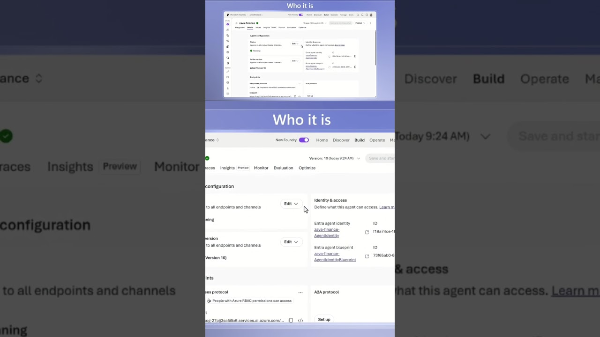

**v11: Microsoft Ignite 2026: Security news​**

**v04: Introducing Microsoft Perception: The Next Evolution of Agentic Security**

**v05: Vulnerability shielding in Microsoft Defender**

**v03: When Security Protects Lives, An AI Security Documentary by Microsoft**

Short GIFs for the top 3 by views:

**v10**: no GIF (see Gaps).

**v11**

**v04**

## X

Official handles checked: @msftsecurity, @MsftSecIntel, @msftsecresponse, @Microsoft, @MSFTMechanics (all verified business accounts). @MicrosoftEntra does not exist on X (see Gaps). Only security-related posts are listed. Threat-intelligence posts appear under Threat intelligence instead. Reply notes are paraphrased and repliers are not named.

### x01: @MSFTMechanics, 2026-11-16 00:49 IST

- Link: https://x.com/MSFTMechanics/status/2122046895052718433
- Summary: Purview's Data Security Posture agent can scan files for credentials such as passwords, API keys and tokens that are easy to miss by hand.
- Engagement: 21 likes, 0 replies, 3 reposts, 1 quotes, 5318 views
- What replies say: No replies. X counts one quote post; its text could not be retrieved.
- Asset: [png](assets/x-msftmechanics-2122046895052718433.png) (public embed, post only; replies could not be captured without signing in, see Gaps)

### x02: @MSFTMechanics, 2026-11-16 09:32 IST

- Link: https://x.com/MSFTMechanics/status/2122178533367722326
- Summary: Pitches Global Secure Access in the Entra Suite as a VPN replacement: access per app, tied to identity, with no inbound ports or public IPs.
- Engagement: 4 likes, 0 replies, 0 reposts, 1 quotes, 6675 views
- What replies say: No replies. X counts one quote post; its text could not be retrieved.
- Asset: [png](assets/x-msftmechanics-2122178533367722326.png) (public embed, post only; replies could not be captured without signing in, see Gaps)

### x03: @MSFTMechanics, 2026-11-16 10:48 IST

- Link: https://x.com/MSFTMechanics/status/2122197510680616962
- Summary: Says Perception agents find, prove and patch vulnerabilities so defenders can match attackers who use AI at machine speed.
- Engagement: 10 likes, 1 replies, 2 reposts, 0 quotes, 3314 views
- What replies say: One reply says the human review step and a small test ring should remain before automated fixes reach production.
- Asset: [png](assets/x-msftmechanics-2122197510680616962.png) (public embed, post only; replies could not be captured without signing in, see Gaps)

### x04: @MSFTMechanics, 2026-11-16 19:14 IST

- Link: https://x.com/MSFTMechanics/status/2122324916334649428
- Summary: Points to the Windows Autopatch report in Intune for seeing which devices are current and closing gaps before attackers exploit them.
- Engagement: 3 likes, 0 replies, 2 reposts, 0 quotes, 1235 views
- What replies say: No replies or quotes.
- Asset: [png](assets/x-msftmechanics-2122324916334649428.png) (public embed, post only; replies could not be captured without signing in, see Gaps)

### x05: @MSFTMechanics, 2026-11-17 00:44 IST

- Link: https://x.com/MSFTMechanics/status/2122407940183277626
- Summary: Shows Intune device compliance used as the entry requirement in Conditional Access, so non-compliant devices cannot reach internal resources.
- Engagement: 35 likes, 0 replies, 5 reposts, 0 quotes, 3274 views
- What replies say: No replies or quotes.
- Asset: [png](assets/x-msftmechanics-2122407940183277626.png) (public embed, post only; replies could not be captured without signing in, see Gaps)

### x06: @MSFTMechanics, 2026-11-17 02:02 IST

- Link: https://x.com/MSFTMechanics/status/2122427618876104967
- Summary: Second post on the Data Security Posture agent's credential scanning, aimed at secrets buried in files before they are exposed.
- Engagement: 37 likes, 0 replies, 4 reposts, 0 quotes, 3100 views
- What replies say: No replies or quotes.
- Asset: [png](assets/x-msftmechanics-2122427618876104967.png) (public embed, post only; replies could not be captured without signing in, see Gaps)

### x07: @MSFTMechanics, 2026-11-17 19:14 IST

- Link: https://x.com/MSFTMechanics/status/2122687353932169479
- Summary: Edge for Business can send saved files to the company OneDrive so organisational data stays inside the security boundary.
- Engagement: 6 likes, 1 replies, 3 reposts, 0 quotes, 1263 views
- What replies say: One reply asks whether the feature also works in Chrome.
- Asset: [png](assets/x-msftmechanics-2122687353932169479.png) (public embed, post only; replies could not be captured without signing in, see Gaps)

### x08: @Microsoft, 2026-11-17 23:59 IST

- Link: https://x.com/Microsoft/status/2122759048827138273
- Summary: @Microsoft introduces new models for coding and security, including Cyber 2 Flash, described as its most capable security model so far.
- Engagement: 608 likes, 34 replies, 80 reposts, 23 quotes, 67851 views
- What replies say: Replies mostly ask for benchmarks, pricing and availability in coding tools; some are off-topic or promotional. Quotes (23) are news roundups.
- Asset: [png](assets/x-microsoft-2122759048827138273.png) (public embed, post only; replies could not be captured without signing in, see Gaps)

### x09: @Microsoft, 2026-11-18 00:05 IST

- Link: https://x.com/Microsoft/status/2122760532688044523
- Summary: @Microsoft announces Perception as generally available: red, blue and green team agents run playbooks to simulate attacks, detect threats and remediate.
- Engagement: 561 likes, 29 replies, 92 reposts, 16 quotes, 75306 views
- What replies say: Of 29 replies, most ask who approves agent actions and how false positives and bad remediations are handled; some praise it; several are off-topic. Quotes (16) are mostly roundups in other languages.
- Asset: [png](assets/x-microsoft-2122760532688044523.png) (public embed, post only; replies could not be captured without signing in, see Gaps)

### x10: @MSFTMechanics, 2026-11-18 00:44 IST

- Link: https://x.com/MSFTMechanics/status/2122770346612806064
- Summary: Edge for Business uses on-device AI vision to spot and block fake tech-support scam pages as they load.
- Engagement: 4 likes, 1 replies, 2 reposts, 0 quotes, 1268 views
- What replies say: One reply notes the vision model runs locally on full-screen pages and names the policy that switches it on or off.
- Asset: [png](assets/x-msftmechanics-2122770346612806064.png) (public embed, post only; replies could not be captured without signing in, see Gaps)

### x11: @MsftSecIntel, 2026-11-18 00:44 IST

- Link: https://x.com/MsftSecIntel/status/2122770379915805067
- Summary: Microsoft's FORGE Lab worked with GitHub and six open-source projects to test whether AI-assisted bug finding yields verified, fixable reports.
- Engagement: 106 likes, 4 replies, 18 reposts, 1 quotes, 13501 views
- What replies say: One reply quotes GitHub that the pilot used an earlier cyber model and that 55 of 99 reports were fixed by 15 November; another welcomes the focus on verification.
- Asset: [png](assets/x-msftsecintel-2122770379915805067.png) (public embed, post only; replies could not be captured without signing in, see Gaps)

### x12: @msftsecurity, 2026-11-18 02:00 IST

- Link: https://x.com/msftsecurity/status/2122789374249037852
- Summary: Announces Perception as generally available at Ignite, plus ISOC in Defender and new controls for agentic insiders, with a link to the security rundown.
- Engagement: 117 likes, 5 replies, 37 reposts, 1 quotes, 26611 views
- What replies say: Five replies counted; four retrieved. One calls it a big release, one praises the red, blue and green agent teams, one questions Microsoft's partnership with another vendor after its past outage, and one is a joke.
- Asset: [png](assets/x-msftsecurity-2122789374249037852.png) (public embed, post only; replies could not be captured without signing in, see Gaps)

### x13: @MSFTMechanics, 2026-11-18 02:02 IST

- Link: https://x.com/MSFTMechanics/status/2122790096378237211
- Summary: Purview DSPM offers one-click policies to curb oversharing of sensitive data in Microsoft 365 Copilot.
- Engagement: 7 likes, 1 replies, 3 reposts, 0 quotes, 1521 views
- What replies say: One reply says one-click policies only help if someone owns the follow-up and reviews flagged items with site owners.
- Asset: [png](assets/x-msftmechanics-2122790096378237211.png) (public embed, post only; replies could not be captured without signing in, see Gaps)

### x14: @msftsecurity, 2026-11-18 03:52 IST

- Link: https://x.com/msftsecurity/status/2122817634832195923
- Summary: With GitHub, reports that MDASH narrowed 9,791 AI-found security findings to 99 verified, private reports with fixes across six open-source projects.
- Engagement: 46 likes, 9 replies, 8 reposts, 1 quotes, 10348 views
- What replies say: Maintainers of two projects thanked Microsoft for involving them. Several replies say triage, not discovery, is the bottleneck and ask how much of the cut was duplicates versus false positives; a few are self-promotion.
- Asset: [png](assets/x-msftsecurity-2122817634832195923.png) (public embed, post only; replies could not be captured without signing in, see Gaps)

### x15: @MSFTMechanics, 2026-11-18 19:14 IST

- Link: https://x.com/MSFTMechanics/status/2123049665113235832
- Summary: Edge for Business enforces Purview DLP in the browser and intercepts sensitive prompts before they reach unsanctioned AI chat apps.
- Engagement: 0 likes, 0 replies, 0 reposts, 0 quotes, 885 views
- What replies say: No replies or quotes.
- Asset: [png](assets/x-msftmechanics-2123049665113235832.png) (public embed, post only; replies could not be captured without signing in, see Gaps)

### x16: @MSFTMechanics, 2026-11-18 20:48 IST

- Link: https://x.com/MSFTMechanics/status/2123073341552570653
- Summary: Entra Tenant Governance can create a drift monitor from any snapshot and rescans the tenant for configuration drift every six hours.
- Engagement: 0 likes, 0 replies, 0 reposts, 0 quotes, 820 views
- What replies say: No replies or quotes.
- Asset: [png](assets/x-msftmechanics-2123073341552570653.png) (public embed, post only; replies could not be captured without signing in, see Gaps)

### x17: @MSFTMechanics, 2026-11-19 11:21 IST

- Link: https://x.com/MSFTMechanics/status/2123292941334499540
- Summary: Prompt Injection Protection in the Entra Suite checks outbound prompts against Microsoft's adversarial patterns and blocks attacks before the agent acts.
- Engagement: 20 likes, 2 replies, 1 reposts, 0 quotes, 3647 views
- What replies say: Two replies. One says outbound filtering looks strong in demos but an injection hidden in a retrieved document may still look legitimate; the other asks what holds an agent-drafted email if one slips through.
- Asset: [png](assets/x-msftmechanics-2123292941334499540.png) (public embed, post only; replies could not be captured without signing in, see Gaps)

### x18: @MSFTMechanics, 2026-11-19 12:25 IST

- Link: https://x.com/MSFTMechanics/status/2123309103468400717
- Summary: Shares Microsoft's updated patching recommendations so admins can see where deployment timelines can be tightened to shrink the exposure gap.
- Engagement: 2 likes, 0 replies, 2 reposts, 0 quotes, 1506 views
- What replies say: No replies or quotes.
- Asset: [png](assets/x-msftmechanics-2123309103468400717.png) (public embed, post only; replies could not be captured without signing in, see Gaps)

### x19: @MSFTMechanics, 2026-11-19 13:29 IST

- Link: https://x.com/MSFTMechanics/status/2123325152943378769
- Summary: Agent 365 lets admins block unsanctioned local agents with Intune policies and isolate them using Microsoft Execution Containers.
- Engagement: 27 likes, 2 replies, 6 reposts, 0 quotes, 4394 views
- What replies say: Two replies. One cautions that Conditional Access gates Entra tokens, not keys already on a device; the other says an inventory is not control and each remaining agent needs a named owner.
- Asset: [png](assets/x-msftmechanics-2123325152943378769.png) (public embed, post only; replies could not be captured without signing in, see Gaps)

### x20: @msftsecurity, 2026-11-20 02:16 IST

- Link: https://x.com/msftsecurity/status/2123518375691255858
- Summary: Shows red, blue and green agent teams running one playbook in a live Ignite demo of Perception, now generally available.
- Engagement: 133 likes, 7 replies, 24 reposts, 1 quotes, 22516 views
- What replies say: Replies hope Perception will not be limited to the top licence tier, praise the integration, and one points out the colour order. Quotes: one.
- Asset: [png](assets/x-msftsecurity-2123518375691255858.png) (public embed, post only; replies could not be captured without signing in, see Gaps)

### x21: @MSFTMechanics, 2026-11-20 11:21 IST

- Link: https://x.com/MSFTMechanics/status/2123655329053315404
- Summary: Lifecycle Workflows in the Entra Suite remove stale entitlements on a role change and assign the right access package from HR data.
- Engagement: 2 likes, 0 replies, 1 reposts, 0 quotes, 1934 views
- What replies say: No replies or quotes.
- Asset: [png](assets/x-msftmechanics-2123655329053315404.png) (public embed, post only; replies could not be captured without signing in, see Gaps)

### x22: @MSFTMechanics, 2026-11-20 12:25 IST

- Link: https://x.com/MSFTMechanics/status/2123671478356844812
- Summary: Shows reusable templates in Agent 365 for Conditional Access, access packages and custom security attributes, applied when an agent is approved.
- Engagement: 1 likes, 0 replies, 1 reposts, 1 quotes, 1309 views
- What replies say: No replies. X counts one quote post; its text could not be retrieved.
- Asset: [png](assets/x-msftmechanics-2123671478356844812.png) (public embed, post only; replies could not be captured without signing in, see Gaps)

### x23: @MSFTMechanics, 2026-11-20 13:29 IST

- Link: https://x.com/MSFTMechanics/status/2123687541031256431
- Summary: A migration folds Conditional Access policies that share a name prefix into one policy plan, converting each old policy into a rule.
- Engagement: 24 likes, 1 replies, 3 reposts, 1 quotes, 6924 views
- What replies say: One reply says a consistent naming convention now pays off and suggests tidying names before migrating. X counts one quote post; its text could not be retrieved.
- Asset: [png](assets/x-msftmechanics-2123687541031256431.png) (public embed, post only; replies could not be captured without signing in, see Gaps)

### x24: @MSFTMechanics, 2026-11-21 11:21 IST

- Link: https://x.com/MSFTMechanics/status/2124017716780507236
- Summary: Walks through recommended deferral periods, deadlines and grace windows for Windows updates and how to set them in Intune.
- Engagement: 22 likes, 0 replies, 4 reposts, 0 quotes, 3963 views
- What replies say: No replies or quotes.
- Asset: [png](assets/x-msftmechanics-2124017716780507236.png) (public embed, post only; replies could not be captured without signing in, see Gaps)

### x25: @MSFTMechanics, 2026-11-21 12:25 IST

- Link: https://x.com/MSFTMechanics/status/2124033895238717582
- Summary: One Conditional Access policy plan can block high-risk agents by using agent risk as a shared condition, with rules for agent users and autonomous agents.
- Engagement: 6 likes, 0 replies, 2 reposts, 0 quotes, 5194 views
- What replies say: No replies or quotes.
- Asset: [png](assets/x-msftmechanics-2124033895238717582.png) (public embed, post only; replies could not be captured without signing in, see Gaps)

### x26: @MSFTMechanics, 2026-11-21 13:29 IST

- Link: https://x.com/MSFTMechanics/status/2124049928901054689
- Summary: Demonstrates Hotpatch in Intune, which installs Windows security updates immediately and cuts reboot disruption.
- Engagement: 16 likes, 1 replies, 3 reposts, 0 quotes, 4153 views
- What replies say: One reply lists the eligibility conditions: a qualifying licence such as Business Premium, Windows 11 24H2 or later, VBS enabled and the latest baseline.
- Asset: [png](assets/x-msftmechanics-2124049928901054689.png) (public embed, post only; replies could not be captured without signing in, see Gaps)

### x27: @MSFTMechanics, 2026-11-22 12:20 IST

- Link: https://x.com/MSFTMechanics/status/2124395033465917699
- Summary: Dynamic policies in the Entra Suite revoke access and force self-remediation when token-theft risk rises, so privilege does not accumulate.
- Engagement: 14 likes, 0 replies, 3 reposts, 1 quotes, 2330 views
- What replies say: No replies. X counts one quote post; its text could not be retrieved.
- Asset: [png](assets/x-msftmechanics-2124395033465917699.png) (public embed, post only; replies could not be captured without signing in, see Gaps)

### x28: @MSFTMechanics, 2026-11-22 13:24 IST

- Link: https://x.com/MSFTMechanics/status/2124411058605486387
- Summary: Network DLP in the Entra Suite checks pasted content against Purview labels before it reaches an AI platform.
- Engagement: 55 likes, 3 replies, 11 reposts, 0 quotes, 8730 views
- What replies say: Three replies counted; two were retrieved. One lists the licences Microsoft requires for Purview-based network DLP; the other says labels must exist first, so labelling cleanup comes before enforcement.
- Asset: [png](assets/x-msftmechanics-2124411058605486387.png) (public embed, post only; replies could not be captured without signing in, see Gaps)

## CVEs this month

Source: MSRC CVRF `2026-Nov` (https://api.msrc.microsoft.com/cvrf/v3.0/cvrf/2026-Nov), first released 2026-11-10 and last revised 2026-11-23. Listed: 1114 CVEs assigned by Microsoft (79 Critical, 1 exploited, 0 publicly disclosed). The same document also carries 1,263 third-party CVEs, which are not listed (see Gaps). Sorted by CVSS, highest first. A CVSS of null means MSRC published no score; severity is as MSRC publishes it.

| CVE | title | product | CVSS | severity | exploited | disclosed | link |
|---|---|---|---|---|---|---|---|
| CVE-2026-109469 | Entra Device Registration Elevation of Privilege Vulnerability | Entra Device Registration | 10.0 | Critical | no | no | [MSRC](https://msrc.microsoft.com/update-guide/vulnerability/CVE-2026-109469) |
| CVE-2026-109484 | Azure App Service for Linux Elevation of Privilege Vulnerability | Azure App Service | 10.0 | Critical | no | no | [MSRC](https://msrc.microsoft.com/update-guide/vulnerability/CVE-2026-109484) |
| CVE-2026-62841 | Azure Event Grid Elevation of Privilege Vulnerability | Azure Event Grid | 10.0 | Critical | no | no | [MSRC](https://msrc.microsoft.com/update-guide/vulnerability/CVE-2026-62841) |
| CVE-2026-109467 | Azure DevOps Server Remote Code Execution Vulnerability | Azure DevOps | 9.9 | Important | no | no | [MSRC](https://msrc.microsoft.com/update-guide/vulnerability/CVE-2026-109467) |
| CVE-2026-120002 | Microsoft SharePoint Server Elevation of Privilege Vulnerability | Microsoft Office SharePoint | 9.9 | Important | no | no | [MSRC](https://msrc.microsoft.com/update-guide/vulnerability/CVE-2026-120002) |
| CVE-2026-50691 | Microsoft 365 Copilot Elevation of Privilege Vulnerability | M365 Copilot | 9.9 | Critical | no | no | [MSRC](https://msrc.microsoft.com/update-guide/vulnerability/CVE-2026-50691) |
| CVE-2026-70193 | Microsoft Office SharePoint Remote Code Execution Vulnerability | Microsoft Office SharePoint | 9.9 | Critical | no | no | [MSRC](https://msrc.microsoft.com/update-guide/vulnerability/CVE-2026-70193) |
| CVE-2026-112967 | Windows Xbox Live Networking Service Remote Code Execution Vulnerability | Windows Xbox Live Networking Service | 9.8 | Critical | no | no | [MSRC](https://msrc.microsoft.com/update-guide/vulnerability/CVE-2026-112967) |
| CVE-2026-116928 | Windows Search Remote Code Execution Vulnerability | Microsoft Windows Search Component | 9.8 | Critical | no | no | [MSRC](https://msrc.microsoft.com/update-guide/vulnerability/CVE-2026-116928) |
| CVE-2026-116945 | Microsoft SQL Server Remote Code Execution Vulnerability | SQL Server | 9.8 | Important | no | no | [MSRC](https://msrc.microsoft.com/update-guide/vulnerability/CVE-2026-116945) |
| CVE-2026-119958 | Windows LDAP - Lightweight Directory Access Protocol Remote Code Execution Vulnerability | Windows LDAP - Lightweight Directory Access Protocol | 9.8 | Critical | no | no | [MSRC](https://msrc.microsoft.com/update-guide/vulnerability/CVE-2026-119958) |
| CVE-2026-119990 | Azure OpenAI Elevation of Privilege Vulnerability | Azure OpenAI | 9.8 | Critical | no | no | [MSRC](https://msrc.microsoft.com/update-guide/vulnerability/CVE-2026-119990) |
| CVE-2026-85844 | Windows Kerberos Elevation of Privilege Vulnerability | Windows Kerberos | 9.8 | Important | no | no | [MSRC](https://msrc.microsoft.com/update-guide/vulnerability/CVE-2026-85844) |
| CVE-2026-88218 | Windows DNS Remote Code Execution Vulnerability | Windows DNS | 9.8 | Important | no | no | [MSRC](https://msrc.microsoft.com/update-guide/vulnerability/CVE-2026-88218) |
| CVE-2026-88234 | Windows iSCSI Remote Code Execution Vulnerability | Windows iSCSI | 9.8 | Important | no | no | [MSRC](https://msrc.microsoft.com/update-guide/vulnerability/CVE-2026-88234) |
| CVE-2026-88243 | Windows DHCP Server Remote Code Execution Vulnerability | Windows DHCP Server | 9.8 | Important | no | no | [MSRC](https://msrc.microsoft.com/update-guide/vulnerability/CVE-2026-88243) |
| CVE-2026-95882 | Microsoft DirectMusic Remote Code Execution Vulnerability | Windows Microsoft DirectMusic | 9.8 | Important | no | no | [MSRC](https://msrc.microsoft.com/update-guide/vulnerability/CVE-2026-95882) |
| CVE-2026-95901 | Microsoft DirectMusic Remote Code Execution Vulnerability | Windows Microsoft DirectMusic | 9.8 | Important | no | no | [MSRC](https://msrc.microsoft.com/update-guide/vulnerability/CVE-2026-95901) |
| CVE-2026-96067 | Microsoft Color Management Remote Code Execution Vulnerability | Microsoft Color Management | 9.8 | Important | no | no | [MSRC](https://msrc.microsoft.com/update-guide/vulnerability/CVE-2026-96067) |
| CVE-2026-96078 | Microsoft Color Management Remote Code Execution Vulnerability | Microsoft Color Management | 9.8 | Important | no | no | [MSRC](https://msrc.microsoft.com/update-guide/vulnerability/CVE-2026-96078) |
| CVE-2026-96157 | Microsoft Windows Media Foundation Remote Code Execution Vulnerability | Microsoft Windows Media Foundation | 9.8 | Important | no | no | [MSRC](https://msrc.microsoft.com/update-guide/vulnerability/CVE-2026-96157) |
| CVE-2026-109480 | Profile Data Roaming Service (PDRS) Elevation of Privilege Vulnerability | Profile Data Roaming Service (PDRS) | 9.6 | Critical | no | no | [MSRC](https://msrc.microsoft.com/update-guide/vulnerability/CVE-2026-109480) |
| CVE-2026-118285 | Azure Machine Learning Elevation of Privilege Vulnerability | Azure Machine Learning | 9.6 | Critical | no | no | [MSRC](https://msrc.microsoft.com/update-guide/vulnerability/CVE-2026-118285) |
| CVE-2026-120779 | Visual Studio Code Remote Code Execution Vulnerability | Visual Studio Code | 9.6 | Important | no | no | [MSRC](https://msrc.microsoft.com/update-guide/vulnerability/CVE-2026-120779) |
| CVE-2026-70305 | Azure Portal Spoofing Vulnerability | Azure Portal | 9.6 | Critical | no | no | [MSRC](https://msrc.microsoft.com/update-guide/vulnerability/CVE-2026-70305) |
| CVE-2026-109490 | Authentication Methods Portal Extension Elevation of Privilege Vulnerability | Authentication Methods Portal Extension | 9.3 | Critical | no | no | [MSRC](https://msrc.microsoft.com/update-guide/vulnerability/CVE-2026-109490) |
| CVE-2026-113824 | Microsoft Clarity Elevation of Privilege Vulnerability | Microsoft Clarity | 9.1 | Critical | no | no | [MSRC](https://msrc.microsoft.com/update-guide/vulnerability/CVE-2026-113824) |
| CVE-2026-114162 | Microsoft Graph Elevation of Privilege Vulnerability | Microsoft Graph | 9.1 | Important | no | no | [MSRC](https://msrc.microsoft.com/update-guide/vulnerability/CVE-2026-114162) |
| CVE-2026-118286 | Azure Site Recovery Elevation of Privilege Vulnerability | Azure Site Recovery | 9.1 | Critical | no | no | [MSRC](https://msrc.microsoft.com/update-guide/vulnerability/CVE-2026-118286) |
| CVE-2026-118740 | Aspire Security Feature Bypass Vulnerability | Aspire | 9.1 | Important | no | no | [MSRC](https://msrc.microsoft.com/update-guide/vulnerability/CVE-2026-118740) |
| CVE-2026-69899 | Azure DevTest Labs Spoofing Vulnerability | Azure DevTest Labs | 9.1 | Critical | no | no | [MSRC](https://msrc.microsoft.com/update-guide/vulnerability/CVE-2026-69899) |
| CVE-2026-109454 | Microsoft Office SharePoint Spoofing Vulnerability | Microsoft Office SharePoint | 9.0 | Important | no | no | [MSRC](https://msrc.microsoft.com/update-guide/vulnerability/CVE-2026-109454) |
| CVE-2026-114146 | ASP.NET Core Elevation of Privilege Vulnerability | ASP.NET Core | 9.0 | Important | no | no | [MSRC](https://msrc.microsoft.com/update-guide/vulnerability/CVE-2026-114146) |
| CVE-2026-80095 | Microsoft Office SharePoint Elevation of Privilege Vulnerability | Microsoft Office SharePoint | 9.0 | Important | no | no | [MSRC](https://msrc.microsoft.com/update-guide/vulnerability/CVE-2026-80095) |
| CVE-2026-95962 | Windows Virtual Filtering Platform (VFP) Remote Code Execution Vulnerability | Windows Virtual Filtering Platform (VFP) | 9.0 | Important | no | no | [MSRC](https://msrc.microsoft.com/update-guide/vulnerability/CVE-2026-95962) |
| CVE-2026-105020 | Windows Advanced Rasterization Platform Elevation of Privilege Vulnerability | Windows Advanced Rasterization Platform | 8.8 | Important | no | no | [MSRC](https://msrc.microsoft.com/update-guide/vulnerability/CVE-2026-105020) |
| CVE-2026-105021 | Windows Advanced Rasterization Platform Elevation of Privilege Vulnerability | Windows Advanced Rasterization Platform | 8.8 | Important | no | no | [MSRC](https://msrc.microsoft.com/update-guide/vulnerability/CVE-2026-105021) |
| CVE-2026-105023 | Windows Advanced Rasterization Platform Elevation of Privilege Vulnerability | Windows Advanced Rasterization Platform | 8.8 | Important | no | no | [MSRC](https://msrc.microsoft.com/update-guide/vulnerability/CVE-2026-105023) |
| CVE-2026-105026 | Windows Advanced Rasterization Platform Elevation of Privilege Vulnerability | Windows Advanced Rasterization Platform | 8.8 | Important | no | no | [MSRC](https://msrc.microsoft.com/update-guide/vulnerability/CVE-2026-105026) |
| CVE-2026-105490 | Windows Advanced Rasterization Platform Elevation of Privilege Vulnerability | Windows Advanced Rasterization Platform | 8.8 | Important | no | no | [MSRC](https://msrc.microsoft.com/update-guide/vulnerability/CVE-2026-105490) |
| CVE-2026-105491 | Windows Advanced Rasterization Platform Elevation of Privilege Vulnerability | Windows Advanced Rasterization Platform | 8.8 | Important | no | no | [MSRC](https://msrc.microsoft.com/update-guide/vulnerability/CVE-2026-105491) |
| CVE-2026-105493 | Windows Advanced Rasterization Platform Elevation of Privilege Vulnerability | Windows Advanced Rasterization Platform | 8.8 | Important | no | no | [MSRC](https://msrc.microsoft.com/update-guide/vulnerability/CVE-2026-105493) |
| CVE-2026-105495 | Windows Advanced Rasterization Platform Elevation of Privilege Vulnerability | Windows Advanced Rasterization Platform | 8.8 | Important | no | no | [MSRC](https://msrc.microsoft.com/update-guide/vulnerability/CVE-2026-105495) |
| CVE-2026-105496 | Windows Advanced Rasterization Platform Elevation of Privilege Vulnerability | Windows Advanced Rasterization Platform | 8.8 | Important | no | no | [MSRC](https://msrc.microsoft.com/update-guide/vulnerability/CVE-2026-105496) |
| CVE-2026-105497 | Windows Advanced Rasterization Platform Elevation of Privilege Vulnerability | Windows Advanced Rasterization Platform | 8.8 | Important | no | no | [MSRC](https://msrc.microsoft.com/update-guide/vulnerability/CVE-2026-105497) |
| CVE-2026-105498 | Windows Advanced Rasterization Platform Elevation of Privilege Vulnerability | Windows Advanced Rasterization Platform | 8.8 | Important | no | no | [MSRC](https://msrc.microsoft.com/update-guide/vulnerability/CVE-2026-105498) |
| CVE-2026-105499 | Windows Advanced Rasterization Platform Elevation of Privilege Vulnerability | Windows Advanced Rasterization Platform | 8.8 | Important | no | no | [MSRC](https://msrc.microsoft.com/update-guide/vulnerability/CVE-2026-105499) |
| CVE-2026-105518 | Windows iSCSI Remote Code Execution Vulnerability | Windows iSCSI | 8.8 | Important | no | no | [MSRC](https://msrc.microsoft.com/update-guide/vulnerability/CVE-2026-105518) |
| CVE-2026-105534 | Windows Storage Remote Code Execution Vulnerability | Windows Storage | 8.8 | Important | no | no | [MSRC](https://msrc.microsoft.com/update-guide/vulnerability/CVE-2026-105534) |
| CVE-2026-105542 | Windows NTFS Remote Code Execution Vulnerability | Windows NTFS | 8.8 | Important | no | no | [MSRC](https://msrc.microsoft.com/update-guide/vulnerability/CVE-2026-105542) |
| CVE-2026-105581 | Desktop Window Manager Elevation of Privilege Vulnerability | Desktop Window Manager | 8.8 | Important | no | no | [MSRC](https://msrc.microsoft.com/update-guide/vulnerability/CVE-2026-105581) |
| CVE-2026-108401 | Remote Desktop Services Remote Code Execution Vulnerability | Windows Remote Desktop Services | 8.8 | Important | no | no | [MSRC](https://msrc.microsoft.com/update-guide/vulnerability/CVE-2026-108401) |
| CVE-2026-108411 | Microsoft ODBC Driver Remote Code Execution Vulnerability | Windows ODBC Driver | 8.8 | Important | no | no | [MSRC](https://msrc.microsoft.com/update-guide/vulnerability/CVE-2026-108411) |
| CVE-2026-109463 | Windows DNS Remote Code Execution Vulnerability | Windows DNS | 8.8 | Important | no | no | [MSRC](https://msrc.microsoft.com/update-guide/vulnerability/CVE-2026-109463) |
| CVE-2026-109464 | Microsoft Office SharePoint Remote Code Execution Vulnerability | Microsoft Office SharePoint | 8.8 | Important | no | no | [MSRC](https://msrc.microsoft.com/update-guide/vulnerability/CVE-2026-109464) |
| CVE-2026-109472 | Microsoft Office SharePoint Remote Code Execution Vulnerability | Microsoft Office SharePoint | 8.8 | Important | no | no | [MSRC](https://msrc.microsoft.com/update-guide/vulnerability/CVE-2026-109472) |
| CVE-2026-109493 | Microsoft Office Access Remote Code Execution Vulnerability | Microsoft Office Access | 8.8 | Important | no | no | [MSRC](https://msrc.microsoft.com/update-guide/vulnerability/CVE-2026-109493) |
| CVE-2026-109494 | Microsoft Office Visio Remote Code Execution Vulnerability | Microsoft Office Visio | 8.8 | Important | no | no | [MSRC](https://msrc.microsoft.com/update-guide/vulnerability/CVE-2026-109494) |
| CVE-2026-109496 | Microsoft Office Visio Remote Code Execution Vulnerability | Microsoft Office Visio | 8.8 | Important | no | no | [MSRC](https://msrc.microsoft.com/update-guide/vulnerability/CVE-2026-109496) |
| CVE-2026-109499 | Microsoft Office SharePoint Remote Code Execution Vulnerability | Microsoft Office SharePoint | 8.8 | Important | no | no | [MSRC](https://msrc.microsoft.com/update-guide/vulnerability/CVE-2026-109499) |
| CVE-2026-109501 | Microsoft Office Word Remote Code Execution Vulnerability | Microsoft Office Word | 8.8 | Important | no | no | [MSRC](https://msrc.microsoft.com/update-guide/vulnerability/CVE-2026-109501) |
| CVE-2026-109502 | Microsoft Office SharePoint Elevation of Privilege Vulnerability | Microsoft Office SharePoint | 8.8 | Important | no | no | [MSRC](https://msrc.microsoft.com/update-guide/vulnerability/CVE-2026-109502) |
| CVE-2026-109503 | Microsoft Office Word Remote Code Execution Vulnerability | Microsoft Office Word | 8.8 | Important | no | no | [MSRC](https://msrc.microsoft.com/update-guide/vulnerability/CVE-2026-109503) |
| CVE-2026-109505 | Microsoft Office Word Remote Code Execution Vulnerability | Microsoft Office Word | 8.8 | Important | no | no | [MSRC](https://msrc.microsoft.com/update-guide/vulnerability/CVE-2026-109505) |
| CVE-2026-110043 | Microsoft Office Outlook Remote Code Execution Vulnerability | Microsoft Office Outlook | 8.8 | Critical | no | no | [MSRC](https://msrc.microsoft.com/update-guide/vulnerability/CVE-2026-110043) |
| CVE-2026-110044 | Microsoft Office SharePoint Remote Code Execution Vulnerability | Microsoft Office SharePoint | 8.8 | Important | no | no | [MSRC](https://msrc.microsoft.com/update-guide/vulnerability/CVE-2026-110044) |
| CVE-2026-110047 | Microsoft Office Word Remote Code Execution Vulnerability | Microsoft Office Word | 8.8 | Critical | no | no | [MSRC](https://msrc.microsoft.com/update-guide/vulnerability/CVE-2026-110047) |
| CVE-2026-110048 | Microsoft Word Remote Code Execution Vulnerability | Microsoft Office Word | 8.8 | Important | no | no | [MSRC](https://msrc.microsoft.com/update-guide/vulnerability/CVE-2026-110048) |
| CVE-2026-110050 | Microsoft Office Word Remote Code Execution Vulnerability | Microsoft Office Word | 8.8 | Important | no | no | [MSRC](https://msrc.microsoft.com/update-guide/vulnerability/CVE-2026-110050) |
| CVE-2026-110054 | Microsoft Office Word Remote Code Execution Vulnerability | Microsoft Office Word | 8.8 | Important | no | no | [MSRC](https://msrc.microsoft.com/update-guide/vulnerability/CVE-2026-110054) |
| CVE-2026-110055 | Microsoft Word Remote Code Execution Vulnerability | Microsoft Office Word | 8.8 | Important | no | no | [MSRC](https://msrc.microsoft.com/update-guide/vulnerability/CVE-2026-110055) |
| CVE-2026-110058 | Microsoft Office Access Remote Code Execution Vulnerability | Microsoft Office Access | 8.8 | Important | no | no | [MSRC](https://msrc.microsoft.com/update-guide/vulnerability/CVE-2026-110058) |
| CVE-2026-110059 | Microsoft Office Access Remote Code Execution Vulnerability | Microsoft Office Access | 8.8 | Important | no | no | [MSRC](https://msrc.microsoft.com/update-guide/vulnerability/CVE-2026-110059) |
| CVE-2026-110060 | Microsoft Office Access Remote Code Execution Vulnerability | Microsoft Office Access | 8.8 | Important | no | no | [MSRC](https://msrc.microsoft.com/update-guide/vulnerability/CVE-2026-110060) |
| CVE-2026-110061 | Microsoft Office Word Remote Code Execution Vulnerability | Microsoft Office Word | 8.8 | Important | no | no | [MSRC](https://msrc.microsoft.com/update-guide/vulnerability/CVE-2026-110061) |
| CVE-2026-110062 | Microsoft Office Word Remote Code Execution Vulnerability | Microsoft Office Word | 8.8 | Important | no | no | [MSRC](https://msrc.microsoft.com/update-guide/vulnerability/CVE-2026-110062) |
| CVE-2026-110064 | Microsoft Office Word Remote Code Execution Vulnerability | Microsoft Office Word | 8.8 | Important | no | no | [MSRC](https://msrc.microsoft.com/update-guide/vulnerability/CVE-2026-110064) |
| CVE-2026-110067 | Microsoft Office Word Remote Code Execution Vulnerability | Microsoft Office Word | 8.8 | Critical | no | no | [MSRC](https://msrc.microsoft.com/update-guide/vulnerability/CVE-2026-110067) |
| CVE-2026-110068 | Microsoft Office Outlook Remote Code Execution Vulnerability | Microsoft Office Outlook | 8.8 | Critical | no | no | [MSRC](https://msrc.microsoft.com/update-guide/vulnerability/CVE-2026-110068) |
| CVE-2026-111285 | Microsoft Office Word Remote Code Execution Vulnerability | Microsoft Office Word | 8.8 | Critical | no | no | [MSRC](https://msrc.microsoft.com/update-guide/vulnerability/CVE-2026-111285) |
| CVE-2026-111289 | Microsoft Office Remote Code Execution Vulnerability | Microsoft Office | 8.8 | Critical | no | no | [MSRC](https://msrc.microsoft.com/update-guide/vulnerability/CVE-2026-111289) |
| CVE-2026-111290 | Microsoft Office Word Remote Code Execution Vulnerability | Microsoft Office Word | 8.8 | Important | no | no | [MSRC](https://msrc.microsoft.com/update-guide/vulnerability/CVE-2026-111290) |
| CVE-2026-111294 | Microsoft Office Word Remote Code Execution Vulnerability | Microsoft Office Word | 8.8 | Important | no | no | [MSRC](https://msrc.microsoft.com/update-guide/vulnerability/CVE-2026-111294) |
| CVE-2026-111295 | Microsoft Office Word Remote Code Execution Vulnerability | Microsoft Office Word | 8.8 | Important | no | no | [MSRC](https://msrc.microsoft.com/update-guide/vulnerability/CVE-2026-111295) |
| CVE-2026-111298 | Microsoft Office Word Remote Code Execution Vulnerability | Microsoft Office Word | 8.8 | Important | no | no | [MSRC](https://msrc.microsoft.com/update-guide/vulnerability/CVE-2026-111298) |
| CVE-2026-111299 | Microsoft Office Word Remote Code Execution Vulnerability | Microsoft Office Word | 8.8 | Important | no | no | [MSRC](https://msrc.microsoft.com/update-guide/vulnerability/CVE-2026-111299) |
| CVE-2026-111301 | Microsoft Office Access Remote Code Execution Vulnerability | Microsoft Office Access | 8.8 | Important | no | no | [MSRC](https://msrc.microsoft.com/update-guide/vulnerability/CVE-2026-111301) |
| CVE-2026-111304 | Microsoft Office Word Remote Code Execution Vulnerability | Microsoft Office Word | 8.8 | Important | no | no | [MSRC](https://msrc.microsoft.com/update-guide/vulnerability/CVE-2026-111304) |
| CVE-2026-111305 | Microsoft Office Access Remote Code Execution Vulnerability | Microsoft Office Access | 8.8 | Important | no | no | [MSRC](https://msrc.microsoft.com/update-guide/vulnerability/CVE-2026-111305) |
| CVE-2026-111306 | Microsoft Office Word Remote Code Execution Vulnerability | Microsoft Office Word | 8.8 | Important | no | no | [MSRC](https://msrc.microsoft.com/update-guide/vulnerability/CVE-2026-111306) |
| CVE-2026-111307 | Microsoft Office Word Remote Code Execution Vulnerability | Microsoft Office Word | 8.8 | Important | no | no | [MSRC](https://msrc.microsoft.com/update-guide/vulnerability/CVE-2026-111307) |
| CVE-2026-111308 | Microsoft Office Word Remote Code Execution Vulnerability | Microsoft Office Word | 8.8 | Important | no | no | [MSRC](https://msrc.microsoft.com/update-guide/vulnerability/CVE-2026-111308) |
| CVE-2026-111309 | Microsoft Office Outlook Remote Code Execution Vulnerability | Microsoft Office Outlook | 8.8 | Critical | no | no | [MSRC](https://msrc.microsoft.com/update-guide/vulnerability/CVE-2026-111309) |
| CVE-2026-111310 | Microsoft Office Word Remote Code Execution Vulnerability | Microsoft Office Word | 8.8 | Important | no | no | [MSRC](https://msrc.microsoft.com/update-guide/vulnerability/CVE-2026-111310) |
| CVE-2026-112714 | Microsoft Office Word Remote Code Execution Vulnerability | Microsoft Office Word | 8.8 | Important | no | no | [MSRC](https://msrc.microsoft.com/update-guide/vulnerability/CVE-2026-112714) |
| CVE-2026-112715 | Microsoft Office Word Remote Code Execution Vulnerability | Microsoft Office Word | 8.8 | Important | no | no | [MSRC](https://msrc.microsoft.com/update-guide/vulnerability/CVE-2026-112715) |
| CVE-2026-112716 | Microsoft Office Word Remote Code Execution Vulnerability | Microsoft Office Word | 8.8 | Important | no | no | [MSRC](https://msrc.microsoft.com/update-guide/vulnerability/CVE-2026-112716) |
| CVE-2026-112717 | Microsoft Office Word Remote Code Execution Vulnerability | Microsoft Office Word | 8.8 | Important | no | no | [MSRC](https://msrc.microsoft.com/update-guide/vulnerability/CVE-2026-112717) |
| CVE-2026-112718 | Microsoft Office Word Remote Code Execution Vulnerability | Microsoft Office Word | 8.8 | Important | no | no | [MSRC](https://msrc.microsoft.com/update-guide/vulnerability/CVE-2026-112718) |
| CVE-2026-112719 | Microsoft Office Word Remote Code Execution Vulnerability | Microsoft Office Word | 8.8 | Important | no | no | [MSRC](https://msrc.microsoft.com/update-guide/vulnerability/CVE-2026-112719) |
| CVE-2026-112721 | Microsoft Office Word Remote Code Execution Vulnerability | Microsoft Office Word | 8.8 | Important | no | no | [MSRC](https://msrc.microsoft.com/update-guide/vulnerability/CVE-2026-112721) |
| CVE-2026-112722 | Microsoft Office Word Remote Code Execution Vulnerability | Microsoft Office Word | 8.8 | Important | no | no | [MSRC](https://msrc.microsoft.com/update-guide/vulnerability/CVE-2026-112722) |
| CVE-2026-112723 | Microsoft Office Word Remote Code Execution Vulnerability | Microsoft Office Word | 8.8 | Important | no | no | [MSRC](https://msrc.microsoft.com/update-guide/vulnerability/CVE-2026-112723) |
| CVE-2026-112724 | Microsoft Office Word Remote Code Execution Vulnerability | Microsoft Office Word | 8.8 | Important | no | no | [MSRC](https://msrc.microsoft.com/update-guide/vulnerability/CVE-2026-112724) |
| CVE-2026-112726 | Microsoft Office Word Remote Code Execution Vulnerability | Microsoft Office Word | 8.8 | Important | no | no | [MSRC](https://msrc.microsoft.com/update-guide/vulnerability/CVE-2026-112726) |
| CVE-2026-112727 | Windows  Domain Name Service Remote Code Execution Vulnerability | Role: DNS Server | 8.8 | Important | no | no | [MSRC](https://msrc.microsoft.com/update-guide/vulnerability/CVE-2026-112727) |
| CVE-2026-112728 | Microsoft Office Word Remote Code Execution Vulnerability | Microsoft Office Word | 8.8 | Important | no | no | [MSRC](https://msrc.microsoft.com/update-guide/vulnerability/CVE-2026-112728) |
| CVE-2026-112729 | Microsoft Office Word Remote Code Execution Vulnerability | Microsoft Office Word | 8.8 | Important | no | no | [MSRC](https://msrc.microsoft.com/update-guide/vulnerability/CVE-2026-112729) |
| CVE-2026-112730 | Microsoft Office Word Remote Code Execution Vulnerability | Microsoft Office Word | 8.8 | Important | no | no | [MSRC](https://msrc.microsoft.com/update-guide/vulnerability/CVE-2026-112730) |
| CVE-2026-112733 | Microsoft Office Word Remote Code Execution Vulnerability | Microsoft Office Word | 8.8 | Important | no | no | [MSRC](https://msrc.microsoft.com/update-guide/vulnerability/CVE-2026-112733) |
| CVE-2026-112734 | Microsoft Office PowerPoint Remote Code Execution Vulnerability | Microsoft Office PowerPoint | 8.8 | Important | no | no | [MSRC](https://msrc.microsoft.com/update-guide/vulnerability/CVE-2026-112734) |
| CVE-2026-112735 | Microsoft Office Word Remote Code Execution Vulnerability | Microsoft Office Word | 8.8 | Important | no | no | [MSRC](https://msrc.microsoft.com/update-guide/vulnerability/CVE-2026-112735) |
| CVE-2026-112737 | Microsoft Office PowerPoint Remote Code Execution Vulnerability | Microsoft Office PowerPoint | 8.8 | Important | no | no | [MSRC](https://msrc.microsoft.com/update-guide/vulnerability/CVE-2026-112737) |
| CVE-2026-112739 | Microsoft Office Word Remote Code Execution Vulnerability | Microsoft Office Word | 8.8 | Important | no | no | [MSRC](https://msrc.microsoft.com/update-guide/vulnerability/CVE-2026-112739) |
| CVE-2026-112741 | Microsoft Office Word Remote Code Execution Vulnerability | Microsoft Office Word | 8.8 | Important | no | no | [MSRC](https://msrc.microsoft.com/update-guide/vulnerability/CVE-2026-112741) |
| CVE-2026-112762 | Windows Print Spooler Components Elevation of Privilege Vulnerability | Windows Print Spooler Components | 8.8 | Important | no | no | [MSRC](https://msrc.microsoft.com/update-guide/vulnerability/CVE-2026-112762) |
| CVE-2026-112805 | Windows Kernel Elevation of Privilege Vulnerability | Windows Kernel | 8.8 | Important | no | no | [MSRC](https://msrc.microsoft.com/update-guide/vulnerability/CVE-2026-112805) |
| CVE-2026-113760 | Windows XWizard Framework Elevation of Privilege Vulnerability | Windows XWizard Framework | 8.8 | Important | no | no | [MSRC](https://msrc.microsoft.com/update-guide/vulnerability/CVE-2026-113760) |
| CVE-2026-113814 | Windows Storage Spaces Controller Remote Code Execution Vulnerability | Windows Storage Spaces Controller | 8.8 | Important | no | no | [MSRC](https://msrc.microsoft.com/update-guide/vulnerability/CVE-2026-113814) |
| CVE-2026-113863 | Windows DHCP Client Elevation of Privilege Vulnerability | Windows DHCP Client | 8.8 | Important | no | no | [MSRC](https://msrc.microsoft.com/update-guide/vulnerability/CVE-2026-113863) |
| CVE-2026-114151 | Visual Studio Remote Code Execution Vulnerability | Visual Studio | 8.8 | Important | no | no | [MSRC](https://msrc.microsoft.com/update-guide/vulnerability/CVE-2026-114151) |
| CVE-2026-114152 | Visual Studio Remote Code Execution Vulnerability | Visual Studio | 8.8 | Important | no | no | [MSRC](https://msrc.microsoft.com/update-guide/vulnerability/CVE-2026-114152) |
| CVE-2026-114158 | Visual Studio Remote Code Execution Vulnerability | Visual Studio | 8.8 | Important | no | no | [MSRC](https://msrc.microsoft.com/update-guide/vulnerability/CVE-2026-114158) |
| CVE-2026-114159 | Visual Studio Remote Code Execution Vulnerability | Visual Studio | 8.8 | Important | no | no | [MSRC](https://msrc.microsoft.com/update-guide/vulnerability/CVE-2026-114159) |
| CVE-2026-114164 | HEVC Video Extensions Remote Code Execution Vulnerability | Microsoft Windows Codecs Library | 8.8 | Important | no | no | [MSRC](https://msrc.microsoft.com/update-guide/vulnerability/CVE-2026-114164) |
| CVE-2026-114169 | Windows Raw Image Extension Remote Code Execution Vulnerability | Windows Raw Image Extension | 8.8 | Critical | no | no | [MSRC](https://msrc.microsoft.com/update-guide/vulnerability/CVE-2026-114169) |
| CVE-2026-114171 | Visual Studio Code Security Feature Bypass Vulnerability | Visual Studio Code | 8.8 | Important | no | no | [MSRC](https://msrc.microsoft.com/update-guide/vulnerability/CVE-2026-114171) |
| CVE-2026-116717 | Microsoft Office Remote Code Execution Vulnerability | Microsoft Office | 8.8 | Important | no | no | [MSRC](https://msrc.microsoft.com/update-guide/vulnerability/CVE-2026-116717) |
| CVE-2026-116719 | Microsoft Office Word Remote Code Execution Vulnerability | Microsoft Office Word | 8.8 | Important | no | no | [MSRC](https://msrc.microsoft.com/update-guide/vulnerability/CVE-2026-116719) |
| CVE-2026-116720 | Microsoft Office Word Remote Code Execution Vulnerability | Microsoft Office Word | 8.8 | Important | no | no | [MSRC](https://msrc.microsoft.com/update-guide/vulnerability/CVE-2026-116720) |
| CVE-2026-116722 | Microsoft Office Word Remote Code Execution Vulnerability | Microsoft Office Word | 8.8 | Important | no | no | [MSRC](https://msrc.microsoft.com/update-guide/vulnerability/CVE-2026-116722) |
| CVE-2026-116923 | Microsoft Office Word Remote Code Execution Vulnerability | Microsoft Office Word | 8.8 | Important | no | no | [MSRC](https://msrc.microsoft.com/update-guide/vulnerability/CVE-2026-116923) |
| CVE-2026-116925 | Microsoft Office Word Remote Code Execution Vulnerability | Microsoft Office Word | 8.8 | Important | no | no | [MSRC](https://msrc.microsoft.com/update-guide/vulnerability/CVE-2026-116925) |
| CVE-2026-116927 | Microsoft Office Excel Remote Code Execution Vulnerability | Microsoft Office Excel | 8.8 | Important | no | no | [MSRC](https://msrc.microsoft.com/update-guide/vulnerability/CVE-2026-116927) |
| CVE-2026-116930 | Microsoft SQL Server Remote Code Execution Vulnerability | SQL Server | 8.8 | Important | no | no | [MSRC](https://msrc.microsoft.com/update-guide/vulnerability/CVE-2026-116930) |
| CVE-2026-116934 | Microsoft SQL Server Elevation of Privilege Vulnerability | SQL Server | 8.8 | Important | no | no | [MSRC](https://msrc.microsoft.com/update-guide/vulnerability/CVE-2026-116934) |
| CVE-2026-116941 | Microsoft SQL Server Remote Code Execution Vulnerability | SQL Server | 8.8 | Important | no | no | [MSRC](https://msrc.microsoft.com/update-guide/vulnerability/CVE-2026-116941) |
| CVE-2026-116942 | Microsoft SQL Server Remote Code Execution Vulnerability | SQL Server | 8.8 | Important | no | no | [MSRC](https://msrc.microsoft.com/update-guide/vulnerability/CVE-2026-116942) |
| CVE-2026-116946 | Microsoft SQL Server Remote Code Execution Vulnerability | SQL Server | 8.8 | Important | no | no | [MSRC](https://msrc.microsoft.com/update-guide/vulnerability/CVE-2026-116946) |
| CVE-2026-118105 | Microsoft SQL Server Elevation of Privilege Vulnerability | SQL Server | 8.8 | Important | no | no | [MSRC](https://msrc.microsoft.com/update-guide/vulnerability/CVE-2026-118105) |
| CVE-2026-118109 | Microsoft SQL Server Elevation of Privilege Vulnerability | SQL Server | 8.8 | Important | no | no | [MSRC](https://msrc.microsoft.com/update-guide/vulnerability/CVE-2026-118109) |
| CVE-2026-118110 | Microsoft SQL Server Elevation of Privilege Vulnerability | SQL Server | 8.8 | Important | no | no | [MSRC](https://msrc.microsoft.com/update-guide/vulnerability/CVE-2026-118110) |
| CVE-2026-118120 | Microsoft SQL Server Elevation of Privilege Vulnerability | SQL Server | 8.8 | Important | no | no | [MSRC](https://msrc.microsoft.com/update-guide/vulnerability/CVE-2026-118120) |
| CVE-2026-118141 | Windows Client for NFS Remote Code Execution Vulnerability | Windows Client for NFS | 8.8 | Important | no | no | [MSRC](https://msrc.microsoft.com/update-guide/vulnerability/CVE-2026-118141) |
| CVE-2026-118146 | Windows Active Directory Domain Services Remote Code Execution Vulnerability | Active Directory Domain Services | 8.8 | Critical | no | no | [MSRC](https://msrc.microsoft.com/update-guide/vulnerability/CVE-2026-118146) |
| CVE-2026-118148 | Active Directory Domain Services Elevation of Privilege Vulnerability | Active Directory Domain Services | 8.8 | Critical | no | no | [MSRC](https://msrc.microsoft.com/update-guide/vulnerability/CVE-2026-118148) |
| CVE-2026-118149 | Microsoft Exchange Server Remote Code Execution Vulnerability | Microsoft Exchange Server | 8.8 | Important | no | no | [MSRC](https://msrc.microsoft.com/update-guide/vulnerability/CVE-2026-118149) |
| CVE-2026-118150 | Microsoft Exchange Server Elevation of Privilege Vulnerability | Microsoft Exchange Server | 8.8 | Important | no | no | [MSRC](https://msrc.microsoft.com/update-guide/vulnerability/CVE-2026-118150) |
| CVE-2026-118154 | Microsoft Exchange Server Elevation of Privilege Vulnerability | Microsoft Exchange Server | 8.8 | Important | no | no | [MSRC](https://msrc.microsoft.com/update-guide/vulnerability/CVE-2026-118154) |
| CVE-2026-118207 | Microsoft Exchange Server Remote Code Execution Vulnerability | Microsoft Exchange Server | 8.8 | Critical | no | no | [MSRC](https://msrc.microsoft.com/update-guide/vulnerability/CVE-2026-118207) |
| CVE-2026-118216 | Windows Advanced Rasterization Platform Elevation of Privilege Vulnerability | Windows Advanced Rasterization Platform | 8.8 | Important | no | no | [MSRC](https://msrc.microsoft.com/update-guide/vulnerability/CVE-2026-118216) |
| CVE-2026-118217 | Windows Advanced Rasterization Platform Elevation of Privilege Vulnerability | Windows Advanced Rasterization Platform | 8.8 | Important | no | no | [MSRC](https://msrc.microsoft.com/update-guide/vulnerability/CVE-2026-118217) |
| CVE-2026-118218 | Windows Advanced Rasterization Platform Elevation of Privilege Vulnerability | Windows Advanced Rasterization Platform | 8.8 | Important | no | no | [MSRC](https://msrc.microsoft.com/update-guide/vulnerability/CVE-2026-118218) |
| CVE-2026-118219 | Windows Advanced Rasterization Platform Elevation of Privilege Vulnerability | Windows Advanced Rasterization Platform | 8.8 | Important | no | no | [MSRC](https://msrc.microsoft.com/update-guide/vulnerability/CVE-2026-118219) |
| CVE-2026-118221 | Windows Advanced Rasterization Platform Elevation of Privilege Vulnerability | Windows Advanced Rasterization Platform | 8.8 | Important | no | no | [MSRC](https://msrc.microsoft.com/update-guide/vulnerability/CVE-2026-118221) |
| CVE-2026-118225 | Windows Advanced Rasterization Platform Elevation of Privilege Vulnerability | Windows Advanced Rasterization Platform | 8.8 | Important | no | no | [MSRC](https://msrc.microsoft.com/update-guide/vulnerability/CVE-2026-118225) |
| CVE-2026-118226 | Windows Advanced Rasterization Platform Elevation of Privilege Vulnerability | Windows Advanced Rasterization Platform | 8.8 | Important | no | no | [MSRC](https://msrc.microsoft.com/update-guide/vulnerability/CVE-2026-118226) |
| CVE-2026-118227 | Windows Advanced Rasterization Platform Elevation of Privilege Vulnerability | Windows Advanced Rasterization Platform | 8.8 | Important | no | no | [MSRC](https://msrc.microsoft.com/update-guide/vulnerability/CVE-2026-118227) |
| CVE-2026-118228 | Windows Advanced Rasterization Platform Elevation of Privilege Vulnerability | Windows Advanced Rasterization Platform | 8.8 | Important | no | no | [MSRC](https://msrc.microsoft.com/update-guide/vulnerability/CVE-2026-118228) |
| CVE-2026-118229 | Windows Advanced Rasterization Platform Elevation of Privilege Vulnerability | Windows Advanced Rasterization Platform | 8.8 | Important | no | no | [MSRC](https://msrc.microsoft.com/update-guide/vulnerability/CVE-2026-118229) |
| CVE-2026-118232 | Windows Advanced Rasterization Platform Elevation of Privilege Vulnerability | Windows Advanced Rasterization Platform | 8.8 | Important | no | no | [MSRC](https://msrc.microsoft.com/update-guide/vulnerability/CVE-2026-118232) |
| CVE-2026-118277 | Windows Advanced Rasterization Platform Elevation of Privilege Vulnerability | Windows Advanced Rasterization Platform | 8.8 | Important | no | no | [MSRC](https://msrc.microsoft.com/update-guide/vulnerability/CVE-2026-118277) |
| CVE-2026-118278 | Windows Advanced Rasterization Platform Elevation of Privilege Vulnerability | Windows Advanced Rasterization Platform | 8.8 | Important | no | no | [MSRC](https://msrc.microsoft.com/update-guide/vulnerability/CVE-2026-118278) |
| CVE-2026-118279 | Windows Advanced Rasterization Platform Elevation of Privilege Vulnerability | Windows Advanced Rasterization Platform | 8.8 | Important | no | no | [MSRC](https://msrc.microsoft.com/update-guide/vulnerability/CVE-2026-118279) |
| CVE-2026-118283 | Windows Advanced Rasterization Platform Elevation of Privilege Vulnerability | Windows Advanced Rasterization Platform | 8.8 | Important | no | no | [MSRC](https://msrc.microsoft.com/update-guide/vulnerability/CVE-2026-118283) |
| CVE-2026-118292 | Microsoft Office Excel Remote Code Execution Vulnerability | Microsoft Office Excel | 8.8 | Critical | no | no | [MSRC](https://msrc.microsoft.com/update-guide/vulnerability/CVE-2026-118292) |
| CVE-2026-118293 | Microsoft Office Excel Remote Code Execution Vulnerability | Microsoft Office Excel | 8.8 | Important | no | no | [MSRC](https://msrc.microsoft.com/update-guide/vulnerability/CVE-2026-118293) |
| CVE-2026-118294 | Microsoft Office Excel Remote Code Execution Vulnerability | Microsoft Office Excel | 8.8 | Important | no | no | [MSRC](https://msrc.microsoft.com/update-guide/vulnerability/CVE-2026-118294) |
| CVE-2026-118295 | Microsoft Office Excel Remote Code Execution Vulnerability | Microsoft Office Excel | 8.8 | Important | no | no | [MSRC](https://msrc.microsoft.com/update-guide/vulnerability/CVE-2026-118295) |
| CVE-2026-118296 | Microsoft Office Excel Remote Code Execution Vulnerability | Microsoft Office Excel | 8.8 | Critical | no | no | [MSRC](https://msrc.microsoft.com/update-guide/vulnerability/CVE-2026-118296) |
| CVE-2026-118297 | Microsoft Office Excel Remote Code Execution Vulnerability | Microsoft Office Excel | 8.8 | Critical | no | no | [MSRC](https://msrc.microsoft.com/update-guide/vulnerability/CVE-2026-118297) |
| CVE-2026-118298 | Microsoft Office Excel Remote Code Execution Vulnerability | Microsoft Office Excel | 8.8 | Important | no | no | [MSRC](https://msrc.microsoft.com/update-guide/vulnerability/CVE-2026-118298) |
| CVE-2026-118299 | Microsoft Office Excel Remote Code Execution Vulnerability | Microsoft Office Excel | 8.8 | Important | no | no | [MSRC](https://msrc.microsoft.com/update-guide/vulnerability/CVE-2026-118299) |
| CVE-2026-118302 | Microsoft Office Excel Remote Code Execution Vulnerability | Microsoft Office Excel | 8.8 | Important | no | no | [MSRC](https://msrc.microsoft.com/update-guide/vulnerability/CVE-2026-118302) |
| CVE-2026-118700 | Microsoft Office Excel Remote Code Execution Vulnerability | Microsoft Office Excel | 8.8 | Important | no | no | [MSRC](https://msrc.microsoft.com/update-guide/vulnerability/CVE-2026-118700) |
| CVE-2026-118701 | Microsoft Office Excel Remote Code Execution Vulnerability | Microsoft Office Excel | 8.8 | Critical | no | no | [MSRC](https://msrc.microsoft.com/update-guide/vulnerability/CVE-2026-118701) |
| CVE-2026-118702 | Microsoft Office Excel Remote Code Execution Vulnerability | Microsoft Office Excel | 8.8 | Critical | no | no | [MSRC](https://msrc.microsoft.com/update-guide/vulnerability/CVE-2026-118702) |
| CVE-2026-118703 | Microsoft Office Excel Remote Code Execution Vulnerability | Microsoft Office Excel | 8.8 | Important | no | no | [MSRC](https://msrc.microsoft.com/update-guide/vulnerability/CVE-2026-118703) |
| CVE-2026-118704 | Microsoft Office Excel Remote Code Execution Vulnerability | Microsoft Office Excel | 8.8 | Important | no | no | [MSRC](https://msrc.microsoft.com/update-guide/vulnerability/CVE-2026-118704) |
| CVE-2026-118705 | Microsoft Office Excel Remote Code Execution Vulnerability | Microsoft Office Excel | 8.8 | Important | no | no | [MSRC](https://msrc.microsoft.com/update-guide/vulnerability/CVE-2026-118705) |
| CVE-2026-118706 | Microsoft Office Excel Remote Code Execution Vulnerability | Microsoft Office Excel | 8.8 | Important | no | no | [MSRC](https://msrc.microsoft.com/update-guide/vulnerability/CVE-2026-118706) |
| CVE-2026-118707 | Microsoft Office Excel Remote Code Execution Vulnerability | Microsoft Office Excel | 8.8 | Important | no | no | [MSRC](https://msrc.microsoft.com/update-guide/vulnerability/CVE-2026-118707) |
| CVE-2026-118708 | Microsoft Office Excel Remote Code Execution Vulnerability | Microsoft Office Excel | 8.8 | Important | no | no | [MSRC](https://msrc.microsoft.com/update-guide/vulnerability/CVE-2026-118708) |
| CVE-2026-118709 | Microsoft Office Excel Remote Code Execution Vulnerability | Microsoft Office Excel | 8.8 | Important | no | no | [MSRC](https://msrc.microsoft.com/update-guide/vulnerability/CVE-2026-118709) |
| CVE-2026-118710 | Microsoft Office Excel Remote Code Execution Vulnerability | Microsoft Office Excel | 8.8 | Important | no | no | [MSRC](https://msrc.microsoft.com/update-guide/vulnerability/CVE-2026-118710) |
| CVE-2026-118711 | Microsoft Office Excel Remote Code Execution Vulnerability | Microsoft Office Excel | 8.8 | Critical | no | no | [MSRC](https://msrc.microsoft.com/update-guide/vulnerability/CVE-2026-118711) |
| CVE-2026-118712 | Microsoft Office Excel Remote Code Execution Vulnerability | Microsoft Office Excel | 8.8 | Important | no | no | [MSRC](https://msrc.microsoft.com/update-guide/vulnerability/CVE-2026-118712) |
| CVE-2026-118713 | Microsoft Office Excel Remote Code Execution Vulnerability | Microsoft Office Excel | 8.8 | Critical | no | no | [MSRC](https://msrc.microsoft.com/update-guide/vulnerability/CVE-2026-118713) |
| CVE-2026-118714 | Microsoft Office Excel Remote Code Execution Vulnerability | Microsoft Office Excel | 8.8 | Important | no | no | [MSRC](https://msrc.microsoft.com/update-guide/vulnerability/CVE-2026-118714) |
| CVE-2026-118715 | Microsoft Office Excel Elevation of Privilege Vulnerability | Microsoft Office Excel | 8.8 | Important | no | no | [MSRC](https://msrc.microsoft.com/update-guide/vulnerability/CVE-2026-118715) |
| CVE-2026-118716 | Microsoft Office Excel Remote Code Execution Vulnerability | Microsoft Office Excel | 8.8 | Important | no | no | [MSRC](https://msrc.microsoft.com/update-guide/vulnerability/CVE-2026-118716) |
| CVE-2026-118717 | Microsoft Office Excel Remote Code Execution Vulnerability | Microsoft Office Excel | 8.8 | Important | no | no | [MSRC](https://msrc.microsoft.com/update-guide/vulnerability/CVE-2026-118717) |
| CVE-2026-118718 | Microsoft Office Excel Remote Code Execution Vulnerability | Microsoft Office Excel | 8.8 | Important | no | no | [MSRC](https://msrc.microsoft.com/update-guide/vulnerability/CVE-2026-118718) |
| CVE-2026-118719 | Microsoft Office Excel Remote Code Execution Vulnerability | Microsoft Office Excel | 8.8 | Important | no | no | [MSRC](https://msrc.microsoft.com/update-guide/vulnerability/CVE-2026-118719) |
| CVE-2026-118720 | Microsoft Office Excel Remote Code Execution Vulnerability | Microsoft Office Excel | 8.8 | Important | no | no | [MSRC](https://msrc.microsoft.com/update-guide/vulnerability/CVE-2026-118720) |
| CVE-2026-118721 | Microsoft Office Excel Remote Code Execution Vulnerability | Microsoft Office Excel | 8.8 | Important | no | no | [MSRC](https://msrc.microsoft.com/update-guide/vulnerability/CVE-2026-118721) |
| CVE-2026-118722 | Microsoft Office Excel Remote Code Execution Vulnerability | Microsoft Office Excel | 8.8 | Important | no | no | [MSRC](https://msrc.microsoft.com/update-guide/vulnerability/CVE-2026-118722) |
| CVE-2026-118724 | Microsoft Office Excel Remote Code Execution Vulnerability | Microsoft Office Excel | 8.8 | Important | no | no | [MSRC](https://msrc.microsoft.com/update-guide/vulnerability/CVE-2026-118724) |
| CVE-2026-118725 | Microsoft Office Excel Elevation of Privilege Vulnerability | Microsoft Office Excel | 8.8 | Important | no | no | [MSRC](https://msrc.microsoft.com/update-guide/vulnerability/CVE-2026-118725) |
| CVE-2026-118726 | Microsoft Office Excel Remote Code Execution Vulnerability | Microsoft Office Excel | 8.8 | Important | no | no | [MSRC](https://msrc.microsoft.com/update-guide/vulnerability/CVE-2026-118726) |
| CVE-2026-118729 | Microsoft Office Excel Remote Code Execution Vulnerability | Microsoft Office Excel | 8.8 | Important | no | no | [MSRC](https://msrc.microsoft.com/update-guide/vulnerability/CVE-2026-118729) |
| CVE-2026-118730 | Microsoft Office Excel Remote Code Execution Vulnerability | Microsoft Office Excel | 8.8 | Critical | no | no | [MSRC](https://msrc.microsoft.com/update-guide/vulnerability/CVE-2026-118730) |
| CVE-2026-118731 | Microsoft Office Excel Remote Code Execution Vulnerability | Microsoft Office Excel | 8.8 | Important | no | no | [MSRC](https://msrc.microsoft.com/update-guide/vulnerability/CVE-2026-118731) |
| CVE-2026-118732 | Microsoft Office Excel Remote Code Execution Vulnerability | Microsoft Office Excel | 8.8 | Important | no | no | [MSRC](https://msrc.microsoft.com/update-guide/vulnerability/CVE-2026-118732) |
| CVE-2026-118745 | Visual Studio Remote Code Execution Vulnerability | Visual Studio | 8.8 | Important | no | no | [MSRC](https://msrc.microsoft.com/update-guide/vulnerability/CVE-2026-118745) |
| CVE-2026-119392 | Windows Storage Spaces Controller Elevation of Privilege Vulnerability | Windows Storage Spaces Controller | 8.8 | Important | no | no | [MSRC](https://msrc.microsoft.com/update-guide/vulnerability/CVE-2026-119392) |
| CVE-2026-119824 | Remote Desktop Client Tampering Vulnerability | Remote Desktop Client | 8.8 | Important | no | no | [MSRC](https://msrc.microsoft.com/update-guide/vulnerability/CVE-2026-119824) |
| CVE-2026-119839 | Windows Remote Desktop Client Elevation of Privilege Vulnerability | Remote Desktop Client | 8.8 | Important | no | no | [MSRC](https://msrc.microsoft.com/update-guide/vulnerability/CVE-2026-119839) |
| CVE-2026-119862 | Windows Input System Elevation of Privilege Vulnerability | Windows Input System | 8.8 | Important | no | no | [MSRC](https://msrc.microsoft.com/update-guide/vulnerability/CVE-2026-119862) |
| CVE-2026-119881 | Microsoft XPS Document Converter Elevation of Privilege Vulnerability | Microsoft XPS Document Converter | 8.8 | Important | no | no | [MSRC](https://msrc.microsoft.com/update-guide/vulnerability/CVE-2026-119881) |
| CVE-2026-119908 | Windows Storage Spaces Controller Remote Code Execution Vulnerability | Windows Storage Spaces Controller | 8.8 | Important | no | no | [MSRC](https://msrc.microsoft.com/update-guide/vulnerability/CVE-2026-119908) |
| CVE-2026-119916 | Windows Input System Elevation of Privilege Vulnerability | Windows Input System | 8.8 | Important | no | no | [MSRC](https://msrc.microsoft.com/update-guide/vulnerability/CVE-2026-119916) |
| CVE-2026-119925 | Windows Text Services Framework Elevation of Privilege Vulnerability | Windows Text Services Framework | 8.8 | Important | no | no | [MSRC](https://msrc.microsoft.com/update-guide/vulnerability/CVE-2026-119925) |
| CVE-2026-119934 | Remote Desktop Client Remote Code Execution Vulnerability | Remote Desktop Client | 8.8 | Important | no | no | [MSRC](https://msrc.microsoft.com/update-guide/vulnerability/CVE-2026-119934) |
| CVE-2026-119950 | Windows Print Spooler Components Elevation of Privilege Vulnerability | Windows Print Spooler Components | 8.8 | Important | no | no | [MSRC](https://msrc.microsoft.com/update-guide/vulnerability/CVE-2026-119950) |
| CVE-2026-119969 | Graphic Fonts Remote Code Execution Vulnerability | Graphic Fonts | 8.8 | Critical | no | no | [MSRC](https://msrc.microsoft.com/update-guide/vulnerability/CVE-2026-119969) |
| CVE-2026-119975 | Visual Studio Code Remote Code Execution Vulnerability | Visual Studio Code | 8.8 | Important | no | no | [MSRC](https://msrc.microsoft.com/update-guide/vulnerability/CVE-2026-119975) |
| CVE-2026-119983 | Visual Studio Code Security Feature Bypass Vulnerability | Visual Studio Code | 8.8 | Important | no | no | [MSRC](https://msrc.microsoft.com/update-guide/vulnerability/CVE-2026-119983) |
| CVE-2026-119986 | Microsoft Office Excel Remote Code Execution Vulnerability | Microsoft Office Excel | 8.8 | Important | no | no | [MSRC](https://msrc.microsoft.com/update-guide/vulnerability/CVE-2026-119986) |
| CVE-2026-120001 | Microsoft Office PowerPoint Remote Code Execution Vulnerability | Microsoft Office PowerPoint | 8.8 | Important | no | no | [MSRC](https://msrc.microsoft.com/update-guide/vulnerability/CVE-2026-120001) |
| CVE-2026-120003 | Microsoft Office Remote Code Execution Vulnerability | Microsoft Office | 8.8 | Critical | no | no | [MSRC](https://msrc.microsoft.com/update-guide/vulnerability/CVE-2026-120003) |
| CVE-2026-120005 | Microsoft PowerPoint Remote Code Execution Vulnerability | Microsoft Office PowerPoint | 8.8 | Critical | no | no | [MSRC](https://msrc.microsoft.com/update-guide/vulnerability/CVE-2026-120005) |
| CVE-2026-120785 | Microsoft Office Excel Remote Code Execution Vulnerability | Microsoft Office Excel | 8.8 | Important | no | no | [MSRC](https://msrc.microsoft.com/update-guide/vulnerability/CVE-2026-120785) |
| CVE-2026-120786 | Microsoft Office Excel Remote Code Execution Vulnerability | Microsoft Office Excel | 8.8 | Critical | no | no | [MSRC](https://msrc.microsoft.com/update-guide/vulnerability/CVE-2026-120786) |
| CVE-2026-120788 | Microsoft Office Excel Remote Code Execution Vulnerability | Microsoft Office Excel | 8.8 | Critical | no | no | [MSRC](https://msrc.microsoft.com/update-guide/vulnerability/CVE-2026-120788) |
| CVE-2026-120789 | Microsoft Office Excel Remote Code Execution Vulnerability | Microsoft Office Excel | 8.8 | Critical | no | no | [MSRC](https://msrc.microsoft.com/update-guide/vulnerability/CVE-2026-120789) |
| CVE-2026-120790 | Microsoft Office Excel Remote Code Execution Vulnerability | Microsoft Office Excel | 8.8 | Important | no | no | [MSRC](https://msrc.microsoft.com/update-guide/vulnerability/CVE-2026-120790) |
| CVE-2026-120791 | Microsoft Office Excel Remote Code Execution Vulnerability | Microsoft Office Excel | 8.8 | Important | no | no | [MSRC](https://msrc.microsoft.com/update-guide/vulnerability/CVE-2026-120791) |
| CVE-2026-121663 | Visual Studio Code Security Feature Bypass Vulnerability | Visual Studio Code | 8.8 | Important | no | no | [MSRC](https://msrc.microsoft.com/update-guide/vulnerability/CVE-2026-121663) |
| CVE-2026-121665 | Visual Studio Code Security Feature Bypass Vulnerability | Visual Studio Code | 8.8 | Important | no | no | [MSRC](https://msrc.microsoft.com/update-guide/vulnerability/CVE-2026-121665) |
| CVE-2026-122171 | Microsoft XPS Document Converter Remote Code Execution Vulnerability | Microsoft XPS Document Converter | 8.8 | Important | no | no | [MSRC](https://msrc.microsoft.com/update-guide/vulnerability/CVE-2026-122171) |
| CVE-2026-122176 | Windows SMB Remote Code Execution Vulnerability | Windows SMB | 8.8 | Important | no | no | [MSRC](https://msrc.microsoft.com/update-guide/vulnerability/CVE-2026-122176) |
| CVE-2026-122194 | Microsoft Defender Remote Code Execution Vulnerability | Microsoft Defender | 8.8 | Critical | no | no | [MSRC](https://msrc.microsoft.com/update-guide/vulnerability/CVE-2026-122194) |
| CVE-2026-122198 | Microsoft Office Remote Code Execution Vulnerability | Microsoft Office | 8.8 | Important | no | no | [MSRC](https://msrc.microsoft.com/update-guide/vulnerability/CVE-2026-122198) |
| CVE-2026-122475 | Windows Storage Spaces Controller Remote Code Execution Vulnerability | Windows Storage Spaces Controller | 8.8 | Important | no | no | [MSRC](https://msrc.microsoft.com/update-guide/vulnerability/CVE-2026-122475) |
| CVE-2026-123375 | Microsoft Office Outlook Remote Code Execution Vulnerability | Microsoft Office Outlook | 8.8 | Important | no | no | [MSRC](https://msrc.microsoft.com/update-guide/vulnerability/CVE-2026-123375) |
| CVE-2026-123376 | Microsoft Office Outlook Remote Code Execution Vulnerability | Microsoft Office Outlook | 8.8 | Important | no | no | [MSRC](https://msrc.microsoft.com/update-guide/vulnerability/CVE-2026-123376) |
| CVE-2026-123377 | Microsoft Office Outlook Remote Code Execution Vulnerability | Microsoft Office Outlook | 8.8 | Important | no | no | [MSRC](https://msrc.microsoft.com/update-guide/vulnerability/CVE-2026-123377) |
| CVE-2026-123380 | Microsoft Office Outlook Remote Code Execution Vulnerability | Microsoft Office Outlook | 8.8 | Important | no | no | [MSRC](https://msrc.microsoft.com/update-guide/vulnerability/CVE-2026-123380) |
| CVE-2026-123381 | Microsoft Office Outlook Remote Code Execution Vulnerability | Microsoft Office Outlook | 8.8 | Important | no | no | [MSRC](https://msrc.microsoft.com/update-guide/vulnerability/CVE-2026-123381) |
| CVE-2026-123382 | Microsoft Office Outlook Remote Code Execution Vulnerability | Microsoft Office Outlook | 8.8 | Important | no | no | [MSRC](https://msrc.microsoft.com/update-guide/vulnerability/CVE-2026-123382) |
| CVE-2026-123383 | Microsoft Office Outlook Remote Code Execution Vulnerability | Microsoft Office Outlook | 8.8 | Important | no | no | [MSRC](https://msrc.microsoft.com/update-guide/vulnerability/CVE-2026-123383) |
| CVE-2026-123384 | Microsoft Office Outlook Remote Code Execution Vulnerability | Microsoft Office Outlook | 8.8 | Important | no | no | [MSRC](https://msrc.microsoft.com/update-guide/vulnerability/CVE-2026-123384) |
| CVE-2026-123385 | Microsoft Office Excel Remote Code Execution Vulnerability | Microsoft Office Excel | 8.8 | Important | no | no | [MSRC](https://msrc.microsoft.com/update-guide/vulnerability/CVE-2026-123385) |
| CVE-2026-123390 | Microsoft Office SharePoint Remote Code Execution Vulnerability | Microsoft Office SharePoint | 8.8 | Important | no | no | [MSRC](https://msrc.microsoft.com/update-guide/vulnerability/CVE-2026-123390) |
| CVE-2026-123391 | Microsoft Office SharePoint Elevation of Privilege Vulnerability | Microsoft Office SharePoint | 8.8 | Important | no | no | [MSRC](https://msrc.microsoft.com/update-guide/vulnerability/CVE-2026-123391) |
| CVE-2026-123394 | Microsoft Office Word Remote Code Execution Vulnerability | Microsoft Office Word | 8.8 | Important | no | no | [MSRC](https://msrc.microsoft.com/update-guide/vulnerability/CVE-2026-123394) |
| CVE-2026-124174 | Microsoft Office Excel Remote Code Execution Vulnerability | Microsoft Office Excel | 8.8 | Important | no | no | [MSRC](https://msrc.microsoft.com/update-guide/vulnerability/CVE-2026-124174) |
| CVE-2026-124176 | Microsoft Office Excel Remote Code Execution Vulnerability | Microsoft Office Excel | 8.8 | Important | no | no | [MSRC](https://msrc.microsoft.com/update-guide/vulnerability/CVE-2026-124176) |
| CVE-2026-124187 | Microsoft Office Excel Remote Code Execution Vulnerability | Microsoft Office Excel | 8.8 | Important | no | no | [MSRC](https://msrc.microsoft.com/update-guide/vulnerability/CVE-2026-124187) |
| CVE-2026-124223 | Microsoft Office SharePoint Remote Code Execution Vulnerability | Microsoft Office SharePoint | 8.8 | Important | no | no | [MSRC](https://msrc.microsoft.com/update-guide/vulnerability/CVE-2026-124223) |
| CVE-2026-124226 | Microsoft PowerShell Security Feature Bypass Vulnerability | Windows PowerShell | 8.8 | Important | no | no | [MSRC](https://msrc.microsoft.com/update-guide/vulnerability/CVE-2026-124226) |
| CVE-2026-124228 | Microsoft Office Outlook Remote Code Execution Vulnerability | Microsoft Office Outlook | 8.8 | Important | no | no | [MSRC](https://msrc.microsoft.com/update-guide/vulnerability/CVE-2026-124228) |
| CVE-2026-125136 | Windows Network Connected Devices Auto-Setup Service Remote Code Execution Vulnerability | Windows Network Connected Devices Auto-Setup Service | 8.8 | Critical | no | no | [MSRC](https://msrc.microsoft.com/update-guide/vulnerability/CVE-2026-125136) |
| CVE-2026-126526 | Microsoft Office OneNote Remote Code Execution Vulnerability | Microsoft Office OneNote | 8.8 | Important | no | no | [MSRC](https://msrc.microsoft.com/update-guide/vulnerability/CVE-2026-126526) |
| CVE-2026-67372 | Microsoft SQL Server Remote Code Execution Vulnerability | SQL Server | 8.8 | Important | no | no | [MSRC](https://msrc.microsoft.com/update-guide/vulnerability/CVE-2026-67372) |
| CVE-2026-67374 | Microsoft SQL Server Remote Code Execution Vulnerability | SQL Server | 8.8 | Important | no | no | [MSRC](https://msrc.microsoft.com/update-guide/vulnerability/CVE-2026-67374) |
| CVE-2026-67375 | Microsoft SQL Server Elevation of Privilege Vulnerability | SQL Server | 8.8 | Important | no | no | [MSRC](https://msrc.microsoft.com/update-guide/vulnerability/CVE-2026-67375) |
| CVE-2026-67387 | Microsoft SQL Server Elevation of Privilege Vulnerability | SQL Server | 8.8 | Important | no | no | [MSRC](https://msrc.microsoft.com/update-guide/vulnerability/CVE-2026-67387) |
| CVE-2026-67391 | Microsoft SQL Server Remote Code Execution Vulnerability | SQL Server | 8.8 | Important | no | no | [MSRC](https://msrc.microsoft.com/update-guide/vulnerability/CVE-2026-67391) |
| CVE-2026-67632 | Microsoft SQL Server Remote Code Execution Vulnerability | SQL Server | 8.8 | Important | no | no | [MSRC](https://msrc.microsoft.com/update-guide/vulnerability/CVE-2026-67632) |
| CVE-2026-67637 | Microsoft SQL Server Remote Code Execution Vulnerability | SQL Server | 8.8 | Important | no | no | [MSRC](https://msrc.microsoft.com/update-guide/vulnerability/CVE-2026-67637) |
| CVE-2026-67646 | Microsoft SQL Server Remote Code Execution Vulnerability | SQL Server | 8.8 | Important | no | no | [MSRC](https://msrc.microsoft.com/update-guide/vulnerability/CVE-2026-67646) |
| CVE-2026-70094 | Visual Studio Code Remote Code Execution Vulnerability | Visual Studio Code | 8.8 | Important | no | no | [MSRC](https://msrc.microsoft.com/update-guide/vulnerability/CVE-2026-70094) |
| CVE-2026-85838 | Microsoft WDAC OLE DB provider for SQL Remote Code Execution Vulnerability | Microsoft WDAC OLE DB provider for SQL | 8.8 | Important | no | no | [MSRC](https://msrc.microsoft.com/update-guide/vulnerability/CVE-2026-85838) |
| CVE-2026-85839 | Microsoft WDAC OLE DB provider for SQL Remote Code Execution Vulnerability | Microsoft WDAC OLE DB provider for SQL | 8.8 | Important | no | no | [MSRC](https://msrc.microsoft.com/update-guide/vulnerability/CVE-2026-85839) |
| CVE-2026-85923 | Azure DevOps Server Elevation of Privilege Vulnerability | Azure DevOps Server | 8.8 | Important | no | no | [MSRC](https://msrc.microsoft.com/update-guide/vulnerability/CVE-2026-85923) |
| CVE-2026-88176 | Microsoft Office SharePoint Elevation of Privilege Vulnerability | Microsoft Office SharePoint | 8.8 | Important | no | no | [MSRC](https://msrc.microsoft.com/update-guide/vulnerability/CVE-2026-88176) |
| CVE-2026-88222 | Microsoft WDAC OLE DB provider for SQL Remote Code Execution Vulnerability | Microsoft WDAC OLE DB provider for SQL | 8.8 | Important | no | no | [MSRC](https://msrc.microsoft.com/update-guide/vulnerability/CVE-2026-88222) |
| CVE-2026-88229 | Windows Media Player Remote Code Execution Vulnerability | Windows Media Player | 8.8 | Important | no | no | [MSRC](https://msrc.microsoft.com/update-guide/vulnerability/CVE-2026-88229) |
| CVE-2026-88249 | Windows Client for NFS Remote Code Execution Vulnerability | Windows Client for NFS | 8.8 | Important | no | no | [MSRC](https://msrc.microsoft.com/update-guide/vulnerability/CVE-2026-88249) |
| CVE-2026-94511 | SQL Server Remote Code Execution Vulnerability | SQL Server | 8.8 | Important | no | no | [MSRC](https://msrc.microsoft.com/update-guide/vulnerability/CVE-2026-94511) |
| CVE-2026-95960 | Windows Advanced Rasterization Platform Elevation of Privilege Vulnerability | Windows Advanced Rasterization Platform | 8.8 | Important | no | no | [MSRC](https://msrc.microsoft.com/update-guide/vulnerability/CVE-2026-95960) |
| CVE-2026-95975 | Windows Performance Counters Remote Code Execution Vulnerability | Windows Performance Counters | 8.8 | Important | no | no | [MSRC](https://msrc.microsoft.com/update-guide/vulnerability/CVE-2026-95975) |
| CVE-2026-95996 | Windows Bluetooth Port Driver Elevation of Privilege Vulnerability | Windows Bluetooth Port Driver | 8.8 | Important | no | no | [MSRC](https://msrc.microsoft.com/update-guide/vulnerability/CVE-2026-95996) |
| CVE-2026-96002 | Windows  Domain Name Service Remote Code Execution Vulnerability | Role: DNS Server | 8.8 | Important | no | no | [MSRC](https://msrc.microsoft.com/update-guide/vulnerability/CVE-2026-96002) |
| CVE-2026-96010 | HID Parser Library Elevation of Privilege Vulnerability | HID Parser Library | 8.8 | Important | no | no | [MSRC](https://msrc.microsoft.com/update-guide/vulnerability/CVE-2026-96010) |
| CVE-2026-96020 | Windows  Domain Name Service Remote Code Execution Vulnerability | Role: DNS Server | 8.8 | Important | no | no | [MSRC](https://msrc.microsoft.com/update-guide/vulnerability/CVE-2026-96020) |
| CVE-2026-96064 | Windows  Domain Name Service Remote Code Execution Vulnerability | Role: DNS Server | 8.8 | Important | no | no | [MSRC](https://msrc.microsoft.com/update-guide/vulnerability/CVE-2026-96064) |
| CVE-2026-96164 | Windows Imaging Component Remote Code Execution Vulnerability | Windows Imaging Component | 8.8 | Important | no | no | [MSRC](https://msrc.microsoft.com/update-guide/vulnerability/CVE-2026-96164) |
| CVE-2026-70003 | JDBC Driver for SQL Server Security Feature Bypass Vulnerability | JDBC Driver for SQL Server | 8.7 | Important | no | no | [MSRC](https://msrc.microsoft.com/update-guide/vulnerability/CVE-2026-70003) |
| CVE-2026-102236 | Visual Studio Code Security Feature Bypass Vulnerability | Visual Studio Code | 8.6 | Important | no | no | [MSRC](https://msrc.microsoft.com/update-guide/vulnerability/CVE-2026-102236) |
| CVE-2026-118742 | Azure Front Door Elevation of Privilege Vulnerability | Azure Front Door (AFD) | 8.6 | Important | no | no | [MSRC](https://msrc.microsoft.com/update-guide/vulnerability/CVE-2026-118742) |
| CVE-2026-121662 | Visual Studio Code Remote Code Execution Vulnerability | Visual Studio Code | 8.6 | Important | no | no | [MSRC](https://msrc.microsoft.com/update-guide/vulnerability/CVE-2026-121662) |
| CVE-2026-69437 | Azure AI Foundry Information Disclosure Vulnerability | Azure AI Foundry | 8.6 | Critical | no | no | [MSRC](https://msrc.microsoft.com/update-guide/vulnerability/CVE-2026-69437) |
| CVE-2026-81962 | Azure Machine Learning Information Disclosure Vulnerability | Azure Machine Learning | 8.6 | Critical | no | no | [MSRC](https://msrc.microsoft.com/update-guide/vulnerability/CVE-2026-81962) |
| CVE-2026-102224 | Azure CycleCloud Elevation of Privilege Vulnerability | Azure CycleCloud | 8.4 | Important | no | no | [MSRC](https://msrc.microsoft.com/update-guide/vulnerability/CVE-2026-102224) |
| CVE-2026-119985 | Visual Studio Code Remote Code Execution Vulnerability | Visual Studio Code | 8.3 | Important | no | no | [MSRC](https://msrc.microsoft.com/update-guide/vulnerability/CVE-2026-119985) |
| CVE-2026-120780 | Visual Studio Code Remote Code Execution Vulnerability | Visual Studio Code | 8.3 | Important | no | no | [MSRC](https://msrc.microsoft.com/update-guide/vulnerability/CVE-2026-120780) |
| CVE-2026-121664 | Visual Studio Code Remote Code Execution Vulnerability | Visual Studio Code | 8.3 | Important | no | no | [MSRC](https://msrc.microsoft.com/update-guide/vulnerability/CVE-2026-121664) |
| CVE-2026-65817 | Azure Managed Instance for Apache Cassandra Remote Code Execution Vulnerability | Azure Managed Instance for Apache Cassandra | 8.3 | Critical | no | no | [MSRC](https://msrc.microsoft.com/update-guide/vulnerability/CVE-2026-65817) |
| CVE-2026-113753 | Windows Hyper-V Elevation of Privilege Vulnerability | Windows Hyper-V | 8.2 | Critical | no | no | [MSRC](https://msrc.microsoft.com/update-guide/vulnerability/CVE-2026-113753) |
| CVE-2026-119989 | Azure Pipelines Remote Code Execution Vulnerability | Azure Pipelines | 8.2 | Important | no | no | [MSRC](https://msrc.microsoft.com/update-guide/vulnerability/CVE-2026-119989) |
| CVE-2026-102219 | Windows Modern Device Management (MDM) Remote Code Execution Vulnerability | Windows Modern Device Management (MDM) | 8.1 | Important | no | no | [MSRC](https://msrc.microsoft.com/update-guide/vulnerability/CVE-2026-102219) |
| CVE-2026-109459 | Windows Message Queuing Queue Manager Remote Code Execution Vulnerability | Windows Message Queuing Queue Manager | 8.1 | Critical | no | no | [MSRC](https://msrc.microsoft.com/update-guide/vulnerability/CVE-2026-109459) |
| CVE-2026-113862 | Windows Network Address Translation (NAT) Remote Code Execution Vulnerability | Windows Network Address Translation (NAT) | 8.1 | Critical | no | no | [MSRC](https://msrc.microsoft.com/update-guide/vulnerability/CVE-2026-113862) |
| CVE-2026-116710 | Windows Message Queuing Remote Code Execution Vulnerability | Windows Message Queuing | 8.1 | Critical | no | no | [MSRC](https://msrc.microsoft.com/update-guide/vulnerability/CVE-2026-116710) |
| CVE-2026-118106 | Microsoft SQL Server Remote Code Execution Vulnerability | SQL Server | 8.1 | Important | no | no | [MSRC](https://msrc.microsoft.com/update-guide/vulnerability/CVE-2026-118106) |
| CVE-2026-118737 | Remote Procedure Call Runtime Remote Code Execution Vulnerability | Windows Remote Procedure Call Runtime | 8.1 | Critical | no | no | [MSRC](https://msrc.microsoft.com/update-guide/vulnerability/CVE-2026-118737) |
| CVE-2026-118741 | ASP.NET Core Elevation of Privilege Vulnerability | ASP.NET Core | 8.1 | Important | no | no | [MSRC](https://msrc.microsoft.com/update-guide/vulnerability/CVE-2026-118741) |
| CVE-2026-119945 | Windows Modern Device Management (MDM) Remote Code Execution Vulnerability | Windows Modern Device Management (MDM) | 8.1 | Important | no | no | [MSRC](https://msrc.microsoft.com/update-guide/vulnerability/CVE-2026-119945) |
| CVE-2026-119951 | Windows Deployment Services Remote Code Execution Vulnerability | Windows Deployment Services | 8.1 | Critical | no | no | [MSRC](https://msrc.microsoft.com/update-guide/vulnerability/CVE-2026-119951) |
| CVE-2026-119952 | Windows Schannel Remote Code Execution Vulnerability | Windows Schannel | 8.1 | Critical | no | no | [MSRC](https://msrc.microsoft.com/update-guide/vulnerability/CVE-2026-119952) |
| CVE-2026-119961 | Windows Internet Information Services Remote Code Execution Vulnerability | Windows Internet Information Services | 8.1 | Critical | no | no | [MSRC](https://msrc.microsoft.com/update-guide/vulnerability/CVE-2026-119961) |
| CVE-2026-119962 | Windows CredSSP Remote Code Execution Vulnerability | Windows Cred SSProvider Protocol | 8.1 | Critical | no | no | [MSRC](https://msrc.microsoft.com/update-guide/vulnerability/CVE-2026-119962) |
| CVE-2026-119963 | Windows Message Queuing Remote Code Execution Vulnerability | Windows Message Queuing | 8.1 | Critical | no | no | [MSRC](https://msrc.microsoft.com/update-guide/vulnerability/CVE-2026-119963) |
| CVE-2026-119964 | Windows Message Queuing Remote Code Execution Vulnerability | Windows Message Queuing | 8.1 | Critical | no | no | [MSRC](https://msrc.microsoft.com/update-guide/vulnerability/CVE-2026-119964) |
| CVE-2026-119967 | Windows Message Queuing Queue Manager Remote Code Execution Vulnerability | Windows Message Queuing Queue Manager | 8.1 | Critical | no | no | [MSRC](https://msrc.microsoft.com/update-guide/vulnerability/CVE-2026-119967) |
| CVE-2026-122979 | Microsoft Teams for Android Spoofing Vulnerability | Microsoft Teams for Android | 8.1 | Important | no | no | [MSRC](https://msrc.microsoft.com/update-guide/vulnerability/CVE-2026-122979) |
| CVE-2026-66813 | Microsoft SQL Server Elevation of Privilege Vulnerability | SQL Server | 8.1 | Important | no | no | [MSRC](https://msrc.microsoft.com/update-guide/vulnerability/CVE-2026-66813) |
| CVE-2026-72998 | Windows DHCP Server Remote Code Execution Vulnerability | Windows DHCP Server | 8.1 | Important | no | no | [MSRC](https://msrc.microsoft.com/update-guide/vulnerability/CVE-2026-72998) |
| CVE-2026-81384 | Windows DNS Server Remote Code Execution Vulnerability | Role: DNS Server | 8.1 | Important | no | no | [MSRC](https://msrc.microsoft.com/update-guide/vulnerability/CVE-2026-81384) |
| CVE-2026-95885 | Windows Client for NFS Elevation of Privilege Vulnerability | Windows Client for NFS | 8.1 | Important | no | no | [MSRC](https://msrc.microsoft.com/update-guide/vulnerability/CVE-2026-95885) |
| CVE-2026-95956 | Windows eSCL Scanner Remote Code Execution Vulnerability | Windows eSCL Scanner | 8.1 | Important | no | no | [MSRC](https://msrc.microsoft.com/update-guide/vulnerability/CVE-2026-95956) |
| CVE-2026-96092 | Windows  Domain Name Service Remote Code Execution Vulnerability | Role: DNS Server | 8.1 | Important | no | no | [MSRC](https://msrc.microsoft.com/update-guide/vulnerability/CVE-2026-96092) |
| CVE-2026-96177 | Windows  Domain Name Service Remote Code Execution Vulnerability | Role: DNS Server | 8.1 | Important | no | no | [MSRC](https://msrc.microsoft.com/update-guide/vulnerability/CVE-2026-96177) |
| CVE-2026-109457 | Azure CLI Remote Code Execution Vulnerability | Azure CLI | 8.0 | Important | no | no | [MSRC](https://msrc.microsoft.com/update-guide/vulnerability/CVE-2026-109457) |
| CVE-2026-109466 | Microsoft Office SharePoint Elevation of Privilege Vulnerability | Microsoft Office SharePoint | 8.0 | Important | no | no | [MSRC](https://msrc.microsoft.com/update-guide/vulnerability/CVE-2026-109466) |
| CVE-2026-111296 | Microsoft Office SharePoint Elevation of Privilege Vulnerability | Microsoft Office SharePoint | 8.0 | Important | no | no | [MSRC](https://msrc.microsoft.com/update-guide/vulnerability/CVE-2026-111296) |
| CVE-2026-111297 | Microsoft Office SharePoint Spoofing Vulnerability | Microsoft Office SharePoint | 8.0 | Important | no | no | [MSRC](https://msrc.microsoft.com/update-guide/vulnerability/CVE-2026-111297) |
| CVE-2026-118111 | Microsoft SQL Server Elevation of Privilege Vulnerability | SQL Server | 8.0 | Important | no | no | [MSRC](https://msrc.microsoft.com/update-guide/vulnerability/CVE-2026-118111) |
| CVE-2026-118112 | Microsoft SQL Server Elevation of Privilege Vulnerability | SQL Server | 8.0 | Important | no | no | [MSRC](https://msrc.microsoft.com/update-guide/vulnerability/CVE-2026-118112) |
| CVE-2026-118113 | Microsoft SQL Server Elevation of Privilege Vulnerability | SQL Server | 8.0 | Important | no | no | [MSRC](https://msrc.microsoft.com/update-guide/vulnerability/CVE-2026-118113) |
| CVE-2026-118117 | Microsoft SQL Server Elevation of Privilege Vulnerability | SQL Server | 8.0 | Important | no | no | [MSRC](https://msrc.microsoft.com/update-guide/vulnerability/CVE-2026-118117) |
| CVE-2026-118118 | Microsoft SQL Server Elevation of Privilege Vulnerability | SQL Server | 8.0 | Important | no | no | [MSRC](https://msrc.microsoft.com/update-guide/vulnerability/CVE-2026-118118) |
| CVE-2026-118119 | Microsoft SQL Server Elevation of Privilege Vulnerability | SQL Server | 8.0 | Important | no | no | [MSRC](https://msrc.microsoft.com/update-guide/vulnerability/CVE-2026-118119) |
| CVE-2026-122164 | Windows Kerberos Elevation of Privilege Vulnerability | Windows Kerberos | 8.0 | Important | no | no | [MSRC](https://msrc.microsoft.com/update-guide/vulnerability/CVE-2026-122164) |
| CVE-2026-122988 | Windows Admin Center Elevation of Privilege Vulnerability | Windows Admin Center | 8.0 | Important | no | no | [MSRC](https://msrc.microsoft.com/update-guide/vulnerability/CVE-2026-122988) |
| CVE-2026-123387 | Active Directory Domain Services Elevation of Privilege Vulnerability | Windows Active Directory | 8.0 | Important | no | no | [MSRC](https://msrc.microsoft.com/update-guide/vulnerability/CVE-2026-123387) |
| CVE-2026-88187 | Windows Bluetooth A2DP driver Elevation of Privilege Vulnerability | Windows Bluetooth A2DP driver | 8.0 | Important | no | no | [MSRC](https://msrc.microsoft.com/update-guide/vulnerability/CVE-2026-88187) |
| CVE-2026-88240 | Windows DHCP Client Elevation of Privilege Vulnerability | Windows DHCP Client | 8.0 | Important | no | no | [MSRC](https://msrc.microsoft.com/update-guide/vulnerability/CVE-2026-88240) |
| CVE-2026-94513 | Microsoft SQL Server Elevation of Privilege Vulnerability | SQL Server | 8.0 | Important | no | no | [MSRC](https://msrc.microsoft.com/update-guide/vulnerability/CVE-2026-94513) |
| CVE-2026-96115 | Windows DHCP Client Elevation of Privilege Vulnerability | Windows DHCP Client | 8.0 | Important | no | no | [MSRC](https://msrc.microsoft.com/update-guide/vulnerability/CVE-2026-96115) |
| CVE-2026-100223 | Windows NTFS Elevation of Privilege Vulnerability | Windows NTFS | 7.8 | Important | no | no | [MSRC](https://msrc.microsoft.com/update-guide/vulnerability/CVE-2026-100223) |
| CVE-2026-105022 | Windows Advanced Rasterization Platform Elevation of Privilege Vulnerability | Windows Advanced Rasterization Platform | 7.8 | Important | no | no | [MSRC](https://msrc.microsoft.com/update-guide/vulnerability/CVE-2026-105022) |
| CVE-2026-105025 | Windows Advanced Rasterization Platform Elevation of Privilege Vulnerability | Windows Advanced Rasterization Platform | 7.8 | Important | no | no | [MSRC](https://msrc.microsoft.com/update-guide/vulnerability/CVE-2026-105025) |
| CVE-2026-105028 | Windows Win32k Elevation of Privilege Vulnerability | Windows Win32K | 7.8 | Important | no | no | [MSRC](https://msrc.microsoft.com/update-guide/vulnerability/CVE-2026-105028) |
| CVE-2026-105501 | Windows Installer Elevation of Privilege Vulnerability | Windows Installer | 7.8 | Important | no | no | [MSRC](https://msrc.microsoft.com/update-guide/vulnerability/CVE-2026-105501) |
| CVE-2026-105503 | Windows Management Instrumentation Elevation of Privilege Vulnerability | Windows Management Instrumentation | 7.8 | Important | no | no | [MSRC](https://msrc.microsoft.com/update-guide/vulnerability/CVE-2026-105503) |
| CVE-2026-105505 | Microsoft Input Method Editor (IME) Elevation of Privilege Vulnerability | Microsoft Input Method Editor (IME) | 7.8 | Important | no | no | [MSRC](https://msrc.microsoft.com/update-guide/vulnerability/CVE-2026-105505) |
| CVE-2026-105507 | Windows Installer Elevation of Privilege Vulnerability | Windows Installer | 7.8 | Important | no | no | [MSRC](https://msrc.microsoft.com/update-guide/vulnerability/CVE-2026-105507) |
| CVE-2026-105524 | Windows Management Instrumentation Elevation of Privilege Vulnerability | Windows Management Instrumentation | 7.8 | Important | no | no | [MSRC](https://msrc.microsoft.com/update-guide/vulnerability/CVE-2026-105524) |
| CVE-2026-105528 | Desktop Window Manager Elevation of Privilege Vulnerability | Desktop Window Manager | 7.8 | Important | no | no | [MSRC](https://msrc.microsoft.com/update-guide/vulnerability/CVE-2026-105528) |
| CVE-2026-105532 | Windows Installer Elevation of Privilege Vulnerability | Windows Installer | 7.8 | Important | no | no | [MSRC](https://msrc.microsoft.com/update-guide/vulnerability/CVE-2026-105532) |
| CVE-2026-105541 | Windows Audio Service Elevation of Privilege Vulnerability | Windows Audio Service | 7.8 | Important | no | no | [MSRC](https://msrc.microsoft.com/update-guide/vulnerability/CVE-2026-105541) |
| CVE-2026-105543 | Windows Installer Elevation of Privilege Vulnerability | Windows Installer | 7.8 | Important | no | no | [MSRC](https://msrc.microsoft.com/update-guide/vulnerability/CVE-2026-105543) |
| CVE-2026-105569 | Windows Cloud Files Mini Filter Driver Elevation of Privilege Vulnerability | Windows Cloud Files Mini Filter Driver | 7.8 | Important | no | no | [MSRC](https://msrc.microsoft.com/update-guide/vulnerability/CVE-2026-105569) |
| CVE-2026-105575 | Windows DWM Core Library Elevation of Privilege Vulnerability | Windows DWM Core Library | 7.8 | Important | no | no | [MSRC](https://msrc.microsoft.com/update-guide/vulnerability/CVE-2026-105575) |
| CVE-2026-105580 | Windows Management Instrumentation Remote Code Execution Vulnerability | Windows Management Instrumentation | 7.8 | Important | no | no | [MSRC](https://msrc.microsoft.com/update-guide/vulnerability/CVE-2026-105580) |
| CVE-2026-108403 | Windows Kernel Elevation of Privilege Vulnerability | Windows Kernel | 7.8 | Important | no | no | [MSRC](https://msrc.microsoft.com/update-guide/vulnerability/CVE-2026-108403) |
| CVE-2026-108405 | Windows CD-ROM Driver Elevation of Privilege Vulnerability | Windows CD-ROM Driver | 7.8 | Important | no | no | [MSRC](https://msrc.microsoft.com/update-guide/vulnerability/CVE-2026-108405) |
| CVE-2026-108407 | Windows GDI Elevation of Privilege Vulnerability | Windows GDI | 7.8 | Important | no | no | [MSRC](https://msrc.microsoft.com/update-guide/vulnerability/CVE-2026-108407) |
| CVE-2026-108412 | Windows Redirected Drive Buffering System Elevation of Privilege Vulnerability | Windows Redirected Drive Buffering | 7.8 | Important | no | no | [MSRC](https://msrc.microsoft.com/update-guide/vulnerability/CVE-2026-108412) |
| CVE-2026-109473 | Windows Kernel Elevation of Privilege Vulnerability | Windows Kernel | 7.8 | Important | no | no | [MSRC](https://msrc.microsoft.com/update-guide/vulnerability/CVE-2026-109473) |
| CVE-2026-110049 | Microsoft Word Remote Code Execution Vulnerability | Microsoft Office Word | 7.8 | Important | no | no | [MSRC](https://msrc.microsoft.com/update-guide/vulnerability/CVE-2026-110049) |
| CVE-2026-110056 | Microsoft Office Word Remote Code Execution Vulnerability | Microsoft Office Word | 7.8 | Important | no | no | [MSRC](https://msrc.microsoft.com/update-guide/vulnerability/CVE-2026-110056) |
| CVE-2026-111302 | Microsoft Office Word Remote Code Execution Vulnerability | Microsoft Office Word | 7.8 | Important | no | no | [MSRC](https://msrc.microsoft.com/update-guide/vulnerability/CVE-2026-111302) |
| CVE-2026-112743 | Windows Device Association Service Elevation of Privilege Vulnerability | Windows Device Association Service | 7.8 | Important | no | no | [MSRC](https://msrc.microsoft.com/update-guide/vulnerability/CVE-2026-112743) |
| CVE-2026-112751 | Windows Remote Assistance Elevation of Privilege Vulnerability | Windows Remote Assistance | 7.8 | Important | no | no | [MSRC](https://msrc.microsoft.com/update-guide/vulnerability/CVE-2026-112751) |
| CVE-2026-112752 | Windows Print Spooler Components Elevation of Privilege Vulnerability | Windows Print Spooler Components | 7.8 | Important | no | no | [MSRC](https://msrc.microsoft.com/update-guide/vulnerability/CVE-2026-112752) |
| CVE-2026-112758 | Windows Defender Firewall Service Elevation of Privilege Vulnerability | Windows Defender Firewall Service | 7.8 | Important | no | no | [MSRC](https://msrc.microsoft.com/update-guide/vulnerability/CVE-2026-112758) |
| CVE-2026-112760 | Windows Overlay Filter Elevation of Privilege Vulnerability | Windows Overlay Filter | 7.8 | Important | no | no | [MSRC](https://msrc.microsoft.com/update-guide/vulnerability/CVE-2026-112760) |
| CVE-2026-112794 | Windows Smart Card Elevation of Privilege Vulnerability | Windows Smart Card | 7.8 | Important | no | no | [MSRC](https://msrc.microsoft.com/update-guide/vulnerability/CVE-2026-112794) |
| CVE-2026-112799 | Windows Projected File System Elevation of Privilege Vulnerability | Windows Projected File System | 7.8 | Important | no | no | [MSRC](https://msrc.microsoft.com/update-guide/vulnerability/CVE-2026-112799) |
| CVE-2026-112801 | Windows eSCL Scanner Elevation of Privilege Vulnerability | Windows eSCL Scanner | 7.8 | Important | no | no | [MSRC](https://msrc.microsoft.com/update-guide/vulnerability/CVE-2026-112801) |
| CVE-2026-112802 | Windows Kernel Elevation of Privilege Vulnerability | Windows Kernel | 7.8 | Important | no | no | [MSRC](https://msrc.microsoft.com/update-guide/vulnerability/CVE-2026-112802) |
| CVE-2026-112811 | Windows Print Spooler Components Elevation of Privilege Vulnerability | Windows Print Spooler Components | 7.8 | Important | no | no | [MSRC](https://msrc.microsoft.com/update-guide/vulnerability/CVE-2026-112811) |
| CVE-2026-112978 | Windows Print Spooler Components Elevation of Privilege Vulnerability | Windows Print Spooler Components | 7.8 | Important | no | no | [MSRC](https://msrc.microsoft.com/update-guide/vulnerability/CVE-2026-112978) |
| CVE-2026-112981 | Windows Print Spooler Components Elevation of Privilege Vulnerability | Windows Print Spooler Components | 7.8 | Important | no | no | [MSRC](https://msrc.microsoft.com/update-guide/vulnerability/CVE-2026-112981) |
| CVE-2026-113748 | Software Protection Platform (SPP) Elevation of Privilege Vulnerability | Software Protection Platform (SPP) | 7.8 | Important | no | no | [MSRC](https://msrc.microsoft.com/update-guide/vulnerability/CVE-2026-113748) |
| CVE-2026-113758 | Windows Desktop Window Manager Elevation of Privilege Vulnerability | Desktop Window Manager | 7.8 | Important | no | no | [MSRC](https://msrc.microsoft.com/update-guide/vulnerability/CVE-2026-113758) |
| CVE-2026-113759 | Microsoft Word Remote Code Execution Vulnerability | Microsoft Office Word | 7.8 | Important | no | no | [MSRC](https://msrc.microsoft.com/update-guide/vulnerability/CVE-2026-113759) |
| CVE-2026-113765 | Windows File Server Resource Management Service Elevation of Privilege Vulnerability | Windows File Server Resource Management Service | 7.8 | Important | no | no | [MSRC](https://msrc.microsoft.com/update-guide/vulnerability/CVE-2026-113765) |
| CVE-2026-113767 | Windows COM+ Event System Service Elevation of Privilege Vulnerability | Windows COM+ Event System Service | 7.8 | Important | no | no | [MSRC](https://msrc.microsoft.com/update-guide/vulnerability/CVE-2026-113767) |
| CVE-2026-113843 | Windows Remote Access Connection Manager Elevation of Privilege Vulnerability | Windows Remote Access Connection Manager | 7.8 | Important | no | no | [MSRC](https://msrc.microsoft.com/update-guide/vulnerability/CVE-2026-113843) |
| CVE-2026-113847 | Windows Installer Elevation of Privilege Vulnerability | Windows Installer | 7.8 | Important | no | no | [MSRC](https://msrc.microsoft.com/update-guide/vulnerability/CVE-2026-113847) |
| CVE-2026-113848 | Windows NTFS Remote Code Execution Vulnerability | Windows NTFS | 7.8 | Important | no | no | [MSRC](https://msrc.microsoft.com/update-guide/vulnerability/CVE-2026-113848) |
| CVE-2026-113856 | Windows Hyper-V Elevation of Privilege Vulnerability | Windows Hyper-V | 7.8 | Critical | no | no | [MSRC](https://msrc.microsoft.com/update-guide/vulnerability/CVE-2026-113856) |
| CVE-2026-113865 | Windows Hyper-V Elevation of Privilege Vulnerability | Windows Hyper-V | 7.8 | Critical | no | no | [MSRC](https://msrc.microsoft.com/update-guide/vulnerability/CVE-2026-113865) |
| CVE-2026-114161 | Azure CycleCloud Elevation of Privilege Vulnerability | Azure CycleCloud | 7.8 | Important | no | no | [MSRC](https://msrc.microsoft.com/update-guide/vulnerability/CVE-2026-114161) |
| CVE-2026-114165 | HEVC Video Extensions Remote Code Execution Vulnerability | Microsoft Windows Codecs Library | 7.8 | Important | no | no | [MSRC](https://msrc.microsoft.com/update-guide/vulnerability/CVE-2026-114165) |
| CVE-2026-114167 | HEVC Video Extensions Remote Code Execution Vulnerability | Microsoft Windows Codecs Library | 7.8 | Important | no | no | [MSRC](https://msrc.microsoft.com/update-guide/vulnerability/CVE-2026-114167) |
| CVE-2026-114170 | Windows Kernel Elevation of Privilege Vulnerability | Windows Kernel | 7.8 | Important | no | no | [MSRC](https://msrc.microsoft.com/update-guide/vulnerability/CVE-2026-114170) |
| CVE-2026-116714 | Windows AppX Deployment Service Elevation of Privilege Vulnerability | Windows AppX Deployment Service | 7.8 | Important | no | no | [MSRC](https://msrc.microsoft.com/update-guide/vulnerability/CVE-2026-116714) |
| CVE-2026-118126 | Windows Message Queuing Elevation of Privilege Vulnerability | Windows Message Queuing | 7.8 | Important | no | no | [MSRC](https://msrc.microsoft.com/update-guide/vulnerability/CVE-2026-118126) |
| CVE-2026-118137 | Windows FTP Service Elevation of Privilege Vulnerability | Windows FTP Service | 7.8 | Important | no | no | [MSRC](https://msrc.microsoft.com/update-guide/vulnerability/CVE-2026-118137) |
| CVE-2026-118138 | Windows Client for NFS Elevation of Privilege Vulnerability | Windows Client for NFS | 7.8 | Important | no | no | [MSRC](https://msrc.microsoft.com/update-guide/vulnerability/CVE-2026-118138) |
| CVE-2026-118142 | Windows Distributed File System (DFS) Elevation of Privilege Vulnerability | Windows Distributed File System (DFS) | 7.8 | Important | no | no | [MSRC](https://msrc.microsoft.com/update-guide/vulnerability/CVE-2026-118142) |
| CVE-2026-118215 | Windows Advanced Rasterization Platform Elevation of Privilege Vulnerability | Windows Advanced Rasterization Platform | 7.8 | Important | no | no | [MSRC](https://msrc.microsoft.com/update-guide/vulnerability/CVE-2026-118215) |
| CVE-2026-118220 | Windows Multiple Provider Router Elevation of Privilege Vulnerability | Windows Multiple Provider Router | 7.8 | Important | no | no | [MSRC](https://msrc.microsoft.com/update-guide/vulnerability/CVE-2026-118220) |
| CVE-2026-118222 | Windows Advanced Rasterization Platform Elevation of Privilege Vulnerability | Windows Advanced Rasterization Platform | 7.8 | Important | no | no | [MSRC](https://msrc.microsoft.com/update-guide/vulnerability/CVE-2026-118222) |
| CVE-2026-118223 | Windows Advanced Rasterization Platform Elevation of Privilege Vulnerability | Windows Advanced Rasterization Platform | 7.8 | Important | no | no | [MSRC](https://msrc.microsoft.com/update-guide/vulnerability/CVE-2026-118223) |
| CVE-2026-118224 | Windows Advanced Rasterization Platform Elevation of Privilege Vulnerability | Windows Advanced Rasterization Platform | 7.8 | Important | no | no | [MSRC](https://msrc.microsoft.com/update-guide/vulnerability/CVE-2026-118224) |
| CVE-2026-118280 | Windows Advanced Rasterization Platform Elevation of Privilege Vulnerability | Windows Advanced Rasterization Platform | 7.8 | Important | no | no | [MSRC](https://msrc.microsoft.com/update-guide/vulnerability/CVE-2026-118280) |
| CVE-2026-118723 | Microsoft Office Excel Remote Code Execution Vulnerability | Microsoft Office Excel | 7.8 | Important | no | no | [MSRC](https://msrc.microsoft.com/update-guide/vulnerability/CVE-2026-118723) |
| CVE-2026-119382 | Windows TPM Elevation of Privilege Vulnerability | Windows TPM | 7.8 | Critical | no | no | [MSRC](https://msrc.microsoft.com/update-guide/vulnerability/CVE-2026-119382) |
| CVE-2026-119390 | Remote Desktop Client Remote Code Execution Vulnerability | Remote Desktop Client | 7.8 | Important | no | no | [MSRC](https://msrc.microsoft.com/update-guide/vulnerability/CVE-2026-119390) |
| CVE-2026-119391 | Windows Hyper-V Elevation of Privilege Vulnerability | Windows Hyper-V | 7.8 | Important | no | no | [MSRC](https://msrc.microsoft.com/update-guide/vulnerability/CVE-2026-119391) |
| CVE-2026-119393 | Windows Credential Manager Elevation of Privilege Vulnerability | Windows Credential Manager | 7.8 | Important | no | no | [MSRC](https://msrc.microsoft.com/update-guide/vulnerability/CVE-2026-119393) |
| CVE-2026-119398 | Windows Installer Elevation of Privilege Vulnerability | Windows Installer | 7.8 | Important | no | no | [MSRC](https://msrc.microsoft.com/update-guide/vulnerability/CVE-2026-119398) |
| CVE-2026-119816 | Windows Microsoft Account Sign-in Assistant Elevation of Privilege Vulnerability | Windows Microsoft Account Sign-in Assistant | 7.8 | Important | no | no | [MSRC](https://msrc.microsoft.com/update-guide/vulnerability/CVE-2026-119816) |
| CVE-2026-119817 | Windows Shell Elevation of Privilege Vulnerability | Windows Shell | 7.8 | Important | no | no | [MSRC](https://msrc.microsoft.com/update-guide/vulnerability/CVE-2026-119817) |
| CVE-2026-119818 | Windows Text Services Framework Elevation of Privilege Vulnerability | Windows Text Services Framework | 7.8 | Important | no | no | [MSRC](https://msrc.microsoft.com/update-guide/vulnerability/CVE-2026-119818) |
| CVE-2026-119821 | Windows Network Connection Broker Elevation of Privilege Vulnerability | Windows Network Connection Broker | 7.8 | Important | no | no | [MSRC](https://msrc.microsoft.com/update-guide/vulnerability/CVE-2026-119821) |
| CVE-2026-119826 | Windows Hyper-V Elevation of Privilege Vulnerability | Windows Hyper-V | 7.8 | Important | no | no | [MSRC](https://msrc.microsoft.com/update-guide/vulnerability/CVE-2026-119826) |
| CVE-2026-119834 | Windows Subsystem for Linux Elevation of Privilege Vulnerability | Windows Subsystem for Linux | 7.8 | Important | no | no | [MSRC](https://msrc.microsoft.com/update-guide/vulnerability/CVE-2026-119834) |
| CVE-2026-119846 | Windows Subsystem for Linux Elevation of Privilege Vulnerability | Windows Subsystem for Linux | 7.8 | Important | no | no | [MSRC](https://msrc.microsoft.com/update-guide/vulnerability/CVE-2026-119846) |
| CVE-2026-119847 | Windows Kerberos Elevation of Privilege Vulnerability | Windows Kerberos | 7.8 | Important | no | no | [MSRC](https://msrc.microsoft.com/update-guide/vulnerability/CVE-2026-119847) |
| CVE-2026-119853 | Remote Access API Elevation of Privilege Vulnerability | Windows Remote Access API | 7.8 | Important | no | no | [MSRC](https://msrc.microsoft.com/update-guide/vulnerability/CVE-2026-119853) |
| CVE-2026-119886 | Windows Telephony Service Elevation of Privilege Vulnerability | Windows Telephony Service | 7.8 | Important | no | no | [MSRC](https://msrc.microsoft.com/update-guide/vulnerability/CVE-2026-119886) |
| CVE-2026-119892 | Windows Installer Elevation of Privilege Vulnerability | Windows Installer | 7.8 | Important | no | no | [MSRC](https://msrc.microsoft.com/update-guide/vulnerability/CVE-2026-119892) |
| CVE-2026-119899 | Windows Win32k Elevation of Privilege Vulnerability | Windows Win32K | 7.8 | Important | no | no | [MSRC](https://msrc.microsoft.com/update-guide/vulnerability/CVE-2026-119899) |
| CVE-2026-119903 | Windows Installer Elevation of Privilege Vulnerability | Windows Installer | 7.8 | Important | no | no | [MSRC](https://msrc.microsoft.com/update-guide/vulnerability/CVE-2026-119903) |
| CVE-2026-119904 | Microsoft Windows Speech Elevation of Privilege Vulnerability | Microsoft Windows Speech | 7.8 | Important | no | no | [MSRC](https://msrc.microsoft.com/update-guide/vulnerability/CVE-2026-119904) |
| CVE-2026-119907 | Windows Function Discovery Resource Publication Elevation of Privilege Vulnerability | Windows Function Discovery Resource Publication | 7.8 | Important | no | no | [MSRC](https://msrc.microsoft.com/update-guide/vulnerability/CVE-2026-119907) |
| CVE-2026-119917 | Windows Distributed Transaction Coordinator Elevation of Privilege Vulnerability | Windows Distributed Transaction Coordinator | 7.8 | Important | no | no | [MSRC](https://msrc.microsoft.com/update-guide/vulnerability/CVE-2026-119917) |
| CVE-2026-119929 | Windows Installer Elevation of Privilege Vulnerability | Windows Installer | 7.8 | Important | no | no | [MSRC](https://msrc.microsoft.com/update-guide/vulnerability/CVE-2026-119929) |
| CVE-2026-119933 | Windows NTFS Elevation of Privilege Vulnerability | Windows NTFS | 7.8 | Important | no | no | [MSRC](https://msrc.microsoft.com/update-guide/vulnerability/CVE-2026-119933) |
| CVE-2026-119939 | Windows Print Spooler Components Elevation of Privilege Vulnerability | Windows Print Spooler Components | 7.8 | Important | no | no | [MSRC](https://msrc.microsoft.com/update-guide/vulnerability/CVE-2026-119939) |
| CVE-2026-119941 | Volume Shadow Copy Elevation of Privilege Vulnerability | Windows Volume Shadow Copy | 7.8 | Important | no | no | [MSRC](https://msrc.microsoft.com/update-guide/vulnerability/CVE-2026-119941) |
| CVE-2026-119943 | Microsoft Windows Search Component Elevation of Privilege Vulnerability | Microsoft Windows Search Component | 7.8 | Important | no | no | [MSRC](https://msrc.microsoft.com/update-guide/vulnerability/CVE-2026-119943) |
| CVE-2026-119953 | Windows DNS Elevation of Privilege Vulnerability | Windows DNS | 7.8 | Important | no | no | [MSRC](https://msrc.microsoft.com/update-guide/vulnerability/CVE-2026-119953) |
| CVE-2026-119954 | Microsoft Windows Search Component Elevation of Privilege Vulnerability | Microsoft Windows Search Component | 7.8 | Important | no | no | [MSRC](https://msrc.microsoft.com/update-guide/vulnerability/CVE-2026-119954) |
| CVE-2026-119957 | Windows Remote Desktop Services Elevation of Privilege Vulnerability | Windows Remote Desktop Services | 7.8 | Critical | no | no | [MSRC](https://msrc.microsoft.com/update-guide/vulnerability/CVE-2026-119957) |
| CVE-2026-119987 | Microsoft Windows App Store Elevation of Privilege Vulnerability | Microsoft Windows App Store | 7.8 | Important | no | no | [MSRC](https://msrc.microsoft.com/update-guide/vulnerability/CVE-2026-119987) |
| CVE-2026-119997 | Microsoft Office Outlook Remote Code Execution Vulnerability | Microsoft Office Outlook | 7.8 | Important | no | no | [MSRC](https://msrc.microsoft.com/update-guide/vulnerability/CVE-2026-119997) |
| CVE-2026-120782 | Visual Studio Code Security Feature Bypass Vulnerability | Visual Studio Code | 7.8 | Important | no | no | [MSRC](https://msrc.microsoft.com/update-guide/vulnerability/CVE-2026-120782) |
| CVE-2026-121661 | Visual Studio Code Security Feature Bypass Vulnerability | Visual Studio Code | 7.8 | Important | no | no | [MSRC](https://msrc.microsoft.com/update-guide/vulnerability/CVE-2026-121661) |
| CVE-2026-121673 | Windows Filter Manager Elevation of Privilege Vulnerability | Windows Filter Manager | 7.8 | Important | no | no | [MSRC](https://msrc.microsoft.com/update-guide/vulnerability/CVE-2026-121673) |
| CVE-2026-121681 | Microsoft Trace Data Helper Elevation of Privilege Vulnerability | Microsoft Trace Data Helper | 7.8 | Important | no | no | [MSRC](https://msrc.microsoft.com/update-guide/vulnerability/CVE-2026-121681) |
| CVE-2026-122165 | Windows Client for NFS Elevation of Privilege Vulnerability | Windows Client for NFS | 7.8 | Important | no | no | [MSRC](https://msrc.microsoft.com/update-guide/vulnerability/CVE-2026-122165) |
| CVE-2026-122166 | Windows Remote Desktop Services Elevation of Privilege Vulnerability | Windows Remote Desktop Services | 7.8 | Important | no | no | [MSRC](https://msrc.microsoft.com/update-guide/vulnerability/CVE-2026-122166) |
| CVE-2026-122168 | Microsoft Windows Media Foundation Elevation of Privilege Vulnerability | Microsoft Windows Media Foundation | 7.8 | Important | no | no | [MSRC](https://msrc.microsoft.com/update-guide/vulnerability/CVE-2026-122168) |
| CVE-2026-122172 | Microsoft Trace Data Helper Elevation of Privilege Vulnerability | Microsoft Trace Data Helper | 7.8 | Important | no | no | [MSRC](https://msrc.microsoft.com/update-guide/vulnerability/CVE-2026-122172) |
| CVE-2026-122183 | Windows Kernel Elevation of Privilege Vulnerability | Windows Kernel | 7.8 | Important | no | no | [MSRC](https://msrc.microsoft.com/update-guide/vulnerability/CVE-2026-122183) |
| CVE-2026-122984 | Windows Universal Disk Format File System Driver (UDFS) Elevation of Privilege Vulnerability | Windows Universal Disk Format File System Driver (UDFS) | 7.8 | Important | no | no | [MSRC](https://msrc.microsoft.com/update-guide/vulnerability/CVE-2026-122984) |
| CVE-2026-122986 | Microsoft Azure Kubernetes Service Elevation of Privilege Vulnerability | Microsoft Azure Kubernetes Service | 7.8 | Important | no | no | [MSRC](https://msrc.microsoft.com/update-guide/vulnerability/CVE-2026-122986) |
| CVE-2026-123388 | Windows Program Compatibility Assistant Service Elevation of Privilege Vulnerability | Windows Program Compatibility Assistant Service | 7.8 | Important | no | no | [MSRC](https://msrc.microsoft.com/update-guide/vulnerability/CVE-2026-123388) |
| CVE-2026-124225 | Windows PowerShell Remote Code Execution Vulnerability | Windows PowerShell | 7.8 | Important | no | no | [MSRC](https://msrc.microsoft.com/update-guide/vulnerability/CVE-2026-124225) |
| CVE-2026-125137 | Windows Graphics Kernel Elevation of Privilege Vulnerability | Windows Graphics Kernel | 7.8 | Critical | no | no | [MSRC](https://msrc.microsoft.com/update-guide/vulnerability/CVE-2026-125137) |
| CVE-2026-70182 | Windows Bind Filter Driver Elevation of Privilege Vulnerability | Windows Bind Filter Driver | 7.8 | Important | no | no | [MSRC](https://msrc.microsoft.com/update-guide/vulnerability/CVE-2026-70182) |
| CVE-2026-83563 | Winlogon Elevation of Privilege Vulnerability | Winlogon | 7.8 | Important | no | no | [MSRC](https://msrc.microsoft.com/update-guide/vulnerability/CVE-2026-83563) |
| CVE-2026-85801 | Windows Local Security Authority Subsystem Service (LSASS) Elevation of Privilege Vulnerability | Windows Local Security Authority Subsystem Service (LSASS) | 7.8 | Important | no | no | [MSRC](https://msrc.microsoft.com/update-guide/vulnerability/CVE-2026-85801) |
| CVE-2026-85929 | Microsoft Brokering File System Elevation of Privilege Vulnerability | Windows Brokering File System | 7.8 | Important | no | no | [MSRC](https://msrc.microsoft.com/update-guide/vulnerability/CVE-2026-85929) |
| CVE-2026-85942 | Windows Camera Frame Server Monitor Elevation of Privilege Vulnerability | Windows Camera Frame Server Monitor | 7.8 | Important | no | no | [MSRC](https://msrc.microsoft.com/update-guide/vulnerability/CVE-2026-85942) |
| CVE-2026-88213 | Windows Bluetooth Service Elevation of Privilege Vulnerability | Windows Bluetooth Service | 7.8 | Important | no | no | [MSRC](https://msrc.microsoft.com/update-guide/vulnerability/CVE-2026-88213) |
| CVE-2026-88227 | Windows Local Security Authority Subsystem Service (LSASS) Elevation of Privilege Vulnerability | Windows Local Security Authority Subsystem Service (LSASS) | 7.8 | Important | no | no | [MSRC](https://msrc.microsoft.com/update-guide/vulnerability/CVE-2026-88227) |
| CVE-2026-88230 | Windows LUA File Virtualization Filter Driver Elevation of Privilege Vulnerability | Windows LUAFV | 7.8 | Important | no | no | [MSRC](https://msrc.microsoft.com/update-guide/vulnerability/CVE-2026-88230) |
| CVE-2026-88232 | Windows Camera Frame Server Monitor Elevation of Privilege Vulnerability | Windows Camera Frame Server Monitor | 7.8 | Important | no | no | [MSRC](https://msrc.microsoft.com/update-guide/vulnerability/CVE-2026-88232) |
| CVE-2026-88233 | Windows Task Scheduler Elevation of Privilege Vulnerability | Windows Task Scheduler | 7.8 | Important | no | no | [MSRC](https://msrc.microsoft.com/update-guide/vulnerability/CVE-2026-88233) |
| CVE-2026-88235 | Servicing Stack Updates Elevation of Privilege Vulnerability | Servicing Stack Updates | 7.8 | Important | no | no | [MSRC](https://msrc.microsoft.com/update-guide/vulnerability/CVE-2026-88235) |
| CVE-2026-88238 | Windows Camera Frame Server Monitor Elevation of Privilege Vulnerability | Windows Camera Frame Server Monitor | 7.8 | Important | no | no | [MSRC](https://msrc.microsoft.com/update-guide/vulnerability/CVE-2026-88238) |
| CVE-2026-88239 | Windows Biometric Service Elevation of Privilege Vulnerability | Windows Biometric Service | 7.8 | Important | no | no | [MSRC](https://msrc.microsoft.com/update-guide/vulnerability/CVE-2026-88239) |
| CVE-2026-88241 | Windows Sensor Data Service Elevation of Privilege Vulnerability | Windows Sensor Data Service | 7.8 | Important | no | no | [MSRC](https://msrc.microsoft.com/update-guide/vulnerability/CVE-2026-88241) |
| CVE-2026-88245 | Windows Brokering File System Elevation of Privilege Vulnerability | Windows Brokering File System | 7.8 | Important | no | no | [MSRC](https://msrc.microsoft.com/update-guide/vulnerability/CVE-2026-88245) |
| CVE-2026-94507 | DirectX Elevation of Privilege Vulnerability | Windows DirectX | 7.8 | Important | no | no | [MSRC](https://msrc.microsoft.com/update-guide/vulnerability/CVE-2026-94507) |
| CVE-2026-94515 | Windows Advanced Rasterization Platform Elevation of Privilege Vulnerability | Windows Advanced Rasterization Platform | 7.8 | Important | no | no | [MSRC](https://msrc.microsoft.com/update-guide/vulnerability/CVE-2026-94515) |
| CVE-2026-94527 | Windows GDI Elevation of Privilege Vulnerability | Windows GDI | 7.8 | Important | no | no | [MSRC](https://msrc.microsoft.com/update-guide/vulnerability/CVE-2026-94527) |
| CVE-2026-94531 | Windows COM Elevation of Privilege Vulnerability | Windows COM | 7.8 | Important | no | no | [MSRC](https://msrc.microsoft.com/update-guide/vulnerability/CVE-2026-94531) |
| CVE-2026-95872 | Windows USB Driver Elevation of Privilege Vulnerability | Windows USB Driver | 7.8 | Important | no | no | [MSRC](https://msrc.microsoft.com/update-guide/vulnerability/CVE-2026-95872) |
| CVE-2026-95874 | Xbox Gaming Services Elevation of Privilege Vulnerability | Xbox | 7.8 | Important | no | no | [MSRC](https://msrc.microsoft.com/update-guide/vulnerability/CVE-2026-95874) |
| CVE-2026-95877 | Windows Biometric Service Elevation of Privilege Vulnerability | Windows Biometric Service | 7.8 | Important | no | no | [MSRC](https://msrc.microsoft.com/update-guide/vulnerability/CVE-2026-95877) |
| CVE-2026-95879 | Windows Graphics Kernel Elevation of Privilege Vulnerability | Windows Graphics Kernel | 7.8 | Important | no | no | [MSRC](https://msrc.microsoft.com/update-guide/vulnerability/CVE-2026-95879) |
| CVE-2026-95881 | Windows Push Notifications Elevation of Privilege Vulnerability | Windows Push Notifications | 7.8 | Important | no | no | [MSRC](https://msrc.microsoft.com/update-guide/vulnerability/CVE-2026-95881) |
| CVE-2026-95891 | Microsoft DirectMusic Remote Code Execution Vulnerability | Windows Microsoft DirectMusic | 7.8 | Important | no | no | [MSRC](https://msrc.microsoft.com/update-guide/vulnerability/CVE-2026-95891) |
| CVE-2026-95894 | Windows Task Scheduler Elevation of Privilege Vulnerability | Windows Task Scheduler | 7.8 | Important | no | no | [MSRC](https://msrc.microsoft.com/update-guide/vulnerability/CVE-2026-95894) |
| CVE-2026-95895 | Windows Graphics Kernel Elevation of Privilege Vulnerability | Windows Graphics Kernel | 7.8 | Important | no | no | [MSRC](https://msrc.microsoft.com/update-guide/vulnerability/CVE-2026-95895) |
| CVE-2026-95896 | Microsoft DirectMusic Remote Code Execution Vulnerability | Windows Microsoft DirectMusic | 7.8 | Important | no | no | [MSRC](https://msrc.microsoft.com/update-guide/vulnerability/CVE-2026-95896) |
| CVE-2026-95898 | Windows iSCSI Elevation of Privilege Vulnerability | Windows iSCSI | 7.8 | Important | no | no | [MSRC](https://msrc.microsoft.com/update-guide/vulnerability/CVE-2026-95898) |
| CVE-2026-95902 | Windows USB Hub Driver Elevation of Privilege Vulnerability | Windows USB Hub Driver | 7.8 | Important | no | no | [MSRC](https://msrc.microsoft.com/update-guide/vulnerability/CVE-2026-95902) |
| CVE-2026-95909 | Windows Graphics Kernel Elevation of Privilege Vulnerability | Windows Graphics Kernel | 7.8 | Important | no | no | [MSRC](https://msrc.microsoft.com/update-guide/vulnerability/CVE-2026-95909) |
| CVE-2026-95920 | Windows Management Instrumentation Elevation of Privilege Vulnerability | Windows Management Instrumentation | 7.8 | Important | no | no | [MSRC](https://msrc.microsoft.com/update-guide/vulnerability/CVE-2026-95920) |
| CVE-2026-95932 | Windows Graphics Kernel Elevation of Privilege Vulnerability | Windows Graphics Kernel | 7.8 | Important | no | no | [MSRC](https://msrc.microsoft.com/update-guide/vulnerability/CVE-2026-95932) |
| CVE-2026-95933 | Windows OLE Elevation of Privilege Vulnerability | Windows OLE | 7.8 | Important | no | no | [MSRC](https://msrc.microsoft.com/update-guide/vulnerability/CVE-2026-95933) |
| CVE-2026-95934 | Windows Diagnostic Policy Service Elevation of Privilege Vulnerability | Windows Diagnostic Policy Service | 7.8 | Important | no | no | [MSRC](https://msrc.microsoft.com/update-guide/vulnerability/CVE-2026-95934) |
| CVE-2026-95935 | Windows Graphics Kernel Elevation of Privilege Vulnerability | Windows Graphics Kernel | 7.8 | Important | no | no | [MSRC](https://msrc.microsoft.com/update-guide/vulnerability/CVE-2026-95935) |
| CVE-2026-95942 | Windows Graphics Kernel Elevation of Privilege Vulnerability | Windows Graphics Kernel | 7.8 | Important | no | no | [MSRC](https://msrc.microsoft.com/update-guide/vulnerability/CVE-2026-95942) |
| CVE-2026-95947 | Windows Error Reporting Elevation of Privilege Vulnerability | Windows Error Reporting | 7.8 | Important | no | no | [MSRC](https://msrc.microsoft.com/update-guide/vulnerability/CVE-2026-95947) |
| CVE-2026-95948 | Windows Graphics Kernel Elevation of Privilege Vulnerability | Windows Graphics Kernel | 7.8 | Important | no | no | [MSRC](https://msrc.microsoft.com/update-guide/vulnerability/CVE-2026-95948) |
| CVE-2026-95951 | Windows Installer Elevation of Privilege Vulnerability | Windows Installer | 7.8 | Important | no | no | [MSRC](https://msrc.microsoft.com/update-guide/vulnerability/CVE-2026-95951) |
| CVE-2026-95953 | Windows Graphics Kernel Elevation of Privilege Vulnerability | Windows Graphics Kernel | 7.8 | Important | no | no | [MSRC](https://msrc.microsoft.com/update-guide/vulnerability/CVE-2026-95953) |
| CVE-2026-95963 | Data Sharing Service Client Elevation of Privilege Vulnerability | Data Sharing Service Client | 7.8 | Important | no | no | [MSRC](https://msrc.microsoft.com/update-guide/vulnerability/CVE-2026-95963) |
| CVE-2026-95965 | Windows USB Video Driver Elevation of Privilege Vulnerability | Windows USB Video Driver | 7.8 | Important | no | no | [MSRC](https://msrc.microsoft.com/update-guide/vulnerability/CVE-2026-95965) |
| CVE-2026-95983 | Windows Graphics Kernel Elevation of Privilege Vulnerability | Windows Graphics Kernel | 7.8 | Important | no | no | [MSRC](https://msrc.microsoft.com/update-guide/vulnerability/CVE-2026-95983) |
| CVE-2026-95988 | Windows Kernel Elevation of Privilege Vulnerability | Windows Kernel | 7.8 | Important | no | no | [MSRC](https://msrc.microsoft.com/update-guide/vulnerability/CVE-2026-95988) |
| CVE-2026-95991 | Windows Graphics Kernel Elevation of Privilege Vulnerability | Windows Graphics Kernel | 7.8 | Important | no | no | [MSRC](https://msrc.microsoft.com/update-guide/vulnerability/CVE-2026-95991) |
| CVE-2026-95997 | Windows Event Logging Service Elevation of Privilege Vulnerability | Windows Event Logging Service | 7.8 | Important | no | no | [MSRC](https://msrc.microsoft.com/update-guide/vulnerability/CVE-2026-95997) |
| CVE-2026-95999 | Windows USB Hub Driver Elevation of Privilege Vulnerability | Windows USB Hub Driver | 7.8 | Important | no | no | [MSRC](https://msrc.microsoft.com/update-guide/vulnerability/CVE-2026-95999) |
| CVE-2026-96005 | Windows USB Driver Elevation of Privilege Vulnerability | Windows USB Driver | 7.8 | Important | no | no | [MSRC](https://msrc.microsoft.com/update-guide/vulnerability/CVE-2026-96005) |
| CVE-2026-96016 | Windows Local Security Authority Subsystem Service (LSASS) Elevation of Privilege Vulnerability | Windows Local Security Authority Subsystem Service (LSASS) | 7.8 | Important | no | no | [MSRC](https://msrc.microsoft.com/update-guide/vulnerability/CVE-2026-96016) |
| CVE-2026-96023 | Windows Push Notification Core Elevation of Privilege Vulnerability | Windows Push Notification Core | 7.8 | Important | no | no | [MSRC](https://msrc.microsoft.com/update-guide/vulnerability/CVE-2026-96023) |
| CVE-2026-96028 | Windows Installer Elevation of Privilege Vulnerability | Windows Installer | 7.8 | Important | no | no | [MSRC](https://msrc.microsoft.com/update-guide/vulnerability/CVE-2026-96028) |
| CVE-2026-96029 | Windows Installer Elevation of Privilege Vulnerability | Windows Installer | 7.8 | Important | no | no | [MSRC](https://msrc.microsoft.com/update-guide/vulnerability/CVE-2026-96029) |
| CVE-2026-96031 | Windows Kernel Elevation of Privilege Vulnerability | Windows Kernel | 7.8 | Important | no | no | [MSRC](https://msrc.microsoft.com/update-guide/vulnerability/CVE-2026-96031) |
| CVE-2026-96036 | Windows Installer Elevation of Privilege Vulnerability | Windows Installer | 7.8 | Important | no | no | [MSRC](https://msrc.microsoft.com/update-guide/vulnerability/CVE-2026-96036) |
| CVE-2026-96037 | Windows User Manager Service Elevation of Privilege Vulnerability | Windows User Manager Service | 7.8 | Important | no | no | [MSRC](https://msrc.microsoft.com/update-guide/vulnerability/CVE-2026-96037) |
| CVE-2026-96038 | Windows Audio Service Elevation of Privilege Vulnerability | Windows Audio Service | 7.8 | Important | no | no | [MSRC](https://msrc.microsoft.com/update-guide/vulnerability/CVE-2026-96038) |
| CVE-2026-96052 | Windows Kernel Elevation of Privilege Vulnerability | Windows Kernel | 7.8 | Important | no | no | [MSRC](https://msrc.microsoft.com/update-guide/vulnerability/CVE-2026-96052) |
| CVE-2026-96053 | Windows Task Scheduler Elevation of Privilege Vulnerability | Windows Task Scheduler | 7.8 | Important | no | no | [MSRC](https://msrc.microsoft.com/update-guide/vulnerability/CVE-2026-96053) |
| CVE-2026-96055 | Windows USB Driver Elevation of Privilege Vulnerability | Windows USB Driver | 7.8 | Important | no | no | [MSRC](https://msrc.microsoft.com/update-guide/vulnerability/CVE-2026-96055) |
| CVE-2026-96056 | Windows USB Driver Elevation of Privilege Vulnerability | Windows USB Driver | 7.8 | Important | no | no | [MSRC](https://msrc.microsoft.com/update-guide/vulnerability/CVE-2026-96056) |
| CVE-2026-96057 | Windows USB Driver Elevation of Privilege Vulnerability | Windows USB Driver | 7.8 | Important | no | no | [MSRC](https://msrc.microsoft.com/update-guide/vulnerability/CVE-2026-96057) |
| CVE-2026-96060 | Windows Installer Elevation of Privilege Vulnerability | Windows Installer | 7.8 | Important | no | no | [MSRC](https://msrc.microsoft.com/update-guide/vulnerability/CVE-2026-96060) |
| CVE-2026-96062 | Windows Installer Elevation of Privilege Vulnerability | Windows Installer | 7.8 | Important | no | no | [MSRC](https://msrc.microsoft.com/update-guide/vulnerability/CVE-2026-96062) |
| CVE-2026-96066 | Windows Local Security Authority Subsystem Service (LSASS) Elevation of Privilege Vulnerability | Windows Local Security Authority Subsystem Service (LSASS) | 7.8 | Important | no | no | [MSRC](https://msrc.microsoft.com/update-guide/vulnerability/CVE-2026-96066) |
| CVE-2026-96074 | Windows AppX Package Manager Elevation of Privilege Vulnerability | Windows AppX Package Manager | 7.8 | Important | no | no | [MSRC](https://msrc.microsoft.com/update-guide/vulnerability/CVE-2026-96074) |
| CVE-2026-96076 | Windows DIAL Client Elevation of Privilege Vulnerability | Windows DIAL Client | 7.8 | Important | no | no | [MSRC](https://msrc.microsoft.com/update-guide/vulnerability/CVE-2026-96076) |
| CVE-2026-96084 | Graphic Fonts Elevation of Privilege Vulnerability | Graphic Fonts | 7.8 | Important | no | no | [MSRC](https://msrc.microsoft.com/update-guide/vulnerability/CVE-2026-96084) |
| CVE-2026-96085 | Windows Installer Elevation of Privilege Vulnerability | Windows Installer | 7.8 | Important | no | no | [MSRC](https://msrc.microsoft.com/update-guide/vulnerability/CVE-2026-96085) |
| CVE-2026-96102 | Windows TCP/IP Elevation of Privilege Vulnerability | Windows TCP/IP | 7.8 | Important | no | no | [MSRC](https://msrc.microsoft.com/update-guide/vulnerability/CVE-2026-96102) |
| CVE-2026-96103 | Desktop Window Manager Elevation of Privilege Vulnerability | Desktop Window Manager | 7.8 | Important | no | no | [MSRC](https://msrc.microsoft.com/update-guide/vulnerability/CVE-2026-96103) |
| CVE-2026-96117 | Windows LUA File Virtualization Filter Driver Elevation of Privilege Vulnerability | Windows LUAFV | 7.8 | Important | no | no | [MSRC](https://msrc.microsoft.com/update-guide/vulnerability/CVE-2026-96117) |
| CVE-2026-96122 | Windows Graphics Kernel Elevation of Privilege Vulnerability | Windows Graphics Kernel | 7.8 | Important | no | no | [MSRC](https://msrc.microsoft.com/update-guide/vulnerability/CVE-2026-96122) |
| CVE-2026-96126 | Windows Graphics Kernel Elevation of Privilege Vulnerability | Windows Graphics Kernel | 7.8 | Important | no | no | [MSRC](https://msrc.microsoft.com/update-guide/vulnerability/CVE-2026-96126) |
| CVE-2026-96127 | Windows Biometric Service Elevation of Privilege Vulnerability | Windows Biometric Service | 7.8 | Important | no | no | [MSRC](https://msrc.microsoft.com/update-guide/vulnerability/CVE-2026-96127) |
| CVE-2026-96129 | Windows Kernel Elevation of Privilege Vulnerability | Windows Kernel | 7.8 | Important | no | no | [MSRC](https://msrc.microsoft.com/update-guide/vulnerability/CVE-2026-96129) |
| CVE-2026-96152 | Windows Installer Elevation of Privilege Vulnerability | Windows Installer | 7.8 | Important | no | no | [MSRC](https://msrc.microsoft.com/update-guide/vulnerability/CVE-2026-96152) |
| CVE-2026-96160 | Windows Graphics Kernel Elevation of Privilege Vulnerability | Windows Graphics Kernel | 7.8 | Important | no | no | [MSRC](https://msrc.microsoft.com/update-guide/vulnerability/CVE-2026-96160) |
| CVE-2026-96162 | Windows Clipboard Virtual Channel Extension Elevation of Privilege Vulnerability | Windows Clipboard Virtual Channel Extension | 7.8 | Important | no | no | [MSRC](https://msrc.microsoft.com/update-guide/vulnerability/CVE-2026-96162) |
| CVE-2026-96172 | Desktop Window Manager Elevation of Privilege Vulnerability | Desktop Window Manager | 7.8 | Important | no | no | [MSRC](https://msrc.microsoft.com/update-guide/vulnerability/CVE-2026-96172) |
| CVE-2026-96174 | Desktop Window Manager Elevation of Privilege Vulnerability | Desktop Window Manager | 7.8 | Important | no | no | [MSRC](https://msrc.microsoft.com/update-guide/vulnerability/CVE-2026-96174) |
| CVE-2026-96175 | Desktop Window Manager Elevation of Privilege Vulnerability | Desktop Window Manager | 7.8 | Important | no | no | [MSRC](https://msrc.microsoft.com/update-guide/vulnerability/CVE-2026-96175) |
| CVE-2026-96184 | Windows Modern Device Management (MDM) Elevation of Privilege Vulnerability | Windows Modern Device Management (MDM) | 7.8 | Important | no | no | [MSRC](https://msrc.microsoft.com/update-guide/vulnerability/CVE-2026-96184) |
| CVE-2026-96845 | Windows Task Scheduler Elevation of Privilege Vulnerability | Windows Task Scheduler | 7.8 | Important | no | no | [MSRC](https://msrc.microsoft.com/update-guide/vulnerability/CVE-2026-96845) |
| CVE-2026-97013 | Windows Shell Elevation of Privilege Vulnerability | Windows Shell | 7.8 | Important | no | no | [MSRC](https://msrc.microsoft.com/update-guide/vulnerability/CVE-2026-97013) |
| CVE-2026-105512 | Microsoft QUIC Denial of Service Vulnerability | Microsoft QUIC | 7.5 | Important | no | no | [MSRC](https://msrc.microsoft.com/update-guide/vulnerability/CVE-2026-105512) |
| CVE-2026-105515 | Windows Message Queuing Denial of Service Vulnerability | Windows Message Queuing | 7.5 | Important | no | no | [MSRC](https://msrc.microsoft.com/update-guide/vulnerability/CVE-2026-105515) |
| CVE-2026-105544 | .NET VSTest Elevation of Privilege Vulnerability | .NET | 7.5 | Important | no | no | [MSRC](https://msrc.microsoft.com/update-guide/vulnerability/CVE-2026-105544) |
| CVE-2026-105551 | Windows NetBIOS Elevation of Privilege Vulnerability | Windows NetBIOS | 7.5 | Important | no | no | [MSRC](https://msrc.microsoft.com/update-guide/vulnerability/CVE-2026-105551) |
| CVE-2026-105558 | Windows Deployment Services Remote Code Execution Vulnerability | Windows Deployment Services | 7.5 | Important | no | no | [MSRC](https://msrc.microsoft.com/update-guide/vulnerability/CVE-2026-105558) |
| CVE-2026-105561 | Windows Secure Socket Tunneling Protocol (SSTP) Denial of Service Vulnerability | Windows Secure Socket Tunneling Protocol (SSTP) | 7.5 | Important | no | no | [MSRC](https://msrc.microsoft.com/update-guide/vulnerability/CVE-2026-105561) |
| CVE-2026-105578 | Microsoft JScript Remote Code Execution Vulnerability | Microsoft JScript | 7.5 | Important | no | no | [MSRC](https://msrc.microsoft.com/update-guide/vulnerability/CVE-2026-105578) |
| CVE-2026-105579 | Windows DNS Information Disclosure Vulnerability | Windows DNS | 7.5 | Important | no | no | [MSRC](https://msrc.microsoft.com/update-guide/vulnerability/CVE-2026-105579) |
| CVE-2026-108421 | Windows File Server Resource Management Service Elevation of Privilege Vulnerability | Windows File Server Resource Management Service | 7.5 | Important | no | no | [MSRC](https://msrc.microsoft.com/update-guide/vulnerability/CVE-2026-108421) |
| CVE-2026-109475 | .NET Denial of Service Vulnerability | .NET | 7.5 | Important | no | no | [MSRC](https://msrc.microsoft.com/update-guide/vulnerability/CVE-2026-109475) |
| CVE-2026-109478 | ASP.NET Core Denial of Service Vulnerability | ASP.NET Core | 7.5 | Important | no | no | [MSRC](https://msrc.microsoft.com/update-guide/vulnerability/CVE-2026-109478) |
| CVE-2026-109481 | ASP.NET Core Elevation of Privilege Vulnerability | ASP.NET Core | 7.5 | Important | no | no | [MSRC](https://msrc.microsoft.com/update-guide/vulnerability/CVE-2026-109481) |
| CVE-2026-109487 | Microsoft PowerPoint Remote Code Execution Vulnerability | Microsoft Office PowerPoint | 7.5 | Important | no | no | [MSRC](https://msrc.microsoft.com/update-guide/vulnerability/CVE-2026-109487) |
| CVE-2026-109491 | Microsoft Office Word Remote Code Execution Vulnerability | Microsoft Office Word | 7.5 | Important | no | no | [MSRC](https://msrc.microsoft.com/update-guide/vulnerability/CVE-2026-109491) |
| CVE-2026-109498 | Microsoft Office Access Remote Code Execution Vulnerability | Microsoft Office Access | 7.5 | Important | no | no | [MSRC](https://msrc.microsoft.com/update-guide/vulnerability/CVE-2026-109498) |
| CVE-2026-109500 | Microsoft Office Word Remote Code Execution Vulnerability | Microsoft Office Word | 7.5 | Important | no | no | [MSRC](https://msrc.microsoft.com/update-guide/vulnerability/CVE-2026-109500) |
| CVE-2026-110052 | Microsoft Office Word Remote Code Execution Vulnerability | Microsoft Office Word | 7.5 | Important | no | no | [MSRC](https://msrc.microsoft.com/update-guide/vulnerability/CVE-2026-110052) |
| CVE-2026-110053 | Microsoft Office Word Remote Code Execution Vulnerability | Microsoft Office Word | 7.5 | Important | no | no | [MSRC](https://msrc.microsoft.com/update-guide/vulnerability/CVE-2026-110053) |
| CVE-2026-111286 | Microsoft Office Remote Code Execution Vulnerability | Microsoft Office | 7.5 | Important | no | no | [MSRC](https://msrc.microsoft.com/update-guide/vulnerability/CVE-2026-111286) |
| CVE-2026-111287 | Microsoft Office Word Remote Code Execution Vulnerability | Microsoft Office Word | 7.5 | Important | no | no | [MSRC](https://msrc.microsoft.com/update-guide/vulnerability/CVE-2026-111287) |
| CVE-2026-112793 | Windows Event Collector Service Elevation of Privilege Vulnerability | Windows Event Collector Service | 7.5 | Important | no | no | [MSRC](https://msrc.microsoft.com/update-guide/vulnerability/CVE-2026-112793) |
| CVE-2026-112966 | Windows Security Account Manager Denial of Service Vulnerability | Windows Security Account Manager | 7.5 | Important | no | no | [MSRC](https://msrc.microsoft.com/update-guide/vulnerability/CVE-2026-112966) |
| CVE-2026-112972 | Windows SMBv3 Server Remote Code Execution Vulnerability | Windows SMB Server | 7.5 | Important | no | no | [MSRC](https://msrc.microsoft.com/update-guide/vulnerability/CVE-2026-112972) |
| CVE-2026-112985 | Windows JScript Remote Code Execution Vulnerability | Microsoft JScript | 7.5 | Important | no | no | [MSRC](https://msrc.microsoft.com/update-guide/vulnerability/CVE-2026-112985) |
| CVE-2026-113749 | Microsoft Windows Codecs Library Remote Code Execution Vulnerability | Microsoft Windows Codecs Library | 7.5 | Critical | no | no | [MSRC](https://msrc.microsoft.com/update-guide/vulnerability/CVE-2026-113749) |
| CVE-2026-113752 | Windows Print Spooler Components Remote Code Execution Vulnerability | Windows Print Spooler Components | 7.5 | Critical | no | no | [MSRC](https://msrc.microsoft.com/update-guide/vulnerability/CVE-2026-113752) |
| CVE-2026-113768 | Windows Performance Counters Remote Code Execution Vulnerability | Windows Performance Counters | 7.5 | Important | no | no | [MSRC](https://msrc.microsoft.com/update-guide/vulnerability/CVE-2026-113768) |
| CVE-2026-113823 | Azure CycleCloud Information Disclosure Vulnerability | Azure CycleCloud | 7.5 | Important | no | no | [MSRC](https://msrc.microsoft.com/update-guide/vulnerability/CVE-2026-113823) |
| CVE-2026-113825 | Windows SMB Server Network Transport Driver (srvnet.sys) Remote Code Execution Vulnerability | Windows SMB Server Network Transport Driver (srvnet.sys) | 7.5 | Critical | no | no | [MSRC](https://msrc.microsoft.com/update-guide/vulnerability/CVE-2026-113825) |
| CVE-2026-113855 | Windows DNS Remote Code Execution Vulnerability | Windows DNS | 7.5 | Important | no | no | [MSRC](https://msrc.microsoft.com/update-guide/vulnerability/CVE-2026-113855) |
| CVE-2026-113859 | Windows TCP/IP Remote Code Execution Vulnerability | Windows TCP/IP | 7.5 | Critical | no | no | [MSRC](https://msrc.microsoft.com/update-guide/vulnerability/CVE-2026-113859) |
| CVE-2026-113861 | Windows Hyper-V Elevation of Privilege Vulnerability | Windows Hyper-V | 7.5 | Critical | no | no | [MSRC](https://msrc.microsoft.com/update-guide/vulnerability/CVE-2026-113861) |
| CVE-2026-114147 | ASP.NET Core Denial of Service Vulnerability | ASP.NET Core | 7.5 | Important | no | no | [MSRC](https://msrc.microsoft.com/update-guide/vulnerability/CVE-2026-114147) |
| CVE-2026-114149 | ASP.NET Core Denial of Service Vulnerability | ASP.NET Core | 7.5 | Important | no | no | [MSRC](https://msrc.microsoft.com/update-guide/vulnerability/CVE-2026-114149) |
| CVE-2026-114154 | ASP.NET Core Denial of Service Vulnerability | ASP.NET Core | 7.5 | Important | no | no | [MSRC](https://msrc.microsoft.com/update-guide/vulnerability/CVE-2026-114154) |
| CVE-2026-114155 | .NET Elevation of Privilege Vulnerability | .NET | 7.5 | Important | no | no | [MSRC](https://msrc.microsoft.com/update-guide/vulnerability/CVE-2026-114155) |
| CVE-2026-114157 | ASP.NET Core Security Feature Bypass Vulnerability | ASP.NET Core | 7.5 | Important | no | no | [MSRC](https://msrc.microsoft.com/update-guide/vulnerability/CVE-2026-114157) |
| CVE-2026-116698 | Microsoft WDAC OLE DB provider for SQL Remote Code Execution Vulnerability | Microsoft WDAC OLE DB provider for SQL | 7.5 | Important | no | no | [MSRC](https://msrc.microsoft.com/update-guide/vulnerability/CVE-2026-116698) |
| CVE-2026-116706 | Windows Link Layer Topology Discovery Protocol Remote Code Execution Vulnerability | Windows Link Layer Topology Discovery Protocol | 7.5 | Important | no | no | [MSRC](https://msrc.microsoft.com/update-guide/vulnerability/CVE-2026-116706) |
| CVE-2026-116718 | Microsoft Office Word Remote Code Execution Vulnerability | Microsoft Office Word | 7.5 | Important | no | no | [MSRC](https://msrc.microsoft.com/update-guide/vulnerability/CVE-2026-116718) |
| CVE-2026-116926 | Microsoft Teams Spoofing Vulnerability | Microsoft Teams | 7.5 | Important | no | no | [MSRC](https://msrc.microsoft.com/update-guide/vulnerability/CVE-2026-116926) |
| CVE-2026-116929 | Microsoft SQL Server Elevation of Privilege Vulnerability | SQL Server | 7.5 | Important | no | no | [MSRC](https://msrc.microsoft.com/update-guide/vulnerability/CVE-2026-116929) |
| CVE-2026-116931 | Microsoft SQL Server Remote Code Execution Vulnerability | SQL Server | 7.5 | Important | no | no | [MSRC](https://msrc.microsoft.com/update-guide/vulnerability/CVE-2026-116931) |
| CVE-2026-116937 | Microsoft SQL Server Remote Code Execution Vulnerability | SQL Server | 7.5 | Important | no | no | [MSRC](https://msrc.microsoft.com/update-guide/vulnerability/CVE-2026-116937) |
| CVE-2026-116938 | Microsoft SQL Server Remote Code Execution Vulnerability | SQL Server | 7.5 | Important | no | no | [MSRC](https://msrc.microsoft.com/update-guide/vulnerability/CVE-2026-116938) |
| CVE-2026-116943 | Microsoft SQL Server Information Disclosure Vulnerability | SQL Server | 7.5 | Important | no | no | [MSRC](https://msrc.microsoft.com/update-guide/vulnerability/CVE-2026-116943) |
| CVE-2026-116947 | Microsoft SQL Server Remote Code Execution Vulnerability | SQL Server | 7.5 | Important | no | no | [MSRC](https://msrc.microsoft.com/update-guide/vulnerability/CVE-2026-116947) |
| CVE-2026-118108 | Microsoft SQL Server Elevation of Privilege Vulnerability | SQL Server | 7.5 | Important | no | no | [MSRC](https://msrc.microsoft.com/update-guide/vulnerability/CVE-2026-118108) |
| CVE-2026-118114 | Microsoft SQL Server Elevation of Privilege Vulnerability | SQL Server | 7.5 | Important | no | no | [MSRC](https://msrc.microsoft.com/update-guide/vulnerability/CVE-2026-118114) |
| CVE-2026-118115 | Microsoft SQL Server Elevation of Privilege Vulnerability | SQL Server | 7.5 | Important | no | no | [MSRC](https://msrc.microsoft.com/update-guide/vulnerability/CVE-2026-118115) |
| CVE-2026-118145 | Windows Function Discovery SSDP Provider Remote Code Execution Vulnerability | Windows Function Discovery SSDP Provider | 7.5 | Critical | no | no | [MSRC](https://msrc.microsoft.com/update-guide/vulnerability/CVE-2026-118145) |
| CVE-2026-118153 | Microsoft Exchange Server Denial of Service Vulnerability | Microsoft Exchange Server | 7.5 | Important | no | no | [MSRC](https://msrc.microsoft.com/update-guide/vulnerability/CVE-2026-118153) |
| CVE-2026-118301 | Microsoft Office Excel Remote Code Execution Vulnerability | Microsoft Office Excel | 7.5 | Important | no | no | [MSRC](https://msrc.microsoft.com/update-guide/vulnerability/CVE-2026-118301) |
| CVE-2026-118735 | Active Directory Domain Services Elevation of Privilege Vulnerability | Active Directory Domain Services | 7.5 | Important | no | no | [MSRC](https://msrc.microsoft.com/update-guide/vulnerability/CVE-2026-118735) |
| CVE-2026-118747 | .NET Denial of Service Vulnerability | .NET | 7.5 | Important | no | no | [MSRC](https://msrc.microsoft.com/update-guide/vulnerability/CVE-2026-118747) |
| CVE-2026-118748 | ASP.NET Core Denial of Service Vulnerability | ASP.NET Core | 7.5 | Important | no | no | [MSRC](https://msrc.microsoft.com/update-guide/vulnerability/CVE-2026-118748) |
| CVE-2026-118749 | ASP.NET Core Denial of Service Vulnerability | ASP.NET Core | 7.5 | Important | no | no | [MSRC](https://msrc.microsoft.com/update-guide/vulnerability/CVE-2026-118749) |
| CVE-2026-118750 | ASP.NET Core Denial of Service Vulnerability | ASP.NET Core | 7.5 | Important | no | no | [MSRC](https://msrc.microsoft.com/update-guide/vulnerability/CVE-2026-118750) |
| CVE-2026-119837 | Windows Universal Disk Format File System Driver (UDFS) Elevation of Privilege Vulnerability | Windows Universal Disk Format File System Driver (UDFS) | 7.5 | Important | no | no | [MSRC](https://msrc.microsoft.com/update-guide/vulnerability/CVE-2026-119837) |
| CVE-2026-119858 | Remote Desktop Client Remote Code Execution Vulnerability | Remote Desktop Client | 7.5 | Important | no | no | [MSRC](https://msrc.microsoft.com/update-guide/vulnerability/CVE-2026-119858) |
| CVE-2026-119880 | Microsoft XPS Document Converter Remote Code Execution Vulnerability | Microsoft XPS Document Converter | 7.5 | Important | no | no | [MSRC](https://msrc.microsoft.com/update-guide/vulnerability/CVE-2026-119880) |
| CVE-2026-119932 | Windows Remote Desktop Denial of Service Vulnerability | Windows Remote Desktop | 7.5 | Important | no | no | [MSRC](https://msrc.microsoft.com/update-guide/vulnerability/CVE-2026-119932) |
| CVE-2026-119938 | Windows Shell Remote Code Execution Vulnerability | Windows Shell | 7.5 | Important | no | no | [MSRC](https://msrc.microsoft.com/update-guide/vulnerability/CVE-2026-119938) |
| CVE-2026-119944 | Windows Mobile Device Management Elevation of Privilege Vulnerability | Windows Mobile Device Management | 7.5 | Important | no | no | [MSRC](https://msrc.microsoft.com/update-guide/vulnerability/CVE-2026-119944) |
| CVE-2026-119947 | Windows Hyper-V Elevation of Privilege Vulnerability | Windows Hyper-V | 7.5 | Critical | no | no | [MSRC](https://msrc.microsoft.com/update-guide/vulnerability/CVE-2026-119947) |
| CVE-2026-119948 | Windows Active Directory Remote Code Execution Vulnerability | Windows Active Directory | 7.5 | Important | no | no | [MSRC](https://msrc.microsoft.com/update-guide/vulnerability/CVE-2026-119948) |
| CVE-2026-119960 | Windows Hyper-V Elevation of Privilege Vulnerability | Windows Hyper-V | 7.5 | Critical | no | no | [MSRC](https://msrc.microsoft.com/update-guide/vulnerability/CVE-2026-119960) |
| CVE-2026-119966 | Windows Graphics Kernel Elevation of Privilege Vulnerability | Windows Graphics Kernel | 7.5 | Critical | no | no | [MSRC](https://msrc.microsoft.com/update-guide/vulnerability/CVE-2026-119966) |
| CVE-2026-119995 | Microsoft Office Outlook Remote Code Execution Vulnerability | Microsoft Office Outlook | 7.5 | Important | no | no | [MSRC](https://msrc.microsoft.com/update-guide/vulnerability/CVE-2026-119995) |
| CVE-2026-119996 | Microsoft Office Outlook Remote Code Execution Vulnerability | Microsoft Office Outlook | 7.5 | Important | no | no | [MSRC](https://msrc.microsoft.com/update-guide/vulnerability/CVE-2026-119996) |
| CVE-2026-120000 | Microsoft Office SharePoint Remote Code Execution Vulnerability | Microsoft Office SharePoint | 7.5 | Important | no | no | [MSRC](https://msrc.microsoft.com/update-guide/vulnerability/CVE-2026-120000) |
| CVE-2026-120787 | Microsoft Office PowerPoint Remote Code Execution Vulnerability | Microsoft Office PowerPoint | 7.5 | Important | no | no | [MSRC](https://msrc.microsoft.com/update-guide/vulnerability/CVE-2026-120787) |
| CVE-2026-121660 | Visual Studio Code Security Feature Bypass Vulnerability | Visual Studio Code | 7.5 | Important | no | no | [MSRC](https://msrc.microsoft.com/update-guide/vulnerability/CVE-2026-121660) |
| CVE-2026-121680 | Windows NTLM Spoofing Vulnerability | Windows NTLM | 7.5 | Important | no | no | [MSRC](https://msrc.microsoft.com/update-guide/vulnerability/CVE-2026-121680) |
| CVE-2026-122163 | Windows Image Acquisition Remote Code Execution Vulnerability | Windows Image Acquisition | 7.5 | Important | no | no | [MSRC](https://msrc.microsoft.com/update-guide/vulnerability/CVE-2026-122163) |
| CVE-2026-122169 | Windows IKE Extension Spoofing Vulnerability | Windows IKE Extension | 7.5 | Important | no | no | [MSRC](https://msrc.microsoft.com/update-guide/vulnerability/CVE-2026-122169) |
| CVE-2026-122177 | Windows iSCSI Elevation of Privilege Vulnerability | Windows iSCSI | 7.5 | Important | no | no | [MSRC](https://msrc.microsoft.com/update-guide/vulnerability/CVE-2026-122177) |
| CVE-2026-123378 | Microsoft Office Outlook Remote Code Execution Vulnerability | Microsoft Office Outlook | 7.5 | Important | no | no | [MSRC](https://msrc.microsoft.com/update-guide/vulnerability/CVE-2026-123378) |
| CVE-2026-123379 | Microsoft Office Outlook Remote Code Execution Vulnerability | Microsoft Office Outlook | 7.5 | Important | no | no | [MSRC](https://msrc.microsoft.com/update-guide/vulnerability/CVE-2026-123379) |
| CVE-2026-124170 | Microsoft Office Excel Remote Code Execution Vulnerability | Microsoft Office Excel | 7.5 | Critical | no | no | [MSRC](https://msrc.microsoft.com/update-guide/vulnerability/CVE-2026-124170) |
| CVE-2026-124185 | Microsoft Office Word Remote Code Execution Vulnerability | Microsoft Office Word | 7.5 | Critical | no | no | [MSRC](https://msrc.microsoft.com/update-guide/vulnerability/CVE-2026-124185) |
| CVE-2026-124227 | Microsoft Office Outlook Remote Code Execution Vulnerability | Microsoft Office Outlook | 7.5 | Important | no | no | [MSRC](https://msrc.microsoft.com/update-guide/vulnerability/CVE-2026-124227) |
| CVE-2026-125134 | Windows Function Discovery Resource Publication Remote Code Execution Vulnerability | Windows Function Discovery Resource Publication | 7.5 | Critical | no | no | [MSRC](https://msrc.microsoft.com/update-guide/vulnerability/CVE-2026-125134) |
| CVE-2026-69901 | Microsoft Teams for Android Spoofing Vulnerability | Microsoft Teams for Android | 7.5 | Important | no | no | [MSRC](https://msrc.microsoft.com/update-guide/vulnerability/CVE-2026-69901) |
| CVE-2026-70240 | Windows Kerberos Denial of Service Vulnerability | Windows Kerberos | 7.5 | Important | no | no | [MSRC](https://msrc.microsoft.com/update-guide/vulnerability/CVE-2026-70240) |
| CVE-2026-80094 | Remote Desktop Gateway Service Elevation of Privilege Vulnerability | Remote Desktop Gateway Service | 7.5 | Important | no | no | [MSRC](https://msrc.microsoft.com/update-guide/vulnerability/CVE-2026-80094) |
| CVE-2026-83684 | Windows iSCSI Target Service Information Disclosure Vulnerability | Windows iSCSI Target Service | 7.5 | Important | no | no | [MSRC](https://msrc.microsoft.com/update-guide/vulnerability/CVE-2026-83684) |
| CVE-2026-84010 | Microsoft SQL Server Elevation of Privilege Vulnerability | SQL Server | 7.5 | Important | no | no | [MSRC](https://msrc.microsoft.com/update-guide/vulnerability/CVE-2026-84010) |
| CVE-2026-88111 | SQL Server Remote Code Execution Vulnerability | SQL Server | 7.5 | Important | no | no | [MSRC](https://msrc.microsoft.com/update-guide/vulnerability/CVE-2026-88111) |
| CVE-2026-88212 | Windows Network Address Translation (NAT) Remote Code Execution Vulnerability | Windows Network Address Translation (NAT) | 7.5 | Important | no | no | [MSRC](https://msrc.microsoft.com/update-guide/vulnerability/CVE-2026-88212) |
| CVE-2026-88216 | Windows DHCP Server Remote Code Execution Vulnerability | Windows DHCP Server | 7.5 | Important | no | no | [MSRC](https://msrc.microsoft.com/update-guide/vulnerability/CVE-2026-88216) |
| CVE-2026-88236 | Microsoft QUIC Denial of Service Vulnerability | Microsoft QUIC | 7.5 | Important | no | no | [MSRC](https://msrc.microsoft.com/update-guide/vulnerability/CVE-2026-88236) |
| CVE-2026-88244 | Windows Link Layer Topology Discovery Protocol Remote Code Execution Vulnerability | Windows Link Layer Topology Discovery Protocol | 7.5 | Important | no | no | [MSRC](https://msrc.microsoft.com/update-guide/vulnerability/CVE-2026-88244) |
| CVE-2026-95964 | Remote Desktop Client Remote Code Execution Vulnerability | Remote Desktop Client | 7.5 | Important | no | no | [MSRC](https://msrc.microsoft.com/update-guide/vulnerability/CVE-2026-95964) |
| CVE-2026-96077 | Windows TCP/IP Denial of Service Vulnerability | Windows TCP/IP | 7.5 | Important | no | no | [MSRC](https://msrc.microsoft.com/update-guide/vulnerability/CVE-2026-96077) |
| CVE-2026-96081 | Windows Rich Text Edit Control Remote Code Execution Vulnerability | Windows Rich Text Edit Control | 7.5 | Important | no | no | [MSRC](https://msrc.microsoft.com/update-guide/vulnerability/CVE-2026-96081) |
| CVE-2026-96134 | Windows DHCP Server Denial of Service Vulnerability | Windows DHCP Server | 7.5 | Important | no | no | [MSRC](https://msrc.microsoft.com/update-guide/vulnerability/CVE-2026-96134) |
| CVE-2026-96176 | Windows DNS Denial of Service Vulnerability | Windows DNS | 7.5 | Important | no | no | [MSRC](https://msrc.microsoft.com/update-guide/vulnerability/CVE-2026-96176) |
| CVE-2026-96972 | Windows DNS Server Information Disclosure Vulnerability | Windows DNS | 7.5 | Important | no | no | [MSRC](https://msrc.microsoft.com/update-guide/vulnerability/CVE-2026-96972) |
| CVE-2026-96993 | Windows Performance Monitor Remote Code Execution Vulnerability | Windows Performance Monitor | 7.5 | Important | no | no | [MSRC](https://msrc.microsoft.com/update-guide/vulnerability/CVE-2026-96993) |
| CVE-2026-97002 | Microsoft Windows VMSwitch Elevation of Privilege Vulnerability | Windows VMSwitch | 7.5 | Important | no | no | [MSRC](https://msrc.microsoft.com/update-guide/vulnerability/CVE-2026-97002) |
| CVE-2026-102230 | Visual Studio Code Information Disclosure Vulnerability | Visual Studio Code | 7.4 | Important | no | no | [MSRC](https://msrc.microsoft.com/update-guide/vulnerability/CVE-2026-102230) |
| CVE-2026-69327 | Windows Remote Desktop Services Remote Code Execution Vulnerability | Remote Desktop Gateway Service | 7.4 | Important | no | no | [MSRC](https://msrc.microsoft.com/update-guide/vulnerability/CVE-2026-69327) |
| CVE-2026-109497 | Microsoft Office SharePoint Spoofing Vulnerability | Microsoft Office SharePoint | 7.3 | Important | no | no | [MSRC](https://msrc.microsoft.com/update-guide/vulnerability/CVE-2026-109497) |
| CVE-2026-109504 | Microsoft Office SharePoint Spoofing Vulnerability | Microsoft Office SharePoint | 7.3 | Important | no | no | [MSRC](https://msrc.microsoft.com/update-guide/vulnerability/CVE-2026-109504) |
| CVE-2026-110045 | Microsoft Office SharePoint Spoofing Vulnerability | Microsoft Office SharePoint | 7.3 | Important | no | no | [MSRC](https://msrc.microsoft.com/update-guide/vulnerability/CVE-2026-110045) |
| CVE-2026-110065 | Microsoft Office SharePoint Spoofing Vulnerability | Microsoft Office SharePoint | 7.3 | Important | no | no | [MSRC](https://msrc.microsoft.com/update-guide/vulnerability/CVE-2026-110065) |
| CVE-2026-111300 | Microsoft Office SharePoint Spoofing Vulnerability | Microsoft Office SharePoint | 7.3 | Important | no | no | [MSRC](https://msrc.microsoft.com/update-guide/vulnerability/CVE-2026-111300) |
| CVE-2026-111303 | Microsoft Office SharePoint Spoofing Vulnerability | Microsoft Office SharePoint | 7.3 | Important | no | no | [MSRC](https://msrc.microsoft.com/update-guide/vulnerability/CVE-2026-111303) |
| CVE-2026-119900 | Windows NTFS Elevation of Privilege Vulnerability | Windows NTFS | 7.3 | Important | no | no | [MSRC](https://msrc.microsoft.com/update-guide/vulnerability/CVE-2026-119900) |
| CVE-2026-120778 | Aspire Elevation of Privilege Vulnerability | Aspire | 7.3 | Important | no | no | [MSRC](https://msrc.microsoft.com/update-guide/vulnerability/CVE-2026-120778) |
| CVE-2026-120792 | Aspire Information Disclosure Vulnerability | Aspire | 7.3 | Important | no | no | [MSRC](https://msrc.microsoft.com/update-guide/vulnerability/CVE-2026-120792) |
| CVE-2026-105520 | Windows DNS Elevation of Privilege Vulnerability | Windows DNS | 7.2 | Important | no | no | [MSRC](https://msrc.microsoft.com/update-guide/vulnerability/CVE-2026-105520) |
| CVE-2026-105560 | Windows DHCP Server Remote Code Execution Vulnerability | Windows DHCP Server | 7.2 | Important | no | no | [MSRC](https://msrc.microsoft.com/update-guide/vulnerability/CVE-2026-105560) |
| CVE-2026-116933 | Microsoft SQL Server Remote Code Execution Vulnerability | SQL Server | 7.2 | Important | no | no | [MSRC](https://msrc.microsoft.com/update-guide/vulnerability/CVE-2026-116933) |
| CVE-2026-116936 | Microsoft SQL Server Remote Code Execution Vulnerability | SQL Server | 7.2 | Important | no | no | [MSRC](https://msrc.microsoft.com/update-guide/vulnerability/CVE-2026-116936) |
| CVE-2026-116944 | Microsoft SQL Server Elevation of Privilege Vulnerability | SQL Server | 7.2 | Important | no | no | [MSRC](https://msrc.microsoft.com/update-guide/vulnerability/CVE-2026-116944) |
| CVE-2026-118151 | Microsoft Exchange Server Elevation of Privilege Vulnerability | Microsoft Exchange Server | 7.2 | Important | no | no | [MSRC](https://msrc.microsoft.com/update-guide/vulnerability/CVE-2026-118151) |
| CVE-2026-118157 | Microsoft Exchange Server Elevation of Privilege Vulnerability | Microsoft Exchange Server | 7.2 | Important | no | no | [MSRC](https://msrc.microsoft.com/update-guide/vulnerability/CVE-2026-118157) |
| CVE-2026-112973 | Windows Kernel Security Feature Bypass Vulnerability | Windows Kernel | 7.1 | Important | no | no | [MSRC](https://msrc.microsoft.com/update-guide/vulnerability/CVE-2026-112973) |
| CVE-2026-118208 | Microsoft Exchange Server Spoofing Vulnerability | Microsoft Exchange Server | 7.1 | Important | no | no | [MSRC](https://msrc.microsoft.com/update-guide/vulnerability/CVE-2026-118208) |
| CVE-2026-119988 | Windows SMB Remote Code Execution Vulnerability | Windows SMB | 7.1 | Important | no | no | [MSRC](https://msrc.microsoft.com/update-guide/vulnerability/CVE-2026-119988) |
| CVE-2026-120777 | Azure Managed Service Identity Elevation of Privilege Vulnerability | Azure Managed Service Identity | 7.1 | Critical | no | no | [MSRC](https://msrc.microsoft.com/update-guide/vulnerability/CVE-2026-120777) |
| CVE-2026-100204 | HEIF Image Extensions Remote Code Execution Vulnerability | HEIF Image Extensions | 7.0 | Important | no | no | [MSRC](https://msrc.microsoft.com/update-guide/vulnerability/CVE-2026-100204) |
| CVE-2026-103571 | Windows CNG Key Isolation Service Elevation of Privilege Vulnerability | Windows CNG Key Isolation Service | 7.0 | Important | no | no | [MSRC](https://msrc.microsoft.com/update-guide/vulnerability/CVE-2026-103571) |
| CVE-2026-105017 | Volume Shadow Copy Elevation of Privilege Vulnerability | Windows Volume Shadow Copy | 7.0 | Important | no | no | [MSRC](https://msrc.microsoft.com/update-guide/vulnerability/CVE-2026-105017) |
| CVE-2026-105024 | Windows Storage Spaces Controller Elevation of Privilege Vulnerability | Windows Storage Spaces Controller | 7.0 | Important | no | no | [MSRC](https://msrc.microsoft.com/update-guide/vulnerability/CVE-2026-105024) |
| CVE-2026-105504 | Windows Kernel Elevation of Privilege Vulnerability | Windows Kernel | 7.0 | Important | no | no | [MSRC](https://msrc.microsoft.com/update-guide/vulnerability/CVE-2026-105504) |
| CVE-2026-105509 | Windows Resilient File System (ReFS) Elevation of Privilege Vulnerability | Windows Resilient File System (ReFS) | 7.0 | Important | no | no | [MSRC](https://msrc.microsoft.com/update-guide/vulnerability/CVE-2026-105509) |
| CVE-2026-105510 | Windows Secure Socket Tunneling Protocol (SSTP) Elevation of Privilege Vulnerability | Windows Secure Socket Tunneling Protocol (SSTP) | 7.0 | Important | no | no | [MSRC](https://msrc.microsoft.com/update-guide/vulnerability/CVE-2026-105510) |
| CVE-2026-105511 | Windows Point-to-Point Protocol over Ethernet (PPPoE) Elevation of Privilege Vulnerability | Windows Point-to-Point Protocol over Ethernet (PPPoE) | 7.0 | Important | no | no | [MSRC](https://msrc.microsoft.com/update-guide/vulnerability/CVE-2026-105511) |
| CVE-2026-105513 | Windows Kernel Elevation of Privilege Vulnerability | Windows Kernel | 7.0 | Important | no | no | [MSRC](https://msrc.microsoft.com/update-guide/vulnerability/CVE-2026-105513) |
| CVE-2026-105522 | Winlogon Elevation of Privilege Vulnerability | Winlogon | 7.0 | Important | no | no | [MSRC](https://msrc.microsoft.com/update-guide/vulnerability/CVE-2026-105522) |
| CVE-2026-105525 | Windows Network Connection Broker Elevation of Privilege Vulnerability | Windows Network Connection Broker | 7.0 | Important | no | no | [MSRC](https://msrc.microsoft.com/update-guide/vulnerability/CVE-2026-105525) |
| CVE-2026-105526 | Winsock Elevation of Privilege Vulnerability | Winsock | 7.0 | Important | no | no | [MSRC](https://msrc.microsoft.com/update-guide/vulnerability/CVE-2026-105526) |
| CVE-2026-105529 | Windows Storage Elevation of Privilege Vulnerability | Windows Storage | 7.0 | Important | no | no | [MSRC](https://msrc.microsoft.com/update-guide/vulnerability/CVE-2026-105529) |
| CVE-2026-105533 | Windows COM Elevation of Privilege Vulnerability | Windows COM | 7.0 | Important | no | no | [MSRC](https://msrc.microsoft.com/update-guide/vulnerability/CVE-2026-105533) |
| CVE-2026-105540 | Windows Error Reporting Elevation of Privilege Vulnerability | Windows Error Reporting | 7.0 | Important | no | no | [MSRC](https://msrc.microsoft.com/update-guide/vulnerability/CVE-2026-105540) |
| CVE-2026-105545 | Windows Installer Elevation of Privilege Vulnerability | Windows Installer | 7.0 | Important | no | no | [MSRC](https://msrc.microsoft.com/update-guide/vulnerability/CVE-2026-105545) |
| CVE-2026-105546 | Windows Management Instrumentation Elevation of Privilege Vulnerability | Windows Management Instrumentation | 7.0 | Important | no | no | [MSRC](https://msrc.microsoft.com/update-guide/vulnerability/CVE-2026-105546) |
| CVE-2026-105547 | Windows Setup and Deployment Elevation of Privilege Vulnerability | Windows Setup and Deployment | 7.0 | Important | no | no | [MSRC](https://msrc.microsoft.com/update-guide/vulnerability/CVE-2026-105547) |
| CVE-2026-105553 | Windows Filtering Platform (WFP) Elevation of Privilege Vulnerability | Windows Filtering Platform (WFP) | 7.0 | Important | no | no | [MSRC](https://msrc.microsoft.com/update-guide/vulnerability/CVE-2026-105553) |
| CVE-2026-105554 | Windows Background Intelligent Transfer Service (BITS) Elevation of Privilege Vulnerability | Windows Background Intelligent Transfer Service (BITS) | 7.0 | Important | no | no | [MSRC](https://msrc.microsoft.com/update-guide/vulnerability/CVE-2026-105554) |
| CVE-2026-105565 | Windows MIDI Service Module Elevation of Privileges Vulnerability | Windows MIDI Service Module | 7.0 | Important | no | no | [MSRC](https://msrc.microsoft.com/update-guide/vulnerability/CVE-2026-105565) |
| CVE-2026-105566 | Windows Kernel Elevation of Privilege Vulnerability | Windows Kernel | 7.0 | Important | no | no | [MSRC](https://msrc.microsoft.com/update-guide/vulnerability/CVE-2026-105566) |
| CVE-2026-105567 | Windows Print Spooler Components Elevation of Privilege Vulnerability | Windows Print Spooler Components | 7.0 | Important | no | no | [MSRC](https://msrc.microsoft.com/update-guide/vulnerability/CVE-2026-105567) |
| CVE-2026-105574 | Windows MIDI Service Module Elevation of Privileges Vulnerability | Windows MIDI Service Module | 7.0 | Important | no | no | [MSRC](https://msrc.microsoft.com/update-guide/vulnerability/CVE-2026-105574) |
| CVE-2026-105582 | Windows DWM Core Library Elevation of Privilege Vulnerability | Windows DWM Core Library | 7.0 | Important | no | no | [MSRC](https://msrc.microsoft.com/update-guide/vulnerability/CVE-2026-105582) |
| CVE-2026-105583 | Windows DWM Core Library Elevation of Privilege Vulnerability | Windows DWM Core Library | 7.0 | Important | no | no | [MSRC](https://msrc.microsoft.com/update-guide/vulnerability/CVE-2026-105583) |
| CVE-2026-105586 | Microsoft Windows SCSI Class System File Elevation of Privilege Vulnerability | Microsoft Windows SCSI Class System File | 7.0 | Important | no | no | [MSRC](https://msrc.microsoft.com/update-guide/vulnerability/CVE-2026-105586) |
| CVE-2026-105587 | Windows OLE DB Elevation of Privilege Vulnerability | Windows OLE DB | 7.0 | Important | no | no | [MSRC](https://msrc.microsoft.com/update-guide/vulnerability/CVE-2026-105587) |
| CVE-2026-105589 | Windows Wireless Networking Elevation of Privilege Vulnerability | Windows Wireless Networking | 7.0 | Important | no | no | [MSRC](https://msrc.microsoft.com/update-guide/vulnerability/CVE-2026-105589) |
| CVE-2026-105734 | Azure Local Elevation of Privilege Vulnerability | Azure Local | 7.0 | Important | no | no | [MSRC](https://msrc.microsoft.com/update-guide/vulnerability/CVE-2026-105734) |
| CVE-2026-108406 | Windows Network Connection Broker Elevation of Privilege Vulnerability | Windows Network Connection Broker | 7.0 | Important | no | no | [MSRC](https://msrc.microsoft.com/update-guide/vulnerability/CVE-2026-108406) |
| CVE-2026-108413 | Windows Telephony Service Elevation of Privilege Vulnerability | Windows Telephony Service | 7.0 | Important | no | no | [MSRC](https://msrc.microsoft.com/update-guide/vulnerability/CVE-2026-108413) |
| CVE-2026-108414 | Windows Projected File System Filter Driver Elevation of Privilege Vulnerability | Windows Projected File System Filter Driver | 7.0 | Important | no | no | [MSRC](https://msrc.microsoft.com/update-guide/vulnerability/CVE-2026-108414) |
| CVE-2026-112753 | Windows Container Isolation FS Filter Driver (unionfs.sys) Elevation of Privilege Vulnerability | Windows Container Isolation FS Filter Driver (unionfs.sys) | 7.0 | Important | no | no | [MSRC](https://msrc.microsoft.com/update-guide/vulnerability/CVE-2026-112753) |
| CVE-2026-112756 | Windows Filtering Platform (WFP) Elevation of Privilege Vulnerability | Windows Filtering Platform (WFP) | 7.0 | Important | no | no | [MSRC](https://msrc.microsoft.com/update-guide/vulnerability/CVE-2026-112756) |
| CVE-2026-112759 | Windows Task Scheduler Elevation of Privilege Vulnerability | Windows Task Scheduler | 7.0 | Important | no | no | [MSRC](https://msrc.microsoft.com/update-guide/vulnerability/CVE-2026-112759) |
| CVE-2026-112761 | Windows Broadcast DVR User Service Elevation of Privilege Vulnerability | Windows Broadcast DVR User Service | 7.0 | Important | no | no | [MSRC](https://msrc.microsoft.com/update-guide/vulnerability/CVE-2026-112761) |
| CVE-2026-112763 | Windows Cloud Files Mini Filter Driver Elevation of Privilege Vulnerability | Windows Cloud Files Mini Filter Driver | 7.0 | Important | no | no | [MSRC](https://msrc.microsoft.com/update-guide/vulnerability/CVE-2026-112763) |
| CVE-2026-112764 | Windows USB Driver Elevation of Privilege Vulnerability | Windows USB Driver | 7.0 | Important | no | no | [MSRC](https://msrc.microsoft.com/update-guide/vulnerability/CVE-2026-112764) |
| CVE-2026-112765 | Windows Print Spooler Components Elevation of Privilege Vulnerability | Windows Print Spooler Components | 7.0 | Important | no | no | [MSRC](https://msrc.microsoft.com/update-guide/vulnerability/CVE-2026-112765) |
| CVE-2026-112766 | Windows exFAT File System Elevation of Privilege Vulnerability | Windows exFAT File System | 7.0 | Important | no | no | [MSRC](https://msrc.microsoft.com/update-guide/vulnerability/CVE-2026-112766) |
| CVE-2026-112790 | Windows Kernel Elevation of Privilege Vulnerability | Windows Kernel | 7.0 | Important | no | no | [MSRC](https://msrc.microsoft.com/update-guide/vulnerability/CVE-2026-112790) |
| CVE-2026-112791 | Windows Print Spooler Components Elevation of Privilege Vulnerability | Windows Print Spooler Components | 7.0 | Important | no | no | [MSRC](https://msrc.microsoft.com/update-guide/vulnerability/CVE-2026-112791) |
| CVE-2026-112792 | Windows Print Spooler Components Elevation of Privilege Vulnerability | Windows Print Spooler Components | 7.0 | Important | no | no | [MSRC](https://msrc.microsoft.com/update-guide/vulnerability/CVE-2026-112792) |
| CVE-2026-112796 | Windows Event Collector Service Elevation of Privilege Vulnerability | Windows Event Collector Service | 7.0 | Important | no | no | [MSRC](https://msrc.microsoft.com/update-guide/vulnerability/CVE-2026-112796) |
| CVE-2026-112797 | Windows Print Spooler Components Elevation of Privilege Vulnerability | Windows Print Spooler Components | 7.0 | Important | no | no | [MSRC](https://msrc.microsoft.com/update-guide/vulnerability/CVE-2026-112797) |
| CVE-2026-112798 | Windows NetBIOS Elevation of Privilege Vulnerability | Windows NetBIOS | 7.0 | Important | no | no | [MSRC](https://msrc.microsoft.com/update-guide/vulnerability/CVE-2026-112798) |
| CVE-2026-112800 | Windows Diagnostic Policy Service Elevation of Privilege Vulnerability | Windows Diagnostic Policy Service | 7.0 | Important | no | no | [MSRC](https://msrc.microsoft.com/update-guide/vulnerability/CVE-2026-112800) |
| CVE-2026-112804 | Windows exFAT File System Elevation of Privilege Vulnerability | Windows exFAT File System | 7.0 | Important | no | no | [MSRC](https://msrc.microsoft.com/update-guide/vulnerability/CVE-2026-112804) |
| CVE-2026-112810 | Windows Cloud Files Mini Filter Driver Elevation of Privilege Vulnerability | Windows Cloud Files Mini Filter Driver | 7.0 | Important | no | no | [MSRC](https://msrc.microsoft.com/update-guide/vulnerability/CVE-2026-112810) |
| CVE-2026-112812 | Windows SMB Client Elevation of Privilege Vulnerability | Windows SMB Client | 7.0 | Important | no | no | [MSRC](https://msrc.microsoft.com/update-guide/vulnerability/CVE-2026-112812) |
| CVE-2026-112968 | Windows COM Elevation of Privilege Vulnerability | Windows COM | 7.0 | Important | no | no | [MSRC](https://msrc.microsoft.com/update-guide/vulnerability/CVE-2026-112968) |
| CVE-2026-112970 | Windows SMB Client Elevation of Privilege Vulnerability | Windows SMB Client | 7.0 | Important | no | no | [MSRC](https://msrc.microsoft.com/update-guide/vulnerability/CVE-2026-112970) |
| CVE-2026-112971 | Windows SMB Client Elevation of Privilege Vulnerability | Windows SMB Client | 7.0 | Important | no | no | [MSRC](https://msrc.microsoft.com/update-guide/vulnerability/CVE-2026-112971) |
| CVE-2026-112976 | Windows Print Spooler Components Elevation of Privilege Vulnerability | Windows Print Spooler Components | 7.0 | Important | no | no | [MSRC](https://msrc.microsoft.com/update-guide/vulnerability/CVE-2026-112976) |
| CVE-2026-112986 | Windows DWM Core Library Elevation of Privilege Vulnerability | Windows DWM Core Library | 7.0 | Important | no | no | [MSRC](https://msrc.microsoft.com/update-guide/vulnerability/CVE-2026-112986) |
| CVE-2026-112987 | Windows Modern Device Management (MDM) Elevation of Privilege Vulnerability | Windows Modern Device Management (MDM) | 7.0 | Important | no | no | [MSRC](https://msrc.microsoft.com/update-guide/vulnerability/CVE-2026-112987) |
| CVE-2026-112989 | Windows Servicing Stack Updates Elevation of Privilege Vulnerability | Servicing Stack Updates | 7.0 | Important | no | no | [MSRC](https://msrc.microsoft.com/update-guide/vulnerability/CVE-2026-112989) |
| CVE-2026-113750 | Windows Device Inventory Elevation of Privilege Vulnerability | Windows Device Inventory | 7.0 | Important | no | no | [MSRC](https://msrc.microsoft.com/update-guide/vulnerability/CVE-2026-113750) |
| CVE-2026-113751 | Windows Fast FAT Driver Elevation of Privilege Vulnerability | Windows Fast FAT Driver | 7.0 | Important | no | no | [MSRC](https://msrc.microsoft.com/update-guide/vulnerability/CVE-2026-113751) |
| CVE-2026-113755 | Windows Filter Manager Elevation of Privilege Vulnerability | Windows Filter Manager | 7.0 | Important | no | no | [MSRC](https://msrc.microsoft.com/update-guide/vulnerability/CVE-2026-113755) |
| CVE-2026-113761 | Windows Container Isolation FS Filter Driver (unionfs.sys) Elevation of Privilege Vulnerability | Windows Container Isolation FS Filter Driver (unionfs.sys) | 7.0 | Important | no | no | [MSRC](https://msrc.microsoft.com/update-guide/vulnerability/CVE-2026-113761) |
| CVE-2026-113762 | Windows Broadcast DVR User Service Elevation of Privilege Vulnerability | Windows Broadcast DVR User Service | 7.0 | Important | no | no | [MSRC](https://msrc.microsoft.com/update-guide/vulnerability/CVE-2026-113762) |
| CVE-2026-113769 | Windows COM+ Event System Service Elevation of Privilege Vulnerability | Windows COM+ Event System Service | 7.0 | Important | no | no | [MSRC](https://msrc.microsoft.com/update-guide/vulnerability/CVE-2026-113769) |
| CVE-2026-113770 | Windows Print Spooler Components Elevation of Privilege Vulnerability | Windows Print Spooler Components | 7.0 | Important | no | no | [MSRC](https://msrc.microsoft.com/update-guide/vulnerability/CVE-2026-113770) |
| CVE-2026-113819 | Desktop Window Manager Elevation of Privilege Vulnerability | Desktop Window Manager | 7.0 | Important | no | no | [MSRC](https://msrc.microsoft.com/update-guide/vulnerability/CVE-2026-113819) |
| CVE-2026-113820 | Windows Modern Device Management (MDM) Elevation of Privilege Vulnerability | Windows Modern Device Management (MDM) | 7.0 | Important | no | no | [MSRC](https://msrc.microsoft.com/update-guide/vulnerability/CVE-2026-113820) |
| CVE-2026-113842 | Windows Security Center Elevation of Privilege Vulnerability | Windows Security Center | 7.0 | Important | no | no | [MSRC](https://msrc.microsoft.com/update-guide/vulnerability/CVE-2026-113842) |
| CVE-2026-113860 | Windows Hyper-V Elevation of Privilege Vulnerability | Windows Hyper-V | 7.0 | Critical | no | no | [MSRC](https://msrc.microsoft.com/update-guide/vulnerability/CVE-2026-113860) |
| CVE-2026-116707 | Windows Link Layer Topology Discovery Protocol Elevation of Privilege Vulnerability | Windows Link Layer Topology Discovery Protocol | 7.0 | Important | no | no | [MSRC](https://msrc.microsoft.com/update-guide/vulnerability/CVE-2026-116707) |
| CVE-2026-118116 | Microsoft SQL Server Elevation of Privilege Vulnerability | SQL Server | 7.0 | Important | no | no | [MSRC](https://msrc.microsoft.com/update-guide/vulnerability/CVE-2026-118116) |
| CVE-2026-118123 | Windows Point-to-Point Protocol over Ethernet (PPPoE) Elevation of Privilege Vulnerability | Windows Point-to-Point Protocol over Ethernet (PPPoE) | 7.0 | Important | no | no | [MSRC](https://msrc.microsoft.com/update-guide/vulnerability/CVE-2026-118123) |
| CVE-2026-118124 | Windows Internet Connection Sharing (ICS) Elevation of Privilege Vulnerability | Windows Internet Connection Sharing (ICS) | 7.0 | Important | no | no | [MSRC](https://msrc.microsoft.com/update-guide/vulnerability/CVE-2026-118124) |
| CVE-2026-118125 | Windows Message Queuing Elevation of Privilege Vulnerability | Windows Message Queuing | 7.0 | Important | no | no | [MSRC](https://msrc.microsoft.com/update-guide/vulnerability/CVE-2026-118125) |
| CVE-2026-118288 | Microsoft Azure File Sync Elevation of Privilege Vulnerability | Azure File Sync | 7.0 | Important | no | no | [MSRC](https://msrc.microsoft.com/update-guide/vulnerability/CVE-2026-118288) |
| CVE-2026-119386 | Windows Resilient File System (ReFS) Elevation of Privilege Vulnerability | Windows Resilient File System (ReFS) | 7.0 | Important | no | no | [MSRC](https://msrc.microsoft.com/update-guide/vulnerability/CVE-2026-119386) |
| CVE-2026-119387 | Quality Windows Audio/Video Experience (QWAVE) service Elevation of Privilege Vulnerability | Quality Windows Audio/Video Experience (QWAVE) service | 7.0 | Important | no | no | [MSRC](https://msrc.microsoft.com/update-guide/vulnerability/CVE-2026-119387) |
| CVE-2026-119388 | Quality Windows Audio/Video Experience (QWAVE) service Elevation of Privilege Vulnerability | Quality Windows Audio/Video Experience (QWAVE) service | 7.0 | Important | no | no | [MSRC](https://msrc.microsoft.com/update-guide/vulnerability/CVE-2026-119388) |
| CVE-2026-119389 | Windows Storage Elevation of Privilege Vulnerability | Windows Storage | 7.0 | Important | no | no | [MSRC](https://msrc.microsoft.com/update-guide/vulnerability/CVE-2026-119389) |
| CVE-2026-119397 | Windows Kernel Transaction Manager Elevation of Privilege Vulnerability | Kernel Transaction Manager | 7.0 | Important | no | no | [MSRC](https://msrc.microsoft.com/update-guide/vulnerability/CVE-2026-119397) |
| CVE-2026-119399 | Windows Installer Elevation of Privilege Vulnerability | Windows Installer | 7.0 | Important | no | no | [MSRC](https://msrc.microsoft.com/update-guide/vulnerability/CVE-2026-119399) |
| CVE-2026-119401 | Windows Broadcast DVR User Service Elevation of Privilege Vulnerability | Windows Broadcast DVR User Service | 7.0 | Important | no | no | [MSRC](https://msrc.microsoft.com/update-guide/vulnerability/CVE-2026-119401) |
| CVE-2026-119402 | Windows Broadcast DVR User Service Elevation of Privilege Vulnerability | Windows Broadcast DVR User Service | 7.0 | Important | no | no | [MSRC](https://msrc.microsoft.com/update-guide/vulnerability/CVE-2026-119402) |
| CVE-2026-119403 | Windows Broadcast DVR User Service Elevation of Privilege Vulnerability | Windows Broadcast DVR User Service | 7.0 | Important | no | no | [MSRC](https://msrc.microsoft.com/update-guide/vulnerability/CVE-2026-119403) |
| CVE-2026-119405 | Windows Backup Engine Elevation of Privilege Vulnerability | Windows Backup Engine | 7.0 | Important | no | no | [MSRC](https://msrc.microsoft.com/update-guide/vulnerability/CVE-2026-119405) |
| CVE-2026-119822 | Windows Overlay Filter Elevation of Privilege Vulnerability | Windows Overlay Filter | 7.0 | Important | no | no | [MSRC](https://msrc.microsoft.com/update-guide/vulnerability/CVE-2026-119822) |
| CVE-2026-119827 | Windows Win32k Elevation of Privilege Vulnerability | Windows Win32K | 7.0 | Important | no | no | [MSRC](https://msrc.microsoft.com/update-guide/vulnerability/CVE-2026-119827) |
| CVE-2026-119831 | Windows Installer Elevation of Privilege Vulnerability | Windows Installer | 7.0 | Important | no | no | [MSRC](https://msrc.microsoft.com/update-guide/vulnerability/CVE-2026-119831) |
| CVE-2026-119833 | Windows Message Queuing Elevation of Privilege Vulnerability | Windows Message Queuing | 7.0 | Important | no | no | [MSRC](https://msrc.microsoft.com/update-guide/vulnerability/CVE-2026-119833) |
| CVE-2026-119835 | Windows Smart Card Elevation of Privilege Vulnerability | Windows Smart Card | 7.0 | Important | no | no | [MSRC](https://msrc.microsoft.com/update-guide/vulnerability/CVE-2026-119835) |
| CVE-2026-119844 | Windows Device Association Service Elevation of Privilege Vulnerability | Windows Device Association Service | 7.0 | Important | no | no | [MSRC](https://msrc.microsoft.com/update-guide/vulnerability/CVE-2026-119844) |
| CVE-2026-119849 | Virtual Hard Disk (VHD) Miniport Driver Remote Code Execution Vulnerability | Virtual Hard Disk (VHD) Miniport Driver | 7.0 | Important | no | no | [MSRC](https://msrc.microsoft.com/update-guide/vulnerability/CVE-2026-119849) |
| CVE-2026-119851 | Windows Storage Spaces Controller Elevation of Privilege Vulnerability | Windows Storage Spaces Controller | 7.0 | Important | no | no | [MSRC](https://msrc.microsoft.com/update-guide/vulnerability/CVE-2026-119851) |
| CVE-2026-119859 | Windows Internet Connection Sharing (ICS) Elevation of Privilege Vulnerability | Windows Internet Connection Sharing (ICS) | 7.0 | Important | no | no | [MSRC](https://msrc.microsoft.com/update-guide/vulnerability/CVE-2026-119859) |
| CVE-2026-119860 | Windows Internet Connection Sharing (ICS) Elevation of Privilege Vulnerability | Windows Internet Connection Sharing (ICS) | 7.0 | Important | no | no | [MSRC](https://msrc.microsoft.com/update-guide/vulnerability/CVE-2026-119860) |
| CVE-2026-119861 | Windows Internet Connection Sharing (ICS) Elevation of Privilege Vulnerability | Windows Internet Connection Sharing (ICS) | 7.0 | Important | no | no | [MSRC](https://msrc.microsoft.com/update-guide/vulnerability/CVE-2026-119861) |
| CVE-2026-119865 | Windows Installer Elevation of Privilege Vulnerability | Windows Installer | 7.0 | Important | no | no | [MSRC](https://msrc.microsoft.com/update-guide/vulnerability/CVE-2026-119865) |
| CVE-2026-119866 | Windows Device Association Service Elevation of Privilege Vulnerability | Windows Device Association Service | 7.0 | Important | no | no | [MSRC](https://msrc.microsoft.com/update-guide/vulnerability/CVE-2026-119866) |
| CVE-2026-119868 | Windows Kernel Elevation of Privilege Vulnerability | Windows Kernel | 7.0 | Important | no | no | [MSRC](https://msrc.microsoft.com/update-guide/vulnerability/CVE-2026-119868) |
| CVE-2026-119870 | Windows SMB Client Elevation of Privilege Vulnerability | Windows SMB Client | 7.0 | Important | no | no | [MSRC](https://msrc.microsoft.com/update-guide/vulnerability/CVE-2026-119870) |
| CVE-2026-119873 | Windows NetBIOS Elevation of Privilege Vulnerability | Windows NetBIOS | 7.0 | Important | no | no | [MSRC](https://msrc.microsoft.com/update-guide/vulnerability/CVE-2026-119873) |
| CVE-2026-119874 | Windows Device Association Service Elevation of Privilege Vulnerability | Windows Device Association Service | 7.0 | Important | no | no | [MSRC](https://msrc.microsoft.com/update-guide/vulnerability/CVE-2026-119874) |
| CVE-2026-119876 | Windows USB Scanner Driver Elevation of Privilege Vulnerability | Windows USB Scanner Driver | 7.0 | Important | no | no | [MSRC](https://msrc.microsoft.com/update-guide/vulnerability/CVE-2026-119876) |
| CVE-2026-119888 | Windows Audio Service Elevation of Privilege Vulnerability | Windows Audio Service | 7.0 | Important | no | no | [MSRC](https://msrc.microsoft.com/update-guide/vulnerability/CVE-2026-119888) |
| CVE-2026-119893 | Windows Audio Service Elevation of Privilege Vulnerability | Windows Audio Service | 7.0 | Important | no | no | [MSRC](https://msrc.microsoft.com/update-guide/vulnerability/CVE-2026-119893) |
| CVE-2026-119894 | Windows Audio Service Elevation of Privilege Vulnerability | Windows Audio Service | 7.0 | Important | no | no | [MSRC](https://msrc.microsoft.com/update-guide/vulnerability/CVE-2026-119894) |
| CVE-2026-119895 | Windows Audio Service Elevation of Privilege Vulnerability | Windows Audio Service | 7.0 | Important | no | no | [MSRC](https://msrc.microsoft.com/update-guide/vulnerability/CVE-2026-119895) |
| CVE-2026-119898 | Windows PrintWorkflowUserSvc Elevation of Privilege Vulnerability | Windows PrintWorkflowUserSvc | 7.0 | Important | no | no | [MSRC](https://msrc.microsoft.com/update-guide/vulnerability/CVE-2026-119898) |
| CVE-2026-119913 | Windows Print Spooler Components Elevation of Privilege Vulnerability | Windows Print Spooler Components | 7.0 | Important | no | no | [MSRC](https://msrc.microsoft.com/update-guide/vulnerability/CVE-2026-119913) |
| CVE-2026-119919 | Windows Distributed Transaction Coordinator Elevation of Privilege Vulnerability | Windows Distributed Transaction Coordinator | 7.0 | Important | no | no | [MSRC](https://msrc.microsoft.com/update-guide/vulnerability/CVE-2026-119919) |
| CVE-2026-119921 | Windows Microsoft Account Sign-in Assistant Elevation of Privilege Vulnerability | Windows Microsoft Account Sign-in Assistant | 7.0 | Important | no | no | [MSRC](https://msrc.microsoft.com/update-guide/vulnerability/CVE-2026-119921) |
| CVE-2026-119928 | Windows PrintWorkflowUserSvc Elevation of Privilege Vulnerability | Windows PrintWorkflowUserSvc | 7.0 | Important | no | no | [MSRC](https://msrc.microsoft.com/update-guide/vulnerability/CVE-2026-119928) |
| CVE-2026-119931 | Windows Text Services Framework Elevation of Privilege Vulnerability | Windows Text Services Framework | 7.0 | Important | no | no | [MSRC](https://msrc.microsoft.com/update-guide/vulnerability/CVE-2026-119931) |
| CVE-2026-119974 | Windows Cloud Files Mini Filter Driver Elevation of Privilege Vulnerability | Windows Cloud Files Mini Filter Driver | 7.0 | Important | no | no | [MSRC](https://msrc.microsoft.com/update-guide/vulnerability/CVE-2026-119974) |
| CVE-2026-119981 | Visual Studio Code Elevation of Privilege Vulnerability | Visual Studio Code | 7.0 | Important | no | no | [MSRC](https://msrc.microsoft.com/update-guide/vulnerability/CVE-2026-119981) |
| CVE-2026-119992 | Windows HTTP.sys Elevation of Privilege Vulnerability | Windows HTTP.sys | 7.0 | Important | no | no | [MSRC](https://msrc.microsoft.com/update-guide/vulnerability/CVE-2026-119992) |
| CVE-2026-121670 | Windows Overlay Filter Elevation of Privilege Vulnerability | Windows Overlay Filter | 7.0 | Important | no | no | [MSRC](https://msrc.microsoft.com/update-guide/vulnerability/CVE-2026-121670) |
| CVE-2026-121671 | Windows Audio Service Elevation of Privilege Vulnerability | Windows Audio Service | 7.0 | Important | no | no | [MSRC](https://msrc.microsoft.com/update-guide/vulnerability/CVE-2026-121671) |
| CVE-2026-122170 | Windows Win32k Elevation of Privilege Vulnerability | Windows Win32K | 7.0 | Important | no | no | [MSRC](https://msrc.microsoft.com/update-guide/vulnerability/CVE-2026-122170) |
| CVE-2026-122174 | Windows Task Scheduler Elevation of Privilege Vulnerability | Windows Task Scheduler | 7.0 | Important | no | no | [MSRC](https://msrc.microsoft.com/update-guide/vulnerability/CVE-2026-122174) |
| CVE-2026-122175 | Windows Autopilot Elevation of Privilege Vulnerability | Windows Autopilot | 7.0 | Important | no | no | [MSRC](https://msrc.microsoft.com/update-guide/vulnerability/CVE-2026-122175) |
| CVE-2026-122179 | Windows Internet Connection Sharing (ICS) Elevation of Privilege Vulnerability | Windows Internet Connection Sharing (ICS) | 7.0 | Important | no | no | [MSRC](https://msrc.microsoft.com/update-guide/vulnerability/CVE-2026-122179) |
| CVE-2026-122182 | Windows Maps Elevation of Privilege Vulnerability | Windows Maps | 7.0 | Important | no | no | [MSRC](https://msrc.microsoft.com/update-guide/vulnerability/CVE-2026-122182) |
| CVE-2026-123389 | Quality Windows Audio/Video Experience (QWAVE) service Elevation of Privilege Vulnerability | Quality Windows Audio/Video Experience (QWAVE) service | 7.0 | Important | no | no | [MSRC](https://msrc.microsoft.com/update-guide/vulnerability/CVE-2026-123389) |
| CVE-2026-124224 | PowerShell Elevation of Privilege Vulnerability | Windows PowerShell | 7.0 | Important | no | no | [MSRC](https://msrc.microsoft.com/update-guide/vulnerability/CVE-2026-124224) |
| CVE-2026-69565 | Windows Remote Desktop Services Remote Code Execution Vulnerability | Remote Desktop Gateway Service | 7.0 | Important | no | no | [MSRC](https://msrc.microsoft.com/update-guide/vulnerability/CVE-2026-69565) |
| CVE-2026-70120 | Microsoft Bluetooth Driver Elevation of Privilege Vulnerability | Microsoft Bluetooth Driver | 7.0 | Important | no | no | [MSRC](https://msrc.microsoft.com/update-guide/vulnerability/CVE-2026-70120) |
| CVE-2026-70231 | Windows Local Security Authority Subsystem Service (LSASS) Elevation of Privilege Vulnerability | Windows Local Security Authority Subsystem Service (LSASS) | 7.0 | Important | no | no | [MSRC](https://msrc.microsoft.com/update-guide/vulnerability/CVE-2026-70231) |
| CVE-2026-83894 | RPC Runtime Elevation of Privilege Vulnerability | RPC Runtime | 7.0 | Important | no | no | [MSRC](https://msrc.microsoft.com/update-guide/vulnerability/CVE-2026-83894) |
| CVE-2026-85862 | Windows Error Reporting Elevation of Privilege Vulnerability | Windows Error Reporting | 7.0 | Important | no | no | [MSRC](https://msrc.microsoft.com/update-guide/vulnerability/CVE-2026-85862) |
| CVE-2026-88221 | Windows Broadcast DVR User Service Elevation of Privilege Vulnerability | Windows Broadcast DVR User Service | 7.0 | Important | no | no | [MSRC](https://msrc.microsoft.com/update-guide/vulnerability/CVE-2026-88221) |
| CVE-2026-88224 | Windows AppX Deployment Service Elevation of Privilege Vulnerability | Windows AppX Deployment Service | 7.0 | Important | no | no | [MSRC](https://msrc.microsoft.com/update-guide/vulnerability/CVE-2026-88224) |
| CVE-2026-88228 | Windows Local Security Authority Subsystem Service (LSASS) Elevation of Privilege Vulnerability | Windows Local Security Authority Subsystem Service (LSASS) | 7.0 | Important | no | no | [MSRC](https://msrc.microsoft.com/update-guide/vulnerability/CVE-2026-88228) |
| CVE-2026-88237 | Windows Subsystem for Linux Elevation of Privilege Vulnerability | Windows Subsystem for Linux | 7.0 | Important | no | no | [MSRC](https://msrc.microsoft.com/update-guide/vulnerability/CVE-2026-88237) |
| CVE-2026-88242 | Windows Ancillary Function Driver for WinSock Elevation of Privilege Vulnerability | Windows Ancillary Function Driver for WinSock | 7.0 | Important | no | no | [MSRC](https://msrc.microsoft.com/update-guide/vulnerability/CVE-2026-88242) |
| CVE-2026-94514 | Windows Kernel Elevation of Privilege Vulnerability | Windows Kernel | 7.0 | Important | no | no | [MSRC](https://msrc.microsoft.com/update-guide/vulnerability/CVE-2026-94514) |
| CVE-2026-94519 | Windows Graphics Kernel Elevation of Privilege Vulnerability | Windows Graphics Kernel | 7.0 | Important | no | no | [MSRC](https://msrc.microsoft.com/update-guide/vulnerability/CVE-2026-94519) |
| CVE-2026-94522 | Windows Kernel Transaction Manager Elevation of Privilege Vulnerability | Kernel Transaction Manager | 7.0 | Important | no | no | [MSRC](https://msrc.microsoft.com/update-guide/vulnerability/CVE-2026-94522) |
| CVE-2026-94525 | Windows Error Reporting Elevation of Privilege Vulnerability | Windows Error Reporting | 7.0 | Important | no | no | [MSRC](https://msrc.microsoft.com/update-guide/vulnerability/CVE-2026-94525) |
| CVE-2026-94529 | Windows Broadcast DVR User Service Elevation of Privilege Vulnerability | Windows Broadcast DVR User Service | 7.0 | Important | no | no | [MSRC](https://msrc.microsoft.com/update-guide/vulnerability/CVE-2026-94529) |
| CVE-2026-95871 | Windows Broadcast DVR User Service Elevation of Privilege Vulnerability | Windows Broadcast DVR User Service | 7.0 | Important | no | no | [MSRC](https://msrc.microsoft.com/update-guide/vulnerability/CVE-2026-95871) |
| CVE-2026-95876 | Windows Local Session Manager (LSM) Elevation of Privilege Vulnerability | Windows Local Session Manager (LSM) | 7.0 | Important | no | no | [MSRC](https://msrc.microsoft.com/update-guide/vulnerability/CVE-2026-95876) |
| CVE-2026-95888 | Windows Graphics Kernel Elevation of Privilege Vulnerability | Windows Graphics Kernel | 7.0 | Important | no | no | [MSRC](https://msrc.microsoft.com/update-guide/vulnerability/CVE-2026-95888) |
| CVE-2026-95906 | Windows Graphics Kernel Elevation of Privilege Vulnerability | Windows Graphics Kernel | 7.0 | Important | no | no | [MSRC](https://msrc.microsoft.com/update-guide/vulnerability/CVE-2026-95906) |
| CVE-2026-95922 | Windows Graphics Kernel Elevation of Privilege Vulnerability | Windows Graphics Kernel | 7.0 | Important | no | no | [MSRC](https://msrc.microsoft.com/update-guide/vulnerability/CVE-2026-95922) |
| CVE-2026-95923 | Windows HTTP.sys Elevation of Privilege Vulnerability | Windows HTTP.sys | 7.0 | Important | no | no | [MSRC](https://msrc.microsoft.com/update-guide/vulnerability/CVE-2026-95923) |
| CVE-2026-95938 | Windows Graphics Kernel Elevation of Privilege Vulnerability | Windows Graphics Kernel | 7.0 | Important | no | no | [MSRC](https://msrc.microsoft.com/update-guide/vulnerability/CVE-2026-95938) |
| CVE-2026-95950 | Windows Graphics Kernel Elevation of Privilege Vulnerability | Windows Graphics Kernel | 7.0 | Important | no | no | [MSRC](https://msrc.microsoft.com/update-guide/vulnerability/CVE-2026-95950) |
| CVE-2026-95961 | Windows USB Video Driver Elevation of Privilege Vulnerability | Windows USB Video Driver | 7.0 | Important | no | no | [MSRC](https://msrc.microsoft.com/update-guide/vulnerability/CVE-2026-95961) |
| CVE-2026-95966 | Windows Graphics Kernel Elevation of Privilege Vulnerability | Windows Graphics Kernel | 7.0 | Important | no | no | [MSRC](https://msrc.microsoft.com/update-guide/vulnerability/CVE-2026-95966) |
| CVE-2026-95968 | Windows Smart Card Elevation of Privilege Vulnerability | Windows Smart Card | 7.0 | Important | no | no | [MSRC](https://msrc.microsoft.com/update-guide/vulnerability/CVE-2026-95968) |
| CVE-2026-95971 | Windows Graphics Kernel Elevation of Privilege Vulnerability | Windows Graphics Kernel | 7.0 | Important | no | no | [MSRC](https://msrc.microsoft.com/update-guide/vulnerability/CVE-2026-95971) |
| CVE-2026-95973 | Windows Graphics Kernel Elevation of Privilege Vulnerability | Windows Graphics Kernel | 7.0 | Important | no | no | [MSRC](https://msrc.microsoft.com/update-guide/vulnerability/CVE-2026-95973) |
| CVE-2026-95974 | Windows Graphics Kernel Elevation of Privilege Vulnerability | Windows Graphics Kernel | 7.0 | Important | no | no | [MSRC](https://msrc.microsoft.com/update-guide/vulnerability/CVE-2026-95974) |
| CVE-2026-95976 | Windows Diagnostic Policy Service Elevation of Privilege Vulnerability | Windows Diagnostic Policy Service | 7.0 | Important | no | no | [MSRC](https://msrc.microsoft.com/update-guide/vulnerability/CVE-2026-95976) |
| CVE-2026-95979 | Windows Brokering File System Elevation of Privilege Vulnerability | Windows Brokering File System | 7.0 | Important | no | no | [MSRC](https://msrc.microsoft.com/update-guide/vulnerability/CVE-2026-95979) |
| CVE-2026-95987 | Windows User Manager Service Elevation of Privilege Vulnerability | Windows User Manager Service | 7.0 | Important | no | no | [MSRC](https://msrc.microsoft.com/update-guide/vulnerability/CVE-2026-95987) |
| CVE-2026-95989 | vhdmp.sys Elevation of Privilege Vulnerability | vhdmp.sys | 7.0 | Important | no | no | [MSRC](https://msrc.microsoft.com/update-guide/vulnerability/CVE-2026-95989) |
| CVE-2026-96004 | Windows Installer Elevation of Privilege Vulnerability | Windows Installer | 7.0 | Important | no | no | [MSRC](https://msrc.microsoft.com/update-guide/vulnerability/CVE-2026-96004) |
| CVE-2026-96007 | Connected Devices Platform Service (Cdpsvc) Elevation of Privilege Vulnerability | Connected Devices Platform Service (Cdpsvc) | 7.0 | Important | no | no | [MSRC](https://msrc.microsoft.com/update-guide/vulnerability/CVE-2026-96007) |
| CVE-2026-96008 | Windows Installer Elevation of Privilege Vulnerability | Windows Installer | 7.0 | Important | no | no | [MSRC](https://msrc.microsoft.com/update-guide/vulnerability/CVE-2026-96008) |
| CVE-2026-96019 | Windows Installer Elevation of Privilege Vulnerability | Windows Installer | 7.0 | Important | no | no | [MSRC](https://msrc.microsoft.com/update-guide/vulnerability/CVE-2026-96019) |
| CVE-2026-96026 | Windows Installer Elevation of Privilege Vulnerability | Windows Installer | 7.0 | Important | no | no | [MSRC](https://msrc.microsoft.com/update-guide/vulnerability/CVE-2026-96026) |
| CVE-2026-96027 | Windows Installer Elevation of Privilege Vulnerability | Windows Installer | 7.0 | Important | no | no | [MSRC](https://msrc.microsoft.com/update-guide/vulnerability/CVE-2026-96027) |
| CVE-2026-96035 | Windows Installer Elevation of Privilege Vulnerability | Windows Installer | 7.0 | Important | no | no | [MSRC](https://msrc.microsoft.com/update-guide/vulnerability/CVE-2026-96035) |
| CVE-2026-96042 | Windows Connection Manager Service Elevation of Privilege Vulnerability | Windows Connection Manager Service | 7.0 | Important | no | no | [MSRC](https://msrc.microsoft.com/update-guide/vulnerability/CVE-2026-96042) |
| CVE-2026-96043 | Windows Connection Manager Service Elevation of Privilege Vulnerability | Windows Connection Manager Service | 7.0 | Important | no | no | [MSRC](https://msrc.microsoft.com/update-guide/vulnerability/CVE-2026-96043) |
| CVE-2026-96046 | Windows Installer Elevation of Privilege Vulnerability | Windows Installer | 7.0 | Important | no | no | [MSRC](https://msrc.microsoft.com/update-guide/vulnerability/CVE-2026-96046) |
| CVE-2026-96047 | Windows Installer Elevation of Privilege Vulnerability | Windows Installer | 7.0 | Important | no | no | [MSRC](https://msrc.microsoft.com/update-guide/vulnerability/CVE-2026-96047) |
| CVE-2026-96051 | Windows USB Driver Elevation of Privilege Vulnerability | Windows USB Driver | 7.0 | Important | no | no | [MSRC](https://msrc.microsoft.com/update-guide/vulnerability/CVE-2026-96051) |
| CVE-2026-96054 | Microsoft Color Management Remote Code Execution Vulnerability | Microsoft Color Management | 7.0 | Important | no | no | [MSRC](https://msrc.microsoft.com/update-guide/vulnerability/CVE-2026-96054) |
| CVE-2026-96061 | Windows Installer Elevation of Privilege Vulnerability | Windows Installer | 7.0 | Important | no | no | [MSRC](https://msrc.microsoft.com/update-guide/vulnerability/CVE-2026-96061) |
| CVE-2026-96072 | Windows Connected User Experiences and Telemetry Elevation of Privilege Vulnerability | Windows Connected User Experiences and Telemetry | 7.0 | Important | no | no | [MSRC](https://msrc.microsoft.com/update-guide/vulnerability/CVE-2026-96072) |
| CVE-2026-96073 | Windows Installer Elevation of Privilege Vulnerability | Windows Installer | 7.0 | Important | no | no | [MSRC](https://msrc.microsoft.com/update-guide/vulnerability/CVE-2026-96073) |
| CVE-2026-96075 | Windows Feedback Hub Elevation of Privilege Vulnerability | Windows Feedback Hub | 7.0 | Important | no | no | [MSRC](https://msrc.microsoft.com/update-guide/vulnerability/CVE-2026-96075) |
| CVE-2026-96088 | Windows Connected User Experiences and Telemetry Elevation of Privilege Vulnerability | Windows Connected User Experiences and Telemetry | 7.0 | Important | no | no | [MSRC](https://msrc.microsoft.com/update-guide/vulnerability/CVE-2026-96088) |
| CVE-2026-96097 | Windows Brokering File System Elevation of Privilege Vulnerability | Windows Brokering File System | 7.0 | Important | no | no | [MSRC](https://msrc.microsoft.com/update-guide/vulnerability/CVE-2026-96097) |
| CVE-2026-96107 | Windows Phone Service Elevation of Privilege Vulnerability | Windows Phone Service | 7.0 | Important | no | no | [MSRC](https://msrc.microsoft.com/update-guide/vulnerability/CVE-2026-96107) |
| CVE-2026-96124 | Windows Graphics Kernel Elevation of Privilege Vulnerability | Windows Graphics Kernel | 7.0 | Important | no | no | [MSRC](https://msrc.microsoft.com/update-guide/vulnerability/CVE-2026-96124) |
| CVE-2026-96139 | Windows Kernel-Mode Drivers Elevation of Privilege Vulnerability | Windows Kernel-Mode Drivers | 7.0 | Important | no | no | [MSRC](https://msrc.microsoft.com/update-guide/vulnerability/CVE-2026-96139) |
| CVE-2026-96153 | Windows Error Reporting Elevation of Privilege Vulnerability | Windows Error Reporting | 7.0 | Important | no | no | [MSRC](https://msrc.microsoft.com/update-guide/vulnerability/CVE-2026-96153) |
| CVE-2026-96155 | Windows Audio Service Elevation of Privilege Vulnerability | Windows Audio Service | 7.0 | Important | no | no | [MSRC](https://msrc.microsoft.com/update-guide/vulnerability/CVE-2026-96155) |
| CVE-2026-96158 | Microsoft ActiveX Installer Service Elevation of Privilege Vulnerability | Microsoft ActiveX Installer Service | 7.0 | Important | no | no | [MSRC](https://msrc.microsoft.com/update-guide/vulnerability/CVE-2026-96158) |
| CVE-2026-96168 | Windows Graphics Kernel Elevation of Privilege Vulnerability | Windows Graphics Kernel | 7.0 | Important | no | no | [MSRC](https://msrc.microsoft.com/update-guide/vulnerability/CVE-2026-96168) |
| CVE-2026-96171 | Windows Graphics Kernel Elevation of Privilege Vulnerability | Windows Graphics Kernel | 7.0 | Important | no | no | [MSRC](https://msrc.microsoft.com/update-guide/vulnerability/CVE-2026-96171) |
| CVE-2026-96969 | Windows TCP/IP Elevation of Privilege Vulnerability | Windows TCP/IP | 7.0 | Important | no | no | [MSRC](https://msrc.microsoft.com/update-guide/vulnerability/CVE-2026-96969) |
| CVE-2026-96971 | Windows NetBIOS Elevation of Privilege Vulnerability | Windows NetBIOS | 7.0 | Important | no | no | [MSRC](https://msrc.microsoft.com/update-guide/vulnerability/CVE-2026-96971) |
| CVE-2026-96973 | Windows Encrypting File System (EFS) Elevation of Privilege Vulnerability | Windows Encrypting File System (EFS) | 7.0 | Important | no | no | [MSRC](https://msrc.microsoft.com/update-guide/vulnerability/CVE-2026-96973) |
| CVE-2026-96978 | Windows Credential User Interface Elevation of Privilege Vulnerability | Windows Credential User Interface | 7.0 | Important | no | no | [MSRC](https://msrc.microsoft.com/update-guide/vulnerability/CVE-2026-96978) |
| CVE-2026-96994 | Winsock Elevation of Privilege Vulnerability | Winsock | 7.0 | Important | no | no | [MSRC](https://msrc.microsoft.com/update-guide/vulnerability/CVE-2026-96994) |
| CVE-2026-97000 | Windows USM Communication Manager Elevation of Privilege Vulnerability | Windows USM Communication Manager | 7.0 | Important | no | no | [MSRC](https://msrc.microsoft.com/update-guide/vulnerability/CVE-2026-97000) |
| CVE-2026-108404 | Windows CD-ROM Driver Remote Code Execution Vulnerability | Windows CD-ROM Driver | 6.8 | Important | no | no | [MSRC](https://msrc.microsoft.com/update-guide/vulnerability/CVE-2026-108404) |
| CVE-2026-108415 | Windows File Server Resource Management Service Elevation of Privilege Vulnerability | Windows File Server Resource Management Service | 6.8 | Important | no | no | [MSRC](https://msrc.microsoft.com/update-guide/vulnerability/CVE-2026-108415) |
| CVE-2026-108416 | Windows File Server Resource Management Service Elevation of Privilege Vulnerability | Windows File Server Resource Management Service | 6.8 | Important | no | no | [MSRC](https://msrc.microsoft.com/update-guide/vulnerability/CVE-2026-108416) |
| CVE-2026-108469 | Microsoft Authentication Library for JavaScript Spoofing Vulnerability | Microsoft Authentication Library for JavaScript | 6.8 | Important | no | no | [MSRC](https://msrc.microsoft.com/update-guide/vulnerability/CVE-2026-108469) |
| CVE-2026-112755 | Windows RNDIS Elevation of Privilege Vulnerability | Windows RNDIS | 6.8 | Important | no | no | [MSRC](https://msrc.microsoft.com/update-guide/vulnerability/CVE-2026-112755) |
| CVE-2026-118143 | Windows Kernel Elevation of Privilege Vulnerability | Windows Kernel | 6.8 | Important | no | no | [MSRC](https://msrc.microsoft.com/update-guide/vulnerability/CVE-2026-118143) |
| CVE-2026-118746 | .NET Security Feature Bypass Vulnerability | .NET | 6.8 | Important | no | no | [MSRC](https://msrc.microsoft.com/update-guide/vulnerability/CVE-2026-118746) |
| CVE-2026-119823 | Windows Storport Miniport Driver Remote Code Execution Vulnerability | Windows Storport Miniport Driver | 6.8 | Important | no | no | [MSRC](https://msrc.microsoft.com/update-guide/vulnerability/CVE-2026-119823) |
| CVE-2026-119829 | Windows USB Audio Class driver (usbaudio.sys) Elevation of Privilege Vulnerability | Windows USB Audio Class driver (usbaudio.sys) | 6.8 | Important | no | no | [MSRC](https://msrc.microsoft.com/update-guide/vulnerability/CVE-2026-119829) |
| CVE-2026-119830 | Windows Storport Miniport Driver Elevation of Privilege Vulnerability | Windows Storport Miniport Driver | 6.8 | Important | no | no | [MSRC](https://msrc.microsoft.com/update-guide/vulnerability/CVE-2026-119830) |
| CVE-2026-119884 | Windows Kernel Elevation of Privilege Vulnerability | Windows Kernel | 6.8 | Important | no | no | [MSRC](https://msrc.microsoft.com/update-guide/vulnerability/CVE-2026-119884) |
| CVE-2026-119885 | Windows Storport Miniport Driver Elevation of Privilege Vulnerability | Windows Storport Miniport Driver | 6.8 | Important | no | no | [MSRC](https://msrc.microsoft.com/update-guide/vulnerability/CVE-2026-119885) |
| CVE-2026-119918 | Windows Kernel Elevation of Privilege Vulnerability | Windows Kernel | 6.8 | Important | no | no | [MSRC](https://msrc.microsoft.com/update-guide/vulnerability/CVE-2026-119918) |
| CVE-2026-119935 | Windows Kernel Elevation of Privilege Vulnerability | Windows Kernel | 6.8 | Important | no | no | [MSRC](https://msrc.microsoft.com/update-guide/vulnerability/CVE-2026-119935) |
| CVE-2026-122167 | Windows USB Driver Elevation of Privilege Vulnerability | Windows USB Driver | 6.8 | Important | no | no | [MSRC](https://msrc.microsoft.com/update-guide/vulnerability/CVE-2026-122167) |
| CVE-2026-122173 | HID Parser Library Elevation of Privilege Vulnerability | HID Parser Library | 6.8 | Important | no | no | [MSRC](https://msrc.microsoft.com/update-guide/vulnerability/CVE-2026-122173) |
| CVE-2026-125135 | HID Parser Library Elevation of Privilege Vulnerability | HID Parser Library | 6.8 | Important | no | no | [MSRC](https://msrc.microsoft.com/update-guide/vulnerability/CVE-2026-125135) |
| CVE-2026-95905 | Windows Kernel Elevation of Privilege Vulnerability | Windows Kernel | 6.8 | Important | no | no | [MSRC](https://msrc.microsoft.com/update-guide/vulnerability/CVE-2026-95905) |
| CVE-2026-96974 | HID Parser Library Elevation of Privilege Vulnerability | HID Parser Library | 6.8 | Important | no | no | [MSRC](https://msrc.microsoft.com/update-guide/vulnerability/CVE-2026-96974) |
| CVE-2026-96979 | HID Parser Library Elevation of Privilege Vulnerability | HID Parser Library | 6.8 | Important | no | no | [MSRC](https://msrc.microsoft.com/update-guide/vulnerability/CVE-2026-96979) |
| CVE-2026-96982 | HID Parser Library Elevation of Privilege Vulnerability | HID Parser Library | 6.8 | Important | no | no | [MSRC](https://msrc.microsoft.com/update-guide/vulnerability/CVE-2026-96982) |
| CVE-2026-97015 | Windows BitLocker Security Feature Bypass Vulnerability | Windows BitLocker | 6.8 | Important | no | no | [MSRC](https://msrc.microsoft.com/update-guide/vulnerability/CVE-2026-97015) |
| CVE-2026-112980 | Windows Print Spooler Components Elevation of Privilege Vulnerability | Windows Print Spooler Components | 6.7 | Important | no | no | [MSRC](https://msrc.microsoft.com/update-guide/vulnerability/CVE-2026-112980) |
| CVE-2026-119852 | Windows Installer Elevation of Privilege Vulnerability | Windows Installer | 6.7 | Important | no | no | [MSRC](https://msrc.microsoft.com/update-guide/vulnerability/CVE-2026-119852) |
| CVE-2026-119912 | Windows Kernel Elevation of Privilege Vulnerability | Windows Kernel | 6.7 | Important | no | no | [MSRC](https://msrc.microsoft.com/update-guide/vulnerability/CVE-2026-119912) |
| CVE-2026-119914 | Windows Setup and Deployment Elevation of Privilege Vulnerability | Windows Setup and Deployment | 6.7 | Important | no | no | [MSRC](https://msrc.microsoft.com/update-guide/vulnerability/CVE-2026-119914) |
| CVE-2026-95910 | Windows Hyper-V Security Feature Bypass Vulnerability | Windows Hyper-V | 6.7 | Important | no | no | [MSRC](https://msrc.microsoft.com/update-guide/vulnerability/CVE-2026-95910) |
| CVE-2026-96179 | Windows DNS Elevation of Privilege Vulnerability | Role: DNS Server | 6.7 | Important | no | no | [MSRC](https://msrc.microsoft.com/update-guide/vulnerability/CVE-2026-96179) |
| CVE-2026-105018 | Windows Partition Management Driver Elevation of Privilege Vulnerability | Windows Partition Management Driver | 6.6 | Important | no | no | [MSRC](https://msrc.microsoft.com/update-guide/vulnerability/CVE-2026-105018) |
| CVE-2026-109495 | Microsoft Office SharePoint Elevation of Privilege Vulnerability | Microsoft Office SharePoint | 6.6 | Important | no | no | [MSRC](https://msrc.microsoft.com/update-guide/vulnerability/CVE-2026-109495) |
| CVE-2026-112969 | Windows Kernel Elevation of Privilege Vulnerability | Windows Kernel | 6.6 | Important | no | no | [MSRC](https://msrc.microsoft.com/update-guide/vulnerability/CVE-2026-112969) |
| CVE-2026-112984 | Windows USB Video Driver Elevation of Privilege Vulnerability | Windows USB Video Driver | 6.6 | Important | no | no | [MSRC](https://msrc.microsoft.com/update-guide/vulnerability/CVE-2026-112984) |
| CVE-2026-113817 | Windows Devices Human Interface Elevation of Privilege Vulnerability | Windows Devices Human Interface | 6.6 | Important | no | no | [MSRC](https://msrc.microsoft.com/update-guide/vulnerability/CVE-2026-113817) |
| CVE-2026-116700 | Windows Telephony Service Elevation of Privilege Vulnerability | Windows Telephony Service | 6.6 | Important | no | no | [MSRC](https://msrc.microsoft.com/update-guide/vulnerability/CVE-2026-116700) |
| CVE-2026-118144 | Windows Smart Card Elevation of Privilege Vulnerability | Windows Smart Card | 6.6 | Important | no | no | [MSRC](https://msrc.microsoft.com/update-guide/vulnerability/CVE-2026-118144) |
| CVE-2026-119383 | Windows Smart Card Elevation of Privilege Vulnerability | Windows Smart Card | 6.6 | Important | no | no | [MSRC](https://msrc.microsoft.com/update-guide/vulnerability/CVE-2026-119383) |
| CVE-2026-119394 | Windows Enhanced Storage Remote Code Execution Vulnerability | Windows Enhanced Storage | 6.6 | Important | no | no | [MSRC](https://msrc.microsoft.com/update-guide/vulnerability/CVE-2026-119394) |
| CVE-2026-119937 | Kernel Streaming Service Driver Elevation of Privilege Vulnerability | Microsoft Streaming Service | 6.6 | Important | no | no | [MSRC](https://msrc.microsoft.com/update-guide/vulnerability/CVE-2026-119937) |
| CVE-2026-124229 | Microsoft Office Excel Remote Code Execution Vulnerability | Microsoft Office Excel | 6.6 | Important | no | no | [MSRC](https://msrc.microsoft.com/update-guide/vulnerability/CVE-2026-124229) |
| CVE-2026-95889 | Windows Storage Elevation of Privilege Vulnerability | Windows Storage | 6.6 | Important | no | no | [MSRC](https://msrc.microsoft.com/update-guide/vulnerability/CVE-2026-95889) |
| CVE-2026-105559 | Windows Active Directory Denial of Service Vulnerability | Windows Active Directory | 6.5 | Important | no | no | [MSRC](https://msrc.microsoft.com/update-guide/vulnerability/CVE-2026-105559) |
| CVE-2026-105568 | Windows Active Directory Domain Services Denial of Service Vulnerability | Active Directory Domain Services | 6.5 | Important | no | no | [MSRC](https://msrc.microsoft.com/update-guide/vulnerability/CVE-2026-105568) |
| CVE-2026-108417 | Windows Remote Desktop Client Information Disclosure Vulnerability | Remote Desktop Client | 6.5 | Important | no | no | [MSRC](https://msrc.microsoft.com/update-guide/vulnerability/CVE-2026-108417) |
| CVE-2026-108418 | Windows Remote Desktop Client Information Disclosure Vulnerability | Remote Desktop Client | 6.5 | Important | no | no | [MSRC](https://msrc.microsoft.com/update-guide/vulnerability/CVE-2026-108418) |
| CVE-2026-108419 | Windows Remote Desktop Client Information Disclosure Vulnerability | Remote Desktop Client | 6.5 | Important | no | no | [MSRC](https://msrc.microsoft.com/update-guide/vulnerability/CVE-2026-108419) |
| CVE-2026-108424 | Windows GDI Information Disclosure Vulnerability | Windows GDI | 6.5 | Important | no | no | [MSRC](https://msrc.microsoft.com/update-guide/vulnerability/CVE-2026-108424) |
| CVE-2026-109455 | Microsoft Office SharePoint Information Disclosure Vulnerability | Microsoft Office SharePoint | 6.5 | Important | no | no | [MSRC](https://msrc.microsoft.com/update-guide/vulnerability/CVE-2026-109455) |
| CVE-2026-110046 | Microsoft Office Word Information Disclosure Vulnerability | Microsoft Office Word | 6.5 | Important | no | no | [MSRC](https://msrc.microsoft.com/update-guide/vulnerability/CVE-2026-110046) |
| CVE-2026-110051 | Microsoft Office Word Information Disclosure Vulnerability | Microsoft Office Word | 6.5 | Important | no | no | [MSRC](https://msrc.microsoft.com/update-guide/vulnerability/CVE-2026-110051) |
| CVE-2026-110057 | Microsoft Office SharePoint Information Disclosure Vulnerability | Microsoft Office SharePoint | 6.5 | Important | no | no | [MSRC](https://msrc.microsoft.com/update-guide/vulnerability/CVE-2026-110057) |
| CVE-2026-110066 | Microsoft Office Word Information Disclosure Vulnerability | Microsoft Office Word | 6.5 | Important | no | no | [MSRC](https://msrc.microsoft.com/update-guide/vulnerability/CVE-2026-110066) |
| CVE-2026-111288 | Microsoft Office Word Information Disclosure Vulnerability | Microsoft Office Word | 6.5 | Important | no | no | [MSRC](https://msrc.microsoft.com/update-guide/vulnerability/CVE-2026-111288) |
| CVE-2026-111291 | Microsoft Office Information Disclosure Vulnerability | Microsoft Office | 6.5 | Important | no | no | [MSRC](https://msrc.microsoft.com/update-guide/vulnerability/CVE-2026-111291) |
| CVE-2026-111292 | Microsoft Office Excel Information Disclosure Vulnerability | Microsoft Office Excel | 6.5 | Important | no | no | [MSRC](https://msrc.microsoft.com/update-guide/vulnerability/CVE-2026-111292) |
| CVE-2026-111293 | Microsoft Office Information Disclosure Vulnerability | Microsoft Office | 6.5 | Important | no | no | [MSRC](https://msrc.microsoft.com/update-guide/vulnerability/CVE-2026-111293) |
| CVE-2026-112731 | Microsoft Office Information Disclosure Vulnerability | Microsoft Office | 6.5 | Important | no | no | [MSRC](https://msrc.microsoft.com/update-guide/vulnerability/CVE-2026-112731) |
| CVE-2026-112738 | Microsoft Office PowerPoint Information Disclosure Vulnerability | Microsoft Office PowerPoint | 6.5 | Important | no | no | [MSRC](https://msrc.microsoft.com/update-guide/vulnerability/CVE-2026-112738) |
| CVE-2026-112745 | Azure DevOps Server Information Disclosure Vulnerability | Azure DevOps Server | 6.5 | Important | no | no | [MSRC](https://msrc.microsoft.com/update-guide/vulnerability/CVE-2026-112745) |
| CVE-2026-112795 | Windows Security Account Manager Denial of Service Vulnerability | Windows Security Account Manager | 6.5 | Important | no | no | [MSRC](https://msrc.microsoft.com/update-guide/vulnerability/CVE-2026-112795) |
| CVE-2026-112807 | Windows Local Security Authority Subsystem Service (LSASS) Denial of Service Vulnerability | Microsoft Local Security Authority Server (lsasrv) | 6.5 | Important | no | no | [MSRC](https://msrc.microsoft.com/update-guide/vulnerability/CVE-2026-112807) |
| CVE-2026-112808 | Windows Print Spooler Components Information Disclosure Vulnerability | Windows Print Spooler Components | 6.5 | Important | no | no | [MSRC](https://msrc.microsoft.com/update-guide/vulnerability/CVE-2026-112808) |
| CVE-2026-113818 | Windows Deployment Services Information Disclosure Vulnerability | Windows Deployment Services | 6.5 | Important | no | no | [MSRC](https://msrc.microsoft.com/update-guide/vulnerability/CVE-2026-113818) |
| CVE-2026-113822 | Azure CycleCloud Elevation of Privilege Vulnerability | Azure CycleCloud | 6.5 | Important | no | no | [MSRC](https://msrc.microsoft.com/update-guide/vulnerability/CVE-2026-113822) |
| CVE-2026-114156 | ASP.NET Core Security Feature Bypass Vulnerability | ASP.NET Core | 6.5 | Important | no | no | [MSRC](https://msrc.microsoft.com/update-guide/vulnerability/CVE-2026-114156) |
| CVE-2026-116699 | Microsoft WDAC OLE DB provider for SQL Remote Code Execution Vulnerability | Microsoft WDAC OLE DB provider for SQL | 6.5 | Important | no | no | [MSRC](https://msrc.microsoft.com/update-guide/vulnerability/CVE-2026-116699) |
| CVE-2026-116721 | Microsoft Office Word Information Disclosure Vulnerability | Microsoft Office Word | 6.5 | Important | no | no | [MSRC](https://msrc.microsoft.com/update-guide/vulnerability/CVE-2026-116721) |
| CVE-2026-116922 | Microsoft Office PowerPoint Information Disclosure Vulnerability | Microsoft Office PowerPoint | 6.5 | Important | no | no | [MSRC](https://msrc.microsoft.com/update-guide/vulnerability/CVE-2026-116922) |
| CVE-2026-116932 | Microsoft SQL Server Information Disclosure Vulnerability | SQL Server | 6.5 | Important | no | no | [MSRC](https://msrc.microsoft.com/update-guide/vulnerability/CVE-2026-116932) |
| CVE-2026-116935 | Microsoft SQL Server Information Disclosure Vulnerability | SQL Server | 6.5 | Important | no | no | [MSRC](https://msrc.microsoft.com/update-guide/vulnerability/CVE-2026-116935) |
| CVE-2026-118103 | Microsoft SQL Server Information Disclosure Vulnerability | SQL Server | 6.5 | Important | no | no | [MSRC](https://msrc.microsoft.com/update-guide/vulnerability/CVE-2026-118103) |
| CVE-2026-118104 | Microsoft SQL Server Information Disclosure Vulnerability | SQL Server | 6.5 | Important | no | no | [MSRC](https://msrc.microsoft.com/update-guide/vulnerability/CVE-2026-118104) |
| CVE-2026-118152 | Microsoft Exchange Server Spoofing Vulnerability | Microsoft Exchange Server | 6.5 | Important | no | no | [MSRC](https://msrc.microsoft.com/update-guide/vulnerability/CVE-2026-118152) |
| CVE-2026-118214 | Windows Advanced Rasterization Platform Information Disclosure Vulnerability | Windows Advanced Rasterization Platform | 6.5 | Important | no | no | [MSRC](https://msrc.microsoft.com/update-guide/vulnerability/CVE-2026-118214) |
| CVE-2026-118300 | Microsoft Office Excel Information Disclosure Vulnerability | Microsoft Office Excel | 6.5 | Important | no | no | [MSRC](https://msrc.microsoft.com/update-guide/vulnerability/CVE-2026-118300) |
| CVE-2026-118727 | Microsoft Office Excel Information Disclosure Vulnerability | Microsoft Office Excel | 6.5 | Important | no | no | [MSRC](https://msrc.microsoft.com/update-guide/vulnerability/CVE-2026-118727) |
| CVE-2026-118728 | Microsoft Office Excel Information Disclosure Vulnerability | Microsoft Office Excel | 6.5 | Important | no | no | [MSRC](https://msrc.microsoft.com/update-guide/vulnerability/CVE-2026-118728) |
| CVE-2026-118739 | Windows DHCP Client Denial of Service Vulnerability | Windows DHCP Client | 6.5 | Important | no | no | [MSRC](https://msrc.microsoft.com/update-guide/vulnerability/CVE-2026-118739) |
| CVE-2026-119396 | Windows Remote Access API Tampering Vulnerability | Windows Remote Access API | 6.5 | Important | no | no | [MSRC](https://msrc.microsoft.com/update-guide/vulnerability/CVE-2026-119396) |
| CVE-2026-119887 | Windows Installer Information Disclosure Vulnerability | Windows Installer | 6.5 | Important | no | no | [MSRC](https://msrc.microsoft.com/update-guide/vulnerability/CVE-2026-119887) |
| CVE-2026-119889 | ActiveSyncProvider Information Disclosure Vulnerability | ActiveSyncProvider | 6.5 | Important | no | no | [MSRC](https://msrc.microsoft.com/update-guide/vulnerability/CVE-2026-119889) |
| CVE-2026-119940 | Windows Kerberos Denial of Service Vulnerability | Windows Kerberos | 6.5 | Important | no | no | [MSRC](https://msrc.microsoft.com/update-guide/vulnerability/CVE-2026-119940) |
| CVE-2026-119976 | Visual Studio Code GitHub Pull Requests and Issues Extension Information Disclosure Vulnerability | Visual Studio Code - GitHub Pull Requests and Issues Extension | 6.5 | Important | no | no | [MSRC](https://msrc.microsoft.com/update-guide/vulnerability/CVE-2026-119976) |
| CVE-2026-119982 | Visual Studio Code Security Feature Bypass Vulnerability | Visual Studio Code | 6.5 | Important | no | no | [MSRC](https://msrc.microsoft.com/update-guide/vulnerability/CVE-2026-119982) |
| CVE-2026-119993 | Microsoft Office Outlook Information Disclosure Vulnerability | Microsoft Office Outlook | 6.5 | Important | no | no | [MSRC](https://msrc.microsoft.com/update-guide/vulnerability/CVE-2026-119993) |
| CVE-2026-119998 | Microsoft Office Security Feature Bypass Vulnerability | Microsoft Office | 6.5 | Important | no | no | [MSRC](https://msrc.microsoft.com/update-guide/vulnerability/CVE-2026-119998) |
| CVE-2026-119999 | Microsoft Office Excel Information Disclosure Vulnerability | Microsoft Office Excel | 6.5 | Important | no | no | [MSRC](https://msrc.microsoft.com/update-guide/vulnerability/CVE-2026-119999) |
| CVE-2026-121677 | Windows Remote Desktop Client Information Disclosure Vulnerability | Remote Desktop Client | 6.5 | Important | no | no | [MSRC](https://msrc.microsoft.com/update-guide/vulnerability/CVE-2026-121677) |
| CVE-2026-122196 | Microsoft Dynamics 365 (on-premises) Information Disclosure Vulnerability | Microsoft Dynamics 365 (on-premises) | 6.5 | Important | no | no | [MSRC](https://msrc.microsoft.com/update-guide/vulnerability/CVE-2026-122196) |
| CVE-2026-122518 | Microsoft Edge (Chromium-based) Information Disclosure Vulnerability | Microsoft Edge (Chromium-based) | 6.5 | Moderate | no | no | [MSRC](https://msrc.microsoft.com/update-guide/vulnerability/CVE-2026-122518) |
| CVE-2026-124178 | Microsoft Office Excel Information Disclosure Vulnerability | Microsoft Office Excel | 6.5 | Important | no | no | [MSRC](https://msrc.microsoft.com/update-guide/vulnerability/CVE-2026-124178) |
| CVE-2026-124179 | Microsoft Office Excel Information Disclosure Vulnerability | Microsoft Office Excel | 6.5 | Important | no | no | [MSRC](https://msrc.microsoft.com/update-guide/vulnerability/CVE-2026-124179) |
| CVE-2026-124183 | Microsoft Office Excel Information Disclosure Vulnerability | Microsoft Office Excel | 6.5 | Important | no | no | [MSRC](https://msrc.microsoft.com/update-guide/vulnerability/CVE-2026-124183) |
| CVE-2026-124194 | Microsoft Outlook Spoofing Vulnerability | Microsoft Office Outlook | 6.5 | Moderate | yes | no | [MSRC](https://msrc.microsoft.com/update-guide/vulnerability/CVE-2026-124194) |
| CVE-2026-124210 | Microsoft Office SharePoint Information Disclosure Vulnerability | Microsoft Office SharePoint | 6.5 | Important | no | no | [MSRC](https://msrc.microsoft.com/update-guide/vulnerability/CVE-2026-124210) |
| CVE-2026-124222 | Microsoft Office SharePoint Elevation of Privilege Vulnerability | Microsoft Office SharePoint | 6.5 | Important | no | no | [MSRC](https://msrc.microsoft.com/update-guide/vulnerability/CVE-2026-124222) |
| CVE-2026-124233 | Microsoft Office Word Information Disclosure Vulnerability | Microsoft Office Word | 6.5 | Important | no | no | [MSRC](https://msrc.microsoft.com/update-guide/vulnerability/CVE-2026-124233) |
| CVE-2026-67382 | Microsoft SQL Server Information Disclosure Vulnerability | SQL Server | 6.5 | Important | no | no | [MSRC](https://msrc.microsoft.com/update-guide/vulnerability/CVE-2026-67382) |
| CVE-2026-68783 | Microsoft SQL Server Information Disclosure Vulnerability | SQL Server | 6.5 | Important | no | no | [MSRC](https://msrc.microsoft.com/update-guide/vulnerability/CVE-2026-68783) |
| CVE-2026-96018 | Windows AppContainer Information Disclosure Vulnerability | Windows AppContainer | 6.5 | Important | no | no | [MSRC](https://msrc.microsoft.com/update-guide/vulnerability/CVE-2026-96018) |
| CVE-2026-96082 | Windows Kerberos Denial of Service Vulnerability | Windows Kerberos | 6.5 | Important | no | no | [MSRC](https://msrc.microsoft.com/update-guide/vulnerability/CVE-2026-96082) |
| CVE-2026-96086 | Windows WLAN Service Denial of Service Vulnerability | Windows WLAN Service | 6.5 | Important | no | no | [MSRC](https://msrc.microsoft.com/update-guide/vulnerability/CVE-2026-96086) |
| CVE-2026-105588 | Windows DHCP Server Elevation of Privilege Vulnerability | Windows DHCP Server | 6.4 | Important | no | no | [MSRC](https://msrc.microsoft.com/update-guide/vulnerability/CVE-2026-105588) |
| CVE-2026-113864 | Windows Hyper-V Elevation of Privilege Vulnerability | Windows Hyper-V | 6.4 | Critical | no | no | [MSRC](https://msrc.microsoft.com/update-guide/vulnerability/CVE-2026-113864) |
| CVE-2026-119869 | Windows Failover Cluster Elevation of Privilege Vulnerability | Windows Failover Cluster | 6.4 | Important | no | no | [MSRC](https://msrc.microsoft.com/update-guide/vulnerability/CVE-2026-119869) |
| CVE-2026-119871 | Windows IP Translation Configuration Service Elevation of Privilege Vulnerability | Windows IP Translation Configuration Service | 6.4 | Important | no | no | [MSRC](https://msrc.microsoft.com/update-guide/vulnerability/CVE-2026-119871) |
| CVE-2026-119872 | Windows USB Driver Elevation of Privilege Vulnerability | Windows USB Driver | 6.4 | Important | no | no | [MSRC](https://msrc.microsoft.com/update-guide/vulnerability/CVE-2026-119872) |
| CVE-2026-119901 | Windows MIDI Service Module Elevation of Privileges Vulnerability | Windows MIDI Service Module | 6.4 | Important | no | no | [MSRC](https://msrc.microsoft.com/update-guide/vulnerability/CVE-2026-119901) |
| CVE-2026-119965 | Windows Kernel Elevation of Privilege Vulnerability | Windows Kernel | 6.4 | Important | no | no | [MSRC](https://msrc.microsoft.com/update-guide/vulnerability/CVE-2026-119965) |
| CVE-2026-120783 | Azure DevOps Server Elevation of Privilege Vulnerability | Azure DevOps Server | 6.4 | Important | no | no | [MSRC](https://msrc.microsoft.com/update-guide/vulnerability/CVE-2026-120783) |
| CVE-2026-88215 | Windows Filtering Platform (WFP) Elevation of Privilege Vulnerability | Windows Filtering Platform (WFP) | 6.4 | Important | no | no | [MSRC](https://msrc.microsoft.com/update-guide/vulnerability/CVE-2026-88215) |
| CVE-2026-96981 | Windows PCI Bus Driver Elevation of Privilege Vulnerability | Windows PCI Bus Driver | 6.4 | Important | no | no | [MSRC](https://msrc.microsoft.com/update-guide/vulnerability/CVE-2026-96981) |
| CVE-2026-96992 | Windows PCI Bus Driver Elevation of Privilege Vulnerability | Windows PCI Bus Driver | 6.4 | Important | no | no | [MSRC](https://msrc.microsoft.com/update-guide/vulnerability/CVE-2026-96992) |
| CVE-2026-109485 | Microsoft 365 Agents SDK Information Disclosure Vulnerability | Microsoft 365 Agents SDK | 6.3 | Important | no | no | [MSRC](https://msrc.microsoft.com/update-guide/vulnerability/CVE-2026-109485) |
| CVE-2026-113763 | Windows DPAPI (Data Protection Application Programming Interface) Elevation of Privilege Vulnerability | Windows DPAPI (Data Protection Application Programming Interface) | 6.3 | Important | no | no | [MSRC](https://msrc.microsoft.com/update-guide/vulnerability/CVE-2026-113763) |
| CVE-2026-119840 | Windows Universal Disk Format File System Driver (UDFS) Elevation of Privilege Vulnerability | Windows Universal Disk Format File System Driver (UDFS) | 6.3 | Important | no | no | [MSRC](https://msrc.microsoft.com/update-guide/vulnerability/CVE-2026-119840) |
| CVE-2026-109476 | ASP.NET Core Information Disclosure Vulnerability | ASP.NET Core | 6.1 | Important | no | no | [MSRC](https://msrc.microsoft.com/update-guide/vulnerability/CVE-2026-109476) |
| CVE-2026-121669 | PowerShell Information Disclosure Vulnerability | Microsoft PowerShell Core | 6.1 | Important | no | no | [MSRC](https://msrc.microsoft.com/update-guide/vulnerability/CVE-2026-121669) |
| CVE-2026-121674 | PowerShell Information Disclosure Vulnerability | Microsoft PowerShell Core | 6.1 | Important | no | no | [MSRC](https://msrc.microsoft.com/update-guide/vulnerability/CVE-2026-121674) |
| CVE-2026-121675 | PowerShell Information Disclosure Vulnerability | Microsoft PowerShell Core | 6.1 | Important | no | no | [MSRC](https://msrc.microsoft.com/update-guide/vulnerability/CVE-2026-121675) |
| CVE-2026-122985 | Microsoft PowerShell Information Disclosure Vulnerability | Microsoft PowerShell | 6.1 | Important | no | no | [MSRC](https://msrc.microsoft.com/update-guide/vulnerability/CVE-2026-122985) |
| CVE-2026-112757 | Windows Secure Kernel Mode Information Disclosure Vulnerability | Windows Secure Kernel Mode | 6.0 | Important | no | no | [MSRC](https://msrc.microsoft.com/update-guide/vulnerability/CVE-2026-112757) |
| CVE-2026-119955 | Windows Hyper-V Denial of Service Vulnerability | Windows Hyper-V | 6.0 | Important | no | no | [MSRC](https://msrc.microsoft.com/update-guide/vulnerability/CVE-2026-119955) |
| CVE-2026-105557 | Windows DHCP Server Information Disclosure Vulnerability | Windows DHCP Server | 5.9 | Important | no | no | [MSRC](https://msrc.microsoft.com/update-guide/vulnerability/CVE-2026-105557) |
| CVE-2026-108425 | Windows DNS Information Disclosure Vulnerability | Windows DNS | 5.9 | Important | no | no | [MSRC](https://msrc.microsoft.com/update-guide/vulnerability/CVE-2026-108425) |
| CVE-2026-114150 | ASP.NET Core Information Disclosure Vulnerability | ASP.NET Core | 5.9 | Important | no | no | [MSRC](https://msrc.microsoft.com/update-guide/vulnerability/CVE-2026-114150) |
| CVE-2026-116697 | Reliable Multicast Transport Driver (RMCAST) Denial of Service Vulnerability | Reliable Multicast Transport Driver (RMCAST) | 5.9 | Important | no | no | [MSRC](https://msrc.microsoft.com/update-guide/vulnerability/CVE-2026-116697) |
| CVE-2026-118102 | Microsoft SQL Server Information Disclosure Vulnerability | SQL Server | 5.9 | Important | no | no | [MSRC](https://msrc.microsoft.com/update-guide/vulnerability/CVE-2026-118102) |
| CVE-2026-118213 | Windows Deployment Services Information Disclosure Vulnerability | Windows Deployment Services | 5.9 | Important | no | no | [MSRC](https://msrc.microsoft.com/update-guide/vulnerability/CVE-2026-118213) |
| CVE-2026-119404 | Windows Client for NFS Security Feature Bypass Vulnerability | Windows Client for NFS | 5.9 | Important | no | no | [MSRC](https://msrc.microsoft.com/update-guide/vulnerability/CVE-2026-119404) |
| CVE-2026-119832 | Windows BitLocker Security Feature Bypass Vulnerability | Windows BitLocker | 5.9 | Important | no | no | [MSRC](https://msrc.microsoft.com/update-guide/vulnerability/CVE-2026-119832) |
| CVE-2026-119909 | Windows Internet Information Services Denial of Service Vulnerability | Windows Internet Information Services | 5.9 | Important | no | no | [MSRC](https://msrc.microsoft.com/update-guide/vulnerability/CVE-2026-119909) |
| CVE-2026-119936 | Windows Internet Information Services Denial of Service Vulnerability | Windows Internet Information Services | 5.9 | Important | no | no | [MSRC](https://msrc.microsoft.com/update-guide/vulnerability/CVE-2026-119936) |
| CVE-2026-119946 | HTTP.sys Information Disclosure Vulnerability | Windows HTTP.sys | 5.9 | Important | no | no | [MSRC](https://msrc.microsoft.com/update-guide/vulnerability/CVE-2026-119946) |
| CVE-2026-119972 | Remote Procedure Call Denial of Service Vulnerability | Windows Remote Procedure Call | 5.9 | Important | no | no | [MSRC](https://msrc.microsoft.com/update-guide/vulnerability/CVE-2026-119972) |
| CVE-2026-119991 | Microsoft Configuration Manager Information Disclosure Vulnerability | Microsoft Configuration Manager | 5.9 | Important | no | no | [MSRC](https://msrc.microsoft.com/update-guide/vulnerability/CVE-2026-119991) |
| CVE-2026-122474 | Windows Security Account Manager Remote Protocol Security Feature Bypass Vulnerability | Windows Security Account Manager | 5.9 | Important | no | no | [MSRC](https://msrc.microsoft.com/update-guide/vulnerability/CVE-2026-122474) |
| CVE-2026-122987 | Microsoft High Performance Computing (HPC) Pack Elevation of Privilege Vulnerability | Microsoft High Performance Computing (HPC) Pack | 5.9 | Important | no | no | [MSRC](https://msrc.microsoft.com/update-guide/vulnerability/CVE-2026-122987) |
| CVE-2026-123395 | Microsoft Office Excel Information Disclosure Vulnerability | Microsoft Office Excel | 5.9 | Important | no | no | [MSRC](https://msrc.microsoft.com/update-guide/vulnerability/CVE-2026-123395) |
| CVE-2026-95913 | Windows Hyper-V Denial of Service Vulnerability | Windows Hyper-V | 5.9 | Important | no | no | [MSRC](https://msrc.microsoft.com/update-guide/vulnerability/CVE-2026-95913) |
| CVE-2026-96975 | Role: DNS Server Denial of Service Vulnerability | Role: DNS Server | 5.9 | Important | no | no | [MSRC](https://msrc.microsoft.com/update-guide/vulnerability/CVE-2026-96975) |
| CVE-2026-116939 | Microsoft SQL Server Information Disclosure Vulnerability | SQL Server | 5.7 | Important | no | no | [MSRC](https://msrc.microsoft.com/update-guide/vulnerability/CVE-2026-116939) |
| CVE-2026-88211 | Graphic Fonts Information Disclosure Vulnerability | Graphic Fonts | 5.7 | Important | no | no | [MSRC](https://msrc.microsoft.com/update-guide/vulnerability/CVE-2026-88211) |
| CVE-2026-88231 | Windows iSCSI Information Disclosure Vulnerability | Windows iSCSI | 5.7 | Important | no | no | [MSRC](https://msrc.microsoft.com/update-guide/vulnerability/CVE-2026-88231) |
| CVE-2026-96022 | Windows Text Services Framework Information Disclosure Vulnerability | Windows Text Services Framework | 5.6 | Important | no | no | [MSRC](https://msrc.microsoft.com/update-guide/vulnerability/CVE-2026-96022) |
| CVE-2026-96150 | Microsoft Windows Codecs Library Information Disclosure Vulnerability | Microsoft Windows Codecs Library | 5.6 | Important | no | no | [MSRC](https://msrc.microsoft.com/update-guide/vulnerability/CVE-2026-96150) |
| CVE-2026-102868 | Windows Shell Information Disclosure Vulnerability | Windows Shell | 5.5 | Important | no | no | [MSRC](https://msrc.microsoft.com/update-guide/vulnerability/CVE-2026-102868) |
| CVE-2026-105527 | Windows Encrypting File System (EFS) Denial of Service Vulnerability | Windows Encrypting File System (EFS) | 5.5 | Important | no | no | [MSRC](https://msrc.microsoft.com/update-guide/vulnerability/CVE-2026-105527) |
| CVE-2026-105530 | Windows System Events Broker Information Disclosure Vulnerability | Windows System Events Broker | 5.5 | Important | no | no | [MSRC](https://msrc.microsoft.com/update-guide/vulnerability/CVE-2026-105530) |
| CVE-2026-105531 | Windows Print Spooler Components Information Disclosure Vulnerability | Windows Print Spooler Components | 5.5 | Important | no | no | [MSRC](https://msrc.microsoft.com/update-guide/vulnerability/CVE-2026-105531) |
| CVE-2026-105537 | Mailslot File System Information Disclosure Vulnerability | Mailslot File System | 5.5 | Important | no | no | [MSRC](https://msrc.microsoft.com/update-guide/vulnerability/CVE-2026-105537) |
| CVE-2026-105552 | Windows Kernel Information Disclosure Vulnerability | Windows Kernel | 5.5 | Important | no | no | [MSRC](https://msrc.microsoft.com/update-guide/vulnerability/CVE-2026-105552) |
| CVE-2026-105584 | Windows Inventory Backup Information Disclosure Vulnerability | Windows Inventory Backup | 5.5 | Important | no | no | [MSRC](https://msrc.microsoft.com/update-guide/vulnerability/CVE-2026-105584) |
| CVE-2026-108408 | Windows Telephony Service Information Disclosure Vulnerability | Windows Telephony Service | 5.5 | Important | no | no | [MSRC](https://msrc.microsoft.com/update-guide/vulnerability/CVE-2026-108408) |
| CVE-2026-108409 | Windows Overlay Filter Information Disclosure Vulnerability | Windows Overlay Filter | 5.5 | Important | no | no | [MSRC](https://msrc.microsoft.com/update-guide/vulnerability/CVE-2026-108409) |
| CVE-2026-108410 | Windows Management Instrumentation Information Disclosure Vulnerability | Windows Management Instrumentation | 5.5 | Important | no | no | [MSRC](https://msrc.microsoft.com/update-guide/vulnerability/CVE-2026-108410) |
| CVE-2026-109460 | Microsoft Entra Private Network Connector Information Disclosure Vulnerability | Microsoft Entra Private Network Connector | 5.5 | Important | no | no | [MSRC](https://msrc.microsoft.com/update-guide/vulnerability/CVE-2026-109460) |
| CVE-2026-112720 | Microsoft Office Word Information Disclosure Vulnerability | Microsoft Office Word | 5.5 | Important | no | no | [MSRC](https://msrc.microsoft.com/update-guide/vulnerability/CVE-2026-112720) |
| CVE-2026-112750 | Windows Overlay Filter Information Disclosure Vulnerability | Windows Overlay Filter | 5.5 | Important | no | no | [MSRC](https://msrc.microsoft.com/update-guide/vulnerability/CVE-2026-112750) |
| CVE-2026-112754 | Microsoft Graphics Component Information Disclosure Vulnerability | Microsoft Graphics Component | 5.5 | Important | no | no | [MSRC](https://msrc.microsoft.com/update-guide/vulnerability/CVE-2026-112754) |
| CVE-2026-112803 | Windows Cloud Files Mini Filter Driver Information Disclosure Vulnerability | Windows Cloud Files Mini Filter Driver | 5.5 | Important | no | no | [MSRC](https://msrc.microsoft.com/update-guide/vulnerability/CVE-2026-112803) |
| CVE-2026-112809 | Windows Composite Image File System Information Disclosure Vulnerability | Windows Composite Image File System | 5.5 | Important | no | no | [MSRC](https://msrc.microsoft.com/update-guide/vulnerability/CVE-2026-112809) |
| CVE-2026-112814 | Windows Management Instrumentation Elevation of Privilege Vulnerability | Windows Management Instrumentation | 5.5 | Important | no | no | [MSRC](https://msrc.microsoft.com/update-guide/vulnerability/CVE-2026-112814) |
| CVE-2026-112965 | Windows Management Instrumentation Information Disclosure Vulnerability | Windows Management Instrumentation | 5.5 | Important | no | no | [MSRC](https://msrc.microsoft.com/update-guide/vulnerability/CVE-2026-112965) |
| CVE-2026-112974 | Microsoft Account Tampering Vulnerability | Microsoft Account | 5.5 | Important | no | no | [MSRC](https://msrc.microsoft.com/update-guide/vulnerability/CVE-2026-112974) |
| CVE-2026-112977 | Windows Deployment Services Information Disclosure Vulnerability | Windows Deployment Services | 5.5 | Important | no | no | [MSRC](https://msrc.microsoft.com/update-guide/vulnerability/CVE-2026-112977) |
| CVE-2026-112979 | Windows State Repository Service Tampering Vulnerability | Windows State Repository Service | 5.5 | Important | no | no | [MSRC](https://msrc.microsoft.com/update-guide/vulnerability/CVE-2026-112979) |
| CVE-2026-112982 | Microsoft Account Tampering Vulnerability | Microsoft Account | 5.5 | Important | no | no | [MSRC](https://msrc.microsoft.com/update-guide/vulnerability/CVE-2026-112982) |
| CVE-2026-112988 | Windows Desktop Window Manager Elevation of Privilege Vulnerability | Desktop Window Manager | 5.5 | Important | no | no | [MSRC](https://msrc.microsoft.com/update-guide/vulnerability/CVE-2026-112988) |
| CVE-2026-113757 | Windows FileCrypt Driver Information Disclosure Vulnerability | Windows FileCrypt Driver | 5.5 | Important | no | no | [MSRC](https://msrc.microsoft.com/update-guide/vulnerability/CVE-2026-113757) |
| CVE-2026-113771 | Windows Container Isolation FS Filter Driver (unionfs.sys) Elevation of Privilege Vulnerability | Windows Container Isolation FS Filter Driver (unionfs.sys) | 5.5 | Important | no | no | [MSRC](https://msrc.microsoft.com/update-guide/vulnerability/CVE-2026-113771) |
| CVE-2026-113844 | Windows NTFS Tampering Vulnerability | Windows NTFS | 5.5 | Important | no | no | [MSRC](https://msrc.microsoft.com/update-guide/vulnerability/CVE-2026-113844) |
| CVE-2026-114166 | Microsoft Raw Image Extension Information Disclosure Vulnerability | Windows Raw Image Extension | 5.5 | Important | no | no | [MSRC](https://msrc.microsoft.com/update-guide/vulnerability/CVE-2026-114166) |
| CVE-2026-118140 | Server for NFS Information Disclosure Vulnerability | Windows Server for NFS | 5.5 | Important | no | no | [MSRC](https://msrc.microsoft.com/update-guide/vulnerability/CVE-2026-118140) |
| CVE-2026-118736 | Windows Network File System Information Disclosure Vulnerability | Windows Network File System | 5.5 | Important | no | no | [MSRC](https://msrc.microsoft.com/update-guide/vulnerability/CVE-2026-118736) |
| CVE-2026-119825 | Win32k Information Disclosure Vulnerability | Windows Win32K | 5.5 | Important | no | no | [MSRC](https://msrc.microsoft.com/update-guide/vulnerability/CVE-2026-119825) |
| CVE-2026-119855 | Windows COM+ Event System Service Information Disclosure Vulnerability | Windows COM+ Event System Service | 5.5 | Important | no | no | [MSRC](https://msrc.microsoft.com/update-guide/vulnerability/CVE-2026-119855) |
| CVE-2026-119856 | Win32k Information Disclosure Vulnerability | Windows Win32K | 5.5 | Important | no | no | [MSRC](https://msrc.microsoft.com/update-guide/vulnerability/CVE-2026-119856) |
| CVE-2026-119857 | Windows Kernel Information Disclosure Vulnerability | Windows Kernel | 5.5 | Important | no | no | [MSRC](https://msrc.microsoft.com/update-guide/vulnerability/CVE-2026-119857) |
| CVE-2026-122162 | Windows Update Stack Information Disclosure Vulnerability | Windows Update Stack | 5.5 | Important | no | no | [MSRC](https://msrc.microsoft.com/update-guide/vulnerability/CVE-2026-122162) |
| CVE-2026-122297 | Windows Kernel Transaction Manager Information Disclosure Vulnerability | Kernel Transaction Manager | 5.5 | Important | no | no | [MSRC](https://msrc.microsoft.com/update-guide/vulnerability/CVE-2026-122297) |
| CVE-2026-83953 | GitHub Copilot for Jetbrains Information Disclosure Vulnerability | Github Copilot | 5.5 | Important | no | no | [MSRC](https://msrc.microsoft.com/update-guide/vulnerability/CVE-2026-83953) |
| CVE-2026-84004 | AMD Zen Information Disclosure Vulnerability | AMD Zen | 5.5 | Important | no | no | [MSRC](https://msrc.microsoft.com/update-guide/vulnerability/CVE-2026-84004) |
| CVE-2026-84005 | AMD Zen Information Disclosure Vulnerability | AMD Zen | 5.5 | Important | no | no | [MSRC](https://msrc.microsoft.com/update-guide/vulnerability/CVE-2026-84005) |
| CVE-2026-88217 | Windows Graphics Kernel Information Disclosure Vulnerability | Windows Graphics Kernel | 5.5 | Important | no | no | [MSRC](https://msrc.microsoft.com/update-guide/vulnerability/CVE-2026-88217) |
| CVE-2026-88220 | Windows Performance Counters Information Disclosure Vulnerability | Windows Performance Counters | 5.5 | Important | no | no | [MSRC](https://msrc.microsoft.com/update-guide/vulnerability/CVE-2026-88220) |
| CVE-2026-88247 | Windows Program Compatibility Assistant Service Information Disclosure Vulnerability | Windows Program Compatibility Assistant Service | 5.5 | Important | no | no | [MSRC](https://msrc.microsoft.com/update-guide/vulnerability/CVE-2026-88247) |
| CVE-2026-94517 | Windows Kernel Transaction Manager Information Disclosure Vulnerability | Kernel Transaction Manager | 5.5 | Important | no | no | [MSRC](https://msrc.microsoft.com/update-guide/vulnerability/CVE-2026-94517) |
| CVE-2026-95893 | Win32k Information Disclosure Vulnerability | Windows Win32K | 5.5 | Important | no | no | [MSRC](https://msrc.microsoft.com/update-guide/vulnerability/CVE-2026-95893) |
| CVE-2026-95908 | Windows Remote Desktop Client Information Disclosure Vulnerability | Remote Desktop Client | 5.5 | Important | no | no | [MSRC](https://msrc.microsoft.com/update-guide/vulnerability/CVE-2026-95908) |
| CVE-2026-95944 | Windows App Readiness Service Tampering Vulnerability | Windows App Readiness Service | 5.5 | Important | no | no | [MSRC](https://msrc.microsoft.com/update-guide/vulnerability/CVE-2026-95944) |
| CVE-2026-95946 | Windows Graphics Kernel Information Disclosure Vulnerability | Windows Graphics Kernel | 5.5 | Important | no | no | [MSRC](https://msrc.microsoft.com/update-guide/vulnerability/CVE-2026-95946) |
| CVE-2026-95977 | Windows Event Viewer Information Disclosure Vulnerability | Windows Event Viewer | 5.5 | Important | no | no | [MSRC](https://msrc.microsoft.com/update-guide/vulnerability/CVE-2026-95977) |
| CVE-2026-96001 | Windows Bluetooth Service Information Disclosure Vulnerability | Windows Bluetooth Service | 5.5 | Important | no | no | [MSRC](https://msrc.microsoft.com/update-guide/vulnerability/CVE-2026-96001) |
| CVE-2026-96041 | Windows USB Hub Driver Information Disclosure Vulnerability | Windows USB Hub Driver | 5.5 | Important | no | no | [MSRC](https://msrc.microsoft.com/update-guide/vulnerability/CVE-2026-96041) |
| CVE-2026-96059 | HID class driver Information Disclosure Vulnerability | HID class driver | 5.5 | Important | no | no | [MSRC](https://msrc.microsoft.com/update-guide/vulnerability/CVE-2026-96059) |
| CVE-2026-96101 | Windows Connected User Experiences and Telemetry Information Disclosure Vulnerability | Windows Connected User Experiences and Telemetry | 5.5 | Important | no | no | [MSRC](https://msrc.microsoft.com/update-guide/vulnerability/CVE-2026-96101) |
| CVE-2026-96110 | Windows OLE Information Disclosure Vulnerability | Windows OLE | 5.5 | Important | no | no | [MSRC](https://msrc.microsoft.com/update-guide/vulnerability/CVE-2026-96110) |
| CVE-2026-96112 | Windows DNS Server Information Disclosure Vulnerability | Role: DNS Server | 5.5 | Important | no | no | [MSRC](https://msrc.microsoft.com/update-guide/vulnerability/CVE-2026-96112) |
| CVE-2026-96133 | Windows Graphics Kernel Information Disclosure Vulnerability | Windows Graphics Kernel | 5.5 | Important | no | no | [MSRC](https://msrc.microsoft.com/update-guide/vulnerability/CVE-2026-96133) |
| CVE-2026-96137 | Windows Graphics Kernel Information Disclosure Vulnerability | Windows Graphics Kernel | 5.5 | Important | no | no | [MSRC](https://msrc.microsoft.com/update-guide/vulnerability/CVE-2026-96137) |
| CVE-2026-96156 | Windows Broker Infrastructure Service Information Disclosure Vulnerability | Windows Broker Infrastructure Service | 5.5 | Important | no | no | [MSRC](https://msrc.microsoft.com/update-guide/vulnerability/CVE-2026-96156) |
| CVE-2026-96989 | Secondary Logon Information Disclosure Vulnerability | Secondary Logon | 5.5 | Important | no | no | [MSRC](https://msrc.microsoft.com/update-guide/vulnerability/CVE-2026-96989) |
| CVE-2026-105492 | Microsoft Remote Registry Service Denial of Service Vulnerability | Microsoft Remote Registry Service | 5.3 | Important | no | no | [MSRC](https://msrc.microsoft.com/update-guide/vulnerability/CVE-2026-105492) |
| CVE-2026-105590 | Windows Active Directory Certificate Services Security Feature Bypass | Windows Active Directory Certificate Services | 5.3 | Important | no | no | [MSRC](https://msrc.microsoft.com/update-guide/vulnerability/CVE-2026-105590) |
| CVE-2026-108402 | Windows Layer-2 Bridge Network Driver Denial of Service Vulnerability | Windows Layer-2 Bridge Network Driver | 5.3 | Important | no | no | [MSRC](https://msrc.microsoft.com/update-guide/vulnerability/CVE-2026-108402) |
| CVE-2026-112736 | Microsoft Office SharePoint Spoofing Vulnerability | Microsoft Office SharePoint | 5.3 | Important | no | no | [MSRC](https://msrc.microsoft.com/update-guide/vulnerability/CVE-2026-112736) |
| CVE-2026-112975 | Windows Link-Layer Discovery Protocol (LLDP) Denial of Service Vulnerability | Windows Link-Layer Discovery Protocol (LLDP) | 5.3 | Important | no | no | [MSRC](https://msrc.microsoft.com/update-guide/vulnerability/CVE-2026-112975) |
| CVE-2026-113756 | Windows FileCrypt Driver Security Feature Bypass Vulnerability | Windows FileCrypt Driver | 5.3 | Important | no | no | [MSRC](https://msrc.microsoft.com/update-guide/vulnerability/CVE-2026-113756) |
| CVE-2026-113773 | Windows DHCP Server Spoofing Vulnerability | Windows DHCP Server | 5.3 | Important | no | no | [MSRC](https://msrc.microsoft.com/update-guide/vulnerability/CVE-2026-113773) |
| CVE-2026-119848 | Windows Message Queuing Denial of Service Vulnerability | Windows Message Queuing | 5.3 | Important | no | no | [MSRC](https://msrc.microsoft.com/update-guide/vulnerability/CVE-2026-119848) |
| CVE-2026-119867 | Windows Installer Security Feature Bypass Vulnerability | Windows Installer | 5.3 | Important | no | no | [MSRC](https://msrc.microsoft.com/update-guide/vulnerability/CVE-2026-119867) |
| CVE-2026-119882 | Windows Remote Desktop Services Information Disclosure Vulnerability | Windows Remote Desktop Services | 5.3 | Important | no | no | [MSRC](https://msrc.microsoft.com/update-guide/vulnerability/CVE-2026-119882) |
| CVE-2026-119890 | Windows DHCP Server Denial of Service Vulnerability | Windows DHCP Server | 5.3 | Important | no | no | [MSRC](https://msrc.microsoft.com/update-guide/vulnerability/CVE-2026-119890) |
| CVE-2026-119959 | Windows Hyper-V Spoofing Vulnerability | Windows Hyper-V | 5.3 | Important | no | no | [MSRC](https://msrc.microsoft.com/update-guide/vulnerability/CVE-2026-119959) |
| CVE-2026-120796 | .NET Denial of Service Vulnerability | .NET | 5.3 | Important | no | no | [MSRC](https://msrc.microsoft.com/update-guide/vulnerability/CVE-2026-120796) |
| CVE-2026-121678 | Windows Remote Desktop Client Information Disclosure Vulnerability | Remote Desktop Client | 5.3 | Important | no | no | [MSRC](https://msrc.microsoft.com/update-guide/vulnerability/CVE-2026-121678) |
| CVE-2026-95884 | Windows Active Directory Certificate Services Information Disclosure Vulnerability | Windows Active Directory Certificate Services | 5.3 | Important | no | no | [MSRC](https://msrc.microsoft.com/update-guide/vulnerability/CVE-2026-95884) |
| CVE-2026-96965 | Windows Hyper-V Denial of Service Vulnerability | Windows Hyper-V | 5.3 | Important | no | no | [MSRC](https://msrc.microsoft.com/update-guide/vulnerability/CVE-2026-96965) |
| CVE-2026-96983 | Windows DNS Denial of Service Vulnerability | Windows DNS | 5.3 | Important | no | no | [MSRC](https://msrc.microsoft.com/update-guide/vulnerability/CVE-2026-96983) |
| CVE-2026-105506 | Windows Shell Information Disclosure Vulnerability | Windows Shell | 5.0 | Important | no | no | [MSRC](https://msrc.microsoft.com/update-guide/vulnerability/CVE-2026-105506) |
| CVE-2026-116940 | Microsoft SQL Server Information Disclosure Vulnerability | SQL Server | 4.9 | Important | no | no | [MSRC](https://msrc.microsoft.com/update-guide/vulnerability/CVE-2026-116940) |
| CVE-2026-119905 | Windows DNS Spoofing Vulnerability | Windows DNS | 4.9 | Important | no | no | [MSRC](https://msrc.microsoft.com/update-guide/vulnerability/CVE-2026-119905) |
| CVE-2026-119970 | Windows DNS Information Disclosure Vulnerability | Windows DNS | 4.9 | Important | no | no | [MSRC](https://msrc.microsoft.com/update-guide/vulnerability/CVE-2026-119970) |
| CVE-2026-119971 | Windows DNS Server Information Disclosure Vulnerability | Windows DNS | 4.9 | Important | no | no | [MSRC](https://msrc.microsoft.com/update-guide/vulnerability/CVE-2026-119971) |
| CVE-2026-96017 | Role: DNS Server Denial of Service Vulnerability | Role: DNS Server | 4.9 | Important | no | no | [MSRC](https://msrc.microsoft.com/update-guide/vulnerability/CVE-2026-96017) |
| CVE-2026-96970 | Windows DNS Information Disclosure Vulnerability | Windows DNS | 4.9 | Important | no | no | [MSRC](https://msrc.microsoft.com/update-guide/vulnerability/CVE-2026-96970) |
| CVE-2026-96976 | Windows DNS Information Disclosure Vulnerability | Windows DNS | 4.9 | Important | no | no | [MSRC](https://msrc.microsoft.com/update-guide/vulnerability/CVE-2026-96976) |
| CVE-2026-96980 | Windows DNS Information Disclosure Vulnerability | Windows DNS | 4.9 | Important | no | no | [MSRC](https://msrc.microsoft.com/update-guide/vulnerability/CVE-2026-96980) |
| CVE-2026-96984 | Windows DNS Information Disclosure Vulnerability | Windows DNS | 4.9 | Important | no | no | [MSRC](https://msrc.microsoft.com/update-guide/vulnerability/CVE-2026-96984) |
| CVE-2026-96985 | Windows DNS Information Disclosure Vulnerability | Windows DNS | 4.9 | Important | no | no | [MSRC](https://msrc.microsoft.com/update-guide/vulnerability/CVE-2026-96985) |
| CVE-2026-96986 | Windows DNS Information Disclosure Vulnerability | Windows DNS | 4.9 | Important | no | no | [MSRC](https://msrc.microsoft.com/update-guide/vulnerability/CVE-2026-96986) |
| CVE-2026-96987 | Windows DNS Information Disclosure Vulnerability | Windows DNS | 4.9 | Important | no | no | [MSRC](https://msrc.microsoft.com/update-guide/vulnerability/CVE-2026-96987) |
| CVE-2026-96988 | Windows DNS Information Disclosure Vulnerability | Windows DNS | 4.9 | Important | no | no | [MSRC](https://msrc.microsoft.com/update-guide/vulnerability/CVE-2026-96988) |
| CVE-2026-97006 | Windows DNS Information Disclosure Vulnerability | Windows DNS | 4.9 | Important | no | no | [MSRC](https://msrc.microsoft.com/update-guide/vulnerability/CVE-2026-97006) |
| CVE-2026-102200 | Windows NTFS Tampering Vulnerability | Windows NTFS | 4.7 | Important | no | no | [MSRC](https://msrc.microsoft.com/update-guide/vulnerability/CVE-2026-102200) |
| CVE-2026-105562 | Windows Container Manager Service Information Disclosure Vulnerability | Windows Container Manager Service | 4.7 | Important | no | no | [MSRC](https://msrc.microsoft.com/update-guide/vulnerability/CVE-2026-105562) |
| CVE-2026-108423 | Windows WinHTTP Information Disclosure Vulnerability | Windows WinHTTP | 4.7 | Important | no | no | [MSRC](https://msrc.microsoft.com/update-guide/vulnerability/CVE-2026-108423) |
| CVE-2026-112789 | Windows Installer Information Disclosure Vulnerability | Windows Installer | 4.7 | Important | no | no | [MSRC](https://msrc.microsoft.com/update-guide/vulnerability/CVE-2026-112789) |
| CVE-2026-112806 | Windows Print Spooler Components Information Disclosure Vulnerability | Windows Print Spooler Components | 4.7 | Important | no | no | [MSRC](https://msrc.microsoft.com/update-guide/vulnerability/CVE-2026-112806) |
| CVE-2026-112813 | Windows Overlay Filter Elevation of Privilege Vulnerability | Windows Overlay Filter | 4.7 | Important | no | no | [MSRC](https://msrc.microsoft.com/update-guide/vulnerability/CVE-2026-112813) |
| CVE-2026-112990 | Windows USB Video Driver Elevation of Privilege Vulnerability | Windows USB Video Driver | 4.7 | Important | no | no | [MSRC](https://msrc.microsoft.com/update-guide/vulnerability/CVE-2026-112990) |
| CVE-2026-113754 | Windows FileCrypt Driver Information Disclosure Vulnerability | Windows FileCrypt Driver | 4.7 | Important | no | no | [MSRC](https://msrc.microsoft.com/update-guide/vulnerability/CVE-2026-113754) |
| CVE-2026-113764 | Windows Projected File System Information Disclosure Vulnerability | Windows Projected File System | 4.7 | Important | no | no | [MSRC](https://msrc.microsoft.com/update-guide/vulnerability/CVE-2026-113764) |
| CVE-2026-113772 | Windows Redirected Drive Buffering Information Disclosure Vulnerability | Windows Redirected Drive Buffering | 4.7 | Important | no | no | [MSRC](https://msrc.microsoft.com/update-guide/vulnerability/CVE-2026-113772) |
| CVE-2026-113815 | Microsoft PowerShell Security Feature Bypass Vulnerability | Windows PowerShell | 4.7 | Important | no | no | [MSRC](https://msrc.microsoft.com/update-guide/vulnerability/CVE-2026-113815) |
| CVE-2026-119385 | Windows Hyper-V Denial of Service Vulnerability | Windows Hyper-V | 4.7 | Important | no | no | [MSRC](https://msrc.microsoft.com/update-guide/vulnerability/CVE-2026-119385) |
| CVE-2026-119836 | Windows Management Services Information Disclosure Vulnerability | Windows Management Services | 4.7 | Important | no | no | [MSRC](https://msrc.microsoft.com/update-guide/vulnerability/CVE-2026-119836) |
| CVE-2026-119838 | Windows Installer Information Disclosure Vulnerability | Windows Installer | 4.7 | Important | no | no | [MSRC](https://msrc.microsoft.com/update-guide/vulnerability/CVE-2026-119838) |
| CVE-2026-119841 | Windows Graphics Kernel Information Disclosure Vulnerability | Windows Graphics Kernel | 4.7 | Important | no | no | [MSRC](https://msrc.microsoft.com/update-guide/vulnerability/CVE-2026-119841) |
| CVE-2026-119910 | Win32k Information Disclosure Vulnerability | Windows Win32K | 4.7 | Important | no | no | [MSRC](https://msrc.microsoft.com/update-guide/vulnerability/CVE-2026-119910) |
| CVE-2026-119942 | HTTP.sys Information Disclosure Vulnerability | Windows HTTP.sys | 4.7 | Important | no | no | [MSRC](https://msrc.microsoft.com/update-guide/vulnerability/CVE-2026-119942) |
| CVE-2026-96048 | Windows Graphics Kernel Information Disclosure Vulnerability | Windows Graphics Kernel | 4.7 | Important | no | no | [MSRC](https://msrc.microsoft.com/update-guide/vulnerability/CVE-2026-96048) |
| CVE-2026-96093 | Windows Internet (wininet.dll) Information Disclosure Vulnerability | Windows Internet (wininet.dll) | 4.7 | Important | no | no | [MSRC](https://msrc.microsoft.com/update-guide/vulnerability/CVE-2026-96093) |
| CVE-2026-96144 | Windows Graphics Kernel Information Disclosure Vulnerability | Windows Graphics Kernel | 4.7 | Important | no | no | [MSRC](https://msrc.microsoft.com/update-guide/vulnerability/CVE-2026-96144) |
| CVE-2026-109456 | Microsoft Office SharePoint Spoofing Vulnerability | Microsoft Office SharePoint | 4.6 | Important | no | no | [MSRC](https://msrc.microsoft.com/update-guide/vulnerability/CVE-2026-109456) |
| CVE-2026-96058 | Windows Kernel Information Disclosure Vulnerability | Windows Kernel | 4.6 | Important | no | no | [MSRC](https://msrc.microsoft.com/update-guide/vulnerability/CVE-2026-96058) |
| CVE-2026-109462 | Azure Firmware Security Feature Bypass Vulnerability | Azure Firmware | 4.4 | Important | no | no | [MSRC](https://msrc.microsoft.com/update-guide/vulnerability/CVE-2026-109462) |
| CVE-2026-85907 | Windows Simple Search and Discovery Protocol (SSDP) Service Elevation of Privilege Vulnerability | Windows SSDP Service | 4.4 | Important | no | no | [MSRC](https://msrc.microsoft.com/update-guide/vulnerability/CVE-2026-85907) |
| CVE-2026-95998 | Windows StateRepository API Tampering Vulnerability | Windows StateRepository API | 4.4 | Important | no | no | [MSRC](https://msrc.microsoft.com/update-guide/vulnerability/CVE-2026-95998) |
| CVE-2026-105549 | Windows Smart Card Information Disclosure Vulnerability | Windows Smart Card | 4.3 | Important | no | no | [MSRC](https://msrc.microsoft.com/update-guide/vulnerability/CVE-2026-105549) |
| CVE-2026-113816 | Windows Link-Layer Discovery Protocol (LLDP) Elevation of Privilege Vulnerability | Windows Link-Layer Discovery Protocol (LLDP) | 4.1 | Important | no | no | [MSRC](https://msrc.microsoft.com/update-guide/vulnerability/CVE-2026-113816) |
| CVE-2026-113821 | Microsoft Windows SCSI Class System File Information Disclosure Vulnerability | Microsoft Windows SCSI Class System File | 4.1 | Important | no | no | [MSRC](https://msrc.microsoft.com/update-guide/vulnerability/CVE-2026-113821) |
| CVE-2026-119395 | Storport.sys Driver Information Disclosure Vulnerability | Storport.sys Driver | 4.0 | Important | no | no | [MSRC](https://msrc.microsoft.com/update-guide/vulnerability/CVE-2026-119395) |
| CVE-2026-119875 | Windows Storport Miniport Driver Information Disclosure Vulnerability | Windows Storport Miniport Driver | 4.0 | Important | no | no | [MSRC](https://msrc.microsoft.com/update-guide/vulnerability/CVE-2026-119875) |
| CVE-2026-113766 | Windows Language Experience Service Tampering Vulnerability | Windows Language Experience Service | 3.3 | Important | no | no | [MSRC](https://msrc.microsoft.com/update-guide/vulnerability/CVE-2026-113766) |
| CVE-2026-119883 | Data Deduplication Security Feature Bypass Vulnerability | Data Deduplication | 3.3 | Important | no | no | [MSRC](https://msrc.microsoft.com/update-guide/vulnerability/CVE-2026-119883) |
| CVE-2026-105494 | Azure NFS mount helper (aznfs) Elevation of Privilege Vulnerability | Azure NFS mount helper (aznfs) | null | Important | no | no | [MSRC](https://msrc.microsoft.com/update-guide/vulnerability/CVE-2026-105494) |
| CVE-2026-108470 | Microsoft Authentication Library (MSAL) for Node.js Information Disclosure Vulnerability | Microsoft Authentication Library (MSAL) for Node.js | null | Important | no | no | [MSRC](https://msrc.microsoft.com/update-guide/vulnerability/CVE-2026-108470) |
| CVE-2026-109492 | Microsoft MCP Gateway Elevation of Privilege Vulnerability | Microsoft MCP Gateway | null | Important | no | no | [MSRC](https://msrc.microsoft.com/update-guide/vulnerability/CVE-2026-109492) |
| CVE-2026-114160 | Azure Managed Grafana Elevation of Privilege Vulnerability | Azure Managed Grafana | null | Critical | no | no | [MSRC](https://msrc.microsoft.com/update-guide/vulnerability/CVE-2026-114160) |
| CVE-2026-119906 | Windows Sandbox Elevation of Privilege Vulnerability | Windows Sandbox | null | Important | no | no | [MSRC](https://msrc.microsoft.com/update-guide/vulnerability/CVE-2026-119906) |
| CVE-2026-120006 | Aspire Elevation of Privilege Vulnerability | Aspire | null | Important | no | no | [MSRC](https://msrc.microsoft.com/update-guide/vulnerability/CVE-2026-120006) |
| CVE-2026-121668 | Azure Confidential Clean Rooms Tampering Vulnerability | Azure Confidential Clean Rooms | null | Important | no | no | [MSRC](https://msrc.microsoft.com/update-guide/vulnerability/CVE-2026-121668) |
| CVE-2026-62903 | Microsoft.Data.SqlClient Information Disclosure Vulnerability | SQL Server | null | Important | no | no | [MSRC](https://msrc.microsoft.com/update-guide/vulnerability/CVE-2026-62903) |
| CVE-2026-66801 | Microsoft Xbox Remote Code Execution Vulnerability | Xbox | null | Important | no | no | [MSRC](https://msrc.microsoft.com/update-guide/vulnerability/CVE-2026-66801) |

Key CVEs:

- One exploited flaw: CVE-2026-124194, an Outlook spoofing bug rated Moderate with CVSS 6.5. Nothing else is marked exploited or publicly disclosed, but 79 of the 1,114 are rated Critical.
- The highest scores (10.0) are elevation-of-privilege flaws in cloud services: Entra Device Registration (CVE-2026-109469), Azure App Service for Linux (CVE-2026-109484) and Azure Event Grid (CVE-2026-62841); the last two were added on 19 November.
- Among Critical remote-code-execution bugs, patch Windows LDAP (CVE-2026-119958, 9.8) and Windows Search (CVE-2026-116928, 9.8) first; SharePoint also has Critical RCE (CVE-2026-70193, 9.9).

## CVE spotlight

Five November 2026 Microsoft CVEs. Ranked from MSRC CVRF data for November 2026 Microsoft-CNA CVEs: exploited first; then CVEs where MSRC marks Customer Action Required = Yes (a patch, update or configuration change), ahead of those MSRC says are fixed in the service with no customer action; then highest CVSS base score; then Critical before Important (a CVE rated differently per product counts at its highest severity). Ties are broken by MSRC exploitability assessment (Exploitation Detected, then More Likely, then Less Likely, then none), then having a downloadable security update, then the lower CVE number. All facts (CVSS, vector, severity, exploited, disclosed, exploitability, impact, products, fixes) are from the MSRC CVRF; what to do comes only from Microsoft's update and FAQ text.

### 1. CVE-2026-124194: Exploited Outlook flaw leaks Windows sign-in hashes

Microsoft Outlook Spoofing Vulnerability. CVSS 6.5 (`CVSS:3.1/AV:N/AC:L/PR:N/UI:R/S:U/C:H/I:N/A:N/E:H/RL:O/RC:C`), severity Moderate, impact Spoofing, customer action required yes, exploited yes, publicly disclosed no, MSRC exploitability: Exploitation Detected.

This is a spoofing bug in Outlook, the only November CVE that Microsoft marks as exploited in the wild. An attacker with no account sends a booby-trapped message file and talks the user into opening it. Outlook then reaches out to a server the attacker controls without showing its usual warning about external content. That connection hands over the user's NTLMv2 hash, which the attacker can reuse to sign in as that person.

Why it matters:
- Microsoft has detected exploitation, so real attackers are already using it.
- A leaked NTLMv2 hash lets the attacker act as the victim, not just read one message.
- It affects Microsoft 365 Apps for Enterprise and Office LTSC 2021 and 2024, widely deployed Office builds.

What to do (Microsoft guidance):
- Install the November security update for Microsoft 365 Apps for Enterprise, Office LTSC 2021 and Office LTSC 2024; MSRC marks customer action as required.
- Use the Microsoft 365 Apps security updates release notes linked from the update guide to find the fixed builds for each channel.
- Per the MSRC FAQ, the Preview Pane is not an attack vector: exploitation needs a user to open the attacker's file.

Affected products: Microsoft Office LTSC 2021 for 64-bit editions; Microsoft Office LTSC 2021 for 32-bit editions; Microsoft Office LTSC 2024 for 64-bit editions; Microsoft Office LTSC 2024 for 32-bit editions; Microsoft 365 Apps for Enterprise for 64-bit Systems; Microsoft 365 Apps for Enterprise for 32-bit Systems

Fix: [Release notes: Microsoft 365 Apps security updates](https://learn.microsoft.com/en-us/officeupdates/microsoft365-apps-security-updates)

Sources: [MSRC Security Update Guide: CVE-2026-124194](https://msrc.microsoft.com/update-guide/vulnerability/CVE-2026-124194)

Items: CVE-2026-124194

### 2. CVE-2026-120002: SharePoint Server flaw lets readers misuse shared credentials

Microsoft SharePoint Server Elevation of Privilege Vulnerability. CVSS 9.9 (`CVSS:3.1/AV:N/AC:L/PR:L/UI:N/S:C/C:H/I:H/A:H/E:U/RL:O/RC:C`), severity Important, impact Elevation of Privilege, customer action required yes, exploited no, publicly disclosed no, MSRC exploitability: Exploitation Less Likely.

SharePoint Server Subscription Edition has an authorisation flaw rated 9.9. An attacker who can already read a site and belongs to the relevant Secure Store target application can send a crafted request to the server. SharePoint may then carry out unauthorised actions on a connected business service using the shared credentials stored for it. No one else has to click anything for the attack to work.

Why it matters:
- CVSS 9.9: a low-privileged insider or compromised account can reach business systems connected through Secure Store.
- It affects on-premises SharePoint Server, so it stays open until the update is installed.
- MSRC marks customer action as required; its assessment is Exploitation Less Likely.

What to do (Microsoft guidance):
- Install security update KB5002945 for SharePoint Server Subscription Edition (download and KB article linked under Fix).
- MSRC lists the fixed build for this update as 16.0.20326.20278.

Affected products: Microsoft SharePoint Server Subscription Edition

Fix: [Security update KB5002945 (download)](https://www.microsoft.com/en-us/download/details.aspx?id=108898), [KB5002945 support article](https://support.microsoft.com/help/5002945)

Sources: [MSRC Security Update Guide: CVE-2026-120002](https://msrc.microsoft.com/update-guide/vulnerability/CVE-2026-120002)

Items: CVE-2026-120002

### 3. CVE-2026-109467: Azure DevOps reader access can run pipeline code

Azure DevOps Server Remote Code Execution Vulnerability. CVSS 9.9 (`CVSS:3.1/AV:N/AC:L/PR:L/UI:N/S:C/C:H/I:H/A:L/E:U/RL:O/RC:C`), severity Important, impact Remote Code Execution, customer action required yes, exploited no, publicly disclosed no, MSRC exploitability: null (none published).

Azure DevOps and Azure DevOps Server 2025 have an authentication flaw rated 9.9. Someone with only Project Reader rights can send a crafted request that starts a pipeline they should not be able to run. That lets them run their own code on the pipeline agents. No other user has to do anything.

Why it matters:
- Reader access is common, and pipeline agents often hold deployment secrets and network access.
- MSRC rates it 9.9 and marks customer action as required for Azure DevOps Server 2025.

What to do (Microsoft guidance):
- For Azure DevOps Server 2025, apply Patch 9 (aka.ms/devopsserverpatch9), as listed in the Azure DevOps Server release notes.
- For the Azure DevOps cloud service, MSRC lists release notes as the remediation with no download and no restart required.

Affected products: Azure DevOps; Azure DevOps Server 2025

Fix: [Azure DevOps Server 2025 Patch 9](https://aka.ms/devopsserverpatch9), [Release notes: Azure DevOps Server](https://learn.microsoft.com/en-us/azure/devops/server/release-notes/azuredevopsserver?view=azure-devops-server)

Sources: [MSRC Security Update Guide: CVE-2026-109467](https://msrc.microsoft.com/update-guide/vulnerability/CVE-2026-109467)

Items: CVE-2026-109467

### 4. CVE-2026-112967: Windows Xbox Live networking bug allows remote takeover

Windows Xbox Live Networking Service Remote Code Execution Vulnerability. CVSS 9.8 (`CVSS:3.1/AV:N/AC:L/PR:N/UI:N/S:U/C:H/I:H/A:H/E:U/RL:O/RC:C`), severity Critical, impact Remote Code Execution, customer action required yes, exploited no, publicly disclosed no, MSRC exploitability: Exploitation Less Likely.

A heap buffer overflow in the Windows Xbox Live Networking Service can let an attacker run code on a PC over the network. No sign-in or user action is needed. MSRC's FAQ says an attacker on the same network could trigger it by calling arbitrary endpoints. It affects supported Windows 10 and Windows 11 releases.

Why it matters:
- Critical, CVSS 9.8, with no credentials or clicks required.
- The service ships on Windows 10 and 11 client builds, so most desktops are in scope.

What to do (Microsoft guidance):
- Install the November 2026 Windows security update for each affected Windows version; the KB numbers per version are linked under Fix and most need a restart.
- Hotpatch-enrolled Windows 11 24H2, 25H2 and 26H2 devices can use hotpatch KB5132043 instead; MSRC lists no restart for it.

Affected products: Windows 10 Version 1809 for 32-bit Systems; Windows 10 Version 1809 for x64-based Systems; Windows 10 Version 21H2 for 32-bit Systems; Windows 10 Version 21H2 for ARM64-based Systems; Windows 10 Version 21H2 for x64-based Systems; Windows 10 Version 22H2 for 32-bit Systems; Windows 10 Version 22H2 for ARM64-based Systems; Windows 10 Version 22H2 for x64-based Systems; Windows 11 Version 23H2 for ARM64-based Systems; Windows 11 Version 23H2 for x64-based Systems; Windows 11 Version 24H2 for ARM64-based Systems; Windows 11 Version 24H2 for x64-based Systems; Windows 11 Version 25H2 for ARM64-based Systems; Windows 11 Version 25H2 for x64-based Systems; Windows 11 Version 26H2 for ARM64-based Systems; Windows 11 Version 26H2 for x64-based Systems; Windows 11 Version 26H1 for ARM64-based Systems; Windows 11 version 26H1 for x64-based Systems

Fix: [Security update KB5131085 (Microsoft Update Catalog)](https://catalog.update.microsoft.com/v7/site/Search.aspx?q=KB5131085), [KB5131085 support article](https://support.microsoft.com/help/5131085), [Security update KB5131096 (Microsoft Update Catalog)](https://catalog.update.microsoft.com/v7/site/Search.aspx?q=KB5131096), [KB5131096 support article](https://support.microsoft.com/help/5131096), [Security update KB5131087 (Microsoft Update Catalog)](https://catalog.update.microsoft.com/v7/site/Search.aspx?q=KB5131087), [KB5131087 support article](https://support.microsoft.com/help/5131087), [Security update KB5132061 (Microsoft Update Catalog)](https://catalog.update.microsoft.com/v7/site/Search.aspx?q=KB5132061), [KB5132061 support article](https://support.microsoft.com/help/5132061), [KB5132043 support article](https://support.microsoft.com/help/5132043), [Security update KB5132059 (Microsoft Update Catalog)](https://catalog.update.microsoft.com/v7/site/Search.aspx?q=KB5132059), [KB5132059 support article](https://support.microsoft.com/help/5132059)

Sources: [MSRC Security Update Guide: CVE-2026-112967](https://msrc.microsoft.com/update-guide/vulnerability/CVE-2026-112967)

Items: CVE-2026-112967

### 5. CVE-2026-116928: Windows Search flaw lets crafted email run code

Windows Search Remote Code Execution Vulnerability. CVSS 9.8 (`CVSS:3.1/AV:N/AC:L/PR:N/UI:N/S:U/C:H/I:H/A:H/E:U/RL:O/RC:C`), severity Critical, impact Remote Code Execution, customer action required yes, exploited no, publicly disclosed no, MSRC exploitability: Exploitation Less Likely.

An out-of-bounds write in the Windows Search component can let an unauthenticated attacker run code remotely. MSRC's FAQ describes Exchange Server indexing an emailed attachment through Windows Search, so the recipient never has to open anything. The attacker's code would run with the rights of the service doing the processing. Supported Windows client and Windows Server releases from 2016 onwards are affected.

Why it matters:
- Critical, CVSS 9.8, and on Exchange servers no user interaction is needed at all.
- It spans Windows 10, Windows 11 and Windows Server 2016 to 2025.

What to do (Microsoft guidance):
- Install the November 2026 Windows security update for each affected Windows and Windows Server version; KB numbers are linked under Fix and most require a restart.
- Hotpatch-enrolled devices can use the hotpatch instead: KB5132043 for Windows 11 24H2, 25H2 and 26H2, and KB5131077 for Windows Server 2025; MSRC lists no restart for these.

Affected products: Windows 11 Version 26H2 for ARM64-based Systems; Windows 11 Version 26H2 for x64-based Systems; Windows 10 Version 1809 for 32-bit Systems; Windows 10 Version 1809 for x64-based Systems; Windows Server 2019; Windows Server 2019 (Server Core installation); Windows Server 2022; Windows Server 2022 (Server Core installation); Windows 10 Version 21H2 for 32-bit Systems; Windows 10 Version 21H2 for ARM64-based Systems; Windows 10 Version 21H2 for x64-based Systems; Windows 10 Version 22H2 for x64-based Systems; Windows 10 Version 22H2 for ARM64-based Systems; Windows 10 Version 22H2 for 32-bit Systems; Windows Server 2025 (Server Core installation); Windows 11 Version 25H2 for ARM64-based Systems; Windows 11 Version 25H2 for x64-based Systems; Windows 11 Version 23H2 for ARM64-based Systems; Windows 11 Version 23H2 for x64-based Systems; Windows 11 Version 24H2 for ARM64-based Systems; Windows 11 Version 24H2 for x64-based Systems; Windows Server 2025; Windows 11 version 26H1 for x64-based Systems; Windows 11 Version 26H1 for ARM64-based Systems; Windows 10 Version 1607 for 32-bit Systems; Windows 10 Version 1607 for x64-based Systems; Windows Server 2016; Windows Server 2016 (Server Core installation)

Fix: [Security update KB5132061 (Microsoft Update Catalog)](https://catalog.update.microsoft.com/v7/site/Search.aspx?q=KB5132061), [KB5132061 support article](https://support.microsoft.com/help/5132061), [KB5132043 support article](https://support.microsoft.com/help/5132043), [Security update KB5131085 (Microsoft Update Catalog)](https://catalog.update.microsoft.com/v7/site/Search.aspx?q=KB5131085), [KB5131085 support article](https://support.microsoft.com/help/5131085), [Security update KB5131090 (Microsoft Update Catalog)](https://catalog.update.microsoft.com/v7/site/Search.aspx?q=KB5131090), [KB5131090 support article](https://support.microsoft.com/help/5131090), [Security update KB5131096 (Microsoft Update Catalog)](https://catalog.update.microsoft.com/v7/site/Search.aspx?q=KB5131096), [KB5131096 support article](https://support.microsoft.com/help/5131096), [Security update KB5131080 (Microsoft Update Catalog)](https://catalog.update.microsoft.com/v7/site/Search.aspx?q=KB5131080), [KB5131080 support article](https://support.microsoft.com/help/5131080), [KB5131077 support article](https://support.microsoft.com/help/5131077), [Security update KB5131087 (Microsoft Update Catalog)](https://catalog.update.microsoft.com/v7/site/Search.aspx?q=KB5131087), [KB5131087 support article](https://support.microsoft.com/help/5131087), [Security update KB5132059 (Microsoft Update Catalog)](https://catalog.update.microsoft.com/v7/site/Search.aspx?q=KB5132059), [KB5132059 support article](https://support.microsoft.com/help/5132059), [Security update KB5131291 (Microsoft Update Catalog)](https://catalog.update.microsoft.com/v7/site/Search.aspx?q=KB5131291), [KB5131291 support article](https://support.microsoft.com/help/5131291)

Sources: [MSRC Security Update Guide: CVE-2026-116928](https://msrc.microsoft.com/update-guide/vulnerability/CVE-2026-116928)

Items: CVE-2026-116928

## Threat intelligence

Sources checked for 16-22 Nov: Microsoft Threat Intelligence posts on the Security Blog, @MsftSecIntel and @msftsecresponse on X, Security Insider, the Microsoft Threat Intelligence podcast, and MSRC advisories.

| id | cves | summary | link |
|---|---|---|---|
| t01 | - | Microsoft saw a large phishing run on 13 November with fake Microsoft 365 outage notices threatening mail deletion in 24 hours; likely credential phishing, no confirmed compromise. | [link](https://www.microsoft.com/en-us/security/blog/2026/11/16/high-volume-phishing-campaign-uses-microsoft-365-outage-lures-target-multiple-industry-sectors-2/) |
| t02 | - | Announces Microsoft's analysis of a phishing campaign that exploited the 12 November Microsoft 365 outage, as an example of attackers using major incidents as lures. | [link](https://x.com/MsftSecIntel/status/2122484150770807014) |
| t03 | - | Lab research shows a phished device-code approval could let an attacker steer a Copilot CLI session, plant memory, read cloud sessions and open private repos; not seen in the wild. | [link](https://www.microsoft.com/en-us/security/blog/2026/11/17/the-risks-of-device-code-authentication-for-ai-coding-agents/) |
| t04 | - | Announces Microsoft research showing device code phishing can be turned against AI coding agents, using GitHub Copilot CLI in a controlled proof of concept. | [link](https://x.com/MsftSecIntel/status/2122708091741286672) |

Details:

- t01: 2026-11-17 05:38 IST, Microsoft Security Blog (Microsoft Threat Intelligence); screenshot: [png](assets/blog-high-volume-phishing-campaign-uses-microsoft-365-o.png); related: t02
- t02: 2026-11-17 05:47 IST, @MsftSecIntel; screenshot: [png](assets/x-msftsecintel-2122484150770807014.png) (public embed, post only); what replies say: Practitioners advise opening the status page or admin centre directly instead of email links, hunting the published sender domains, and after any password entry revoking sessions and reviewing new MFA methods and inbox rules. One reply notes no named actor is attributed; some are spam.; related: t01; engagement: 549 likes, 28 replies, 82722 views
- t03: 2026-11-17 20:30 IST, Microsoft Security Blog (Microsoft Threat Intelligence); screenshot: [png](assets/blog-the-risks-of-device-code-authentication-for-ai-cod.png); related: t04
- t04: 2026-11-17 20:37 IST, @MsftSecIntel; screenshot: [png](assets/x-msftsecintel-2122708091741286672.png) (public embed, post only); what replies say: Replies stress revoking the OAuth grant rather than only resetting a password, restricting device code flow with Conditional Access, and checking agent memory for planted entries; one asks whether the user must approve anything; some are unrelated.; related: t03; engagement: 138 likes, 15 replies, 13535 views

## Blogs

| id | date (IST) | blog | title | theme | summary | asset |
|---|---|---|---|---|---|---|
| b01 | 2026-11-16 15:34 | Microsoft Sentinel Blog | [Protecting Microsoft's SAP workload with Microsoft Sentinel for SAP: the RISE with SAP chapter](https://techcommunity.microsoft.com/t5/microsoft-sentinel-blog/protecting-microsoft-s-sap-workload-with-microsoft-sentinel-for/ba-p/4571716) | Customer zero | Microsoft's internal team describes how its SAP estate is monitored with Sentinel for SAP now that the SAP workload runs under RISE. | [png](assets/blog-protecting-microsoft-s-sap-workload-with-microsoft.png) |
| b02 | 2026-11-17 04:00 | Azure Network Security Blog | [Azure DDoS Custom Policy GA](https://techcommunity.microsoft.com/t5/azure-network-security-blog/azure-ddos-custom-policy-ga/ba-p/4573866) | Network security | Custom policies for Azure DDoS Protection are generally available, letting teams tune protocol-specific detection while keeping adaptive protection. | [png](assets/blog-azure-ddos-custom-policy-ga.png) |
| b03 | 2026-11-17 04:22 | Azure Network Security Blog | [DDoS Support for NATGWv2 IP - Public Preview](https://techcommunity.microsoft.com/t5/azure-network-security-blog/ddos-support-for-natgwv2-ip-public-preview/ba-p/4573913) | Network security | Azure DDoS Protection now covers the public IPs of NAT Gateway StandardV2 in public preview, using existing DDoS plans. | [png](assets/blog-ddos-support-for-natgwv2-ip-public-preview.png) |
| b04 | 2026-11-17 23:44 | Microsoft Security Blog | [Security for the agentic era, powered by Microsoft Perception ](https://www.microsoft.com/en-us/security/blog/2026/11/17/security-for-the-agentic-era-powered-by-microsoft-perception/) | Ignite / agentic security | Ignite overview of Perception and the wider Microsoft security lineup, grouped into foundations, defending with agents and securing agentic insiders. | [png](assets/blog-security-for-the-agentic-era-powered-by-microsoft.png) |
| b05 | 2026-11-17 23:45 | Microsoft Sentinel Blog | [Ignite 2026: What's new in Microsoft Sentinel](https://techcommunity.microsoft.com/t5/microsoft-sentinel-blog/ignite-2026-what-s-new-in-microsoft-sentinel/ba-p/4571174) | Ignite / SIEM | Ignite news for Sentinel: ISOC for eligible customers, easier access to more security data and faster detection and response in the Defender portal. | [png](assets/blog-ignite-2026-what-s-new-in-microsoft-sentinel.png) |
| b06 | 2026-11-17 23:45 | Microsoft Defender XDR Blog | [Vulnerability shielding: Protect the time before the patch](https://techcommunity.microsoft.com/t5/microsoft-defender-blog/vulnerability-shielding-protect-the-time-before-the-patch/ba-p/4572135) | Vulnerability response | Explains vulnerability shielding, temporary protection on exposed assets before patches land, citing that many critical Patch Tuesday exposures stay open past five days. | [png](assets/blog-vulnerability-shielding-protect-the-time-before-th.png) |
| b07 | 2026-11-17 23:45 | Microsoft Security Community Blog | [Threat intelligence that moves at the speed of the threat: What’s new at Microsoft Ignite …](https://techcommunity.microsoft.com/t5/microsoft-security-community/threat-intelligence-that-moves-at-the-speed-of-the-threat-what-s/ba-p/4573823) | Threat intelligence / Ignite | Ignite post on giving defenders faster answers about new threats, what applies to them and where to act. | [png](assets/blog-threat-intelligence-that-moves-at-the-speed-of-the.png) |
| b08 | 2026-11-17 23:45 | Microsoft Security Community Blog | [Preparing for a Post-Quantum Future with TLS in Windows](https://techcommunity.microsoft.com/t5/microsoft-security-community/preparing-for-a-post-quantum-future-with-tls-in-windows/ba-p/4572619) | Cryptography | Explains why post-quantum TLS work in Windows should start now, since traffic can be harvested today and decrypted later. | [png](assets/blog-preparing-for-a-post-quantum-future-with-tls-in-wi.png) |
| b09 | 2026-11-17 23:45 | Microsoft Security Community Blog | [Artifact Signing with Signing Transparency: Private Preview](https://techcommunity.microsoft.com/t5/microsoft-security-community/artifact-signing-with-signing-transparency-private-preview/ba-p/4572667) | Supply chain | Opens a controlled private preview of Signing Transparency in Artifact Signing, following October work with AMD on verifiable hardware provenance. | [png](assets/blog-artifact-signing-with-signing-transparency-private.png) |
| b10 | 2026-11-17 23:45 | Microsoft Security Community Blog | [Microsoft Purview: Data Loss Prevention (DLP) vs. Insider Risk Management (IRM)](https://techcommunity.microsoft.com/t5/microsoft-security-community/microsoft-purview-data-loss-prevention-dlp-vs-insider-risk/ba-p/4573235) | Data security | Plain-language comparison of Purview DLP, which guards data leaving, and Insider Risk Management, which watches risky user behaviour. | [png](assets/blog-microsoft-purview-data-loss-prevention-dlp-vs-insi.png) |
| b11 | 2026-11-18 00:15 | Microsoft Security Community Blog | [Accelerate Zero Trust for AI: Expanded SecOps coverage and new guides to turn insights into …](https://techcommunity.microsoft.com/t5/microsoft-security-community/accelerate-zero-trust-for-ai-expanded-secops-coverage-and-new/ba-p/4573339) | Zero Trust / Ignite | Announces wider SecOps coverage and new guides in the Zero Trust for AI effort, aimed at measuring whether defenses keep up with agents. | [png](assets/blog-accelerate-zero-trust-for-ai-expanded-secops-cover.png) |
| b12 | 2026-11-18 00:23 | Microsoft Security Community Blog | [Secure the data that fuels AI with Microsoft Purview](https://techcommunity.microsoft.com/t5/microsoft-security-community/secure-the-data-that-fuels-ai-with-microsoft-purview/ba-p/4573266) | Data security / Ignite | Purview Ignite post on protecting data that AI agents can reach, noting agent counts in Microsoft 365 grew fifteen-fold in a year. | [png](assets/blog-secure-the-data-that-fuels-ai-with-microsoft-purvi.png) |
| b13 | 2026-11-18 01:44 | Microsoft Defender XDR Blog | [Ignite 2026: What’s new in endpoint security](https://techcommunity.microsoft.com/t5/microsoft-defender-blog/ignite-2026-what-s-new-in-endpoint-security/ba-p/4573835) | Ignite / endpoint | Ignite endpoint news centred on browser-borne attacks such as fake CAPTCHA lures that push users to run commands or approve requests. | [png](assets/blog-ignite-2026-whats-new-in-endpoint-security.png) |
| b14 | 2026-11-18 02:03 | Microsoft Sentinel Blog | [Microsoft Ignite 2026: New Sentinel Connectors Announcement](https://techcommunity.microsoft.com/t5/microsoft-sentinel-blog/microsoft-ignite-2026-new-sentinel-connectors-announcement/ba-p/4565258) | Ignite / SIEM | Lists new Sentinel connectors announced at Ignite that bring Microsoft and third-party signals to defenders and AI agents. | [png](assets/blog-microsoft-ignite-2026-new-sentinel-connectors-anno.png) |
| b15 | 2026-11-18 05:38 | Microsoft Entra Blog | [AI is changing access: Catch Microsoft Entra at Ignite 2026](https://techcommunity.microsoft.com/t5/microsoft-entra-blog/ai-is-changing-access-catch-microsoft-entra-at-ignite-2026/ba-p/4513159) | Identity / Ignite | Session guide for Entra at Ignite 2026 covering identity attacks, simpler access policies and securing agents. | [png](assets/blog-ai-is-changing-access-catch-microsoft-entra-at-ign.png) |
| b16 | 2026-11-18 06:09 | Microsoft Entra Blog | [AI is changing access. See how Microsoft Entra helps you stay ahead.](https://techcommunity.microsoft.com/t5/microsoft-entra-blog/ai-is-changing-access-see-how-microsoft-entra-helps-you-stay/ba-p/4556456) | Identity / Ignite | Companion to the BRK343 session on securing access for people and AI agents with Entra, including agent sprawl and Agent 365. | [png](assets/blog-ai-is-changing-access-see-how-microsoft-entra-help.png) |
| b17 | 2026-11-18 13:16 | Azure Network Security Blog | [Addressing Java4Shell CVE-2026-114938: upgrade guidance and Azure WAF mitigations](https://techcommunity.microsoft.com/t5/azure-network-security-blog/addressing-java4shell-cve-2026-114938-upgrade-guidance-and-azure/ba-p/4574305) | Vulnerability response | Guidance for the OpenJDK flaw disclosed 17 November: update Java runtimes, with Azure WAF mitigations as interim cover. | [png](assets/blog-addressing-java4shell-cve-2026-114938-upgrade-guid.png) |
| b18 | 2026-11-18 20:34 | Microsoft Defender XDR Blog | [Ignite 2026: What's new in Microsoft Defender & Sentinel](https://techcommunity.microsoft.com/t5/microsoft-defender-blog/ignite-2026-what-s-new-in-microsoft-defender-sentinel/ba-p/4569975) | Ignite / SecOps | Ignite roundup for Defender and Sentinel: fuller ISOC, getting ahead of attacks, securing agents and protecting critical workloads. | [png](assets/blog-ignite-2026-what-s-new-in-microsoft-defender-senti.png) |
| b19 | 2026-11-18 23:45 | Microsoft Intune Blog | [Intune’s journey to faster device management](https://techcommunity.microsoft.com/t5/microsoft-intune-blog/intune-s-journey-to-faster-device-management/ba-p/4574234) | Endpoint management | Describes work to make policy and app changes reach devices faster and to report results back to IT sooner. | [png](assets/blog-intunes-journey-to-faster-device-management.png) |
| b20 | 2026-11-19 00:44 | Microsoft Intune Blog | [What’s new in Microsoft Intune at Microsoft Ignite](https://techcommunity.microsoft.com/t5/microsoft-intune-blog/what-s-new-in-microsoft-intune-at-microsoft-ignite/ba-p/4570003) | Ignite / endpoint | Ignite news for Intune on governing AI agents and closing AI-driven vulnerability gaps across a growing device estate. | [png](assets/blog-whats-new-in-microsoft-intune-at-microsoft-ignite.png) |
| b21 | 2026-11-20 21:30 | Microsoft Entra Blog | [Demystifying macOS Platform SSO: How Apple and Microsoft Entra ID work together](https://techcommunity.microsoft.com/t5/microsoft-entra-blog/demystifying-macos-platform-sso-how-apple-and-microsoft-entra-id/ba-p/4437423) | Identity | Explains what happens behind Platform SSO on macOS and which duties belong to Apple versus Entra. | [png](assets/blog-demystifying-macos-platform-sso-how-apple-and-micr.png) |
| b22 | 2026-11-20 22:30 | Microsoft Security Blog | [Microsoft named a Leader in the 2026 Gartner® Magic Quadrant™ for SIEM ](https://www.microsoft.com/en-us/security/blog/2026/11/20/microsoft-named-a-leader-in-the-2026-gartner-magic-quadrant-for-siem/) | Analyst recognition | Microsoft says Gartner again placed it in the Leaders group of the 2026 Magic Quadrant for SIEM. | [png](assets/blog-microsoft-named-a-leader-in-the-2026-gartner-magic.png) |

Blog screenshots (top of each post, 1200x630):

**b01: Protecting Microsoft's SAP workload with Microsoft Sentinel for SAP: the RISE with SAP chapter**

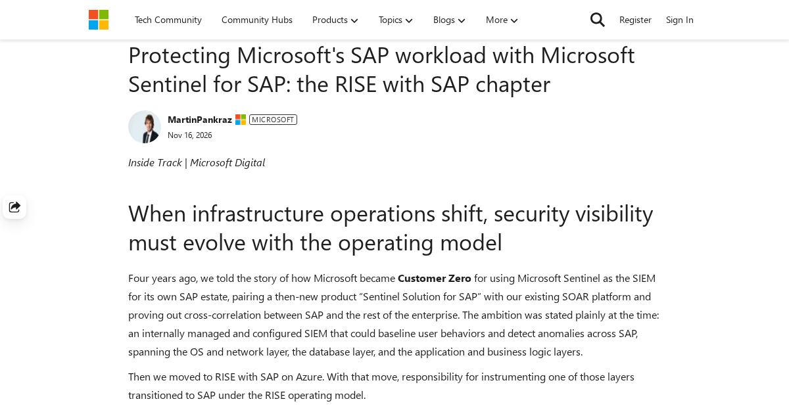

**b02: Azure DDoS Custom Policy GA**

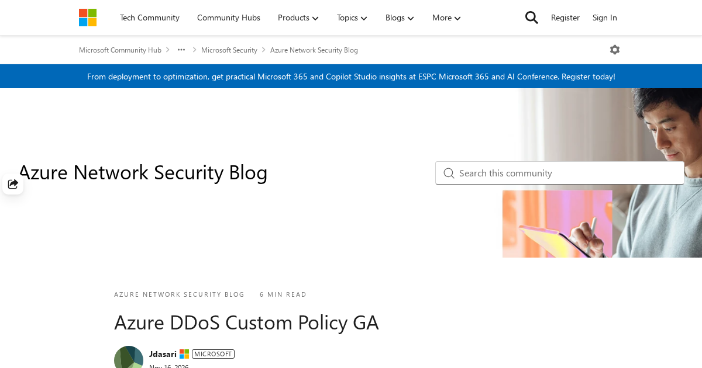

**b03: DDoS Support for NATGWv2 IP - Public Preview**

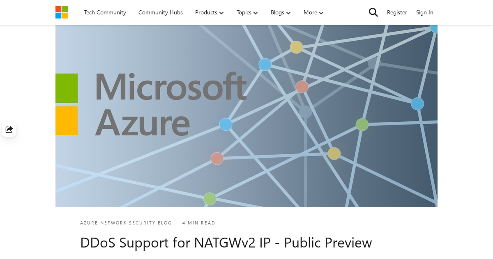

**b04: Security for the agentic era, powered by Microsoft Perception **

**b05: Ignite 2026: What's new in Microsoft Sentinel**

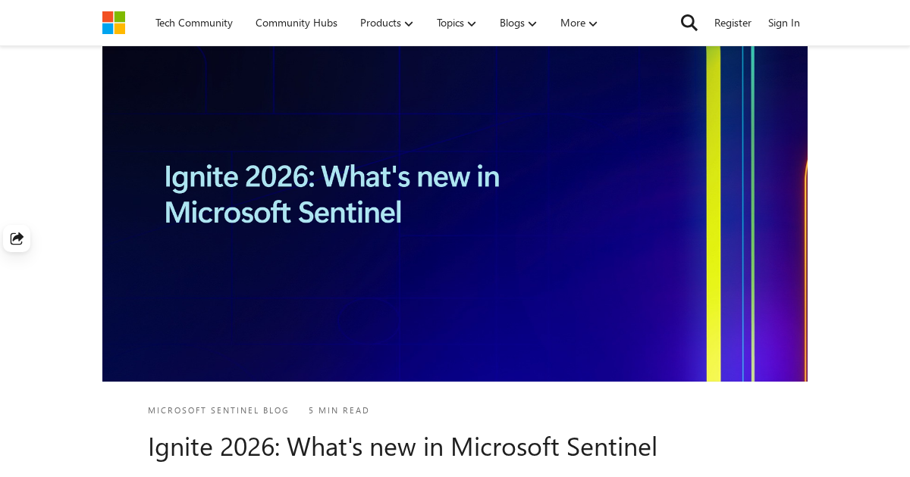

**b06: Vulnerability shielding: Protect the time before the patch**

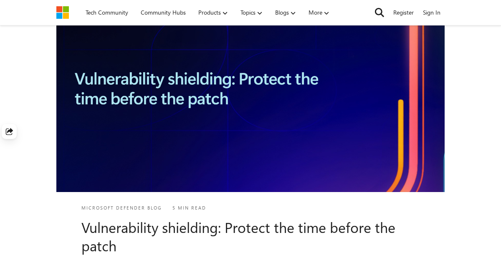

**b07: Threat intelligence that moves at the speed of the threat: What’s new at Microsoft Ignite …**

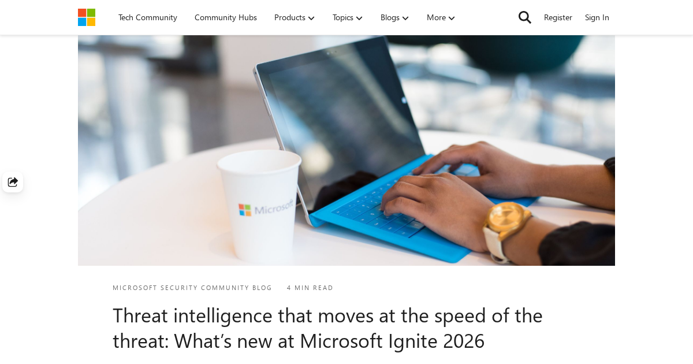

**b08: Preparing for a Post-Quantum Future with TLS in Windows**

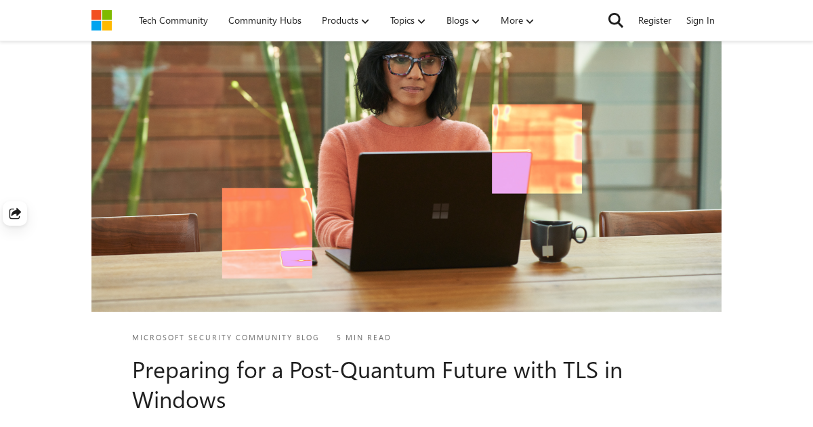

**b09: Artifact Signing with Signing Transparency: Private Preview**

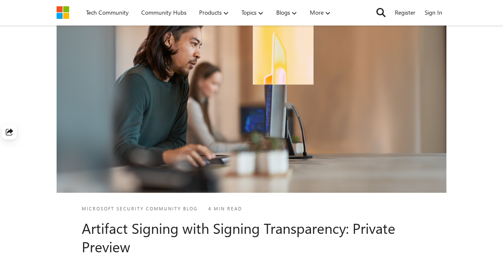

**b10: Microsoft Purview: Data Loss Prevention (DLP) vs. Insider Risk Management (IRM)**

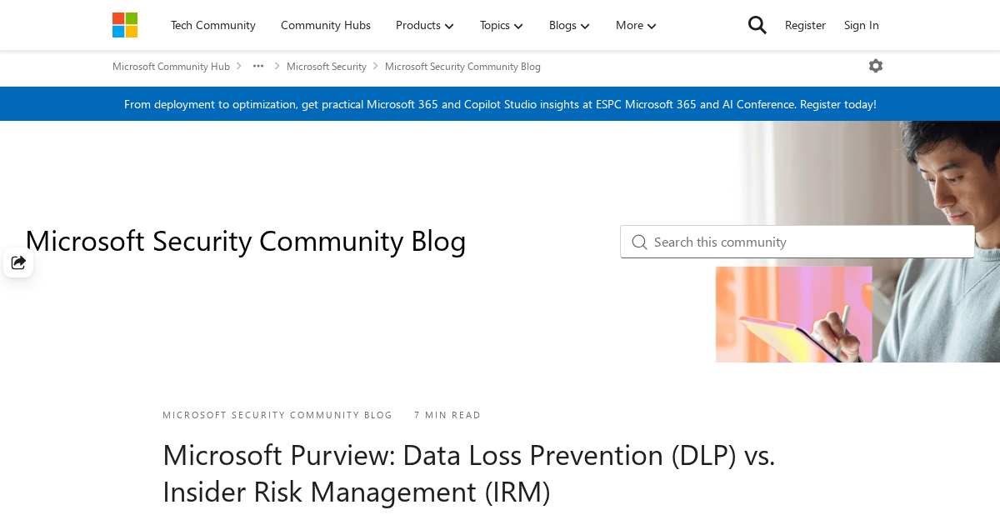

**b11: Accelerate Zero Trust for AI: Expanded SecOps coverage and new guides to turn insights into …**

**b12: Secure the data that fuels AI with Microsoft Purview**

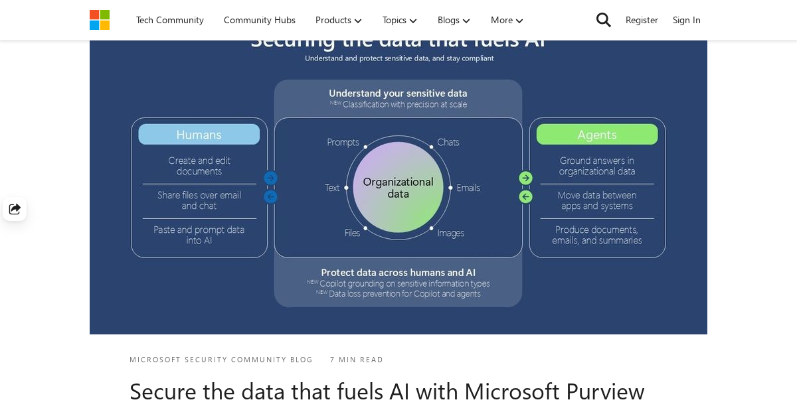

**b13: Ignite 2026: What’s new in endpoint security**

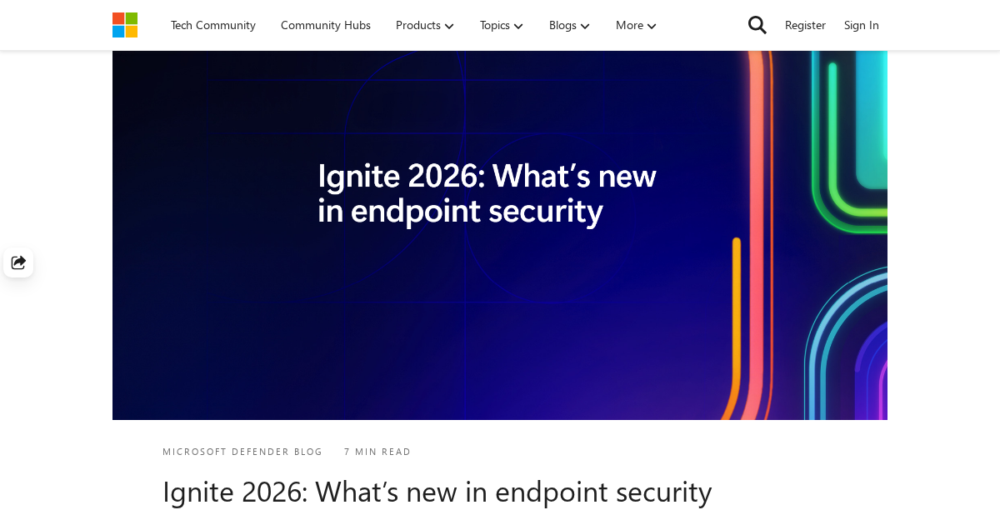

**b14: Microsoft Ignite 2026: New Sentinel Connectors Announcement**

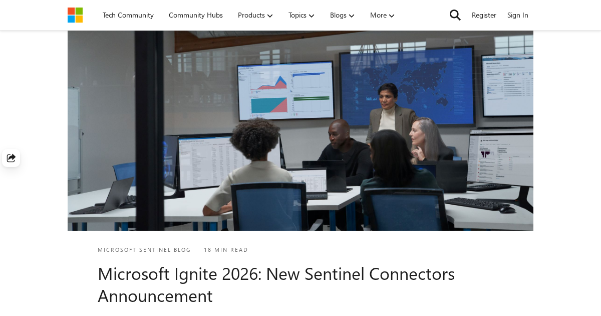

**b15: AI is changing access: Catch Microsoft Entra at Ignite 2026**

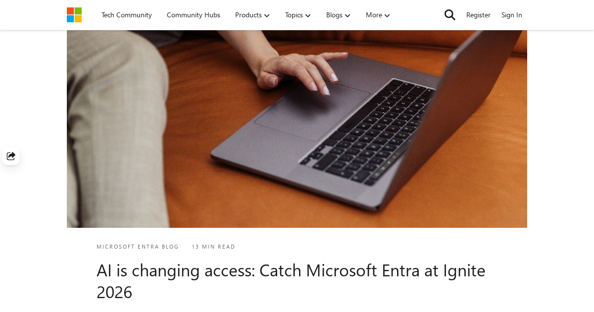

**b16: AI is changing access. See how Microsoft Entra helps you stay ahead.**

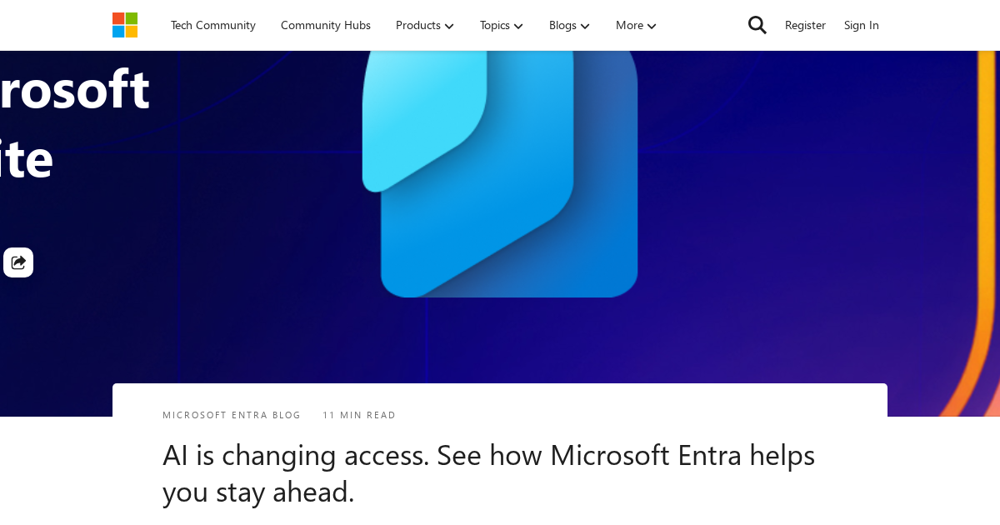

**b17: Addressing Java4Shell CVE-2026-114938: upgrade guidance and Azure WAF mitigations**

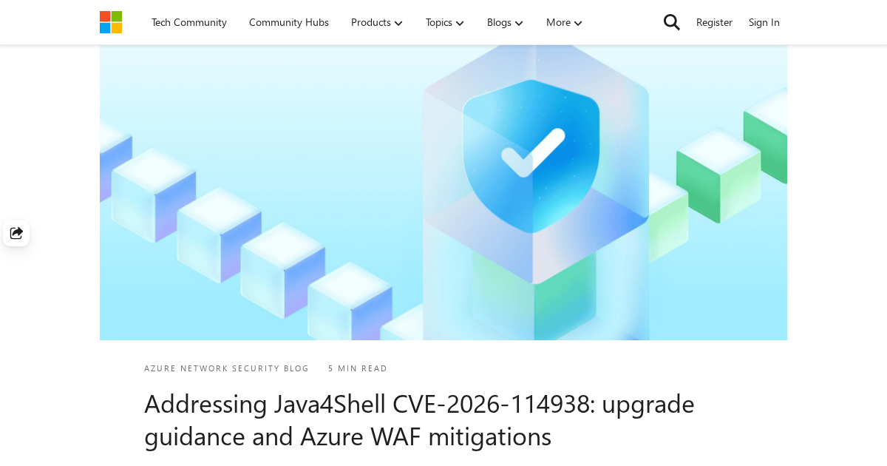

**b18: Ignite 2026: What's new in Microsoft Defender & Sentinel**

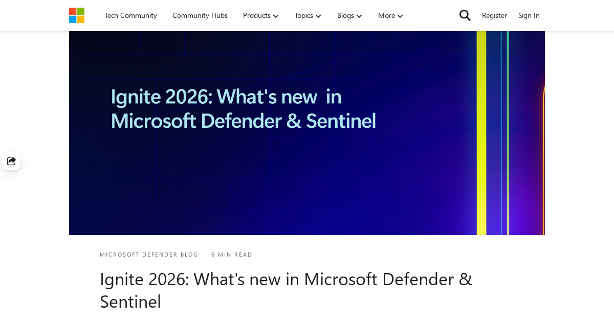

**b19: Intune’s journey to faster device management**

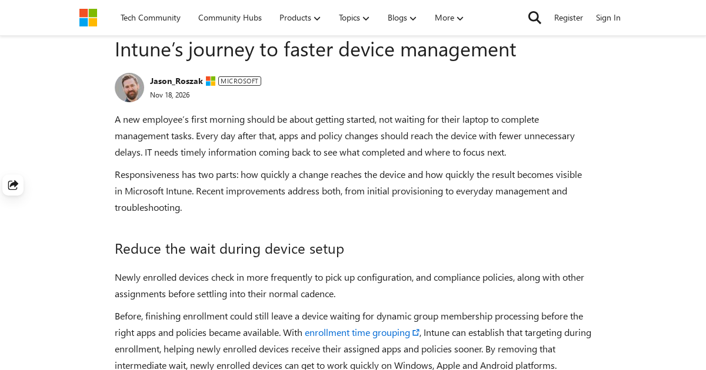

**b20: What’s new in Microsoft Intune at Microsoft Ignite**

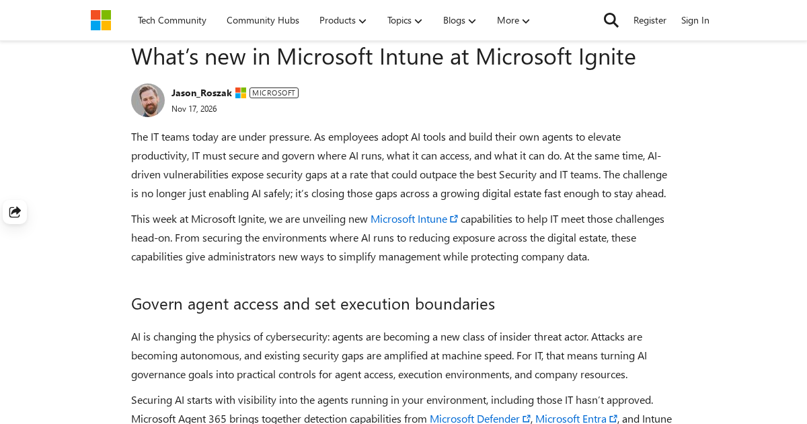

**b21: Demystifying macOS Platform SSO: How Apple and Microsoft Entra ID work together**

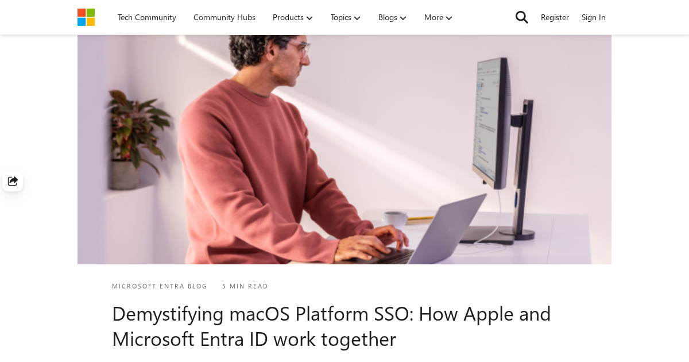

**b22: Microsoft named a Leader in the 2026 Gartner® Magic Quadrant™ for SIEM **

## What's new on Learn

Latest heading on each product's What's new / release-notes source, with every entry under it, whether or not it falls in the window. Three products have no Learn page and use an official Tech Community blog post instead (stated per product). Dates: an entry with its own day keeps it (precision day); blog-sourced entries use the post's publish date (day); otherwise the first day of the heading's period (month, shown as YYYY-MM, or week, shown as the week's start date); undated entries use the capture day (captured, never in window). In-window is yes only for a day inside 16-22 Nov 2026 IST, or a week whose Monday-Sunday is exactly 16-22 Nov. An empty summary means the entry is a bare feature name.

### Microsoft Sentinel

Source used: Microsoft Sentinel Blog on Tech Community: the newest post that lists new features, "Ignite 2026: What's new in Microsoft Sentinel" (17 Nov 2026). The latest post titled by month is "What's new in Microsoft Sentinel: October 2026" (30 Oct 2026); the Ignite post is newer and covers November, so it was used.  
Page: https://techcommunity.microsoft.com/t5/microsoft-sentinel-blog/ignite-2026-what-s-new-in-microsoft-sentinel/ba-p/4571174  
Latest heading: **Ignite 2026: What's new in Microsoft Sentinel (published November 17, 2026)**  
Note: Blog post, not a Learn page: each entry is a feature heading in the post, with its group heading as the category. Dated with the post's publish date (day). The closing "See what's next" and "Additional resources" sections are not features and are left out.  
Screenshot: [png](assets/learn-microsoft-sentinel.png)

| id | title | date | status | summary | in window | link |
|---|---|---|---|---|---|---|
| l01 | Integrated Security Operations Center (ISOC) expands to Microsoft Sentinel customers | 2026-11-17 (day) | - | Sentinel customers on M365 E5, E7 or Defender Suite can opt in to ISOC in Defender from 17 November, gaining 90-day retention and cheaper ingestion. | yes | [link](https://techcommunity.microsoft.com/t5/microsoft-sentinel-blog/ignite-2026-what-s-new-in-microsoft-sentinel/ba-p/4571174#community-4571174-toc-hId--1546787465) |
| l02 | More visibility into automation | 2026-11-17 (day) | Preview | Defender portal audit logs now record who created, edited, switched on or off, or deleted automation rules and generated playbooks. | yes | [link](https://techcommunity.microsoft.com/t5/microsoft-sentinel-blog/ignite-2026-what-s-new-in-microsoft-sentinel/ba-p/4571174#community-4571174-toc-hId-940725368) |
| l03 | Expand security visibility for stronger protection | 2026-11-17 (day) | - | The connector catalogue passes 500, adding sources such as Edge for Business, CrowdStrike, Wiz and OpenAI audit logs, with multi-instance support. | yes | [link](https://techcommunity.microsoft.com/t5/microsoft-sentinel-blog/ignite-2026-what-s-new-in-microsoft-sentinel/ba-p/4571174#community-4571174-toc-hId-1620783738) |
| l04 | Analyze security data together with ingest-time data normalization | 2026-11-17 (day) | - | Microsoft-managed parsers will normalise selected logs into standard schemas as they arrive; public preview is planned for December 2026. | yes | [link](https://techcommunity.microsoft.com/t5/microsoft-sentinel-blog/ignite-2026-what-s-new-in-microsoft-sentinel/ba-p/4571174#community-4571174-toc-hId--186670725) |
| l05 | Build Microsoft Sentinel connectors faster with AI in VS code | 2026-11-17 (day) | - | An AI agent in VS Code that drafts, checks and deploys Sentinel connectors is due to reach general availability by the end of November. | yes | [link](https://techcommunity.microsoft.com/t5/microsoft-sentinel-blog/ignite-2026-what-s-new-in-microsoft-sentinel/ba-p/4571174#community-4571174-toc-hId-493387645) |
| l06 | Monitor connector health and data ingestion | 2026-11-17 (day) | Preview | A Data & Connectors Overview tab in Defender shows connector health, ingestion volume and latency across the analytics and data lake tiers. | yes | [link](https://techcommunity.microsoft.com/t5/microsoft-sentinel-blog/ignite-2026-what-s-new-in-microsoft-sentinel/ba-p/4571174#community-4571174-toc-hId--1314066818) |

### Intune

Source used: https://learn.microsoft.com/en-us/intune/whats-new/ (as given).  
Page: https://learn.microsoft.com/en-us/intune/whats-new/  
Latest heading: **Week of November 16, 2026 (Service release 2611)** ([anchor](https://learn.microsoft.com/en-us/intune/whats-new/#week-of-november-16-2026-service-release-2611))  
Screenshot: [png](assets/learn-intune.png)

| id | title | date | status | summary | in window | link |
|---|---|---|---|---|---|---|
| l07 | Share device diagnostics during Remote Help sessions on Windows | 2026-11-16 (week) | - | Remote Help sessions on Windows can share device diagnostics with the helpdesk after the end user consents, and they can stop sharing at any time. | yes | [link](https://learn.microsoft.com/en-us/intune/whats-new/#share-device-diagnostics-during-remote-help-sessions-on-windows) |
| l08 | Keep work files in OneDrive for Business with Edge for Business on Windows | 2026-11-16 (week) | - | Windows app protection policy can send Edge for Business downloads to OneDrive for Business instead of the local disk (Edge 158 or later). | yes | [link](https://learn.microsoft.com/en-us/intune/whats-new/#keep-work-files-in-onedrive-for-business-with-edge-for-business-on-windows) |
| l09 | Newly available protected apps for Intune | 2026-11-16 (week) | - | Ten more apps join the Intune protected apps list, on iOS, Android or both. | yes | [link](https://learn.microsoft.com/en-us/intune/whats-new/#newly-available-protected-apps-for-intune) |
| l10 | New and updated settings for Windows in the settings catalog | 2026-11-16 (week) | - | The Windows settings catalog adds refreshed Edge and Chrome templates plus new Cloud PC device reset settings. | yes | [link](https://learn.microsoft.com/en-us/intune/whats-new/#new-and-updated-settings-for-windows-in-the-settings-catalog) |
| l11 | Automate tasks with local actions on Android Enterprise devices | 2026-11-16 (week) | - | Android Enterprise fully managed and dedicated devices can run local actions on events such as restarts, sign-in and power changes. | yes | [link](https://learn.microsoft.com/en-us/intune/whats-new/#automate-tasks-with-local-actions-on-android-enterprise-devices) |
| l12 | New settings for macOS in the settings catalog | 2026-11-16 (week) | - | The macOS settings catalog gains controls for EWS retirement alerts, Edge and Copilot browsing, and AI agent runtime protection with Defender for Endpoint. | yes | [link](https://learn.microsoft.com/en-us/intune/whats-new/#new-settings-for-macos-in-the-settings-catalog) |
| l13 | Group exclusions and built-in group targeting for PowerShell scripts on Windows | 2026-11-16 (week) | - | Windows PowerShell script assignments now accept group exclusions and the built-in All Users and All Devices groups. | yes | [link](https://learn.microsoft.com/en-us/intune/whats-new/#group-exclusions-and-built-in-group-targeting-for-powershell-scripts-on-windows) |
| l14 | Require Google Workspace authentication on Android Enterprise devices | 2026-11-16 (week) | - | Admins can require sign-in with a managed Google Workspace account on supported Android Enterprise devices. | yes | [link](https://learn.microsoft.com/en-us/intune/whats-new/#require-google-workspace-authentication-on-android-enterprise-devices) |
| l15 | Increase Intune management agent check-ins on macOS | 2026-11-16 (week) | - | Newly enrolled Macs check in with the Intune agent more often at first, so apps and scripts arrive sooner. | yes | [link](https://learn.microsoft.com/en-us/intune/whats-new/#increase-intune-management-agent-check-ins-on-macos) |
| l16 | Maintenance windows for operating system and driver updates on Windows | 2026-11-16 (week) | - | Maintenance windows let admins pick when Windows OS and driver update operations run, with schedule and duration settings. | yes | [link](https://learn.microsoft.com/en-us/intune/whats-new/#maintenance-windows-for-operating-system-and-driver-updates-on-windows) |
| l17 | Configure evaluation frequency for custom compliance scripts on Windows and macOS | 2026-11-16 (week) | - | Custom compliance scripts on Windows and macOS can be evaluated every 15 minutes up to every eight hours. | yes | [link](https://learn.microsoft.com/en-us/intune/whats-new/#configure-evaluation-frequency-for-custom-compliance-scripts-on-windows-and-macos) |
| l18 | Manage Windows Server devices with Microsoft Intune (Insider preview) | 2026-11-16 (week) | Preview | Intune can manage eligible Windows Server Insider builds, for nonproduction testing only. | yes | [link](https://learn.microsoft.com/en-us/intune/whats-new/#manage-windows-server-devices-with-microsoft-intune-insider-preview) |
| l19 | CIS benchmark auditing for Windows 11 devices (public preview) | 2026-11-16 (week) | Preview | Windows 11 devices can be audited against the CIS Intune benchmark in an audit-only profile, with per-setting results to export. | yes | [link](https://learn.microsoft.com/en-us/intune/whats-new/#cis-benchmark-auditing-for-windows-11-devices-public-preview) |
| l20 | Get more remediation guidance in Windows Autopatch reports | 2026-11-16 (week) | - | Windows Autopatch reports add data, remediation guidance and guardrails for configuration problems that block updates. | yes | [link](https://learn.microsoft.com/en-us/intune/whats-new/#get-more-remediation-guidance-in-windows-autopatch-reports) |

### Defender XDR

Source used: https://learn.microsoft.com/en-us/defender-xdr/whats-new (as given).  
Page: https://learn.microsoft.com/en-us/defender-xdr/whats-new  
Latest heading: **November 2026** ([anchor](https://learn.microsoft.com/en-us/defender-xdr/whats-new#november-2026))  
Screenshot: [png](assets/learn-defender-xdr.png)

| id | title | date | status | summary | in window | link |
|---|---|---|---|---|---|---|
| l21 | Domain filter in device inventory portal | 2026-11 (month) | - | Device inventory gains an Active Directory domain filter, so investigators can narrow the list to one domain's machines. | no | [link](https://learn.microsoft.com/en-us/defender-xdr/whats-new#november-2026) |
| l22 | Expanded identity activity visibility in advanced hunting | 2026-11 (month) | - | Advanced hunting adds more Active Directory events to the identity tables, covering directory replication, GPO updates, LDAP searches and Kerberos binds. | no | [link](https://learn.microsoft.com/en-us/defender-xdr/whats-new#november-2026) |
| l23 | Alert grouping for custom detection rules | 2026-11 (month) | Preview | From 17 November, custom detection rules can merge related alerts from one rule into a single incident using a time frame and matching criteria. | no | [link](https://learn.microsoft.com/en-us/defender-xdr/whats-new#november-2026) |
| l24 | Protect AI assets from trusted-identity attacks | 2026-11 (month) | Preview | New coverage detects and disrupts device code phishing aimed at GitHub Copilot CLI; best results need the GitHub connector at Enterprise level. | no | [link](https://learn.microsoft.com/en-us/defender-xdr/whats-new#november-2026) |
| l25 | New navigation | 2026-11 (month) | Preview | The Defender portal menu is reorganised so Sentinel pages sit where they are used; ISOC tenants get new paths and others keep the old ones. | no | [link](https://learn.microsoft.com/en-us/defender-xdr/whats-new#november-2026) |
| l26 | Entity mapping enhancements for custom detection rules | 2026-11 (month) | Preview | From 17 November, custom detections can map up to four identifiers per entity and repeat an entity type, with more identifiers supported. | no | [link](https://learn.microsoft.com/en-us/defender-xdr/whats-new#november-2026) |

### Purview

Source used: https://learn.microsoft.com/en-us/purview/whats-new (as given); the first heading, "What's planned for Microsoft Purview", is a forward-looking list, so the latest dated heading was used.  
Page: https://learn.microsoft.com/en-us/purview/whats-new  
Latest heading: **October 2026** ([anchor](https://learn.microsoft.com/en-us/purview/whats-new#october-2026))  
Screenshot: [png](assets/learn-purview.png)

| id | title | date | status | summary | in window | link |
|---|---|---|---|---|---|---|
| l27 | Endpoint data loss prevention (DLP) can now monitor sensitive data transferred over FTP and SFTP | 2026-10 (month) | GA | Endpoint DLP can watch FTP and SFTP transfers and apply restrictive actions once those activities are added to a policy. | no | [link](https://learn.microsoft.com/en-us/purview/whats-new#data-loss-prevention) |

### Microsoft Entra

Source used: https://learn.microsoft.com/en-us/entra/fundamentals/whats-new (dated release notes; switched from /whats-new-overview, which has no dated entries, per Shalabh's t18u decision).  
Page: https://learn.microsoft.com/en-us/entra/fundamentals/whats-new  
Latest heading: **June 2026** ([anchor](https://learn.microsoft.com/en-us/entra/fundamentals/whats-new#june-2026))  
Note: All entries under the latest heading on the Entra releases page, including those previously listed separately as Entra ID Governance and Global Secure Access. The page's newest heading is June 2026 (page date 26 June 2026), so none is in the window.  
Screenshot: [png](assets/learn-entra.png)

| id | title | date | status | summary | in window | link |
|---|---|---|---|---|---|---|
| l28 | General Availability - External users can be directly assigned to Access Packages | 2026-06 (month) | GA | Entitlement management admins can give an outside person an access package by email; they join as a guest and stay governed. | no | [link](https://learn.microsoft.com/en-us/entra/fundamentals/whats-new#general-availability---external-users-can-be-directly-assigned-to-access-packages) |
| l29 | General availability - Microsoft Entra Kerberos key rotation improved reliability for incoming trust referral flows | 2026-06 (month) | GA | Entra Kerberos now tries both the primary and secondary key, so key rotation no longer breaks referral sign-ins across trusts. | no | [link](https://learn.microsoft.com/en-us/entra/fundamentals/whats-new#general-availability---microsoft-entra-kerberos-key-rotation-improved-reliability-for-incoming-trust-referral-flows) |
| l30 | General Availability - BYOD support for Windows client using Entra registration | 2026-06 (month) | GA | Private Access traffic profiles can now be given to users on Entra-registered Windows devices, so those PCs need not be domain-joined. | no | [link](https://learn.microsoft.com/en-us/entra/fundamentals/whats-new#general-availability---byod-support-for-windows-client-using-entra-registration) |
| l31 | Generally available - Jailbreak/Root Detection in Authenticator App | 2026-06 (month) | GA | Authenticator now refuses work or school accounts on rooted or jailbroken phones, pushing users to compliant devices. | no | [link](https://learn.microsoft.com/en-us/entra/fundamentals/whats-new#generally-available---jailbreakroot-detection-in-authenticator-app) |
| l32 | Public Preview - Extended Conditional Access protections for Agent's user accounts | 2026-06 (month) | Preview | Conditional Access can target individual AI agents that hold user accounts, react to agent risk and require compliant devices or networks. | no | [link](https://learn.microsoft.com/en-us/entra/fundamentals/whats-new#public-preview---extended-conditional-access-protections-for-agents-user-accounts) |
| l33 | General Availability - Domainless SAML IdP federation for workforce tenants | 2026-06 (month) | GA | Guests can sign in through a SAML identity provider even when their email domain is not one configured for that provider. | no | [link](https://learn.microsoft.com/en-us/entra/fundamentals/whats-new#general-availability---domainless-saml-idp-federation-for-workforce-tenants) |
| l34 | General Availability - SCIM 2.0 APIs for Microsoft Entra ID in US Gov cloud | 2026-06 (month) | GA | The SCIM 2.0 provisioning APIs for Entra reach general availability in the US Government cloud. | no | [link](https://learn.microsoft.com/en-us/entra/fundamentals/whats-new#general-availability---scim-20-apis-for-microsoft-entra-id-in-us-gov-cloud) |
| l35 | General Availability - Microsoft Entra Backup and Recovery is now available | 2026-06 (month) | GA | Entra Backup and Recovery is on by default, snapshots key directory objects daily and lets admins diff and restore them. | no | [link](https://learn.microsoft.com/en-us/entra/fundamentals/whats-new#general-availability---microsoft-entra-backup-and-recovery-is-now-available) |
| l36 | Upcoming change - Improved restore experience for device-bound Authenticator app passkeys on iOS | 2026-06 (month) | - | From August 2026 iOS users get a smoother restore of device-bound Authenticator passkeys when iCloud Keychain backup is on; nobody needs to act. | no | [link](https://learn.microsoft.com/en-us/entra/fundamentals/whats-new#upcoming-change---improved-restore-experience-for-device-bound-authenticator-app-passkeys-on-ios) |
| l37 | Public Preview - New built-in Entra role for SOC identity response in Microsoft Defender | 2026-06 (month) | Preview | A new SOC Identity Responder role lets analysts disable users, revoke sessions and reset passwords from Defender without broad directory rights. | no | [link](https://learn.microsoft.com/en-us/entra/fundamentals/whats-new#public-preview---new-built-in-entra-role-for-soc-identity-response-in-microsoft-defender) |
| l38 | Public Preview - Prevent unauthorized changes to AD groups with AD group enforcement | 2026-06 (month) | Preview | Cloud Sync can lock chosen on-premises AD groups so only the Entra provisioning service may change them, preventing drift. | no | [link](https://learn.microsoft.com/en-us/entra/fundamentals/whats-new#public-preview---prevent-unauthorized-changes-to-ad-groups-with-ad-group-enforcement) |

### Defender for Cloud

Source used: https://learn.microsoft.com/en-us/azure/defender-for-cloud/release-notes (as given).  
Page: https://learn.microsoft.com/en-us/azure/defender-for-cloud/release-notes  
Latest heading: **November 2026** ([anchor](https://learn.microsoft.com/en-us/azure/defender-for-cloud/release-notes#november-2026))  
Screenshot: [png](assets/learn-defender-for-cloud.png)

| id | title | date | status | summary | in window | link |
|---|---|---|---|---|---|---|
| l39 | Arc proxy support for Defender for SQL Servers on Machines | 2026-11-04 (day) | - | Defender for SQL Servers on Machines now works for Arc-enabled SQL Server behind an Arc proxy, starting from extension 2.0.3585.403. | no | [link](https://learn.microsoft.com/en-us/azure/defender-for-cloud/release-notes#arc-proxy-support-for-defender-for-sql-servers-on-machines) |

### Microsoft Perception

Source used: No What's new or release-notes page on Learn (/security/agentic-security/whats-new and /release-notes return 404; the Perception docs table of contents has no such page). Used the official Microsoft Perception Blog on Tech Community: "What's new with Microsoft Perception at Ignite 2026" (17 Nov 2026).  
Page: https://techcommunity.microsoft.com/t5/microsoft-perception-blog/what-s-new-with-microsoft-perception-at-ignite-2026/ba-p/4571834  
Latest heading: **What's new with Microsoft Perception at Ignite 2026 (published November 17, 2026)**  
Note: Blog post, not a Learn page: each top-level section of the post is an entry. Dated with the post's publish date (day). The closing Ignite sessions section is left out.  
Screenshot: [png](assets/learn-microsoft-perception.png)

| id | title | date | status | summary | in window | link |
|---|---|---|---|---|---|---|
| l40 | A cyber stack built for agentic security | 2026-11-17 (day) | - | Microsoft frames Perception as the orchestration layer of a three-part cyber stack, feeding signals and context to specialised models and agent teams. | yes | [link](https://techcommunity.microsoft.com/t5/microsoft-perception-blog/what-s-new-with-microsoft-perception-at-ignite-2026/ba-p/4571834#community-4571834-toc-hId--1130952451) |
| l41 | Microsoft Perception is now generally available | 2026-11-17 (day) | GA | Project Perception is now generally available as Microsoft Perception, with red, blue and green agent teams run through reviewable playbooks. | yes | [link](https://techcommunity.microsoft.com/t5/microsoft-perception-blog/what-s-new-with-microsoft-perception-at-ignite-2026/ba-p/4571834#community-4571834-toc-hId-1356560382) |
| l42 | Stop threats at machine speed | 2026-11-17 (day) | - | The Triage Agent handles roughly 80% of a typical Defender alert queue, and the Attack Investigation Agent rebuilds timelines for confirmed threats. | yes | [link](https://techcommunity.microsoft.com/t5/microsoft-perception-blog/what-s-new-with-microsoft-perception-at-ignite-2026/ba-p/4571834#community-4571834-toc-hId--450894081) |
| l43 | Think like an attacker with advanced code scanning | 2026-11-17 (day) | - | A web pen test playbook lets an agent probe authorised apps, with MDASH code-scanning findings validated and newer MAI-Cyber models supported. | yes | [link](https://techcommunity.microsoft.com/t5/microsoft-perception-blog/what-s-new-with-microsoft-perception-at-ignite-2026/ba-p/4571834#community-4571834-toc-hId--1578290174) |
| l44 | Shrink your attack surface | 2026-11-17 (day) | - | AI Readiness Initiatives group exposure fixes into programmes, and a Risk Reduction Agent can patch through Intune or shield a flaw until patching. | yes | [link](https://techcommunity.microsoft.com/t5/microsoft-perception-blog/what-s-new-with-microsoft-perception-at-ignite-2026/ba-p/4571834#community-4571834-toc-hId-909222659) |
| l45 | Secure your AI and agents | 2026-11-17 (day) | - | With Microsoft 365 E7, Perception gives one view of AI agents' access and behaviour, and playbooks drive remediation of risky agents. | yes | [link](https://techcommunity.microsoft.com/t5/microsoft-perception-blog/what-s-new-with-microsoft-perception-at-ignite-2026/ba-p/4571834#community-4571834-toc-hId--898231804) |
| l46 | Put agentic security to work, and stay in control | 2026-11-17 (day) | - | APIs and MCP let ITSM, SIEM or SOAR tools start Perception playbooks, and new usage dashboards and a cost calculator track agent spend. | yes | [link](https://techcommunity.microsoft.com/t5/microsoft-perception-blog/what-s-new-with-microsoft-perception-at-ignite-2026/ba-p/4571834#community-4571834-toc-hId-1589281029) |

### Security Copilot

Source used: Learn page found: https://learn.microsoft.com/en-us/copilot/security/whats-new-copilot-security.  
Page: https://learn.microsoft.com/en-us/copilot/security/whats-new-copilot-security  
Latest heading: **April 2026** ([anchor](https://learn.microsoft.com/en-us/copilot/security/whats-new-copilot-security#april-2026))  
Screenshot: [png](assets/learn-security-copilot.png)

| id | title | date | status | summary | in window | link |
|---|---|---|---|---|---|---|
| l47 | Security Analyst Agent - Public preview | 2026-04 (month) | Preview | The Security Analyst Agent runs multi-step investigations across Defender and Sentinel data and returns prioritised risks with reasoning and evidence. | no | [link](https://learn.microsoft.com/en-us/copilot/security/whats-new-copilot-security#security-analyst-agent---public-preview) |

### Agent 365

Source used: No What's new or release-notes page on Learn (/microsoft-agent-365/whats-new returns 404; the Agent 365 docs table of contents has no such page). Used the official Agent 365 Blog on Tech Community: "What's new in Microsoft Agent 365: Ignite 2026" (17 Nov 2026).  
Page: https://techcommunity.microsoft.com/t5/agent-365-blog/what-s-new-in-microsoft-agent-365-ignite-2026/ba-p/4571753  
Latest heading: **What's new in Microsoft Agent 365: Ignite 2026 (published November 17, 2026)**  
Note: Blog post, not a Learn page: each feature heading is an entry, with its section heading as the category. Dated with the post's publish date (day). The closing Get started, Ignite sessions and Learn more sections are left out.  
Screenshot: [png](assets/learn-agent-365.png)

| id | title | date | status | summary | in window | link |
|---|---|---|---|---|---|---|
| l48 | Connect your agent estate across platforms | 2026-11-17 (day) | - | Connected platforms bring agents built in tools such as Agentforce, Databricks Genie or Bedrock into one Agent 365 view for IT and security. | yes | [link](https://techcommunity.microsoft.com/t5/agent-365-blog/what-s-new-in-microsoft-agent-365-ignite-2026/ba-p/4571753#community-4571753-toc-hId-2057624060) |
| l49 | Local and shadow agent discovery | 2026-11-17 (day) | - | Defender (now GA) and Global Secure Access (preview) find over 60 local agents, like Claude Code and Copilot CLI, plus their MCP servers. | yes | [link](https://techcommunity.microsoft.com/t5/agent-365-blog/what-s-new-in-microsoft-agent-365-ignite-2026/ba-p/4571753#community-4571753-toc-hId-250169597) |
| l50 | Secure local agents with Entra Agent ID | 2026-11-17 (day) | Preview | Entra Agent ID gives discovered local agents, starting with GitHub Copilot CLI and Claude Code, their own identity so access rules can target them. | yes | [link](https://techcommunity.microsoft.com/t5/agent-365-blog/what-s-new-in-microsoft-agent-365-ignite-2026/ba-p/4571753#community-4571753-toc-hId--1557284866) |
| l51 | Extend Entra Agent ID to Microsoft Autopilot | 2026-11-17 (day) | Preview | Entra Agent ID support extends to agents in Microsoft Autopilot, alongside Copilot Studio and Foundry agents. | yes | [link](https://techcommunity.microsoft.com/t5/agent-365-blog/what-s-new-in-microsoft-agent-365-ignite-2026/ba-p/4571753#community-4571753-toc-hId-930227967) |
| l52 | Export Agent Activity | 2026-11-17 (day) | - | Admins can stream agent traces from Agent 365 into their own Azure Monitor and Application Insights, choosing which prompts and responses go along. | yes | [link](https://techcommunity.microsoft.com/t5/agent-365-blog/what-s-new-in-microsoft-agent-365-ignite-2026/ba-p/4571753#community-4571753-toc-hId--877226496) |
| l53 | Tools Registry | 2026-11-17 (day) | - | A tools registry (GA) lists the tools and connections agents use and flags risky ones; linking outside catalogues enters private preview in December. | yes | [link](https://techcommunity.microsoft.com/t5/agent-365-blog/what-s-new-in-microsoft-agent-365-ignite-2026/ba-p/4571753#community-4571753-toc-hId-1610286337) |
| l54 | Agent Map Use Cases | 2026-11-17 (day) | Preview | Agent map use cases sort agent sessions by type of work, helping admins spot duplicate agents and adoption patterns. | yes | [link](https://techcommunity.microsoft.com/t5/agent-365-blog/what-s-new-in-microsoft-agent-365-ignite-2026/ba-p/4571753#community-4571753-toc-hId--197168126) |
| l55 | Manage agents across multiple tenants at scale | 2026-11-17 (day) | Preview | Partners and multi-tenant organisations get one Agent 365 view of agents across the tenants they manage, in the Microsoft 365 admin center. | yes | [link](https://techcommunity.microsoft.com/t5/agent-365-blog/what-s-new-in-microsoft-agent-365-ignite-2026/ba-p/4571753#community-4571753-toc-hId--2004622589) |
| l56 | Expand usage insights for Microsoft agents to Agent 365 core users | 2026-11-17 (day) | GA | Users with qualifying Microsoft 365 subscriptions gain Agent 365 usage and activity insights for Microsoft-built and Microsoft-platform agents. | yes | [link](https://techcommunity.microsoft.com/t5/agent-365-blog/what-s-new-in-microsoft-agent-365-ignite-2026/ba-p/4571753#community-4571753-toc-hId-482890244) |
| l57 | Plugins, skills, and MCP server governance | 2026-11-17 (day) | - | Plugin and skill governance for Copilot and Copilot Cowork is GA; MCP servers from Azure AI Gateway and LiteLLM join in preview. | yes | [link](https://techcommunity.microsoft.com/t5/agent-365-blog/what-s-new-in-microsoft-agent-365-ignite-2026/ba-p/4571753#community-4571753-toc-hId-467785135) |
| l58 | Local and shadow agent governance | 2026-11-17 (day) | Preview | Admins can review discovered local agents and block unapproved ones with Intune, Defender and Global Secure Access controls. | yes | [link](https://techcommunity.microsoft.com/t5/agent-365-blog/what-s-new-in-microsoft-agent-365-ignite-2026/ba-p/4571753#community-4571753-toc-hId--1339669328) |
| l59 | Copilot Cowork with Agent 365 plugin | 2026-11-17 (day) | Preview | An Agent 365 plugin for Copilot Cowork lets admins inspect and govern their AI estate by describing the outcome they want in plain language. | yes | [link](https://techcommunity.microsoft.com/t5/agent-365-blog/what-s-new-in-microsoft-agent-365-ignite-2026/ba-p/4571753#community-4571753-toc-hId-1147843505) |
| l60 | Action center | 2026-11-17 (day) | - | Action center collects governance tasks, starting with inactive agents and agents that have no owner. | yes | [link](https://techcommunity.microsoft.com/t5/agent-365-blog/what-s-new-in-microsoft-agent-365-ignite-2026/ba-p/4571753#community-4571753-toc-hId--659610958) |
| l61 | Dynamic agent risk | 2026-11-17 (day) | Preview | Each agent gets one risk level built from runtime signals and exposure, updated as it acts, shown across Agent 365, Defender and other consoles. | yes | [link](https://techcommunity.microsoft.com/t5/agent-365-blog/what-s-new-in-microsoft-agent-365-ignite-2026/ba-p/4571753#community-4571753-toc-hId-20447412) |
| l62 | Identity and access controls that adapt to risk | 2026-11-17 (day) | - | Conditional Access can now re-check policy at the moment an agent acts and set separate rules for agents acting on a user's behalf. | yes | [link](https://techcommunity.microsoft.com/t5/agent-365-blog/what-s-new-in-microsoft-agent-365-ignite-2026/ba-p/4571753#community-4571753-toc-hId--1787007051) |
| l63 | Data security for Microsoft and local agents | 2026-11-17 (day) | Preview | Purview DLP can stop sensitive data reaching Microsoft agents and local agents such as Claude Code and GitHub Copilot tools. | yes | [link](https://techcommunity.microsoft.com/t5/agent-365-blog/what-s-new-in-microsoft-agent-365-ignite-2026/ba-p/4571753#community-4571753-toc-hId-700505782) |
| l64 | Runtime protection for local agents | 2026-11-17 (day) | GA | Defender runtime protection for local agents on Windows is now GA, blocking malicious instructions mid-loop for agents like Claude Code and OpenClaw. | yes | [link](https://techcommunity.microsoft.com/t5/agent-365-blog/what-s-new-in-microsoft-agent-365-ignite-2026/ba-p/4571753#community-4571753-toc-hId--1106948681) |
| l65 | Security posture for third-party agents and tools | 2026-11-17 (day) | Preview | Defender posture assessment now covers agents on Amazon Bedrock, Google Gemini and Vertex AI, and Anthropic Claude, in the shared AI agent inventory. | yes | [link](https://techcommunity.microsoft.com/t5/agent-365-blog/what-s-new-in-microsoft-agent-365-ignite-2026/ba-p/4571753#community-4571753-toc-hId-2078726093) |
| l66 | Endpoint and network controls for local agents | 2026-11-17 (day) | Preview | Intune policies set file and network limits that Microsoft Execution Containers enforce on Windows, outside the agent's own control. | yes | [link](https://techcommunity.microsoft.com/t5/agent-365-blog/what-s-new-in-microsoft-agent-365-ignite-2026/ba-p/4571753#community-4571753-toc-hId-271271630) |
| l67 | Agent 365 Business Analytics | 2026-11-17 (day) | - | Business Analytics puts AI spend, usage and value across Microsoft and other providers in one place for business leaders. | yes | [link](https://techcommunity.microsoft.com/t5/agent-365-blog/what-s-new-in-microsoft-agent-365-ignite-2026/ba-p/4571753#community-4571753-toc-hId-951330000) |
| l68 | Agent 365 Cost Management | 2026-11-17 (day) | - | Cost Management tracks AI consumption by user, service, agent and model, with spending limits and alerts at several levels. | yes | [link](https://techcommunity.microsoft.com/t5/agent-365-blog/what-s-new-in-microsoft-agent-365-ignite-2026/ba-p/4571753#community-4571753-toc-hId--856124463) |

### MDASH

Source used: No separate MDASH page on Learn (/security-exposure-management/mdash/whats-new returns 404). MDASH updates are published on the Microsoft Security Exposure Management What's new page (https://learn.microsoft.com/en-us/security-exposure-management/whats-new); only entries under its latest heading that name Codename MDASH are listed.  
Page: https://learn.microsoft.com/en-us/security-exposure-management/whats-new  
Latest heading: **November 2026** ([anchor](https://learn.microsoft.com/en-us/security-exposure-management/whats-new#november-2026))  
Note: Shares the Security Exposure Management page; only the entry under the latest heading (November 2026) that names Codename MDASH is listed.  
Screenshot: [png](assets/learn-mdash.png)

| id | title | date | status | summary | in window | link |
|---|---|---|---|---|---|---|
| l69 | Codename MDASH - Finding validation and scan improvements | 2026-11-20 (day) | - | MDASH code-scanning findings can feed a Perception web pen test playbook, with cheaper scans, fewer duplicate findings and a lower model requirement. | yes | [link](https://learn.microsoft.com/en-us/security-exposure-management/whats-new#codename-mdash---finding-validation-and-scan-improvements) |

## Coming soon

Two official sources. (1) Microsoft 365 Roadmap: security items whose published rollout month is November 2026 to February 2027 (rollout months starting within 90 days of the window end; the whole month counts). Launched items are left out, and an edit date alone does not qualify an item. Worldwide ID is primary; US Government IDs for the same feature are listed under also ids; US-Government-only items are left out. mrcwall.com was used only to discover items; status, rollout and dates come from the official Roadmap API. (2) Microsoft Learn: In development for Microsoft Intune; every feature entry is included because the page states it is in development. Learn entries carry no Roadmap ID or dates.

Items per product: Microsoft Purview 43, Microsoft Intune 16, Microsoft Entra 2, Microsoft 365 1, Microsoft 365 admin center 1, Microsoft Copilot (Microsoft 365) 1. Total 61 items (an item tagged to several products is counted under each).

| id | product | title | status | rollout | added / last modified | also ids | summary |
|---|---|---|---|---|---|---|---|
| rm01 | Microsoft Purview | [Microsoft Purview: Purview Information Protection \| Classifier Simulation Mode (Health Monitoring)](https://www.microsoft.com/microsoft-365/roadmap?id=523201) | In development | November CY2026 | 2025-11-05 / 2026-07-14 | - | A simulation mode lets admins test and tune custom classifiers on live data before turning enforcement on. |
| rm02 | Microsoft Purview | [Microsoft Purview: Data Lifecycle Management– Hard delete capability for OneDrive and SharePoint through secure priority …](https://www.microsoft.com/microsoft-365/roadmap?id=558343) | In development | November CY2026 | 2026-03-09 / 2026-10-26 | 561034 (GCC/GCC High/DoD) | A secured cleanup workflow lets compliance admins hard-delete OneDrive and SharePoint content that retention would normally keep. |
| rm03 | Microsoft Purview | [Microsoft Purview: Data Loss Prevention – Reduce policy sync status SLA on the Purview UI …](https://www.microsoft.com/microsoft-365/roadmap?id=558682) | In development | November CY2026 | 2026-03-24 / 2026-08-12 | 562994 (GCC/GCC High/DoD) | Endpoint DLP policy sync status will show in the Purview portal within 30 minutes instead of two hours. |
| rm04 | Microsoft Purview | [Microsoft Purview: Data Lifecycle Management – Archive SharePoint files under retention](https://www.microsoft.com/microsoft-365/roadmap?id=561208) | In development | November CY2026 | 2026-05-05 / 2026-10-12 | 562345 (GCC/GCC High/DoD) | SharePoint retention policies can archive files, not just keep or delete them. |
| rm05 | Microsoft Entra | [Microsoft Entra: Enhanced Security Accounts Manager (sAM) Account Name support for Microsoft Entra Domain Services](https://www.microsoft.com/microsoft-365/roadmap?id=569446) | In development | November CY2026 | 2026-09-01 / 2026-09-01 | - | Entra Domain Services can fill sAMAccountName from the synced on-premises attribute; existing managed domains can switch it on. |
| rm06 | Microsoft Purview | [Microsoft Purview: Information Protection-Auto-labeling for legacy Office files](https://www.microsoft.com/microsoft-365/roadmap?id=574363) | In development | November CY2026 | 2026-10-13 / 2026-10-13 | 578872 (GCC/GCC High/DoD) | Server-side auto-labeling will evaluate and label older Word, Excel and PowerPoint files in SharePoint and OneDrive. |
| rm07 | Microsoft Purview | [Microsoft Purview: Data Loss Prevention-Admin Units Support for Copilot & Cowork DLP](https://www.microsoft.com/microsoft-365/roadmap?id=575287) | In development | November CY2026 | 2026-10-13 / 2026-10-13 | - | Copilot, Copilot Chat and Cowork DLP policies can be delegated to admins in administrative units. |
| rm08 | Microsoft Purview | [Microsoft Purview compliance portal: Data Lifecycle Management - Bulk replacement or removal of a retention …](https://www.microsoft.com/microsoft-365/roadmap?id=392456) | In development | December CY2026 | 2024-04-12 / 2026-04-03 | 392457 (GCC/GCC High/DoD) | Admins can replace or remove a retention label in bulk, tenant-wide or scoped with KQL and adaptive or static scopes. |
| rm09 | Microsoft Purview | [Microsoft Purview compliance portal: eDiscovery - Advanced Review Set Explorer](https://www.microsoft.com/microsoft-365/roadmap?id=484086) | In development | December CY2026 | 2025-03-07 / 2026-08-14 | 565372 (GCC/GCC High/DoD) | Review set analytics in eDiscovery add Kusto-style exploration to see item types, patterns and trends. |
| rm10 | Microsoft Purview | [Microsoft Purview: eDiscovery- CMK (Customer managed key) for eDiscovery direct export ](https://www.microsoft.com/microsoft-365/roadmap?id=557684) | In development | December CY2026 | 2026-02-25 / 2026-08-17 | 565373 (GCC/GCC High/DoD) | eDiscovery direct export can use customer-managed encryption keys. |
| rm11 | Microsoft Purview | [Microsoft Purview: Data Loss Prevention - Count of Labelled Documents Condition](https://www.microsoft.com/microsoft-365/roadmap?id=562342) | In development | December CY2026 | 2026-05-15 / 2026-08-11 | - | A new Exchange DLP condition triggers when an email carries more than a set number of attachments with a matching sensitivity label. |
| rm12 | Microsoft Purview | [Microsoft Purview: Endpoint Data Loss Prevention - Allow customer to scope JIT Audit to specific …](https://www.microsoft.com/microsoft-365/roadmap?id=562991) | In development | December CY2026 | 2026-05-26 / 2026-09-14 | - | Endpoint DLP just-in-time audit can be limited to chosen users or groups. |
| rm13 | Microsoft Purview | [Endpoint Data Loss Prevention — Endpoint DLP now supports a pre curated list of file …](https://www.microsoft.com/microsoft-365/roadmap?id=562993) | In development | December CY2026 | 2026-05-27 / 2026-09-18 | - | Endpoint DLP gets a curated list of file extensions for its extension condition, replacing free-text entry. |
| rm14 | Microsoft Purview | [Microsoft Purview: eDiscovery - In-product diagnostics to troubleshoot common challenges](https://www.microsoft.com/microsoft-365/roadmap?id=565222) | In development | December CY2026 | 2026-06-05 / 2026-11-04 | - | eDiscovery gains self-service diagnostics that flag case permission, security filter and policy status problems. |
| rm15 | Microsoft Purview | [Microsoft Purview: Data Lifecycle Management - Ensure regulatory compliance by deleting inactive OneDrives and mailboxes …](https://www.microsoft.com/microsoft-365/roadmap?id=566527) | In development | December CY2026 | 2026-06-25 / 2026-09-21 | 569721 (GCC/GCC High/DoD) | Admins can delete inactive OneDrives and mailboxes of departed users at scale to stay compliant. |
| rm16 | Microsoft Purview | [Microsoft Purview: Insider Risk Management - DS Triage Agent for IRM available in Defender](https://www.microsoft.com/microsoft-365/roadmap?id=567472) | In development | December CY2026 | 2026-07-09 / 2026-07-09 | - | Insider Risk Management triage-agent summaries will appear in the Defender alert queue. |
| rm17 | Microsoft 365, Microsoft 365 admin center, Microsoft Entra | [Microsoft 365: Entra ID Backup & Recovery](https://www.microsoft.com/microsoft-365/roadmap?id=567885) | In development | December CY2026 | 2026-09-01 / 2026-09-01 | - | Entra objects can be backed up for 30 days and restored to a point in time through Microsoft 365 Backup. |
| rm18 | Microsoft Purview | [Microsoft Purview: Data Loss Prevention-Apply Purview network data security DLP policies to all websites, or …](https://www.microsoft.com/microsoft-365/roadmap?id=575285) | In development | December CY2026 | 2026-10-12 / 2026-10-12 | - | Network DLP policies enforced through Entra Internet Access can cover all websites or all except chosen cloud apps. |
| rm19 | Microsoft Purview | [Microsoft Purview compliance portal: Communication Compliance - Alert improvements](https://www.microsoft.com/microsoft-365/roadmap?id=181825) | In development | January CY2027 | 2023-10-16 / 2026-10-22 | 529852 (GCC/GCC High/DoD) | Communication Compliance gets better alert handling and customization. |
| rm20 | Microsoft Purview | [Microsoft Purview compliance portal: Data Lifecycle Management - Introduction of secure workflow to bypass legal …](https://www.microsoft.com/microsoft-365/roadmap?id=392838) | In development | January CY2027 | 2024-05-22 / 2026-11-17 | 473493 (GCC/GCC High/DoD) | A priority cleanup workflow lets admins delete Exchange items that a broader retention policy or legal hold would keep, under a separate role. |
| rm21 | Microsoft Purview | [Microsoft Purview compliance portal: Data Lifecycle Management - Automatic data preservation for high-risk users](https://www.microsoft.com/microsoft-365/roadmap?id=392839) | In development | January CY2027 | 2024-05-06 / 2026-11-17 | 566324 (GCC/GCC High/DoD) | Adaptive Protection risk levels can trigger automatic data preservation for high-risk users. |
| rm22 | Microsoft Purview | [Microsoft Purview compliance portal: Scanner data export for custom reporting](https://www.microsoft.com/microsoft-365/roadmap?id=494839) | In development | January CY2027 | 2025-05-22 / 2026-10-29 | - | The information protection scanner exports label and classification results to SQL tables for custom reports. |
| rm23 | Microsoft Purview | [Microsoft Purview: Compliance Manager-Purview Compliance Manager integration with Microsoft Foundry for automated mapping of AI …](https://www.microsoft.com/microsoft-365/roadmap?id=536576) | In development | January CY2027 | 2025-12-04 / 2026-10-19 | - | Compliance Manager will map Foundry agents to regulations and assess their compliance posture automatically. |
| rm24 | Microsoft Purview | [Microsoft Purview: Data Loss Prevention- Adaptive Scopes for DLP for SharePoint](https://www.microsoft.com/microsoft-365/roadmap?id=549288) | In development | January CY2027 | 2026-01-21 / 2026-08-27 | - | DLP policies for SharePoint can target sites dynamically using attributes such as URL, name or metadata. |
| rm25 | Microsoft Purview | [Microsoft Purview: Information Protection- File Labeler and File Viewer for MacOS](https://www.microsoft.com/microsoft-365/roadmap?id=561327) | In development | January CY2027 | 2026-05-07 / 2026-10-13 | - | Information Protection File Labeler and File Viewer come to macOS, with core functions available. |
| rm26 | Microsoft Purview | [Microsoft Purview: Data Loss Prevention - Reusable Global List for Exchange Online](https://www.microsoft.com/microsoft-365/roadmap?id=561919) | In development | January CY2027 | 2026-05-13 / 2026-08-11 | - | Exchange DLP gets reusable global lists of keywords, domains and addresses shared across rules. |
| rm27 | Microsoft Purview | [Microsoft Purview: Data Loss Prevention - AI Powered Data Loss Prevention Policy Optimizer](https://www.microsoft.com/microsoft-365/roadmap?id=564616) | In development | January CY2027 | 2026-06-02 / 2026-07-15 | - | An AI-powered DLP Policy Optimizer finds overlapping or redundant rules and suggests improvements. |
| rm28 | Microsoft Purview | [Microsoft Purview: Information Protection - Rights Management connector – Certificate-based authentication](https://www.microsoft.com/microsoft-365/roadmap?id=564617) | In development | January CY2027 | 2026-06-03 / 2026-10-13 | - | The Rights Management connector moves from shared secrets to certificate-based authentication through the admin's own Entra app registration. |
| rm29 | Microsoft Purview | [Microsoft Purview: Data Loss Prevention - Endpoint DLP now detects sensitivity labels on files inside …](https://www.microsoft.com/microsoft-365/roadmap?id=566617) | In development | January CY2027 | 2026-06-25 / 2026-07-06 | - | Endpoint DLP will detect sensitivity labels on files inside archives such as zip files, with finer admin control. |
| rm30 | Microsoft Purview | [Microsoft Purview: Information Protection - Sensitivity Labels for Microsoft Entra Security Groups](https://www.microsoft.com/microsoft-365/roadmap?id=568217) | In development | January CY2027 | 2026-07-28 / 2026-11-17 | - | Sensitivity labels can be applied to Entra cloud security groups, as they already are for Microsoft 365 groups. |
| rm31 | Microsoft Purview | [Microsoft Purview: Data Loss Prevention - SLA Based Alert Reporting Dashboard](https://www.microsoft.com/microsoft-365/roadmap?id=568372) | In development | January CY2027 | 2026-07-28 / 2026-10-21 | - | A built-in DLP dashboard tracks alert response times against customizable service levels. |
| rm32 | Microsoft Purview | [Microsoft Purview: Data Lifecycle Management-Legacy Teams retention policies covering Copilot will be treated as Teams-only](https://www.microsoft.com/microsoft-365/roadmap?id=571306) | In development | January CY2027 | 2026-09-18 / 2026-10-28 | - | Legacy Teams retention policies that also covered Copilot interactions will be treated as Teams-only. |
| rm33 | Microsoft Purview | [Microsoft Purview: Data Lifecycle Management-Enable version trimming for data covered by retention policies in OneDrive …](https://www.microsoft.com/microsoft-365/roadmap?id=575284) | In development | January CY2027 | 2026-11-05 / 2026-11-05 | - | Admins can trim file versions piled up by retention in OneDrive and SharePoint without breaking compliance holds. |
| rm34 | Microsoft Purview | [Microsoft Purview: Introducing IRM Alert classification](https://www.microsoft.com/microsoft-365/roadmap?id=576710) | In development | January CY2027 | 2026-10-22 / 2026-11-19 | - | Insider risk analysts can label alerts true positive, benign or false positive. |
| rm35 | Microsoft Purview | [Microsoft Purview: Endpoint Data Loss Prevention-View-only access to device onboarding with the View-Only Device Management …](https://www.microsoft.com/microsoft-365/roadmap?id=577187) | In development | January CY2027 | 2026-10-20 / 2026-11-11 | - | A View-Only Device Management role gives read access to Endpoint DLP device onboarding without broad admin rights. |
| rm36 | Microsoft Purview | [Microsoft Purview compliance portal: Communication Compliance - Ability to set a retention period for a …](https://www.microsoft.com/microsoft-365/roadmap?id=68688) | In development | January CY2027 | 2020-09-14 / 2026-06-25 | - | Communication Compliance policies can set how long captured content is kept. |
| rm37 | Microsoft Purview | [Microsoft Purview compliance portal:  eDiscovery (Premium) – Hold reports](https://www.microsoft.com/microsoft-365/roadmap?id=93268) | In development | January CY2027 | 2022-06-02 / 2026-08-17 | 93269 (GCC/GCC High/DoD) | Built-in eDiscovery Premium reports list every legal hold across cases, with sorting, filtering and download. |
| rm38 | Microsoft Purview | [Microsoft Purview compliance portal: eDiscovery (Premium) - CMK (Customer Managed Keys) encryption support for data …](https://www.microsoft.com/microsoft-365/roadmap?id=117569) | In development | February CY2027 | 2023-03-15 / 2026-04-09 | - | eDiscovery Premium review set data can be encrypted with customer-managed keys. |
| rm39 | Microsoft Copilot (Microsoft 365), Microsoft Purview | [Microsoft Purview compliance portal: Data Lifecycle Management - Retention based on Last Accessed for files …](https://www.microsoft.com/microsoft-365/roadmap?id=472030) | In development | February CY2027 | 2024-12-11 / 2026-10-13 | 565866 (GCC/GCC High/DoD) | Retention can be applied to OneDrive and SharePoint items based on when they were last accessed. |
| rm40 | Microsoft Purview | [Microsoft Purview: Insider Risk Management – Policy Recommendation Panel in IRM](https://www.microsoft.com/microsoft-365/roadmap?id=560600) | In development | February CY2027 | 2026-04-28 / 2026-09-29 | - | Insider Risk Management adds a panel that recommends policies where coverage could be broadened. |
| rm41 | Microsoft Purview | [Microsoft Purview: Data Lifecycle Management - Insights and policy recommendations on sensitive M365 data for …](https://www.microsoft.com/microsoft-365/roadmap?id=562343) | In development | February CY2027 | 2026-05-18 / 2026-09-21 | - | Purview will give insights on sensitive OneDrive and SharePoint data and recommend retention policies. |
| rm42 | Microsoft Purview | [Microsoft Purview: Endpoint Data Loss Prevention – Ability to protect files stored in the excluded …](https://www.microsoft.com/microsoft-365/roadmap?id=562992) | In development | February CY2027 | 2026-05-26 / 2026-10-28 | - | Endpoint DLP extends protection to files in commonly excluded Windows folders such as Temp and AppData. |
| rm43 | Microsoft Purview | [Microsoft Purview: Data Loss Prevention - Collection and DLP Policies for Intune-Policy Managed Apps](https://www.microsoft.com/microsoft-365/roadmap?id=567311) | In development | February CY2027 | 2026-07-08 / 2026-10-06 | - | Purview DLP will cover Intune MAM-protected mobile apps, controlling clipboard actions and other sensitive data movements. |
| rm44 | Microsoft Purview | [Microsoft Purview: Data Loss Prevention - Rule-based tagging and auto-resolution of alerts based on business …](https://www.microsoft.com/microsoft-365/roadmap?id=568371) | In development | February CY2027 | 2026-07-28 / 2026-10-12 | - | DLP rules can tag or auto-resolve predictable alerts as they arrive, such as low-severity mail to trusted partners. |
| rm45 | Microsoft Purview | [Microsoft Purview: Data Loss Prevention-Expanded inline protection for unmanaged apps in Edge for Business](https://www.microsoft.com/microsoft-365/roadmap?id=571396) | In development | February CY2027 | 2026-09-15 / 2026-11-06 | - | Edge for Business browser inline protection will cover many more unmanaged generative AI apps under Purview DLP. |
| rm46 | Microsoft Intune | [Scope tags support for Endpoint Privilege Management reports](https://learn.microsoft.com/en-us/intune/whats-new/in-development#scope-tags-support-for-endpoint-privilege-management-reports) | In development | not stated | - (Learn) | - | Endpoint Privilege Management reports will honour a viewer's scope tags and show only the users and devices they may manage. |
| rm47 | Microsoft Intune | [Declarative VPP app download in Company Portal](https://learn.microsoft.com/en-us/intune/whats-new/in-development#declarative-vpp-app-download-in-company-portal) | In development | not stated | - (Learn) | - | Company Portal on iOS will fetch declarative VPP apps from its Apps tab, speeding installs and allowing overnight updates. |
| rm48 | Microsoft Intune | [View eSIM profiles and deployment status for Windows devices](https://learn.microsoft.com/en-us/intune/whats-new/in-development#view-esim-profiles-and-deployment-status-for-windows-devices-) | In development | not stated | - (Learn) | - | Windows eSIM profile details and deployment status will show in the Properties Catalog so admins can find devices needing follow-up. |
| rm49 | Microsoft Intune | [Support for the KEYENCE OEMConfig app on Android Enterprise](https://learn.microsoft.com/en-us/intune/whats-new/in-development#support-for-the-keyence-oemconfig-app-on-android-enterprise-) | In development | not stated | - (Learn) | - | Intune will support the KEYENCE OEMConfig app on Android Enterprise so its settings can be configured through OEMConfig. |
| rm50 | Microsoft Intune | [Disable MAC address randomization on macOS Wi-Fi profiles](https://learn.microsoft.com/en-us/intune/whats-new/in-development#disable-mac-address-randomization-on-macos-wi-fi-profiles) | In development | not stated | - (Learn) | - | macOS Wi-Fi profiles will gain a setting to turn off MAC address randomization on managed Macs. |
| rm51 | Microsoft Intune | [Just-in-time registration automatically enabled for eligible iOS/iPadOS tenants](https://learn.microsoft.com/en-us/intune/whats-new/in-development#just-in-time-registration-automatically-enabled-for-eligible-iosipados-tenants-) | In development | 2611 release | - (Learn) | - | Just-in-time registration will switch on automatically for eligible iOS and iPadOS tenants in the 2611 release. |
| rm52 | Microsoft Intune | [Updated minimum supported version for macOS](https://learn.microsoft.com/en-us/intune/whats-new/in-development#updated-minimum-supported-version-for-macos) | In development | not stated | - (Learn) | - | After Apple ships macOS 27, Intune will support macOS 15 and later; older enrolled Macs stay enrolled but new ones cannot enroll. |
| rm53 | Microsoft Intune | [Device query for multiple devices for app inventory on Windows](https://learn.microsoft.com/en-us/intune/whats-new/in-development#device-query-for-multiple-devices-for-app-inventory-on-windows) | In development | not stated | - (Learn) | - | Multi-device query will cover Windows app inventory, so KQL can find installed apps across the fleet. |
| rm54 | Microsoft Intune | [Agentic identity for the Policy Configuration Agent (public preview)](https://learn.microsoft.com/en-us/intune/whats-new/in-development#agentic-identity-for-the-policy-configuration-agent-public-preview) | In development | not stated | - (Learn) | - | The Policy Configuration Agent will run under an Entra agentic identity rather than a human user's identity. |
| rm55 | Microsoft Intune | [New endpoint security template for Microsoft Defender for Endpoint safe deployment settings](https://learn.microsoft.com/en-us/intune/whats-new/in-development#new-endpoint-security-template-for-microsoft-defender-for-endpoint-safe-deployment-settings) | In development | not stated | - (Learn) | - | A new endpoint security template will manage how Defender for Endpoint updates roll out across Windows devices. |
| rm56 | Microsoft Intune | [Controlled Configuration for Microsoft Defender Antivirus on Windows](https://learn.microsoft.com/en-us/intune/whats-new/in-development#controlled-configuration-for-microsoft-defender-antivirus-on-windows) | In development | not stated | - (Learn) | - | Antivirus settings from Intune or Defender security settings management will override conflicting local or Group Policy settings. |
| rm57 | Microsoft Intune | [Configure Quality Update approvals and policies for Quick Machine Recovery (QMR)](https://learn.microsoft.com/en-us/intune/whats-new/in-development#configure-quality-update-approvals-and-policies-for-quick-machine-recovery-qmr) | In development | not stated | - (Learn) | - | Admins will approve specific quality updates and set separate deployment schedules, including for Quick Machine Recovery. |
| rm58 | Microsoft Intune | [New Linux antivirus settings for Microsoft Defender for Endpoint](https://learn.microsoft.com/en-us/intune/whats-new/in-development#new-linux-antivirus-settings-for-microsoft-defender-for-endpoint) | In development | not stated | - (Learn) | - | A Defender Updates template for Linux adds four settings controlling the Defender agent's auto-update behaviour. |
| rm59 | Microsoft Intune | [Mark Windows devices noncompliant when prohibited AI agents are discovered](https://learn.microsoft.com/en-us/intune/whats-new/in-development#mark-windows-devices-noncompliant-when-prohibited-ai-agents-are-discovered) | In development | not stated | - (Learn) | - | Windows compliance policies will mark a device noncompliant when a prohibited local AI agent from an admin list is found. |
| rm60 | Microsoft Intune | [Support for Intune Device control policy for devices managed by Microsoft Defender for Endpoint](https://learn.microsoft.com/en-us/intune/whats-new/in-development#support-for-intune-device-control-policy-for-devices-managed-by-microsoft-defender-for-endpoint) | In development | not stated | - (Learn) | - | The Device control attack surface reduction policy will work for devices managed through Defender for Endpoint security settings management. |
| rm61 | Microsoft Intune | [JIT registration reminder during Apple MDM push certificate renewal for iOS and iPadOS](https://learn.microsoft.com/en-us/intune/whats-new/in-development#jit-registration-reminder-during-apple-mdm-push-certificate-renewal-for-ios-and-ipados-) | In development | November 2026 release | - (Learn) | - | From the November 2026 release, renewing an Apple MDM push certificate shows a reminder to set up JIT registration. |

## Retiring and changing soon

Plan-for-change and upcoming-change notices from the change-notice sources: Intune In development, the Entra releases page, Defender for Cloud release notes and Sentinel's What's new page. These pages feed this section only, not What's new on Learn. Only notices still current are listed: any whose stated change date is before 16 Nov 2026 was dropped. change_type follows the notice; change_date only where the notice states one. Full notice text is in the JSON details field (Microsoft Learn, CC BY 4.0).

| id | product | title | change_type | change_date | summary |
|---|---|---|---|---|---|
| ch01 | Microsoft Entra ID | [Plan for change - Switch from basic auth to workload identity based auth for SAP SuccessFactors provisioning integrations](https://learn.microsoft.com/en-us/entra/fundamentals/whats-new#plan-for-change---switch-from-basic-auth-to-workload-identity-based-auth-for-sap-successfactors-provisioning-integrations) | deprecation | 2026-11 | SAP is retiring basic auth for SuccessFactors APIs, so Entra provisioning to and from SuccessFactors must use workload identity. |
| ch02 | Defender for Cloud | [Upcoming deprecation of the Machines should have a vulnerability assessment solution recommendation](https://learn.microsoft.com/en-us/azure/defender-for-cloud/release-notes#upcoming-deprecation-of-the-machines-should-have-a-vulnerability-assessment-solution-recommendation) | deprecation | 2026-12-14 | The single grouped recommendation that machines need a vulnerability assessment solution is retiring in favour of individual recommendations. |
| ch03 | Microsoft Sentinel | [Updated date: Microsoft Sentinel in the Azure portal to be retired March 2027](https://learn.microsoft.com/en-us/azure/sentinel/whats-new#updated-date-microsoft-sentinel-in-the-azure-portal-to-be-retired-march-2027) | retirement | 2027-03-31 | After the Azure portal experience for Sentinel ends, it will be supported only in the Defender portal; start planning the move. |
| ch04 | Defender for Cloud | [Classic Defender for SQL APIs retirement](https://learn.microsoft.com/en-us/azure/defender-for-cloud/release-notes#classic-defender-for-sql-apis-retirement) | retirement | 2027-08-16 | The classic Defender for SQL vulnerability assessment and threat protection APIs will be shut down; move integrations to the supported setup. |
| ch05 | Microsoft Intune | [Plan for Change: Intune is moving to support iOS/iPadOS 18 and later](https://learn.microsoft.com/en-us/intune/whats-new/in-development#plan-for-change-intune-is-moving-to-support-iosipados-18-and-later) | deprecation | not stated | Once Apple ships iOS/iPadOS 27, Intune, Company Portal and app protection drop support for older iPhone and iPad versions; check device reports. |
| ch06 | Microsoft Intune | [Plan for change: Intune is moving to support macOS 15 and higher later this year](https://learn.microsoft.com/en-us/intune/whats-new/in-development#plan-for-change-intune-is-moving-to-support-macos-15-and-higher-later-this-year) | deprecation | not stated | Soon after macOS 27 arrives, new Macs on macOS 14 or older cannot enroll; devices already enrolled remain managed. |
| ch07 | Microsoft Intune | [Plan for Change: New settings for Apple AI features; Genmojis, Writing tools, Screen capture](https://learn.microsoft.com/en-us/intune/whats-new/in-development#plan-for-change-new-settings-for-apple-ai-features-genmojis-writing-tools-screen-capture) | enforcement | not stated | App protection gets separate switches for blocking screen capture, Genmoji and Writing Tools; tenants that restrict data sharing start with all three blocked. |
| ch08 | Microsoft Intune | [Plan for change: User alerts on iOS for when screen capture actions are blocked](https://learn.microsoft.com/en-us/intune/whats-new/in-development#plan-for-change-user-alerts-on-ios-for-when-screen-capture-actions-are-blocked) | enforcement | not stated | Newer iOS SDK builds will tell users when a protected app blocks a screenshot, recording or mirroring attempt. |
| ch09 | Microsoft Intune | [Plan for Change: Blocking screen capture in the latest Intune App SDK for iOS and Intune App Wrapping Tool for iOS](https://learn.microsoft.com/en-us/intune/whats-new/in-development#plan-for-change-blocking-screen-capture-in-the-latest-intune-app-sdk-for-ios-and-intune-app-wrapping-tool-for-ios) | enforcement | not stated | Apps rebuilt with the new iOS SDK or wrapper block screen capture whenever data sharing is restricted, unless an app setting re-allows it. |
| ch10 | Microsoft Intune | [Update to the latest Intune App SDK and Intune App Wrapper for Android 15 support](https://learn.microsoft.com/en-us/intune/whats-new/in-development#update-to-the-latest-intune-app-sdk-and-intune-app-wrapper-for-android-15-support) | enforcement | not stated | Apps targeting Android 15 (API 35) must move to Intune App SDK 11.0.0 or the matching wrapper build. |
| ch11 | Microsoft Entra ID | [Upcoming change - Enhanced admin authorization for Microsoft Entra Connect Sync configuration changes](https://learn.microsoft.com/en-us/entra/fundamentals/whats-new#upcoming-change---enhanced-admin-authorization-for-microsoft-entra-connect-sync-configuration-changes) | enforcement | not stated | Changing Entra Connect Sync settings through the wizard or PowerShell will need an interactive sign-in by an authorised cloud admin. |
| ch12 | Microsoft Entra ID | [Upcoming Change - Migrate from Microsoft Entra Connect Sync to Microsoft Entra Cloud Sync](https://learn.microsoft.com/en-us/entra/fundamentals/whats-new#upcoming-change---migrate-from-microsoft-entra-connect-sync-to-microsoft-entra-cloud-sync) | enforcement | not stated | Tenants will be moved from Connect Sync to Cloud Sync in phases, each notified of its own transition timeline. |
| ch13 | Microsoft Entra ID | [Plan for change - Update SCIM provisioning applications to use modern authentication](https://learn.microsoft.com/en-us/entra/fundamentals/whats-new#plan-for-change---update-scim-provisioning-applications-to-use-modern-authentication) | enforcement | not stated | SCIM provisioning apps using the OAuth authorization code grant must change to client credentials or workload identity; some gallery apps may be affected. |
| ch14 | Defender for Cloud | [Breaking change: Unused actions no longer included in AWS and GCP overprovisioned identity assessments](https://learn.microsoft.com/en-us/azure/defender-for-cloud/release-notes#breaking-change-unused-actions-no-longer-included-in-aws-and-gcp-overprovisioned-identity-assessments) | deprecation | not stated | Overprovisioned identity findings for AWS and GCP will stop using unused actions; check permission usage with the cloud provider instead. |

## Community

Community discussion only, not Microsoft. Source: public Reddit pages. Commenters are not named.

| id | subreddit | title | upvotes | comments | date (IST) | what it is about | asset |
|---|---|---|---|---|---|---|---|
| r01 | r/sysadmin | [Ignite 2026: Microsoft Introduces Vulnerability Shielding to Protect Unpatched Systems](https://www.reddit.com/r/sysadmin/comments/1xzcbhs/ignite_2026_microsoft_introduces_vulnerability/) | 91 | 37 | 2026-11-18 16:24 | Post summarizing vulnerability shielding: Defender suggests shielding plans through Perception and applies protection during active attacks. Commenters want to see it past preview, ask about pricing and wonder how it works. | [png](assets/reddit-sysadmin-1xzcbhs.png) |
| r02 | r/sysadmin | [Windows Nov Hot patch breaking print spooler - KB5132043 - xxxx.9911](https://www.reddit.com/r/sysadmin/comments/1xyoihd/windows_nov_hot_patch_breaking_print_spooler/) | 81 | 14 | 2026-11-17 21:42 | Admins report the November hotpatch leaves the print spooler stopped; removing it or installing the regular update helps. Commenters tie it to a third-party endpoint agent and share a bypass-rule workaround. | [png](assets/reddit-sysadmin-1xyoihd.png) |
| r03 | r/entra | [Global Secure Access - Device Access is here!](https://www.reddit.com/r/entra/comments/1xyx4wv/global_secure_access_device_access_is_here/) | 77 | 16 | 2026-11-18 03:11 | MVP post on the public preview of Device Access, which gives Windows devices pre-logon connectivity using device identity. Commenters ask about licences and whether it removes the need for a KDC proxy. | [png](assets/reddit-entra-1xyx4wv.png) |
| r04 | r/entra | [Entra Privilege Identity Management (PIM) - Role activation and more now possible at MyAccess](https://www.reddit.com/r/entra/comments/1xytl6e/entra_privilege_identity_management_pim_role/) | 62 | 13 | 2026-11-18 00:52 | MVP post on PIM role activation moving into the My Access portal. Commenters welcome it, ask for bulk activation and debate how it differs from the existing short link. | [png](assets/reddit-entra-1xytl6e.png) |
| r05 | r/sysadmin | [KB5132043 breaks Citrix Workspace App and msiexec 32-bit in general](https://www.reddit.com/r/sysadmin/comments/1xyhzxr/kb5132043_breaks_citrix_workspace_app_and_msiexec/) | 50 | 34 | 2026-11-17 16:54 | Admin reports the November hotpatch broke 32-bit msiexec and Citrix Workspace; uninstalling it fixed things. Replies mention a Microsoft known-issue workaround and want a way to block specific updates in Intune. | [png](assets/reddit-sysadmin-1xyhzxr.png) |

## Themes

1. **Perception and agentic security**: Microsoft used Ignite week to make Perception generally available, presenting it as the layer that coordinates red, blue and green security agents over Defender data. Launch and walkthrough videos, a Security Blog post and posts on X showed triage and investigation agents, reviewable playbooks and a web pen test flow fed by MDASH code scanning. Vulnerability shielding, which protects a flaw until a patch is installed, got its own video and drew admin discussion on Reddit. For security leaders this marks a shift from single assistants to orchestrated agents, so any evaluation should cover licensing, human approval points and how results reach existing SOC tools.
   Items: v04, v06, v08, b04, b06, v05, l41, l42, l69, r01, x03, x09, x12, x20
2. **Securing AI agents and identity**: Treating AI agents as identities ran through the week's Entra and Agent 365 material. Videos and Entra blog posts covered Conditional Access for agents, access governance and Agent ID. The Agent 365 Ignite update gave discovered local agents such as Claude Code their own Entra identity and let Conditional Access re-check policy at the moment an agent acts. Microsoft also tied Purview and Defender coverage to AI use in its Zero Trust for AI guidance. Teams that let staff run coding or SaaS agents should list them, give each an owner and decide which access rules apply to agents rather than people.
   Items: v01, v07, v10, b16, b15, b11, l50, l32, l37, l62, l49, x01, x03, x06, x09, x12
3. **Outage-lure and device-code phishing**: Microsoft Threat Intelligence described a high-volume phishing campaign that dressed its lures up as Microsoft 365 outage and service notices to steer people to credential theft pages. A second write-up showed how device code phishing can be aimed at AI coding agents, abusing a legitimate sign-in flow to obtain tokens. Defender XDR added preview coverage that detects and disrupts device code phishing against GitHub Copilot CLI. The practical response is to remind staff to check service health directly rather than through emailed links, and to review where device code sign-in is still allowed.
   Items: t01, t02, t03, t04, l24
4. **Patch exposure and November Patch Tuesday**: Microsoft's November release lists 1,114 CVEs, 79 of them rated Critical, and one Outlook spoofing flaw is marked as exploited. Three cloud flaws, in Entra device registration, App Service for Linux and Event Grid, carry the maximum 10.0 score, although Microsoft says it has already mitigated them in the service. On Reddit, admins reported that the KB5132043 hotpatch broke printing and 32-bit msiexec installs, including Citrix Workspace. Patch teams should push the Outlook fix quickly while keeping pilot rings for hotpatch, and Microsoft pitched vulnerability shielding as cover for the gap before patches land.
   Items: CVE-2026-124194, CVE-2026-109469, CVE-2026-109484, CVE-2026-62841, r02, r05, r01, v05
5. **Data protection for AI and planned changes**: The Microsoft 365 Roadmap carries a run of Purview items due between November and February, mostly data loss prevention. They include admin unit support for Copilot and Cowork policies, inline protection for unmanaged apps in Edge for Business, and Compliance Manager mapping AI regulations for Foundry agents. A Security Blog post on securing the data behind AI, and the Agent 365 update extending Purview DLP to local agents, point the same way. Dated retirements follow: a Defender for Cloud vulnerability recommendation on 14 December 2026 and Sentinel in the Azure portal after 31 March 2027, so each needs an owner and a date.
   Items: rm07, rm23, rm45, rm27, rm43, ch02, ch03, ch04, b12, l63

## Gaps

- X: @MicrosoftEntra does not exist (the X API returns not found for that username), so no Entra account posts could be collected. No substitute account was guessed. Checked and verified: @msftsecurity, @MsftSecIntel, @msftsecresponse, @Microsoft, @MSFTMechanics.
- X practitioner search: the connector ignores min_faves, so the search for Defender/Sentinel/Entra/Purview/Security Copilot posts could not be limited to 100+ likes; none of the posts sampled reached 100 likes, so no practitioner posts are included.
- X screenshots: direct x.com status pages returned 403 to a headless, signed-out browser, so every X screenshot is the public platform.twitter.com embed (post only, no replies). Reply and quote notes come from the X API, are paraphrased, and the reply-to-post mapping is best-effort; where it was uncertain the note is general. Several X API fields (like quote text) were not retrievable, as stated per post.
- X selection: msftsecresponse congratulatory replies, non-security @Microsoft and @MSFTMechanics posts and duplicate follow-up posts are left out.
- MSRC: 1,263 third-party CVEs in the same CVRF document are excluded and not listed (Chrome 403, Linux 395, VulnCheck 106, GitHub_M 66, PostgreSQL 56, Red Hat 45, others 192). Nine Microsoft CVEs have no CVSS score from MSRC (null). The CVRF was last revised 2026-11-23, after the window; 16 CVEs are dated 16-21 Nov.
- Videos: the Microsoft 365 channel has no videos. One Microsoft Mechanics live event (starts in 8 days) is outside the window. Non-security videos on the security channels (Foundry, Azure SQL, Copilot, the Ignite keynote and similar) are excluded.
- Video GIFs: made for the top 3 by views (v-ids below) by recording the YouTube watch page for a short clip. The recordings also show YouTube's signed-out sidebar of unrelated suggested videos, which is not part of the video.
- Blogs: no in-window posts found from the Purview, Security Copilot, Core Infrastructure or Defender for Endpoint Tech Community hubs. The MSRC blog feed XML is malformed, so the HTML page was read instead: its latest post is October 2026. Security Insider (latest 1 Oct 2026) and the Microsoft Threat Intelligence podcast (latest 5 Nov 2026) had nothing in the window. The MSRC advisories page was not re-read.
- Threat intelligence: no CVE identifiers appear in this week's threat research, so each threat item has cves []. The Java4Shell CVE-2026-114938 is an OpenJDK (third-party) CVE and is covered only by an Azure network security blog item.
- Learn sources: ten products. Sentinel, Perception and Agent 365 come from official Tech Community blog posts, not Learn pages (see each product's source line under What's new on Learn and the Learn lines below). Sentinel uses the newest Microsoft Sentinel Blog post that lists new features: "Ignite 2026: What's new in Microsoft Sentinel" (17 Nov 2026), which is newer than the last monthly post ("What's new in Microsoft Sentinel: October 2026", 30 Oct). Blog-sourced entries carry the post's publish date (precision day), so the 17 Nov posts count as in window. Their details are written in our own words (at most 80 words, link to the section kept); only Learn entries keep verbatim details (CC BY 4.0).
- Learn dates: Entra's latest heading is June 2026 (page date 26 June), Purview's is October 2026 and Security Copilot's is April 2026, so their entries are not in the window. No Learn entry this week is undated, so none uses the capture day. Old products no longer on the list (Defender for Endpoint, Office 365, Identity, Cloud Apps, Vulnerability Management, Threat Intelligence, Security Exposure Management as its own product, Azure network security, Windows security) were dropped with their screenshots; the Entra ID Governance and Global Secure Access entries are now under Microsoft Entra
- Roadmap: mrcwall.com was used only for discovery; its updates file path changed and was found from the site's page. Only 45 official Roadmap items qualified (43 Purview-related, 2 Entra-related); the official API returned no Defender, Sentinel, Security Copilot, Exchange Online Protection or Intune items with a rollout month in Nov 2026 to Feb 2027. US-Government-only items, and items not tagged to a security product (for example Teams phishing detection and Outlook Purview DLP wait-on-send), were left out. The 16 Intune entries come from Learn's In development page, which gives no Roadmap ID or dates.
- Change notices: 14 notices kept, from change-notice sources only (these pages feed Retiring and changing soon, not What's new): 6 from Intune's In development page, 4 from the Entra releases page, 3 from Defender for Cloud release notes and 1 from Sentinel's What's new page (Microsoft Sentinel in the Azure portal, retiring after 31 March 2027). Notices dated before 16 Nov 2026 were dropped; change_date is set only where a notice states one. Only change items carry change_date; no other item in this week's set announced an end or enforcement date
- CVE spotlight: ranked by the rule in that section: exploited, then customer action required, then CVSS, then severity, then the documented tiebreaks. Because customer action now comes before CVSS, the cloud CVEs Microsoft fixed in the service (for example the three 10.0 cloud CVEs) drop out. CVE-2026-112967 beat CVE-2026-116928 and CVE-2026-119958 (all 9.8, Critical, Exploitation Less Likely, downloadable update) on the lower CVE number. No Microsoft blog, X post or video about any of the five was found (X search of Microsoft accounts and this week's blog feeds), so the sources are MSRC only. mention_ids holds the CVE's own item; no other item names these CVEs
- Reddit: Reddit's JSON listing returned 403, so the top posts came from a signed-out scrape of www.reddit.com; r/AzureSentinel returned no posts. old.reddit.com shows a login wall (not signed in), so screenshots use embed.reddit.com, which shows the post only and not the comments. Thread text and comment themes come from the public thread pages. Commenters are not named.
- Environment: the user's computer was offline, so all browsing and fetching ran over the box's own network.
- GIFs: v11, v04 (see above). v10 has no GIF: its recording was never made in the Tuesday run, and a retry on 26 Nov hit YouTube's signed-out bot check ("Sign in to confirm you're not a bot"), so no clip could be recorded without signing in.
- Learn, Microsoft Sentinel: source used: Microsoft Sentinel Blog on Tech Community: the newest post that lists new features, "Ignite 2026: What's new in Microsoft Sentinel" (17 Nov 2026). The latest post titled by month is "What's new in Microsoft Sentinel: October 2026" (30 Oct 2026); the Ignite post is newer and covers November, so it was used.
- Learn, Intune: source used: https://learn.microsoft.com/en-us/intune/whats-new/ (as given).
- Learn, Defender XDR: source used: https://learn.microsoft.com/en-us/defender-xdr/whats-new (as given).
- Learn, Purview: source used: https://learn.microsoft.com/en-us/purview/whats-new (as given); the first heading, "What's planned for Microsoft Purview", is a forward-looking list, so the latest dated heading was used.
- Learn, Microsoft Entra: source used: https://learn.microsoft.com/en-us/entra/fundamentals/whats-new (dated release notes; switched from /whats-new-overview, which has no dated entries, per Shalabh's t18u decision).
- Learn, Defender for Cloud: source used: https://learn.microsoft.com/en-us/azure/defender-for-cloud/release-notes (as given).
- Learn, Microsoft Perception: source used: No What's new or release-notes page on Learn (/security/agentic-security/whats-new and /release-notes return 404; the Perception docs table of contents has no such page). Used the official Microsoft Perception Blog on Tech Community: "What's new with Microsoft Perception at Ignite 2026" (17 Nov 2026).
- Learn, Security Copilot: source used: Learn page found: https://learn.microsoft.com/en-us/copilot/security/whats-new-copilot-security.
- Learn, Agent 365: source used: No What's new or release-notes page on Learn (/microsoft-agent-365/whats-new returns 404; the Agent 365 docs table of contents has no such page). Used the official Agent 365 Blog on Tech Community: "What's new in Microsoft Agent 365: Ignite 2026" (17 Nov 2026).
- Learn, MDASH: source used: No separate MDASH page on Learn (/security-exposure-management/mdash/whats-new returns 404). MDASH updates are published on the Microsoft Security Exposure Management What's new page (https://learn.microsoft.com/en-us/security-exposure-management/whats-new); only entries under its latest heading that name Codename MDASH are listed.
